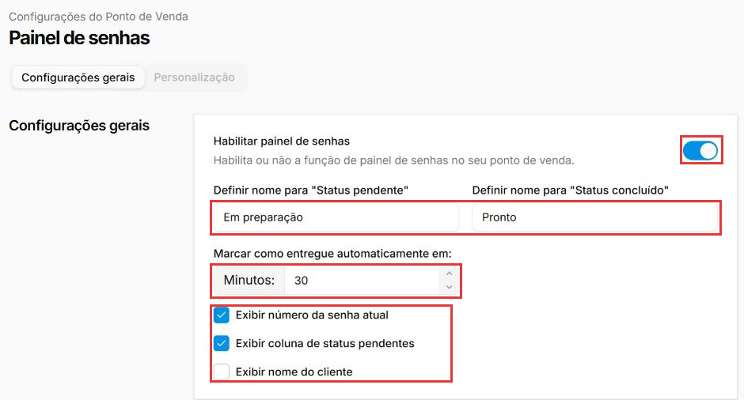

# Como configurar o painel de senhas

:material-clock-outline: 5 minutos · :material-format-list-numbered: 3 passos · :material-calendar-check: Atualizado em 20/11/2026

O **painel de senhas** é a tela que acompanha os pedidos pela senha, comum em lanchonetes e praças de alimentação, onde o cliente faz o pedido no caixa e espera ser chamado. Na configuração, você dá nome aos dois status do pedido (pendente e concluído), por exemplo "Em preparação" e "Pronto", e escolhe o que é exibido. Este manual prepara o sistema.

## Entenda o conceito

A configuração tem dois status, e você escolhe o nome de cada um:

| Status | Nome que vem de fábrica | Exemplo de nome |
| --- | --- | --- |
| **Pendente** | Pendente | "Em preparação" |
| **Concluído** | Concluído | "Pronto" |

**Marcar como entregue automaticamente** define em quantos minutos o pedido é marcado como entregue, como diz o nome do campo.

**Quando usar:** atendimento em que o cliente faz o pedido no caixa e espera ser chamado. **Quando não usar:** atendimento na mesa, com garçom ou comandas (veja [Como usar comandas](comandas.md)).

**As mudanças valem no caixa.** Esta tela só guarda a configuração. Se o caixa estiver aberto, faça a **sincronização** no PDV. Se o painel não mostrar a mudança, fale com o suporte.

!!! info "Antes de começar"
    - Normalmente o painel fica numa TV ou monitor voltado para os clientes.
    - Ao mudar qualquer opção, aparece no rodapé **Você tem alterações não salvas**, com **Descartar alterações** e **Salvar**. Ao salvar, aparece **Configurações do painel de senhas atualizadas com sucesso**.

Nos prints, o **quadrado vermelho** mostra onde você deve clicar ou digitar.

## Ligue o painel de senhas

No menu do lado esquerdo, clique em **Ponto de venda**, depois em **Configurações** e em **Painel de senhas**. A tela abre na aba **Configurações gerais**.

Ligue a chave **Habilitar painel de senhas** ("Habilita ou não a função de painel de senhas no seu ponto de venda"). As demais opções só aparecem com essa chave ligada.

{ loading=lazy }

## Ajuste os status, o tempo e o que é exibido

- **Definir nome para "Status pendente":** o nome do status do pedido pendente (vem "Pendente"; no exemplo, "Em preparação").
- **Definir nome para "Status concluído":** o nome do status do pedido concluído (vem "Concluído"; no exemplo, "Pronto").
- **Marcar como entregue automaticamente em:** em **Minutos**, em quanto tempo o pedido é marcado como entregue (vem com 30).

Use nomes de **até 15 caracteres, contando os espaços**. Com um nome maior, a tela não salva e não aparece nenhum aviso. Cuidado: o exemplo que aparece no campo do status concluído, "Pedido finalizado", tem 17 caracteres e não é salvo.

Logo abaixo, cada opção mostra ou esconde, no painel, a informação do nome dela:

- **Exibir número da senha atual** (vem marcada).
- **Exibir coluna de status pendentes** (vem marcada).
- **Exibir nome do cliente** (vem desmarcada).

## Salve

Clique em **Salvar**, no rodapé. Aparece **Configurações do painel de senhas atualizadas com sucesso**. Se a mensagem **Você tem alterações não salvas** ainda estiver lá, as mudanças não foram gravadas: confira o tamanho dos nomes dos status.

!!! tip "Boas práticas"
    - **Nomes curtos e claros:** "Em preparação" e "Pronto" são fáceis de ler; nomes com mais de 15 caracteres não são salvos.
    - **Tempo compatível com a loja:** escolha um tempo compatível com o ritmo de atendimento; na dúvida, mantenha os 30 minutos que vêm de fábrica.
    - **Nome do cliente com cuidado:** mostrar o nome ajuda a chamar o cliente, mas expõe o nome dele na tela. Decida conforme o perfil da loja.

## Deu algum problema?

??? question "Não aparecem os nomes dos status nem os minutos"
    A chave **Habilitar painel de senhas** está desligada. Ligue a chave e as opções aparecem logo abaixo.

??? question "Cliquei em Salvar e a mensagem Você tem alterações não salvas não sumiu"
    Confira o tamanho dos nomes dos status: com mais de 15 caracteres, a tela não salva e não mostra aviso. Encurte o nome (por exemplo, "Pronto" em vez de "Pronto para retirar") e clique em **Salvar** de novo. Se continuar, fale com o suporte.

??? question "Cliquei em Descartar alterações e a tela voltou para valores antigos"
    O **Descartar alterações** volta a tela para como ela estava quando foi aberta, mesmo que você tenha salvo depois. Para ver o que está gravado, atualize a página (tecla **F5**).

??? question "A aba Personalização está cinza"
    A aba **Personalização** fica cinza e não abre. Tudo o que este manual configura fica em **Configurações gerais**. Se precisar dela, fale com o suporte.

??? question "Como coloco o painel na TV e como os pedidos aparecem nele?"
    Este manual prepara o sistema. Para dúvidas sobre o aparelho do painel e o funcionamento no dia a dia, fale com o suporte.

**Relacionados:** [Como configurar o terminal de vendas](configurar-terminal.md) · [Como configurar recibos e notas impressas](recibos-e-notas.md) · [Como usar comandas](comandas.md)

painel de senhas senha chamada de senha tv monitor pedido pronto em preparação status pendente status concluído marcar como entregue automaticamente minutos exibir número da senha exibir nome do cliente lanchonete praça de alimentação
