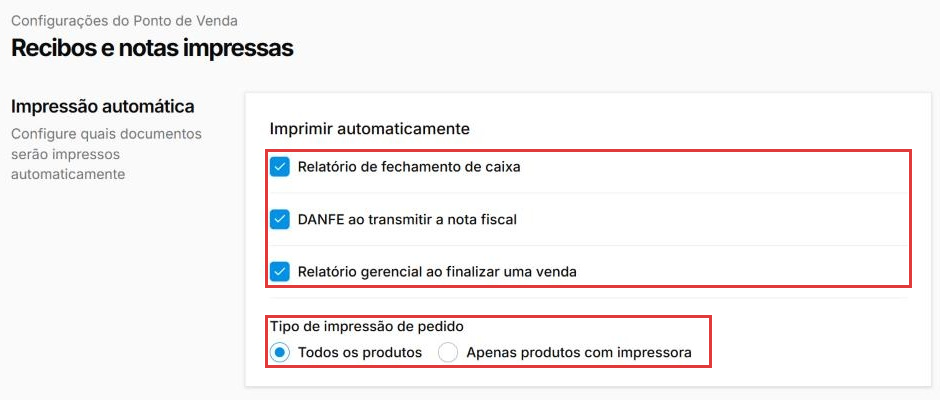
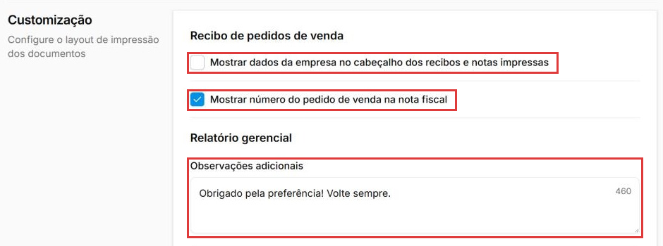
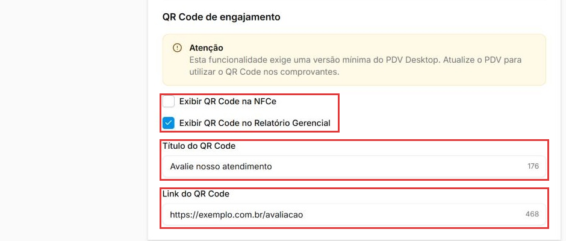
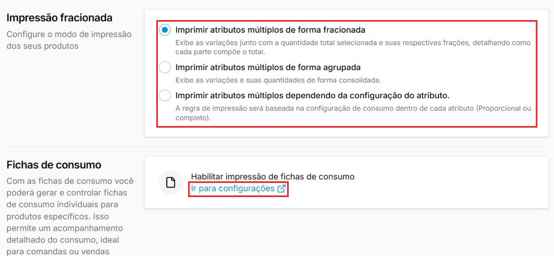

# Como configurar recibos e notas impressas

:material-clock-outline: 8 minutos · :material-format-list-numbered: 5 passos · :material-calendar-check: Atualizado em 19/11/2026

Esta tela decide **o que sai na impressora do caixa**. Exemplo: você quer que o caixa imprima sozinho o relatório de fechamento no fim do dia e quer que o relatório gerencial (o comprovante sem valor fiscal) traga a mensagem "Obrigado pela preferência! Volte sempre." e um QR Code para o cliente avaliar o atendimento. Tudo isso se configura aqui, uma vez, e vale para os caixas da loja.

## Entenda o conceito

A tela tem quatro blocos, e cada um responde a uma pergunta:

| Bloco | Pergunta | Exemplo |
| --- | --- | --- |
| **Impressão automática** | O que o caixa imprime **sem ninguém pedir**? | O relatório de fechamento de caixa ao fechar o caixa. |
| **Customização** | O que aparece escrito nos **recibos de pedidos de venda** e no **relatório gerencial**, incluindo o QR Code? | A mensagem "Obrigado pela preferência! Volte sempre." |
| **Impressão fracionada** | Como saem os produtos com **várias opções** escolhidas, como uma pizza meio a meio? | As frações de cada sabor ou as opções de forma resumida. |
| **Fichas de consumo** | A loja usa **fichas individuais** para alguns produtos? | Ligar as fichas nas preferências de produtos. |

**Relatório gerencial não é nota fiscal.** O **relatório gerencial** é o comprovante simples que o caixa imprime para o cliente, sem valor fiscal. A nota fiscal do consumidor é a **NFC-e** (na tela, **NFCe**), e o **DANFE** é a versão impressa da nota fiscal. Por isso a tela trata os dois separadamente, por exemplo no QR Code.

**As mudanças valem no caixa.** Esta tela só guarda a configuração; o efeito aparece nas impressões do PDV. Se o caixa estiver aberto, faça a **sincronização** no PDV para aplicar as mudanças na hora. Depois, confira o papel nas próximas impressões.

!!! info "Antes de começar"
    - Para imprimir, o caixa precisa de uma impressora cadastrada em **Configurações** → **Periféricos** (veja [Como configurar uma impressora](../dispositivos/impressora.md)).
    - Ao mudar qualquer opção, aparece no rodapé **Você tem alterações não salvas**, com **Descartar alterações** e **Salvar**. Ao salvar, aparece **Configurações do PDV atualizadas com sucesso**.

Nos prints, o **quadrado vermelho** mostra onde você deve clicar ou digitar.

## Abra a tela de recibos e notas

No menu do lado esquerdo, clique em **Ponto de venda**, depois em **Configurações** e em **Recibos e notas impressas**.

## Escolha o que o caixa imprime sozinho

No bloco **Impressão automática**, em **Imprimir automaticamente**, marque o que deve sair na impressora sem o operador pedir:

- **Relatório de fechamento de caixa:** imprime o resumo do caixa quando o caixa é fechado. Bom para conferir o dinheiro e guardar junto com o dinheiro do dia.
- **DANFE ao transmitir a nota fiscal:** imprime a nota fiscal assim que ela é transmitida. Antes de desmarcar, confirme com o **contador** se a sua loja pode deixar de imprimir a nota a cada venda.
- **Relatório gerencial ao finalizar uma venda:** imprime o comprovante simples (sem valor fiscal) ao terminar cada venda. É nele que saem as **Observações adicionais** e o QR Code do relatório gerencial (próximos passos).

Em **Tipo de impressão de pedido**, escolha entre **Todos os produtos**, em que o pedido impresso traz todos os itens da venda, e **Apenas produtos com impressora**, que, como o nome diz, considera só os produtos ligados a uma impressora. Na dúvida, mantenha a opção que a loja já usa e confira o primeiro pedido impresso depois de trocar.

{ loading=lazy }

## Ajuste o que aparece nos recibos

No bloco **Customização**, em **Recibo de pedidos de venda**:

- **Mostrar dados da empresa no cabeçalho dos recibos e notas impressas:** marque para o recibo começar com os dados da sua empresa.
- **Mostrar número do pedido de venda na nota fiscal:** marque para a nota trazer o número do [pedido de venda](../vendas/pedido-de-venda.md) que originou a venda.

Em **Relatório gerencial**, use **Observações adicionais** para o recado que sai no comprovante (até 500 caracteres; o número no canto mostra quantos ainda cabem). No exemplo: "Obrigado pela preferência! Volte sempre." A mensagem sai no relatório gerencial: se ele não é impresso (passo anterior), ela não aparece.

{ loading=lazy }

## Coloque um QR Code no comprovante

Mais abaixo, ainda em **Customização**, fica o **QR Code de engajamento**. Ele leva o cliente para um endereço da internet que você escolhe: uma pesquisa de satisfação, o seu Instagram ou o cardápio digital. O aviso amarelo lembra que a função exige uma versão mínima do **PDV Desktop**: atualize o PDV para o QR Code aparecer.

- **Exibir QR Code na NFCe** e **Exibir QR Code no Relatório Gerencial:** marque em quais comprovantes o QR Code sai (no exemplo, só no relatório gerencial). Não confunda com o QR Code de consulta que toda NFC-e já traz: o QR Code de engajamento é o seu, com o link que você escolher.
- **Título do QR Code:** o texto que convida o cliente (até 200 caracteres). No exemplo: "Avalie nosso atendimento".
- **Link do QR Code:** o endereço completo, começando com **https://** (até 500 caracteres). No exemplo: https://exemplo.com.br/avaliacao.

Ao marcar a exibição do QR Code, o **Título** e o **Link** passam a ser obrigatórios.

{ loading=lazy }

## Escolha como saem os produtos com várias opções

O bloco **Impressão fracionada** vale para produtos em que o cliente escolhe mais de uma opção no mesmo item, como os sabores de uma pizza ou os adicionais de um lanche. Escolha uma das três formas:

- **Imprimir atributos múltiplos de forma fracionada:** mostra as opções com a quantidade total e as frações de cada uma, detalhando como cada parte compõe o total. Boa para pizzarias e produtos divididos em partes.
- **Imprimir atributos múltiplos de forma agrupada:** mostra as opções e as quantidades de forma resumida. Boa quando a fração confunde a cozinha, como em hamburguerias.
- **Imprimir atributos múltiplos dependendo da configuração do atributo:** cada grupo de opções segue a regra de consumo definida nele (**Proporcional** ou **completo**). Esta depende de uma configuração em cada atributo: antes de usá-la, fale com o suporte.

No bloco **Fichas de consumo**, ao lado de **Habilitar impressão de fichas de consumo**, o link **Ir para configurações** abre a tela **Preferências de produtos**, seção **Ficha de consumo**. Lá fica a opção **Habilitar ficha de consumo de produtos**, para gerar e controlar fichas individuais de produtos específicos, o que é útil em comandas e vendas fracionadas.

{ loading=lazy }

Pronto! Clique em **Salvar**, no rodapé. Se a mensagem **Você tem alterações não salvas** ainda estiver lá, as mudanças não foram gravadas.

!!! tip "Boas práticas"
    - **Imprima o fechamento de caixa:** o papel do fechamento ajuda a conferir o dinheiro da gaveta e a resolver diferenças depois.
    - **Mensagem curta:** uma linha de agradecimento é lida; um parágrafo longo gasta papel e ninguém lê.
    - **Confira o link do QR Code:** abra o link no celular antes de salvar e, depois, aponte a câmera do celular para o primeiro QR Code impresso.
    - **Mude uma coisa de cada vez:** assim, se a impressão sair diferente do esperado, você sabe qual opção causou a mudança.

## Deu algum problema?

??? question "Cliquei em Salvar e apareceu \"Erro ao salvar as configurações do PDV.\""
    Algum campo obrigatório está vazio ou inválido. Role até o bloco **QR Code de engajamento** e leia a mensagem junto aos campos. As mais comuns são **É necessário informar o título do QR Code quando a funcionalidade estiver ativa.** e **É necessário informar o link do QR Code quando a funcionalidade estiver ativa.** Preencha o **Título do QR Code** e o **Link do QR Code**, ou desmarque os QR Codes.

??? question "Apareceu \"Por favor, insira uma URL válida\""
    O link precisa ser completo, começando com **https://**. Exemplo: em vez de exemplo.com.br/avaliacao, digite https://exemplo.com.br/avaliacao.

??? question "Configurei o QR Code, mas ele não sai no comprovante"
    Confira se o comprovante certo está marcado (**NFCe** ou **Relatório Gerencial**) e se esse comprovante está sendo impresso (bloco **Impressão automática**). Confira também se o PDV Desktop está atualizado: a função exige uma versão mínima. Se não souber qual versão o seu PDV tem, fale com o suporte.

??? question "O caixa parou de imprimir o comprovante da venda ou a nota"
    Confira se **Relatório gerencial ao finalizar uma venda** e **DANFE ao transmitir a nota fiscal** continuam marcados e se a impressora do caixa está funcionando (veja [Como configurar uma impressora](../dispositivos/impressora.md)).

**Relacionados:** [Como configurar o terminal de vendas](configurar-terminal.md) · [Como escolher a impressão fracionada ou agrupada dos atributos](../suporte/erp/impressao-de-atributos.md) · [Como cadastrar variações](../produtos/cadastrar-variacoes.md) · [Como definir o tipo de nota emitida no PDV](../configuracoes/tipo-de-nota-no-pdv.md) · [Como criar um pedido de venda](../vendas/pedido-de-venda.md)

recibo comprovante nota impressa impressão automática relatório de fechamento de caixa danfe relatório gerencial cupom não fiscal comprovante não fiscal tipo de impressão de pedido produtos com impressora dados da empresa no cabeçalho número do pedido na nota observações adicionais mensagem no cupom mensagem no recibo qr code de engajamento pesquisa de satisfação avaliação instagram cardápio nfce nfc-e impressão fracionada pizza meio a meio sabores adicionais fichas de consumo ficha comanda cupom de pedido cozinha
