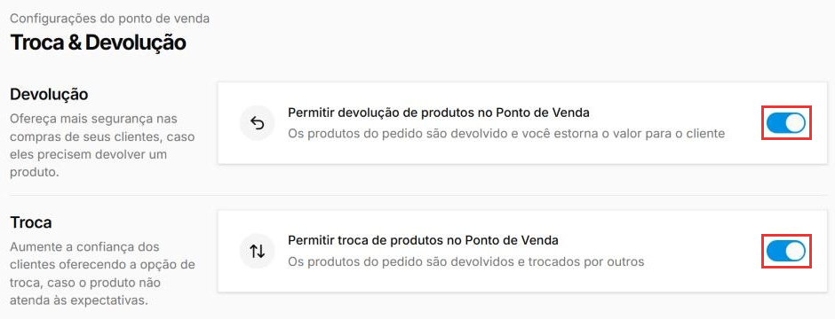
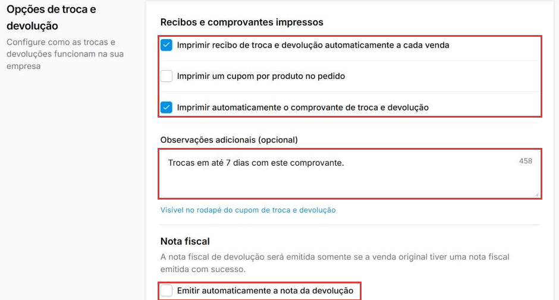
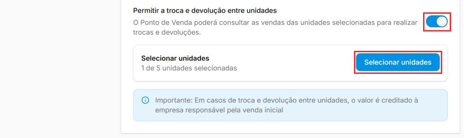
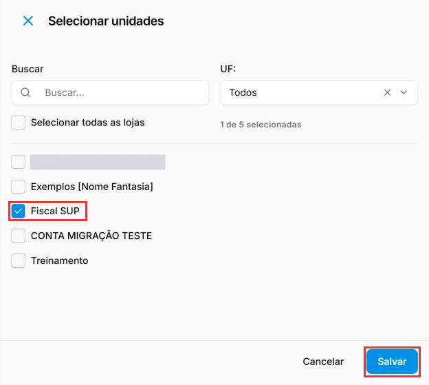

# Como configurar troca e devolução

:material-clock-outline: 6 minutos · :material-format-list-numbered: 4 passos · :material-calendar-check: Atualizado em 19/11/2026

Esta tela libera o caixa para fazer **trocas** e **devoluções**. Exemplo: um cliente comprou uma camiseta, ela não serviu e ele volta para trocar por outro tamanho; outro cliente desistiu da compra e quer o dinheiro de volta. Com as opções ligadas aqui, o Ponto de Venda passa a permitir a troca e a devolução de produtos.

## Entenda o conceito

**Troca e devolução não são a mesma coisa:**

| | Devolução | Troca |
| --- | --- | --- |
| **O que acontece** | Os produtos do pedido voltam e **você estorna o valor** para o cliente. | Os produtos do pedido voltam e **são trocados por outros**. |
| **Quando usar** | O cliente desistiu da compra ou o produto veio com defeito e ele quer o dinheiro. | O produto não serviu ou não agradou, e o cliente quer outro. |

Cada uma tem a sua chave, e você pode ligar uma, a outra ou as duas. Ligue só o que a loja pratica: se a sua política é "troca sim, devolução de dinheiro não", ligue só a troca. Com as duas desligadas, o Ponto de Venda não fica liberado para trocar nem devolver.

**Nota fiscal de devolução.** Em geral, quando a venda original teve nota fiscal, a devolução também pede uma nota, a **nota de devolução**. Esta tela pode emiti-la sozinha, mas só quando a venda original tiver uma nota fiscal emitida com sucesso. Quem confirma a regra da sua loja é o **contador**.

**Lojas com mais de uma unidade.** Com a troca entre unidades ligada, o caixa desta loja pode buscar as vendas feitas nas unidades que você escolher, e o cliente consegue trocar ou devolver aqui o que comprou lá. O valor fica com a empresa que fez a venda.

**As mudanças valem no caixa.** Esta tela só guarda a configuração. Se o caixa estiver aberto, faça a **sincronização** no PDV para aplicar as mudanças na hora.

!!! info "Antes de começar"
    - Defina com a equipe a política de trocas da loja (prazo, condições) antes de ligar as opções. O prazo pode ir nas observações do comprovante (passo 2).
    - Para imprimir os recibos e comprovantes, o caixa precisa de uma impressora cadastrada em **Dispositivos** (veja os [manuais de periféricos](../suporte/perifericos/index.md)).
    - Ao mudar qualquer opção, aparece no rodapé **Você tem alterações não salvas**, com **Descartar alterações** e **Salvar**. Ao salvar, aparece **Configurações do PDV atualizadas com sucesso**.

Nos prints, o **quadrado vermelho** mostra onde você deve clicar ou digitar.

## Abra a tela e ligue a troca, a devolução ou as duas

No menu do lado esquerdo, clique em **Ponto de venda**, depois em **Configurações** e em **Troca & Devolução**.

Ligue a chave de **Permitir devolução de produtos no Ponto de Venda**, a de **Permitir troca de produtos no Ponto de Venda**, ou as duas. Com pelo menos uma ligada, aparece logo abaixo o bloco **Opções de troca e devolução**.

{ loading=lazy }

## Escolha os comprovantes e a nota fiscal

No bloco **Opções de troca e devolução**, em **Recibos e comprovantes impressos**:

- **Imprimir recibo de troca e devolução automaticamente a cada venda:** marque para o caixa imprimir, a cada venda, o recibo de troca e devolução.
- **Imprimir um cupom por produto no pedido:** marque para sair um cupom para cada produto do pedido.
- **Imprimir automaticamente o comprovante de troca e devolução:** marque para o comprovante de troca e devolução sair na impressora sem o operador pedir.
- **Observações adicionais (opcional):** o texto que aparece no rodapé do cupom de troca e devolução, como indica a tela (até 500 caracteres; o número no canto mostra quantos ainda cabem). No exemplo: "Trocas em até 7 dias com este comprovante."

Em **Nota fiscal**, marque **Emitir automaticamente a nota da devolução** para o sistema emitir a nota de devolução sozinho. Ela só é emitida se a venda original tiver uma nota fiscal emitida com sucesso.

{ loading=lazy }

## Se tiver mais de uma loja, libere a troca entre unidades

Se a empresa tem uma loja só, deixe esta chave desligada e vá para o fim do manual.

Ligue **Permitir a troca e devolução entre unidades**. Com ela ligada, o Ponto de Venda pode consultar as vendas das unidades escolhidas para fazer a troca ou a devolução. Aparece um cartão que mostra quantas unidades estão marcadas e o botão **Selecionar unidades**. Clique nele.

O aviso azul lembra: na troca ou na devolução entre unidades, o valor é creditado à empresa responsável pela venda inicial.

{ loading=lazy }

## Escolha as unidades

Na janela **Selecionar unidades**, marque as lojas cujas vendas podem ser trocadas ou devolvidas aqui. Use **Buscar** ou o filtro **UF** para achar a loja, ou **Selecionar todas as lojas**. O contador mostra quantas estão marcadas. Clique em **Salvar**, no canto de baixo da janela. O cartão passa a mostrar, por exemplo, **1 de 5 unidades selecionadas**.

O sistema aceita salvar a tela sem nenhuma unidade marcada: confira se o cartão mostra pelo menos uma unidade selecionada.

{ loading=lazy }

Pronto! Clique em **Salvar**, no rodapé. Se a mensagem **Você tem alterações não salvas** ainda estiver lá, as mudanças não foram gravadas.

!!! tip "Boas práticas"
    - **Escreva a política no comprovante:** o prazo de troca nas **Observações adicionais** evita discussão no balcão.
    - **Ligue só o que a loja pratica:** se a loja não devolve dinheiro, deixe a devolução desligada.
    - **Troca entre unidades com critério:** marque só as lojas que realmente aceitam trocas umas das outras, e combine antes como o valor será acertado entre elas.
    - **Nota de devolução com o contador:** antes de ligar a emissão automática, confirme com o contador como a sua loja deve tratar as devoluções.

## Deu algum problema?

??? question "Não aparece o bloco Opções de troca e devolução"
    Ele só aparece com a troca ou a devolução ligada. Ligue pelo menos uma das duas chaves no alto da tela.

??? question "Liguei a emissão automática, mas a nota de devolução não saiu"
    A nota de devolução só é emitida se a venda original tiver uma nota fiscal emitida com sucesso. Confira a nota da venda original. Se precisar emitir a nota de devolução de outra forma, fale com o contador e com o suporte.

??? question "Liguei a troca entre unidades, mas o caixa não encontra a venda da outra loja"
    Primeiro, veja se o cartão mostra **0 unidades selecionadas**: nesse caso, nenhuma loja foi marcada. Abra **Selecionar unidades**, marque a loja da venda original, clique em **Salvar** na janela e depois no rodapé da tela. Se o caixa estava aberto, faça a sincronização no PDV.

**Relacionados:** [Como configurar o terminal de vendas](configurar-terminal.md) · [Como configurar recibos e notas impressas](recibos-e-notas.md) · [Como emitir uma NF-e de devolução](../vendas/nfe-de-devolucao.md) (vendas com NF-e) · [Como cancelar uma venda](../vendas/cancelar-venda.md)

troca devolução trocar produto devolver produto estorno reembolso permitir devolução permitir troca recibo de troca cupom de troca comprovante de troca e devolução cupom por produto prazo de troca nota de devolução emitir nota de devolução automaticamente troca entre unidades troca em outra loja selecionar unidades
