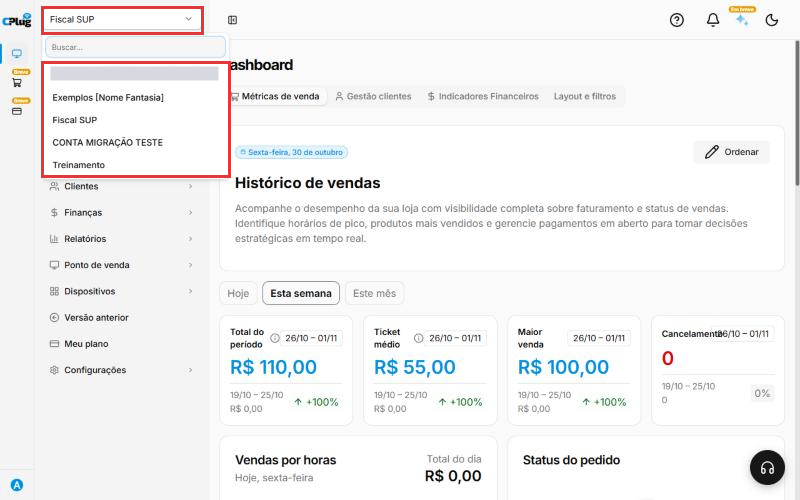
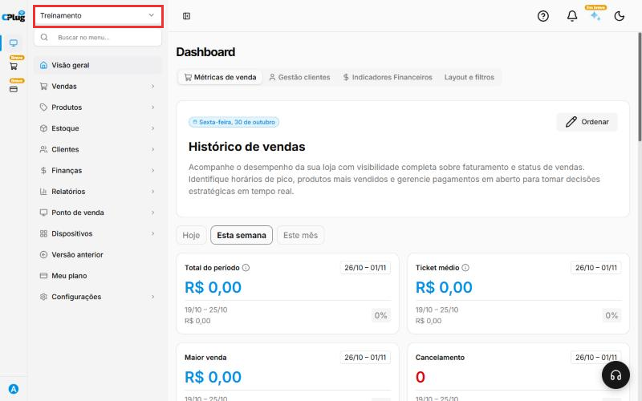

# Como trocar de empresa ou loja

:material-clock-outline: 1 minuto · :material-format-list-numbered: 3 passos · :material-calendar-check: Atualizado em 30/10/2026

Se a sua empresa tem **mais de uma loja ou filial**, cada uma tem os seus próprios produtos, clientes, estoque, vendas e notas fiscais. Por isso, antes de cadastrar ou consultar qualquer coisa, confira **em qual loja você está**.

Nos prints, o **quadrado vermelho** mostra onde você deve clicar.

## Veja em qual loja você está

O nome da loja atual aparece **no topo do menu**, do lado esquerdo.

## Escolha a outra loja

Clique no nome da loja. Abre a lista com todas as lojas que o seu usuário pode acessar. Clique na loja desejada.

Se a lista for grande, digite parte do nome no campo **Buscar...**, no topo da lista.

{ loading=lazy }

## Confira a troca

A tela recarrega e o nome da nova loja aparece no topo do menu. A partir daqui, **tudo o que você fizer vale para essa loja**.

{ loading=lazy }

!!! warning "Atenção às notas fiscais"
    Cada loja tem o seu **CNPJ**, certificado digital e configuração fiscal. Uma venda ou compra lançada na loja errada sai com os dados fiscais da loja errada. Confira sempre o nome no topo antes de lançar.

## Deu algum problema?

??? question "A loja que eu preciso não aparece na lista"
    O seu usuário não tem acesso a essa loja. Peça ao administrador da sua empresa para liberar.

??? question "Cadastrei um produto e ele não aparece na outra loja"
    Os produtos, clientes e o estoque são separados por loja. Troque para a outra loja e confira lá.

**Relacionados:** [Como usar o menu do sistema](usar-o-menu.md)

trocar loja trocar empresa filial unidade mudar de loja selecionar empresa outra loja matriz cnpj dados de outra loja
