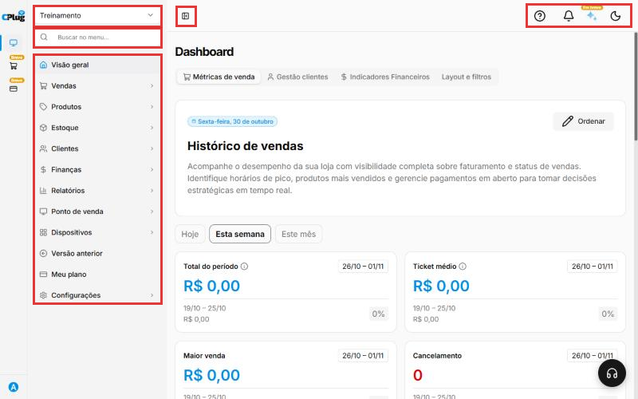
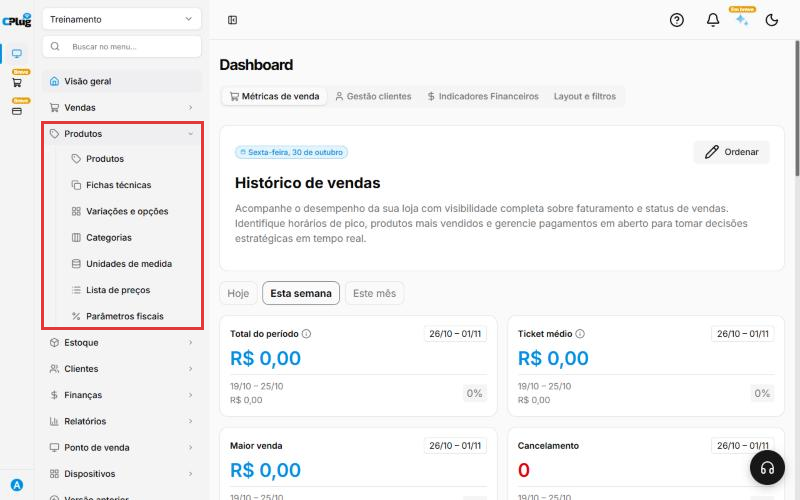
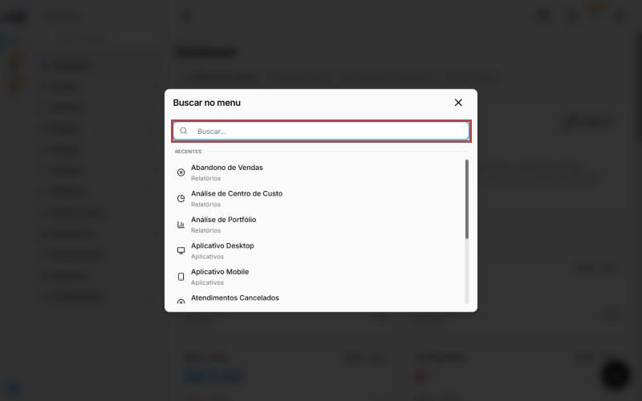
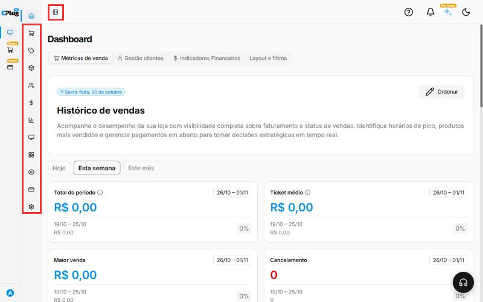
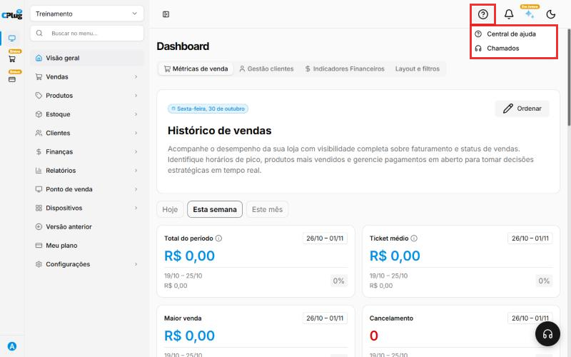
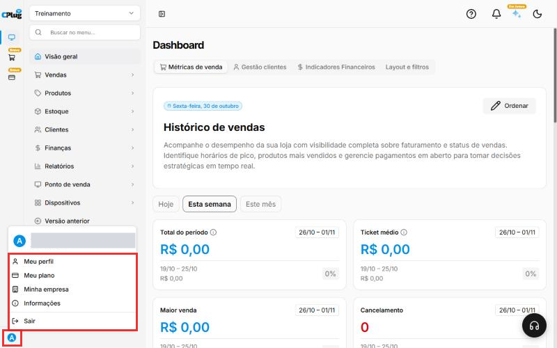
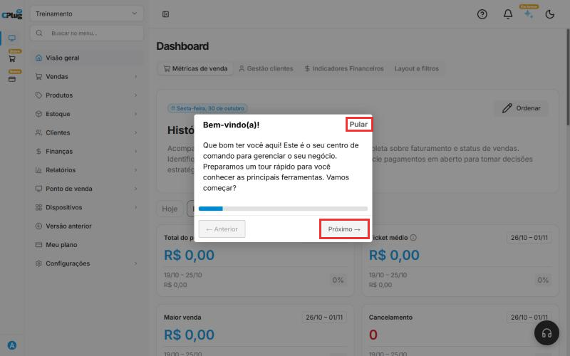

# Como usar o menu do sistema

:material-clock-outline: 3 minutos · :material-format-list-numbered: 7 passos · :material-calendar-check: Atualizado em 30/10/2026

Este manual apresenta as partes da tela da CPlug. Depois de ler, você vai saber chegar em qualquer função do sistema.

Nos prints, o **quadrado vermelho** mostra a parte da tela explicada em cada passo.

## Conheça as partes da tela

Ao entrar no sistema, você vê a tela **Dashboard** (Visão geral). Os quadrados vermelhos mostram, de cima para baixo e da esquerda para a direita:

- **Nome da empresa ou loja:** em qual loja você está trabalhando agora. Veja [Como trocar de empresa ou loja](trocar-de-empresa.md).
- **Buscar no menu:** encontra qualquer tela pelo nome.
- **Menu:** todas as funções do sistema, organizadas por assunto.
- **Recolher o menu:** o botão ao lado do menu esconde os nomes e deixa só os ícones, para sobrar mais espaço na tela.
- **Ícones do topo:** ajuda, notificações, assistente e modo escuro.

{ loading=lazy }

## Abra um grupo do menu

Cada item do menu com uma setinha **›** é um **grupo**. Clique nele para ver as telas que estão dentro.

Exemplo: clique em **Produtos** para ver Produtos, Fichas técnicas, Variações e opções, Categorias, Unidades de medida, Lista de preços e Parâmetros fiscais. Clique de novo para fechar.

{ loading=lazy }

O que fica em cada grupo:

| Grupo | O que você encontra |
| --- | --- |
| **Visão geral** | O painel com o resumo das vendas. |
| **Vendas** | Vendas, pedidos de venda, notas fiscais emitidas (NF-e), promoções, ordens de serviço. |
| **Produtos** | Cadastro de produtos, categorias, variações, fichas técnicas, listas de preços e parâmetros fiscais. |
| **Estoque** | Saldo do estoque, movimentações, transferências, compras, fornecedores, notas de entrada (XML) e produção. |
| **Clientes** | Cadastro de clientes, categorias de clientes e campanhas de marketing. |
| **Finanças** | Contas a pagar e a receber, extratos, contas bancárias, conciliação, plano de contas e contabilidade. |
| **Relatórios** | Relatórios de vendas, caixa, lucro, estoque, segurança e o relatório dinâmico. |
| **Ponto de venda** | Pontos de venda, caixas, mesas, comandas, tela da cozinha (KDS) e as configurações do caixa. |
| **Dispositivos** | Terminais, totens e o download dos aplicativos. |
| **Meu plano** | O plano contratado da sua empresa. |
| **Configurações** | Dados da empresa, filiais, usuários, formas de pagamento, impressoras, integrações e a parte **Fiscal** (certificado, notas e impostos). |

!!! warning "Versão anterior"
    O item **Versão anterior** abre o sistema antigo. Use só se o suporte pedir.

## Busque uma tela pelo nome

Não sabe em qual grupo está? Clique em **Buscar no menu**, no topo do menu. Abre uma janela de busca: digite parte do nome da tela (por exemplo, "fornecedor") e clique no resultado.

{ loading=lazy }

## Recolha o menu para ganhar espaço

Clique no botão ao lado do menu (o quadradinho com uma barra) para recolher o menu. Ficam só os ícones de cada grupo. Clique de novo para voltar ao normal.

{ loading=lazy }

## Use os ícones do topo

No canto de cima, à direita:

- **Ponto de interrogação (Ajuda):** abre a **Central de ajuda** e os **Chamados** com o suporte.
- **Sino (Notificações):** avisos do sistema.
- **Estrela (Assistente de IA):** marcado como **"Em breve"**.
- **Lua (Modo escuro):** deixa a tela escura, mais confortável à noite. Clique de novo para voltar ao modo claro.

{ loading=lazy }

No canto inferior direito fica o **botão de atendimento** (o fone de ouvido), para falar com o suporte pelo chat.

## Acesse o seu perfil e saia do sistema

Clique na **bolinha com a sua inicial**, no canto de baixo, à esquerda. Aparecem:

- **Meu perfil:** seus dados de usuário.
- **Meu plano:** o plano da empresa.
- **Minha empresa:** os dados do negócio.
- **Informações:** detalhes do sistema.
- **Sair:** encerra o acesso. Use sempre que usar um computador compartilhado.

{ loading=lazy }

## Faça o tour de boas-vindas

Ao entrar, o sistema pode mostrar o **Bem-vindo(a)!**, um tour rápido que apresenta os menus. Clique em **Próximo** para seguir, ou em **Pular** para fechar.

{ loading=lazy }

!!! tip "Na faixa da esquerda"
    Os ícones da faixa fina à esquerda trocam de produto CPlug. O primeiro é o **ERP** (este sistema). Os outros, **Meu Delivery** e **Pagamentos**, estão marcados como **"Breve"**.

## Deu algum problema?

??? question "Não encontro uma tela que o manual cita"
    Use o **Buscar no menu** e digite o nome da tela. Se mesmo assim não aparecer, o seu usuário pode não ter permissão para ela. Fale com o administrador da sua empresa.

??? question "Os dados que aparecem são de outra loja"
    Confira o nome da loja no topo do menu. Veja [Como trocar de empresa ou loja](trocar-de-empresa.md).

??? question "A tela ficou escura"
    O **modo escuro** foi ligado. Clique no ícone do topo, à direita, para voltar ao modo claro.

**Relacionados:** [Como trocar de empresa ou loja](trocar-de-empresa.md)

menu tela inicial dashboard visão geral buscar no menu procurar tela recolher menu ícones ajuda central de ajuda chamados notificações modo escuro tema perfil sair logout trocar loja tour bem-vindo versão anterior
