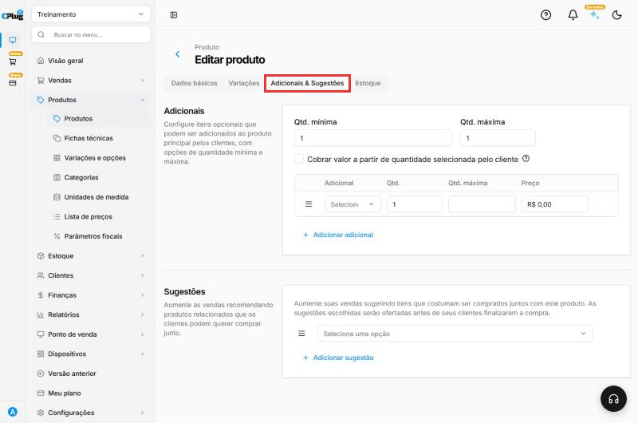
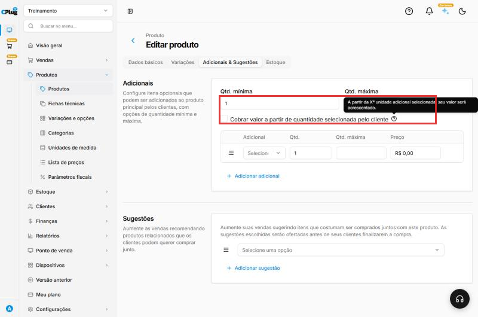
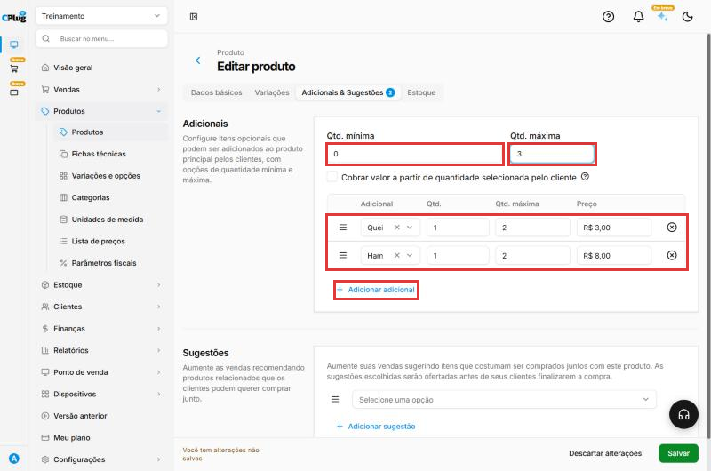
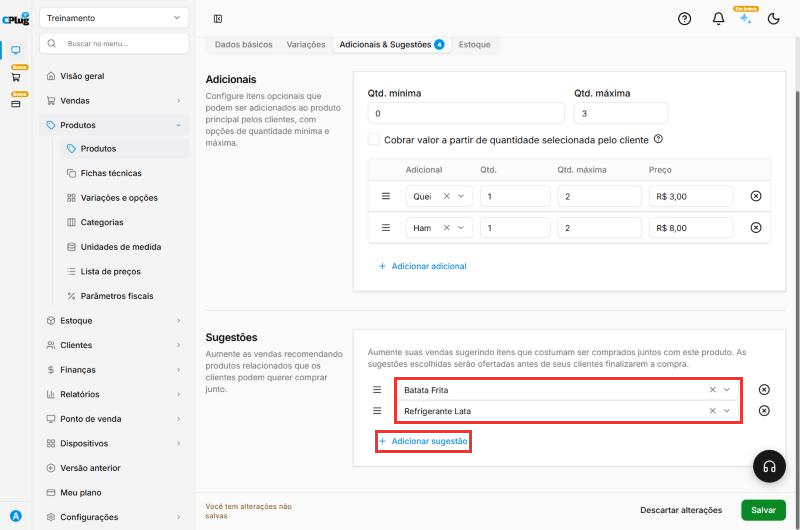
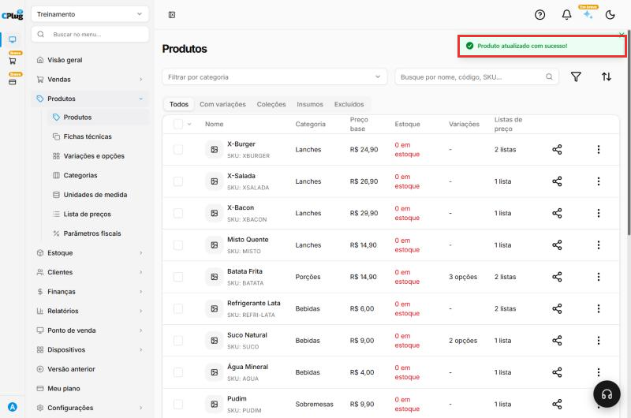

# Como cadastrar adicionais e sugestões

:material-clock-outline: 10 minutos · :material-format-list-numbered: 5 passos · :material-calendar-check: Atualizado em 31/10/2026

- **Adicionais** são extras que o cliente pode **acrescentar** ao produto, pagando a mais. Exemplo: no X-Burger, "queijo extra" por R$ 3,00 ou "hambúrguer extra" por R$ 8,00.
- **Sugestões** são outros produtos **oferecidos antes de o cliente finalizar a compra**. Exemplo: quem pede um X-Burger recebe a sugestão de Batata Frita e Refrigerante.

## Entenda o conceito

### Três jeitos de personalizar um produto

O sistema tem três ferramentas diferentes para o cliente "montar" o pedido do jeito dele. Escolher a certa evita confusão no caixa e na cozinha:

| Ferramenta | Quando usar | O cliente... | Exemplo |
| --- | --- | --- | --- |
| **Variação** | O produto existe em versões diferentes. | **precisa escolher** uma opção. | Milk-shake P, M ou G |
| **Adicional** | Extras que podem ser somados ao produto. | **pode acrescentar**, e paga a mais. | Queijo extra, bacon extra |
| **Opcional da ficha técnica** | Ingredientes que fazem parte da receita. | **pode pedir para tirar**. | Sem molho, sem cebola |

Veja também [Como cadastrar um produto com variações](cadastrar-produto-com-variacoes.md) e [Como montar uma ficha técnica](ficha-tecnica.md).

### Como funcionam as quantidades dos adicionais

Os adicionais têm dois tipos de limite:

- **Do grupo todo** (no topo): **Qtd. mínima** e **Qtd. máxima** de extras que o cliente escolhe somando todos.
- **De cada adicional** (na linha): **Qtd. máxima** de vezes que aquele extra pode ser repetido.

Exemplo com o X-Burger: máximo do grupo **3**, máximo do queijo **2** e máximo do hambúrguer **2**. O cliente pode pedir 2 queijos e 1 hambúrguer (3 no total), mas não 3 queijos.

### O que é a sugestão

A sugestão é a **venda cruzada**: o atendente que pergunta "vai uma batata para acompanhar?". O sistema faz essa pergunta por você, oferecendo os produtos sugeridos antes de o cliente finalizar a compra. O cliente aceita se quiser. Bem usada, aumenta o valor de cada pedido.

!!! info "Antes de começar"
    O adicional e a sugestão precisam estar **cadastrados como produtos**. A lista de adicionais mostra os **produtos comuns** e também os **insumos** (veja [Como montar uma ficha técnica](ficha-tecnica.md)). Assim, o mesmo "Queijo prato (fatia)" da receita pode ser vendido como queijo extra.

Nos prints, o **quadrado vermelho** mostra onde você deve clicar ou digitar.

## Abra o produto na aba Adicionais & Sugestões

No menu do lado esquerdo, clique em **Produtos** e depois em **Produtos**. Clique no nome do produto (no exemplo, X-Burger) e depois na aba **Adicionais & Sugestões**, no topo.

O número ao lado do nome da aba mostra quantos adicionais e sugestões o produto já tem. No X-Burger do exemplo, **4**: dois adicionais e duas sugestões.

{ loading=lazy }

## Defina quantos adicionais o cliente pode escolher

No topo de **Adicionais**:

- **Qtd. mínima:** quantos adicionais o cliente é **obrigado** a escolher. Para extras opcionais, use **0**.
- **Qtd. máxima:** quantos adicionais ele pode escolher **no total**. Exemplo: 3.

A opção **Cobrar valor a partir de quantidade selecionada pelo cliente** serve para dar alguns extras de graça. Ao marcar, aparece o campo **Cobrar a partir de**. Como diz a dica da tela, "a partir da Xª unidade adicional selecionada, seu valor será acrescentado". Exemplo: com **Cobrar a partir de 2**, o primeiro extra sai de graça e o cliente paga a partir do segundo.

{ loading=lazy }

## Adicione os adicionais

Para cada extra:

1. Em **Adicional**, clique e escolha o produto. Digite parte do nome para achar mais rápido.
2. **Qtd.:** a quantidade que vai a cada vez que o cliente escolhe o extra. Normalmente, 1.
3. **Qtd. máxima:** quantas vezes o cliente pode repetir esse extra. Exemplo: 2.
4. **Preço:** quanto o extra custa para o cliente. Exemplo: R$ 3,00.

Para mais um extra, clique em **Adicionar adicional**. Para tirar um extra, clique no **X** no fim da linha. A alça **≡**, no começo da linha, muda a ordem dos extras.

{ loading=lazy }

## Escolha as sugestões

Em **Sugestões**, clique em **Selecione uma opção** e escolha o produto a sugerir. Para sugerir mais um, clique em **Adicionar sugestão**. Arraste pelos tracinhos à esquerda para mudar a ordem.

{ loading=lazy }

## Salve o produto

Clique em **Salvar**, no canto de baixo, à direita. Aparece a mensagem **Produto atualizado com sucesso**.

{ loading=lazy }

!!! tip "Boas práticas"
    - **Use a ferramenta certa.** Tamanho é variação; extra pago é adicional; tirar ingrediente é opcional da ficha técnica. Misturar as três confunde o cliente e o caixa.
    - **Deixe a Qtd. mínima em 0** para extras. Só use 1 ou mais quando o cliente for obrigado a escolher algo, e mesmo assim pense se não seria uma variação.
    - **Limite as repetições.** Um máximo por extra evita pedidos estranhos, como 10 queijos num lanche.
    - **Sugira complementos, não substitutos.** Para um lanche, sugira batata, bebida ou sobremesa, e não outro lanche.
    - **Poucas sugestões, bem escolhidas.** Duas ou três funcionam melhor que uma lista longa. Coloque primeiro a que dá mais lucro: a ordem pode ser mudada pela alça **≡**.
    - **Revise os preços dos extras** quando o custo do ingrediente subir, junto com a revisão da ficha técnica.

## Deu algum problema?

??? question "O cliente não consegue pedir o produto sem adicional"
    Confira a **Qtd. mínima**. Se estiver em 1 ou mais, o cliente é obrigado a escolher um adicional. Para extras opcionais, use 0.

??? question "O produto que eu quero não aparece na lista de adicionais"
    Ele precisa estar cadastrado como produto na **mesma loja**. Cadastre primeiro e depois volte a esta tela.

??? question "O cliente não consegue pedir mais um extra"
    Ele chegou a um limite: a **Qtd. máxima** do grupo (no topo) ou a **Qtd. máxima** daquele extra (na linha). Aumente o limite se fizer sentido.

??? question "Quero dar o primeiro extra de graça"
    Marque **Cobrar valor a partir de quantidade selecionada pelo cliente** e, em **Cobrar a partir de**, coloque **2**.

??? question "O cliente quer tirar um ingrediente, e não acrescentar"
    Isso não é adicional: é o **Opcional** da ficha técnica. Veja [Como montar uma ficha técnica](ficha-tecnica.md).

**Relacionados:** [Como cadastrar um produto](cadastrar-produto.md) · [Como montar uma ficha técnica](ficha-tecnica.md)

adicionais adicional extra queijo extra bacon extra complemento acréscimo sugestões sugestão venda cruzada recomendação levar junto quantidade mínima quantidade máxima cobrar a partir de extra grátis acompanhamento personalizar produto variação ou adicional tirar ingrediente
