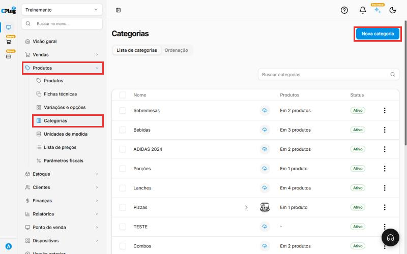
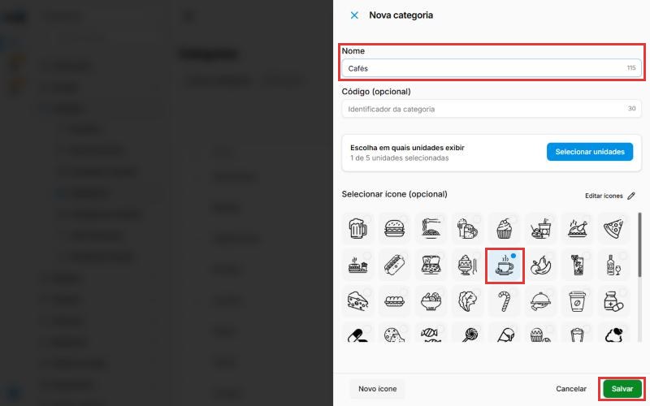
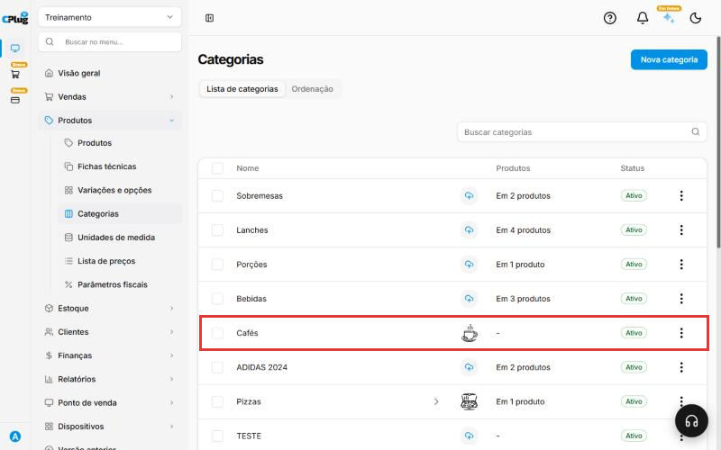
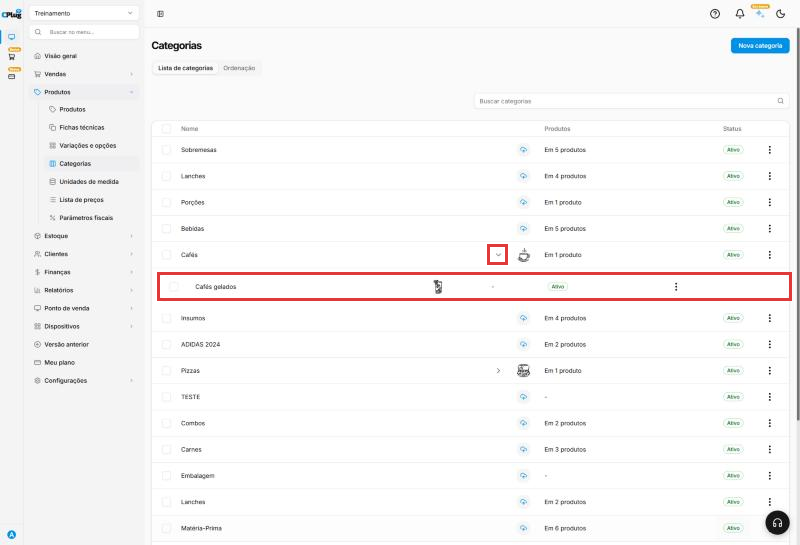
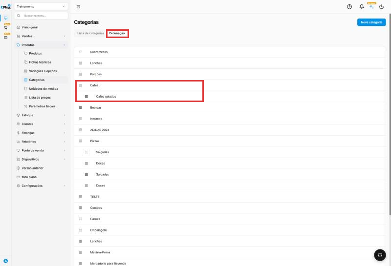
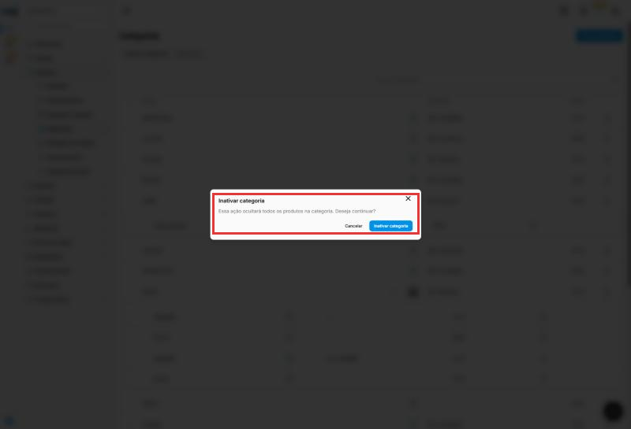

# Como cadastrar uma categoria

:material-clock-outline: 3 minutos · :material-format-list-numbered: 6 passos · :material-calendar-check: Atualizado em 30/10/2026

Categorias agrupam seus produtos, por exemplo "Bebidas", "Lanches" ou "Sobremesas". Isso deixa a busca e o caixa mais organizados. Só o **nome** é obrigatório.

Uma categoria pode ter **subcategorias**. Exemplo: dentro de "Pizzas", as subcategorias "Salgadas" e "Doces".

Nos prints, o **quadrado vermelho** mostra onde você deve clicar ou digitar.

## Abra a tela de categorias

No menu do lado esquerdo, clique em **Produtos**. Depois clique em **Categorias**. No canto de cima, à direita, clique no botão azul **Nova categoria**.

{ loading=lazy }

## Escreva o nome e escolha um ícone

Uma janela abre do lado direito.

- **Nome:** digite o nome da categoria. Exemplo: Cafés.
- **Ícone (opcional):** clique no desenho que combina com a categoria. Ele aparece com uma bolinha azul quando está escolhido.

Os outros campos são opcionais:

- **Código:** um identificador seu para a categoria, com até 30 caracteres. Pode ficar vazio.
- **Escolha em quais unidades exibir:** se a empresa tem mais de uma loja, clique em **Selecionar unidades** e marque as lojas que vão usar esta categoria. Por padrão, vem marcada só a loja em que você está.

{ loading=lazy }

## Clique em "Salvar"

Clique no botão verde **Salvar**, embaixo, à direita. A categoria nova aparece na lista. A coluna **Produtos** mostra quantos produtos há em cada categoria, e a coluna **Status** mostra se ela está **Ativo** ou **Inativo**.

{ loading=lazy }

## Crie subcategorias, se precisar

Nos **três pontinhos** no fim da linha da categoria, clique em **Nova subcategoria**. A janela é igual à da categoria: **Nome**, **Código (opcional)**, unidades e ícone. Clique em **Salvar**. Aparece **Subcategoria criada com sucesso**.

A categoria passa a ter uma setinha ao lado do ícone. Clique nela para ver as subcategorias. Exemplo: "Cafés gelados" dentro de "Cafés".

{ loading=lazy }

## Mude a ordem das categorias

Clique na aba **Ordenação**. Segure a alça **≡** do lado esquerdo e arraste a categoria para cima ou para baixo. A ordem salva sozinha, com a mensagem **Ordenação atualizada com sucesso**. As subcategorias vão junto com a categoria.

{ loading=lazy }

## Conheça as opções da categoria

Nos **três pontinhos** no fim da linha você tem:

- **Marcar como inativo:** o sistema avisa que **"essa ação ocultará todos os produtos na categoria"**. Confirme em **Inativar categoria**. Para desfazer, use **Marcar como ativo**, que volta a mostrar os produtos.
- **Nova subcategoria:** cria uma subcategoria dentro desta, como no passo 4.
- **Editar:** muda nome, código, unidades e ícone. Clicar na linha da categoria também abre a edição.
- **Excluir:** apaga a categoria.

{ loading=lazy }

!!! success "Como saber que deu certo"
    Aparece a mensagem **Categoria criada com sucesso** e a categoria nova aparece na lista.

## Deu algum problema?

??? question "Estou cadastrando um produto e a categoria não existe"
    Não precisa sair da tela do produto. Clique na caixa **Categoria** e depois em **+ Criar nova categoria**.

??? question "Não achei um ícone que combine"
    O ícone é opcional. Pode salvar sem escolher.

??? question "Errei e quero desistir"
    Clique em **Cancelar**, ao lado do Salvar. Nada é gravado.

??? question "Inativei uma categoria e os produtos sumiram"
    É o esperado: inativar a categoria oculta os produtos dela. Use **Marcar como ativo** nos três pontinhos para voltar a mostrar.

??? question "Tenho duas categorias com o mesmo nome"
    O sistema aceita nomes repetidos. Para não confundir, edite uma delas e mude o nome, ou exclua a que está sem produtos (a coluna **Produtos** mostra "-").

**Próximo passo:** [Como cadastrar um produto](cadastrar-produto.md).

grupo departamento seção cardápio categoria subcategoria ordem ordenação organizar inativar ativar ocultar produtos ícone código unidades
