# Como cadastrar um produto com variações

:material-clock-outline: 10 minutos · :material-format-list-numbered: 8 passos · :material-calendar-check: Atualizado em 01/11/2026

Use este manual para produtos que têm tamanho, cor ou modelo, como um milk-shake pequeno, médio e grande. Cada opção pode ter o seu próprio preço. No fim, o passo 8 mostra o outro formato: o produto montado, como a pizza de dois sabores.

## Entenda o conceito

Um produto com variações é **um cadastro só** que se desdobra em opções. Você não cadastra "Milk-shake P", "Milk-shake M" e "Milk-shake G" separados: cadastra o Milk-shake e liga a variação "Tamanho".

| | **Variação em grade** | **Variação de valor composto** |
| --- | --- | --- |
| **Exemplo** | Milk-shake P / M / G; camiseta azul / preta | Pizza de 2 sabores; açaí montado |
| **Cada opção é...** | uma **versão** do produto, com preço e código de barras próprios | um **ingrediente** escolhido, que soma ao preço |
| **O cliente escolhe** | uma opção | uma ou mais, conforme as quantidades |
| **Preço** | o da opção escolhida | preço do produto + cálculo (soma, média ou maior preço) |

**Estoque e notas com grade:** como cada opção é uma versão do produto, o sistema pergunta a opção nas movimentações. Na entrada de estoque, o produto pede "as opções do produto para entrada"; na NF-e, ao escolher o produto, abre uma janela para escolher a opção (tamanho, por exemplo). E o inventário só aceita produtos com variações **depois da primeira entrada** de estoque.

A variação em si (o "molde" com as opções) é cadastrada antes, em [Como cadastrar variações](cadastrar-variacoes.md).

!!! info "Antes de começar"
    A variação (por exemplo, "Tamanho do milk-shake" com Pequeno, Médio e Grande) precisa estar cadastrada. Se não estiver, veja [Como cadastrar variações](cadastrar-variacoes.md).

!!! warning "Vai vender com nota fiscal?"
    Depois de salvar, configure os dados fiscais do produto (NCM, origem, ICMS, PIS/COFINS e CFOP). Veja [Como configurar os dados fiscais de um produto](parametros-fiscais.md).

Nos prints, o **quadrado vermelho** mostra onde você deve clicar ou digitar.

## Comece como um produto normal

No menu, clique em **Produtos** e depois em **Produtos** de novo. Clique no botão azul **Novo produto**.

Preencha **Nome**, **Categoria**, **Preço** e **Unidade de medida**, igual ao manual [Como cadastrar um produto](cadastrar-produto.md). O **Código (SKU)** o sistema preenche sozinho. Se o nome for longo, troque por um código curto.

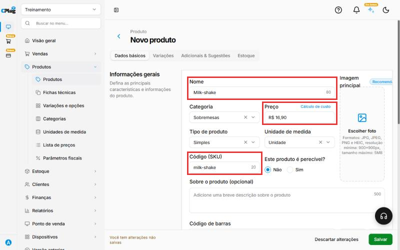{ loading=lazy }

## Abra a aba "Variações"

No topo do formulário, clique na aba **Variações**. A tela pede para escolher o formato:

- **Variação em grade:** para itens com diferenças físicas, como tamanho, cor ou modelo. Cada opção vira um item com preço e código de barras próprios. É o formato deste manual.
- **Variação de valor composto:** para produtos montados, em que o preço depende das opções que o cliente escolhe, como os sabores de uma pizza. Veja o passo 8.

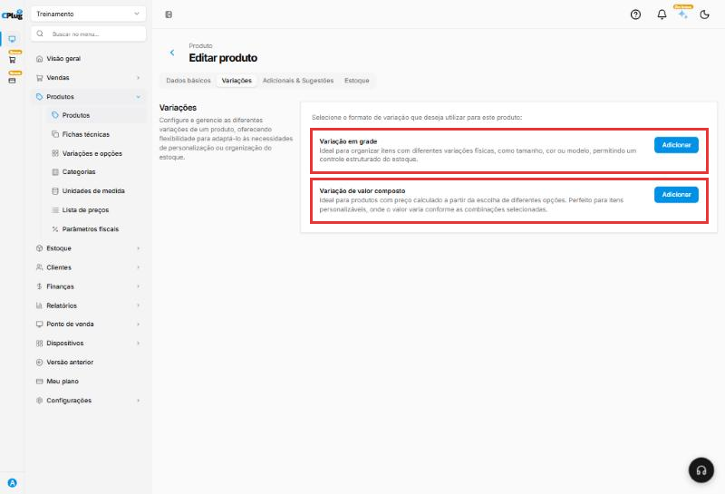{ loading=lazy }

No quadro **Variação em grade**, clique em **Adicionar**.

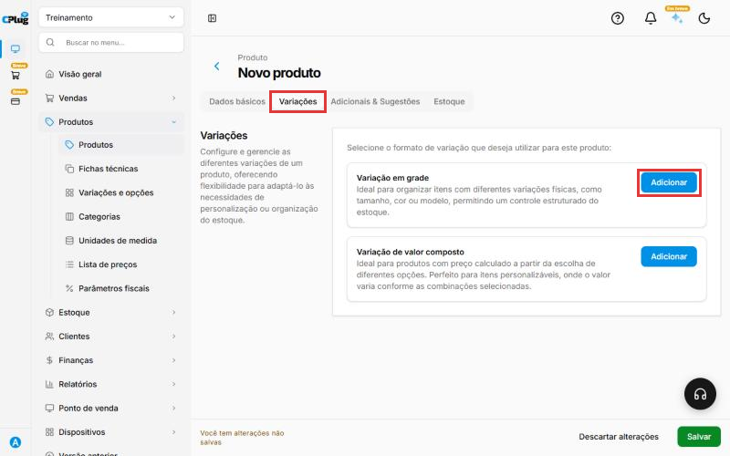{ loading=lazy }

## Escolha a variação

Uma janela abre do lado direito.

1. Clique na caixa **Nome da variação**, digite o nome (exemplo: milk-shake) e clique nela.
2. Clique em **Adicionar todas as opções**. As opções aparecem embaixo.
3. Clique em **Continuar**.

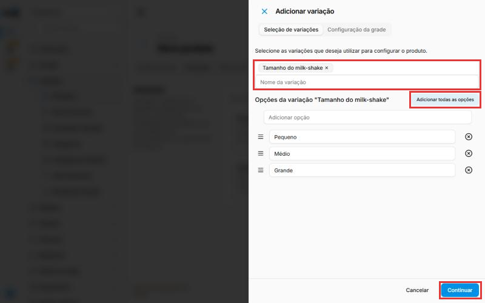{ loading=lazy }

## Confirme as opções

A janela mostra as opções escolhidas. Clique no botão verde **Salvar**. Isso ainda não salva o produto, só fecha a janela.

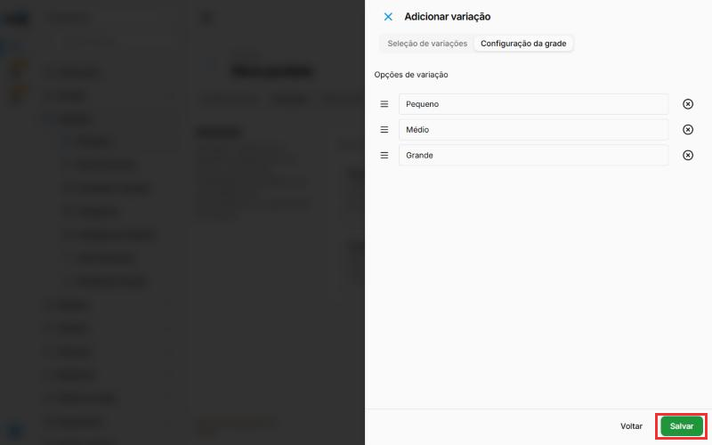{ loading=lazy }

## Coloque o preço de cada opção

As opções aparecem em uma tabela. Na coluna **Preço**, digite o preço de cada uma, só com números. Para R$ 19,90, digite 1990.

Depois clique no botão verde **Salvar**, no canto de baixo, à direita. Agora sim o produto é salvo.

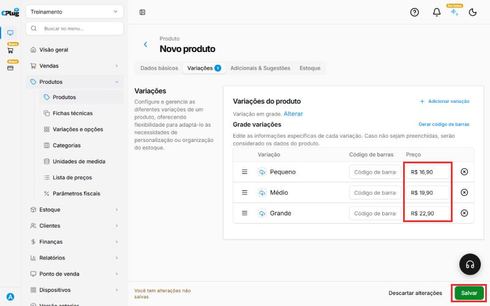{ loading=lazy }

## Complete a grade, se precisar

Na tabela **Grade variações**, cada opção também tem:

- **Imagem:** o ícone de nuvem antes do nome, para pôr uma foto da opção.
- **Código de barras:** o código daquela opção. Como diz a tela, o que ficar vazio usa os dados do produto.
- A alça **≡** muda a ordem, e o **⊗** tira a opção.

O link **Gerar código de barras** abre uma janela para criar os códigos de uma vez: **Gerar códigos EAN-13** ou **Gerar códigos EAN-8** preenchem todas as linhas, ou use os botões de cada linha. Clique em **Confirmar** e depois em **Salvar**.

O link **Alterar**, ao lado de "Variação em grade", troca o formato da variação.

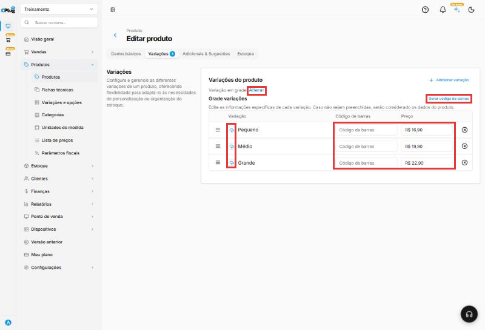{ loading=lazy }

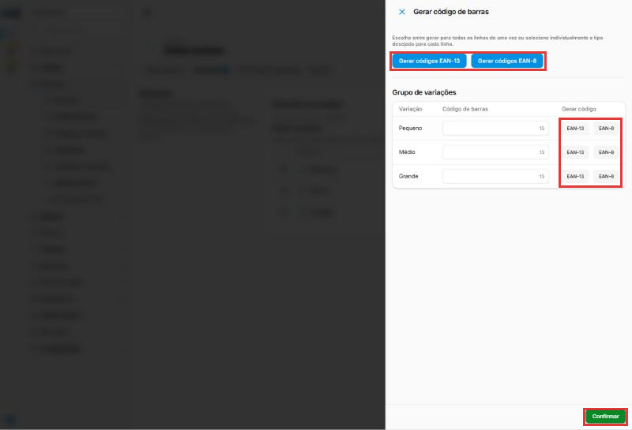{ loading=lazy }

## Confira se deu certo

Aparece a mensagem **Produto cadastrado com sucesso!** no canto de cima.

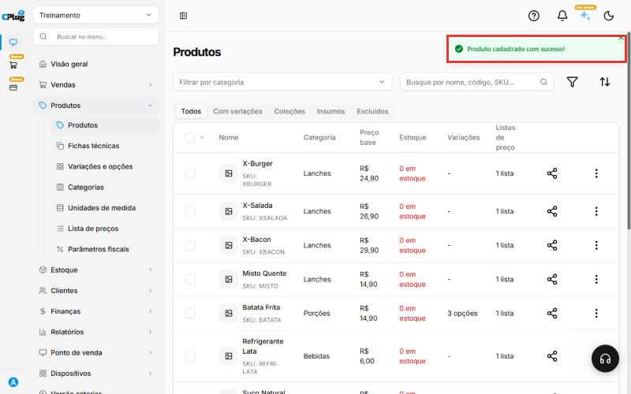{ loading=lazy }

Na lista de produtos, clique na aba **Com variações**. O produto aparece com a quantidade de opções. Exemplo: "3 opções".

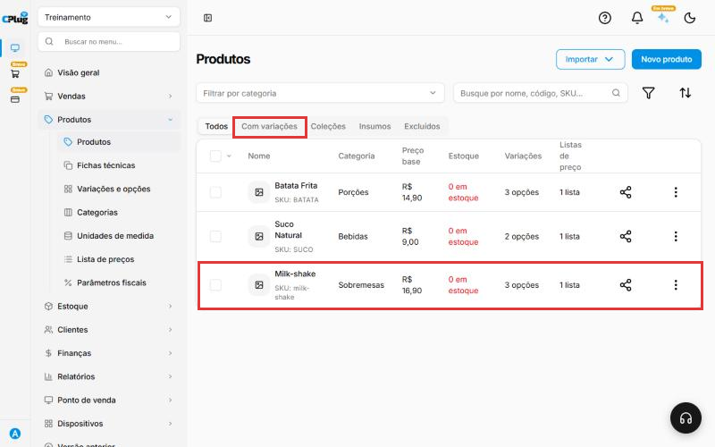{ loading=lazy }

## Para produto montado: use a variação de valor composto

Na aba **Variações**, no quadro **Variação de valor composto**, clique em **Adicionar**. Escolha a variação (exemplo: "Sabor da pizza"), clique em **Adicionar todas as opções** e em **Adicionar**.

A variação aparece em **Grupos de variações** com um resumo, como "2 opções ∙ Escolha múltipla ∙ Opcional". Clique na setinha para abrir. As regras vêm do cadastro da variação (veja [Como cadastrar variações](cadastrar-variacoes.md)), mas podem ser ajustadas só para este produto:

- **Cálculo para o preço da variação:** **Soma total**, **Média** ou **Maior preço**.
- **Qtd. mínima** e **Qtd. máxima:** quantas opções o cliente escolhe.
- **Cobrar valor a partir de quantidade selecionada pelo cliente** e **Cobrar a partir de**.
- Em cada opção: **Código de barras**, **Preço** e **Pré-selecionado?**, que deixa a opção já marcada.

O **+ Adicionar variação** coloca mais um grupo, como "Borda", no mesmo produto. A lixeira apaga o grupo.

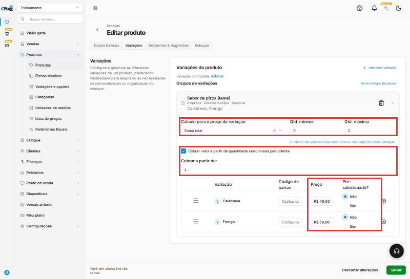{ loading=lazy }

!!! tip "Boas práticas"
    - **Um produto, várias opções**: não crie um cadastro para cada tamanho.
    - **Preencha o preço de todas as opções** antes de salvar; opção com preço zerado sai de graça.
    - **Use o código de barras de cada opção** quando a embalagem tiver; senão, gere EAN para todas de uma vez.
    - **Dê a entrada inicial de cada opção** no estoque antes do primeiro inventário.
    - **Grade para versões, valor composto para montagem.** Na dúvida, pense: o cliente escolhe **qual** produto (grade) ou **o que vai dentro** (valor composto)?

## Deu algum problema?

??? question "A variação não aparece quando eu digito o nome"
    Ela ainda não foi cadastrada. Veja [Como cadastrar variações](cadastrar-variacoes.md).

??? question "Apareceu \"Erro ao criar o produto\""
    Volte para a aba **Dados básicos** e olhe o **Código (SKU)**. Se estiver escrito "O número máximo de caracteres foi excedido", troque por um código curto.

??? question "Não quero vender uma das opções"
    Na tabela de opções, clique no X ao lado dela antes de salvar o produto.

??? question "Escolhi a variação errada"
    Antes de salvar, clique em **Descartar alterações** e comece o cadastro de novo.

??? question "Errei tudo e quero desistir"
    Clique em **Descartar alterações**, ao lado do Salvar. Nada é gravado.

grade tamanho cor sabor modelo camiseta roupa calçado numeração produto com variação variação em grade valor composto pizza dois sabores meio a meio montar produto código de barras por opção gerar ean-13 ean-8 pré-selecionado
