# Como cadastrar um produto

:material-clock-outline: 12 minutos · :material-format-list-numbered: 9 passos · :material-calendar-check: Atualizado em 01/11/2026

Este manual mostra como cadastrar um produto simples, como uma lata de refrigerante ou um pastel. Para produtos com tamanho, cor ou sabor, veja [Como cadastrar um produto com variações](cadastrar-produto-com-variacoes.md).

## Entenda o conceito

O produto é o **centro** do sistema: quase tudo se liga a ele. Cada aba do cadastro responde a uma pergunta:

| Pergunta | Onde se responde | Liga com |
| --- | --- | --- |
| **O que é e quanto custa para o cliente?** | Dados básicos: nome, categoria, preço, unidade | Caixa, cardápio, [listas de preço](lista-de-precos.md) |
| **Que tipo de produto é?** | Tipo: Simples, Coleção (combo) ou Insumo (matéria-prima) | [Ficha técnica](ficha-tecnica.md) |
| **Quanto eu tenho e quanto me custou?** | Aba Estoque e **Cálculo de custo** | [Entradas de estoque](../estoque/entrada-de-estoque.md): cada entrada vira um lote e forma o **custo médio** |
| **Como sai na nota fiscal?** | [Parâmetros fiscais](parametros-fiscais.md) | NFC-e e NF-e |
| **Onde ele aparece?** | Canais de venda e Unidades (lojas) | PDV, loja online, totem, Smart Menu |

**Preço × custo:** o **Preço** é o que o cliente paga. O **custo** é o que você pagou, e normalmente vem sozinho das entradas de estoque (custo médio). A diferença entre os dois é a sua margem.

**Código (SKU):** é a "identidade" do produto. É por ele que a importação por planilha e a edição em massa encontram o produto. Use códigos simples e únicos.

!!! info "Antes de começar, confira se já existe"
    1. **A categoria** do produto, por exemplo "Bebidas". Se não existir, veja [Como cadastrar uma categoria](cadastrar-categoria.md).
    2. **A unidade de medida**, por exemplo "Unidade" ou "Kilograma". O sistema já vem com as mais comuns. Se precisar de outra, veja [Como cadastrar uma unidade de medida](cadastrar-unidade-de-medida.md).

!!! warning "Vai vender com nota fiscal? O cadastro não termina aqui"
    Este manual cadastra o produto para **vender**. Para a **nota fiscal** sair (cupom NFC-e ou NF-e), o produto também precisa dos **dados fiscais**: NCM, origem, ICMS, PIS/COFINS e CFOP. Sem eles, a nota é recusada.

    Depois de salvar o produto, siga o manual [Como configurar os dados fiscais de um produto](parametros-fiscais.md).

Nos prints, o **quadrado vermelho** mostra onde você deve clicar ou digitar.

## Abra a tela de produtos

No menu do lado esquerdo, clique em **Produtos**. Depois clique em **Produtos** de novo, logo abaixo. No canto de cima, à direita, clique no botão azul **Novo produto**.

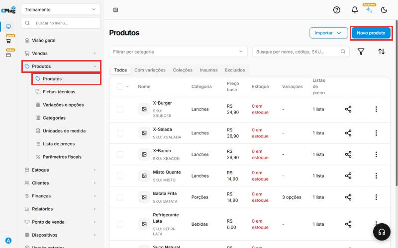{ loading=lazy }

## Escolha a categoria

Clique na caixa **Categoria**. Digite o começo do nome da categoria e clique nela quando aparecer.

Se a categoria ainda não existir, clique em **+ Criar nova categoria**, que aparece no topo da lista.

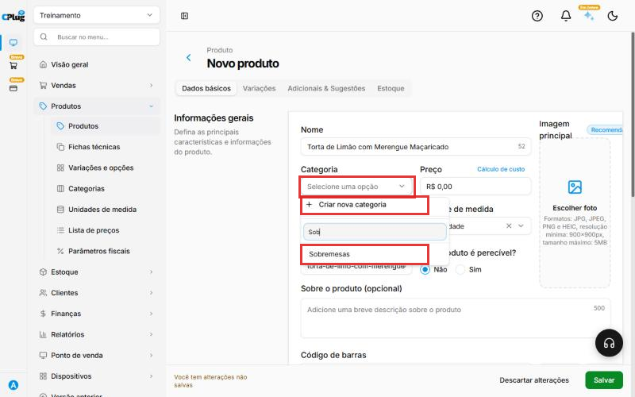{ loading=lazy }

## Preencha os dados do produto

- **Nome:** o nome que vai aparecer na venda. Exemplo: Torta de Limão.
- **Preço:** digite só os números. Para R$ 12,90, digite 1290.
- **Unidade de medida:** vem como "Quantidade". Clique e escolha como o produto é vendido. Exemplo: "Unidade" para uma lata, "Kilograma" para algo vendido por peso.
- **Código (SKU):** o sistema preenche sozinho a partir do nome. Exemplo: "Brownie (teste manual)" vira **brownie-teste-manual**. Pode trocar por um código seu, com até 30 caracteres.

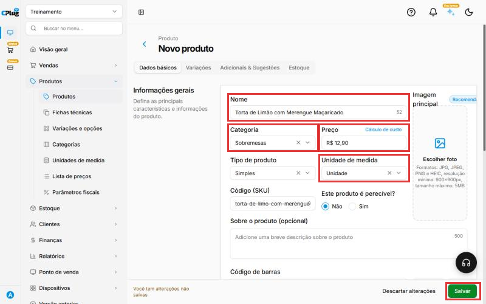{ loading=lazy }

## Escolha o tipo de produto

O **Tipo de produto** muda as abas do cadastro:

- **Simples:** o produto comum, vendido do jeito que é cadastrado. É o tipo deste manual e já vem marcado.
- **Coleção:** um combo de produtos. Aparece a aba **Coleção**, onde você escolhe os produtos, a **Quantidade** e o **Preço unitário** de cada um. O preço da coleção é definido pelos itens que a compõem.
- **Insumo:** a matéria-prima usada no preparo de outros produtos, como pão ou carne. Saem as abas Variações e Adicionais e entra a aba **Produções**, que mostra em quais fichas técnicas o insumo é usado (veja [Como montar uma ficha técnica](ficha-tecnica.md)).

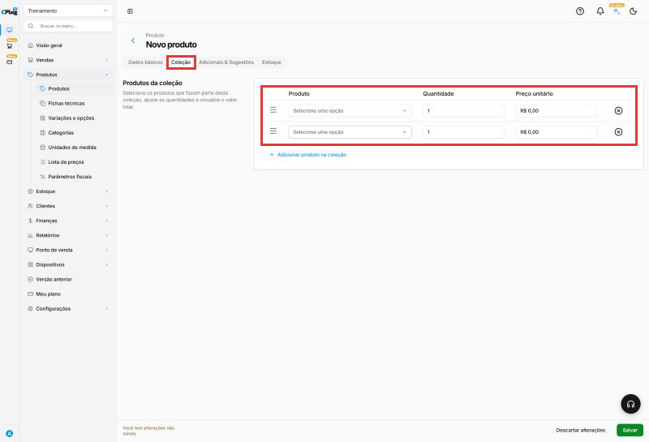{ loading=lazy }

## Complete as informações opcionais

Ainda em **Dados básicos**:

- **Cálculo de custo:** o link ao lado do Preço abre a janela **Calcular custo do produto**. Digite o **Preço do custo** e a **Porcentagem** de lucro. A janela mostra o **Novo preço de venda** (custo + porcentagem). Ao clicar em **Salvar**, esse valor vai para o campo Preço. Exemplo: custo R$ 5,50 com 100% dá R$ 11,00. A janela também mostra o **Custo médio** e o **Histórico de custo**, que vêm das entradas de estoque.
- **Este produto é perecível?:** marque **Sim** para produtos que estragam, como doces e salgados.
- **Imagem principal:** clique em **Escolher foto**. Aceita JPG, JPEG, PNG e HEIC, de pelo menos 900x900 pixels e até 5 MB.
- **Sobre o produto (opcional):** uma descrição curta, com até 500 caracteres.
- **Código de barras:** digite o código da embalagem. Se o produto não tem código, clique em **EAN-13** (ou **EAN-8**) para o sistema gerar um. **Adicionar código de barras** cria mais uma linha, e o **⊗** apaga a linha.
- **Unidades:** se a empresa tem mais de uma loja, clique em **Selecionar unidades** e marque as lojas que vão vender o produto.

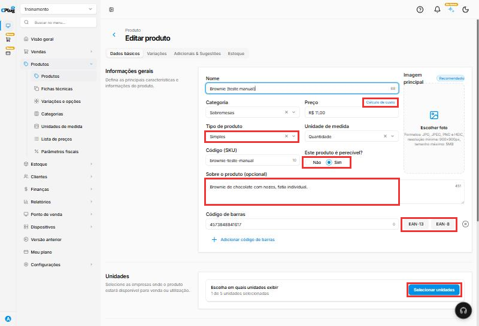{ loading=lazy }

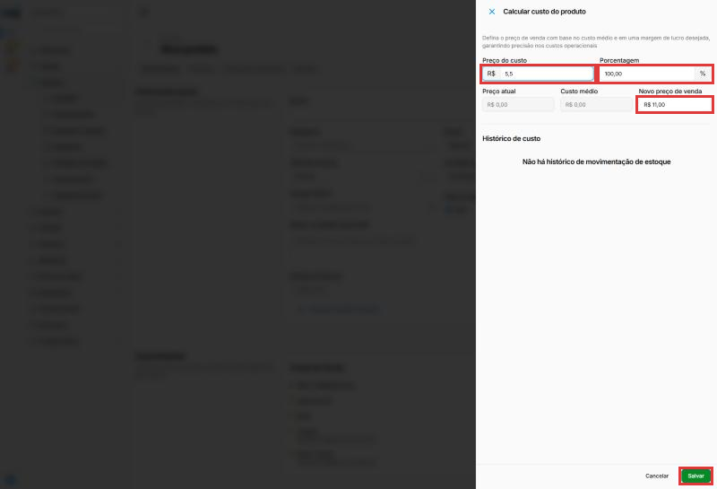{ loading=lazy }

## Confira os canais de venda e os fornecedores

Mais abaixo, em **Disponibilidade**, o quadro **Canais de Venda** mostra onde o produto aparece: **PDV & Atendimento**, **Loja Online**, **ERP**, **Totens** e **Smart Menu**. A bolinha **verde** indica um canal com terminal ativo. Os canais com bolinha laranja e "Nenhum terminal disponível" ainda não têm aparelho cadastrado. Clique em **Editar** para escolher em quais terminais o produto aparece.

Em **Fornecedores**, clique em **Adicionar Fornecedor** para ligar o produto a quem vende para você:

- **Fornecedor:** escolha na lista.
- **Código:** o código que o fornecedor usa para esse produto.
- **Conversão:** quantas unidades suas vêm em cada unidade do fornecedor. Exemplo: ele vende caixa com 12 e você vende por unidade: 12. Se for igual, deixe 1.

Se clicou em **Adicionar Fornecedor** e não vai usar, apague a linha no **⊗**. Uma linha vazia impede o produto de ser salvo.

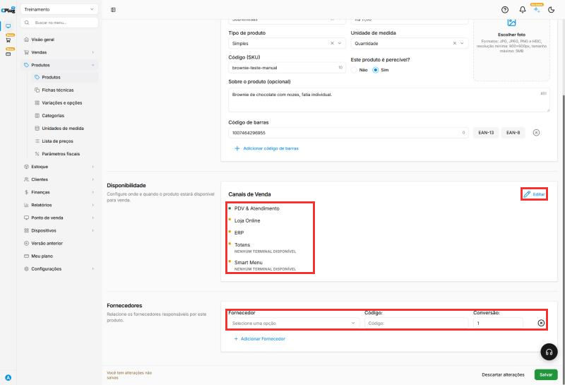{ loading=lazy }

## Ajuste o controle de estoque

Clique na aba **Estoque**:

- **Controlar quantidade em estoque:** já vem ligado. O produto tem entradas e saídas no estoque. Desligue só para o que não tem estoque, como um serviço.
- **Notificação de estoque:** escolha **Sim** para aparecerem **Estoque mínimo** e **Estoque máximo**. Exemplo: mínimo 5 e máximo 30.
- **Custo com valor fixo:** escolha **Sim** para aparecer **Valor do custo** e usar sempre esse custo.

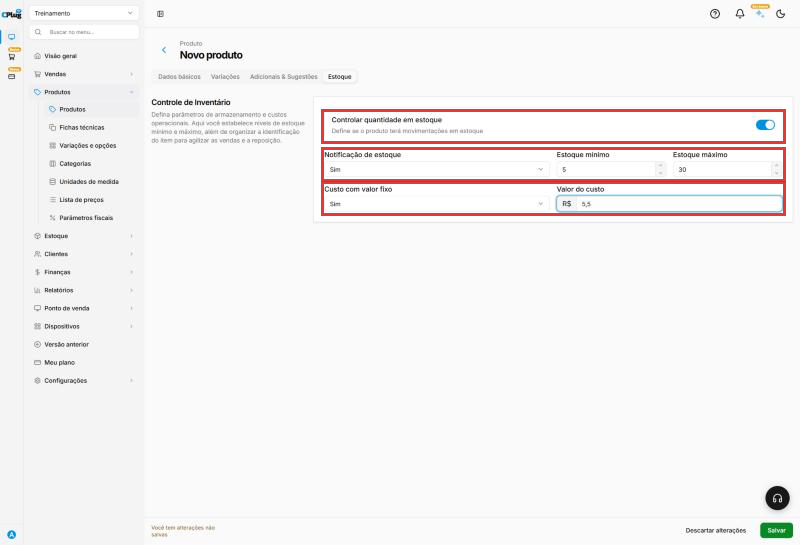{ loading=lazy }

## Clique em "Salvar"

Clique no botão verde **Salvar**, no canto de baixo, à direita.

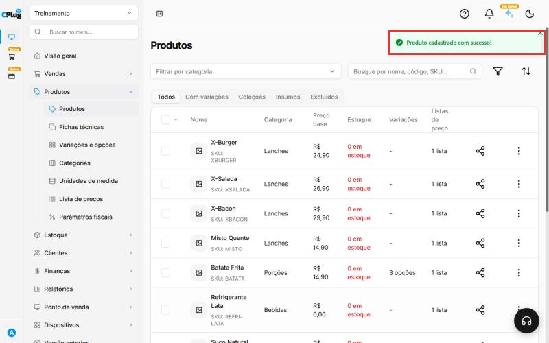{ loading=lazy }

## Confira se deu certo

O sistema volta para a lista de produtos. Digite o nome do produto na caixa **Busque por nome, código, SKU...** e aperte Enter. O produto aparece com a categoria, o **Preço base**, o **Estoque** e as **Listas de preço** em que está (todo produto novo entra na lista Padrão).

No topo da lista, as abas **Todos**, **Com variações**, **Coleções**, **Insumos** e **Excluídos** filtram os produtos por tipo. Para mudar um produto, clique no nome dele.

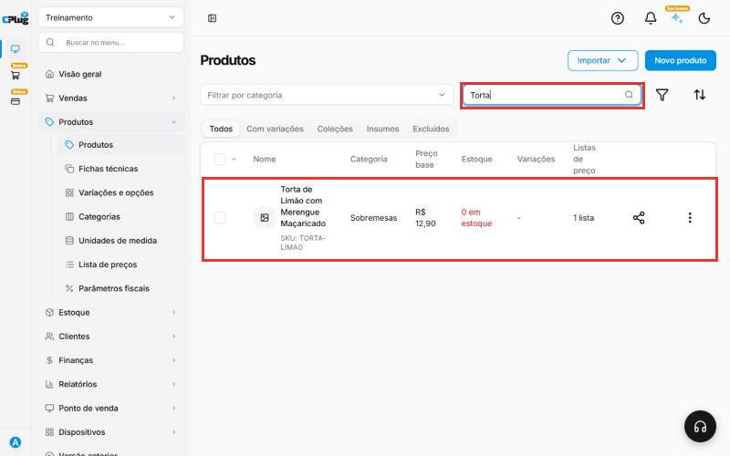{ loading=lazy }

!!! success "Como saber que deu certo"
    Aparece a mensagem **Produto cadastrado com sucesso!** no canto de cima, e o produto já pode ser vendido no caixa.

    **Próximo passo:** [configure os dados fiscais](parametros-fiscais.md) para a nota fiscal sair sem erro.

!!! tip "Boas práticas"
    - **Procure antes de cadastrar**: produto duplicado divide o estoque e o custo em dois.
    - **Nome igual ao que o cliente pede** no balcão; detalhes técnicos vão em **Sobre o produto**.
    - **SKU simples e único**, em maiúsculas e sem espaços (ex.: CHA-LATA).
    - **Código de barras da embalagem** sempre que existir: agiliza o caixa e evita erro de digitação.
    - **Deixe o estoque controlado** (padrão) e dê a **entrada inicial** logo depois do cadastro.
    - **Complete os dados fiscais** antes da primeira venda com nota.

## Deu algum problema?

??? question "Apareceu \"Erro ao criar o produto\""
    Olhe a caixa **Código (SKU)**. Se embaixo dela estiver escrito "O número máximo de caracteres foi excedido", o código ficou grande demais. Isso acontece quando o nome do produto é longo.

    Apague o que está na caixa e digite um código curto, com até 30 letras ou números. Exemplo: TORTA-LIMAO. Depois clique em **Salvar** de novo.

    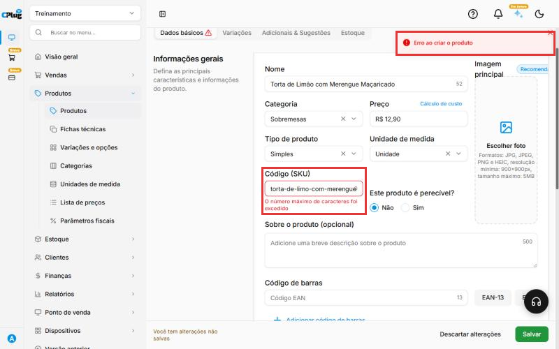{ loading=lazy }

??? question "A categoria que eu quero não aparece"
    Na lista de categorias, clique em **+ Criar nova categoria**.

??? question "O produto aparece com \"0 em estoque\""
    É normal. A quantidade em estoque é lançada no menu **Estoque**, não nesta tela.

??? question "Cliquei em Salvar e nada aconteceu"
    Role a tela até **Fornecedores**. Se houver uma linha sem fornecedor escolhido, apague no **⊗** e salve de novo.

??? question "O Cálculo de custo deu um preço altíssimo"
    No **Preço do custo**, digite o valor com vírgula, como **5,50**. Diferente dos outros campos de dinheiro, ali "550" vira R$ 550,00.

??? question "Errei tudo e quero desistir"
    Clique em **Descartar alterações**, ao lado do Salvar. Nada é gravado.

**Relacionados:** [Como cadastrar um produto com variações](cadastrar-produto-com-variacoes.md) · [Como montar uma ficha técnica](ficha-tecnica.md) · [Como configurar os dados fiscais de um produto](parametros-fiscais.md) · [Como dar entrada no estoque](../estoque/entrada-de-estoque.md)

sku código item mercadoria cardápio cadastrar novo produto preço tipo de produto simples coleção combo insumo matéria-prima cálculo de custo margem lucro perecível imagem foto código de barras ean-13 ean-8 gerar código canais de venda pdv loja online totem smart menu fornecedor conversão estoque mínimo máximo notificação custo fixo unidades
