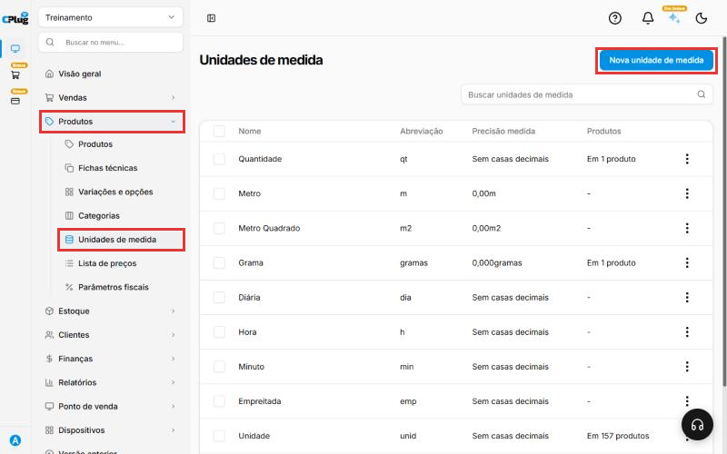
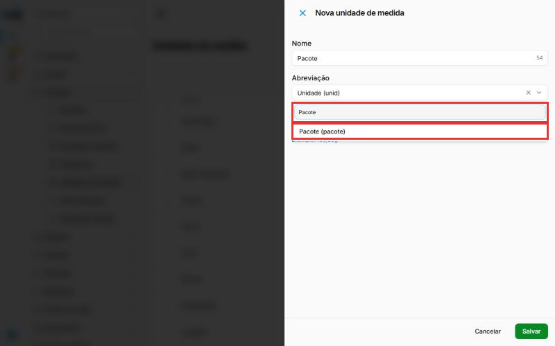
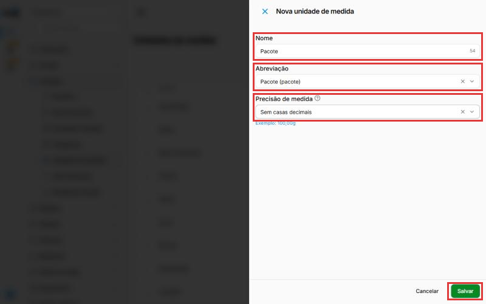
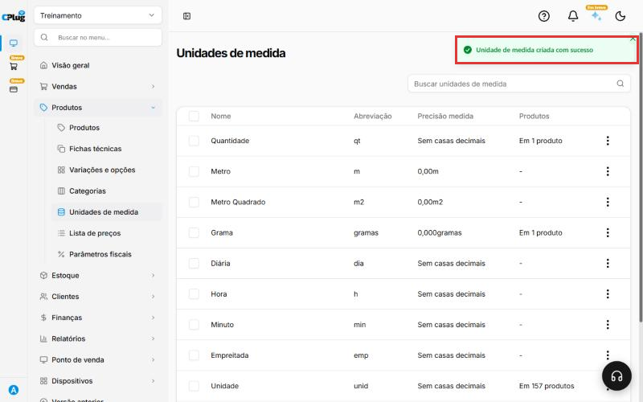

# Como cadastrar uma unidade de medida

:material-clock-outline: 2 minutos · :material-format-list-numbered: 4 passos · :material-calendar-check: Atualizado em 29/10/2026

A unidade de medida diz como o produto é vendido: por unidade, por quilo, por litro, por caixa. O sistema já vem com as mais comuns, como Unidade, Kilograma, Grama, Litros e Metro.

!!! info "Só siga este manual se a unidade que você precisa não estiver na lista"

Nos prints, o **quadrado vermelho** mostra onde você deve clicar ou digitar.

## Abra a tela de unidades de medida

No menu do lado esquerdo, clique em **Produtos**. Depois clique em **Unidades de medida**. Confira na lista se a unidade já existe. Se não existir, clique no botão azul **Nova unidade de medida**, no canto de cima, à direita.

{ loading=lazy }

## Escreva o nome e escolha a abreviação

Uma janela abre do lado direito.

1. Em **Nome**, digite o nome da unidade. Exemplo: Pacote.
2. Clique na caixa **Abreviação**. Digite o nome da unidade na busca e clique na opção certa. Exemplo: "Pacote (pacote)".

{ loading=lazy }

## Escolha a precisão e salve

A **Precisão de medida** diz se a quantidade pode ter vírgula.

- **Sem casas decimais:** para o que é contado inteiro, como caixa, lata ou peça.
- **Com casas decimais:** para o que é pesado ou medido, como 1,250 kg. Escolha quantos números depois da vírgula você usa.

Depois clique no botão verde **Salvar**.

{ loading=lazy }

## Confira a mensagem

Aparece a mensagem **Unidade de medida criada com sucesso** no canto de cima.

{ loading=lazy }

!!! success "Como saber que deu certo"
    A unidade nova já pode ser escolhida no cadastro de produtos.

## Deu algum problema?

??? question "Não sei qual abreviação escolher"
    Digite o nome da unidade na busca, como "Caixa" ou "Pacote". A primeira opção costuma ser a certa.

??? question "A unidade nova não aparece na lista"
    Ela entra no fim da lista. Role a tela até o final ou use a caixa **Buscar unidades de medida**.

??? question "Errei e quero desistir"
    Clique em **Cancelar**, ao lado do Salvar. Nada é gravado.

**Próximo passo:** [Como cadastrar um produto](cadastrar-produto.md).

kg quilo litro caixa pacote peso medida unidade
