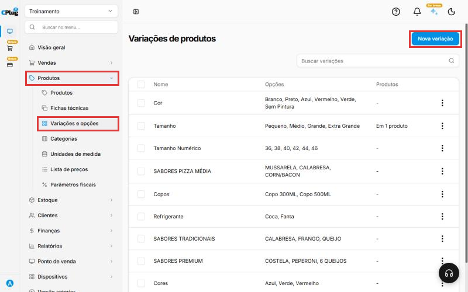
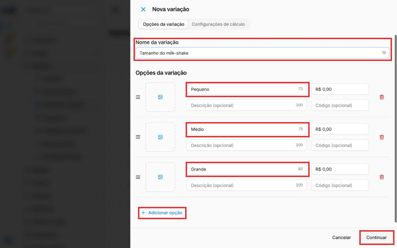
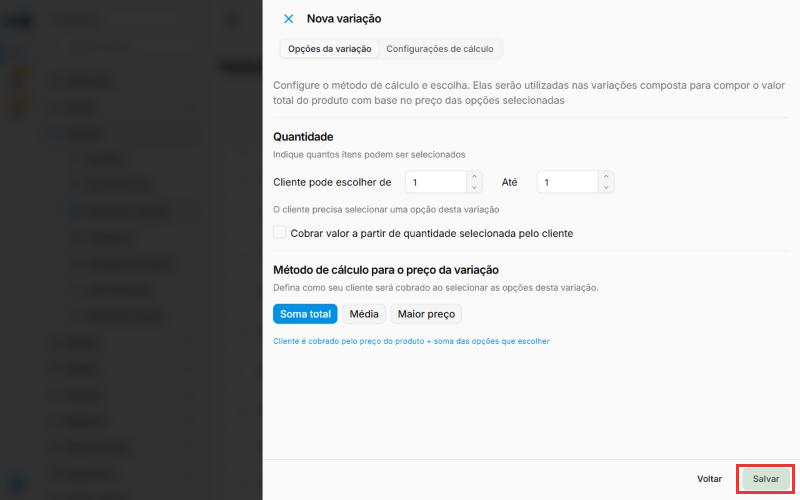
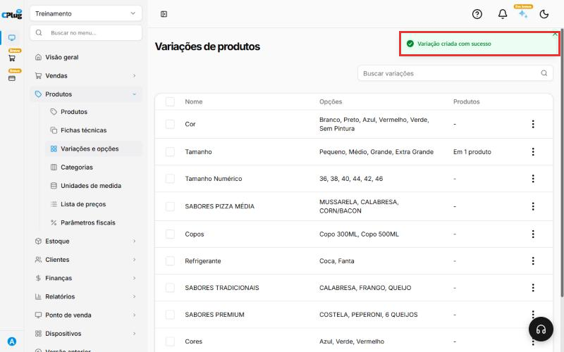

# Como cadastrar variações

:material-clock-outline: 2 minutos · :material-format-list-numbered: 4 passos · :material-calendar-check: Atualizado em 29/10/2026

Uma variação é uma escolha que o produto tem, como **Tamanho** (P, M, G), **Cor** (Azul, Preto) ou **Sabor** (Calabresa, Frango). Você cadastra a variação uma vez só e depois usa em vários produtos.

Nos prints, o **quadrado vermelho** mostra onde você deve clicar ou digitar.

## Abra a tela de variações

No menu do lado esquerdo, clique em **Produtos**. Depois clique em **Variações e opções**. Confira na lista se a variação já existe. Se não existir, clique no botão azul **Nova variação**, no canto de cima, à direita.

{ loading=lazy }

## Escreva o nome e as opções

Uma janela abre do lado direito.

1. Em **Nome da variação**, digite o nome. Exemplo: Tamanho do milk-shake.
2. Na primeira caixa **Nome**, digite a primeira opção. Exemplo: Pequeno.
3. Clique em **+ Adicionar opção** e digite a próxima. Exemplo: Médio. Repita até colocar todas.
4. Clique em **Continuar**.

O valor em R$ ao lado de cada opção só é usado em produtos montados, como pizza com sabores de preços diferentes. Para tamanho e cor, deixe R$ 0,00.

{ loading=lazy }

## Clique em "Salvar"

A janela mostra as **Configurações de cálculo**. Para tamanho, cor e casos parecidos, não precisa mexer em nada. Clique no botão verde **Salvar**.

{ loading=lazy }

## Confira a mensagem

Aparece a mensagem **Variação criada com sucesso** no canto de cima.

{ loading=lazy }

!!! success "Como saber que deu certo"
    A variação já pode ser usada nos produtos.

## Deu algum problema?

??? question "Coloquei uma opção a mais"
    Clique na lixeira vermelha ao lado dela, antes de clicar em Continuar.

??? question "A variação nova não aparece na lista"
    Ela entra no fim da lista. Role a tela até o final ou use a caixa **Buscar variações**.

??? question "Errei e quero desistir"
    Clique em **Cancelar**. Nada é gravado.

**Próximo passo:** [Como cadastrar um produto com variações](cadastrar-produto-com-variacoes.md).

grade tamanho cor sabor modelo atributo opção variação
