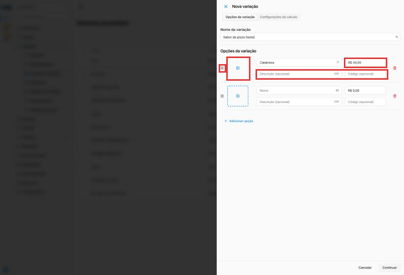
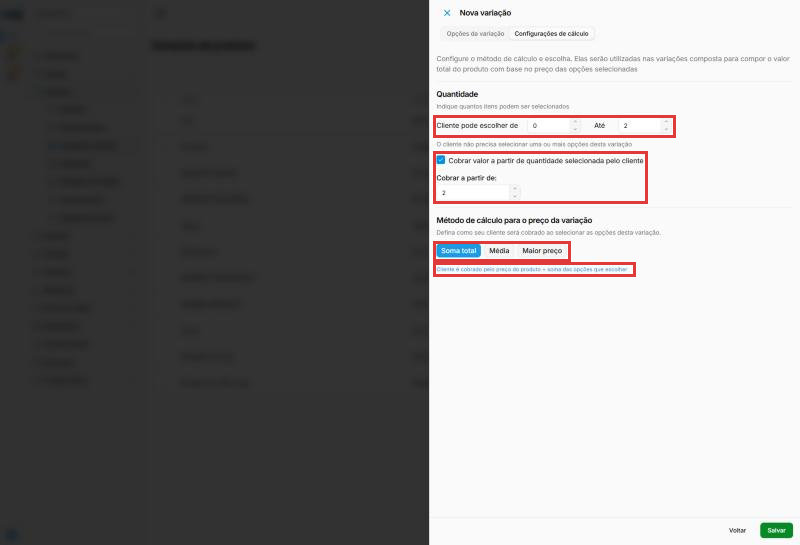

# Como cadastrar variações

:material-clock-outline: 8 minutos · :material-format-list-numbered: 4 passos · :material-calendar-check: Atualizado em 01/11/2026

Uma variação é uma escolha que o produto tem, como **Tamanho** (P, M, G), **Cor** (Azul, Preto) ou **Sabor** (Calabresa, Frango). Você cadastra a variação uma vez só e depois usa em vários produtos.

## Entenda o conceito

A variação é um **molde** de escolhas. Ela fica guardada aqui e é **ligada** aos produtos depois. O mesmo molde "Tamanho P/M/G" serve para o milk-shake, o açaí e o suco.

Existem dois usos bem diferentes:

| Uso | O cliente escolhe... | O preço... | Configuração de cálculo |
| --- | --- | --- | --- |
| **Versão do produto** (tamanho, cor, voltagem) | **uma** opção | é definido em cada versão do produto | como vem: de 1 até 1, Soma total, R$ 0,00 nas opções |
| **Composição de preço** (sabores de pizza, montagem) | uma ou **mais** opções | vem das opções escolhidas | quantidade e método de cálculo ajustados |

!!! note "Variação, adicional ou opcional?"
    **Variação** = o cliente **precisa escolher** (tamanho, sabor). **Adicional** = o cliente **pode acrescentar**, pagando a mais (queijo extra). **Opcional da ficha técnica** = o cliente **pode tirar** um ingrediente. Veja a comparação em [Como cadastrar adicionais e sugestões](adicionais-e-sugestoes.md).

Nos prints, o **quadrado vermelho** mostra onde você deve clicar ou digitar.

## Abra a tela de variações

No menu do lado esquerdo, clique em **Produtos**. Depois clique em **Variações e opções**. Confira na lista se a variação já existe. Se não existir, clique no botão azul **Nova variação**, no canto de cima, à direita.

{ loading=lazy }

## Escreva o nome e as opções

Uma janela abre do lado direito.

1. Em **Nome da variação**, digite o nome. Exemplo: Tamanho do milk-shake.
2. Na primeira caixa **Nome**, digite a primeira opção. Exemplo: Pequeno.
3. Clique em **+ Adicionar opção** e digite a próxima. Exemplo: Médio. Repita até colocar todas.
4. Clique em **Continuar**.

{ loading=lazy }

Cada opção tem mais campos, todos opcionais:

- **Imagem:** o quadrado do lado esquerdo, para uma foto da opção.
- **R$:** o preço da opção. Só é usado quando a variação compõe o preço do produto, como os sabores de uma pizza com preços diferentes. Para tamanho e cor, deixe **R$ 0,00**.
- **Descrição (opcional)** e **Código (opcional)**.
- A alça **≡**, à esquerda, muda a ordem das opções. A lixeira vermelha, à direita, apaga a opção.

{ loading=lazy }

## Ajuste as configurações de cálculo e salve

A aba **Configurações de cálculo** define quantas opções o cliente escolhe e como o preço é calculado. Para tamanho, cor e casos parecidos, deixe como vem (de 1 até 1, **Soma total**) e clique no botão verde **Salvar**.

{ loading=lazy }

Para variações que formam o preço, como os sabores de uma pizza, ajuste:

- **Quantidade – Cliente pode escolher de ... Até ...:** o mínimo e o máximo de opções. Com mínimo **1**, a tela avisa que "o cliente precisa selecionar uma opção". Com mínimo **0**, a escolha é opcional. Exemplo: pizza de até 2 sabores, de 1 até 2.
- **Cobrar valor a partir de quantidade selecionada pelo cliente:** ao marcar, aparece o campo **Cobrar a partir de**, com a quantidade de escolhas a partir da qual a cobrança começa.
- **Método de cálculo para o preço da variação:** a frase abaixo dos botões explica cada um. Exemplo com Calabresa a R$ 40,00 e Frango a R$ 50,00, escolhendo os dois:
    - **Soma total:** preço do produto + a soma das opções (R$ 40 + R$ 50 = R$ 90).
    - **Média:** preço do produto + a média das opções (R$ 45).
    - **Maior preço:** preço do produto + a opção mais cara (R$ 50). É o jeito comum de cobrar pizza meio a meio.

{ loading=lazy }

Clique em **Salvar**.

## Confira a mensagem

Aparece a mensagem **Variação criada com sucesso** no canto de cima.

{ loading=lazy }

!!! success "Como saber que deu certo"
    A variação aparece na lista, com as opções e a coluna **Produtos** (quantos produtos a usam), e já pode ser usada nos produtos. Nos **três pontinhos** da linha você tem **Editar**, **Duplicar** (cria uma cópia, útil para fazer uma variação parecida) e **Excluir**.

!!! tip "Boas práticas"
    - **Nome da variação que diga o uso**: "Tamanho do milk-shake", e não só "Tamanho", quando houver mais de uma variação de tamanho.
    - **Reaproveite**: antes de criar, veja se já existe uma variação igual na lista.
    - **Use Duplicar** para criar uma variação parecida sem digitar tudo de novo.
    - **Ordem das opções**: do menor para o maior, ou do mais vendido para o menos vendido.
    - **Pizza meio a meio**: o método **Maior preço** é o mais usado; combine com o cliente qual regra a loja segue.

## Deu algum problema?

??? question "Coloquei uma opção a mais"
    Clique na lixeira vermelha ao lado dela, antes de clicar em Continuar.

??? question "A variação nova não aparece na lista"
    Ela entra no fim da lista. Role a tela até o final ou use a caixa **Buscar variações**.

??? question "Errei e quero desistir"
    Clique em **Cancelar**. Nada é gravado.

**Próximo passo:** [Como cadastrar um produto com variações](cadastrar-produto-com-variacoes.md).

grade tamanho cor sabor modelo atributo opção variação pizza meio a meio dois sabores soma total média maior preço configurações de cálculo quantidade mínima máxima cobrar a partir de duplicar
