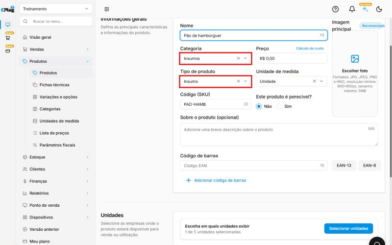
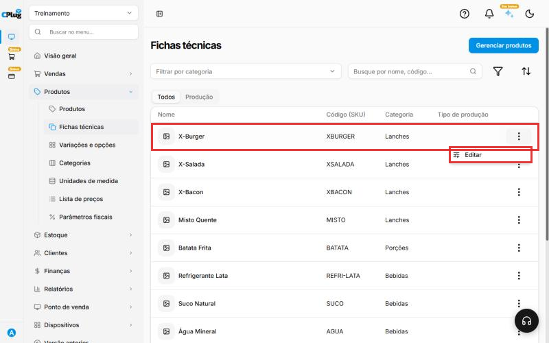
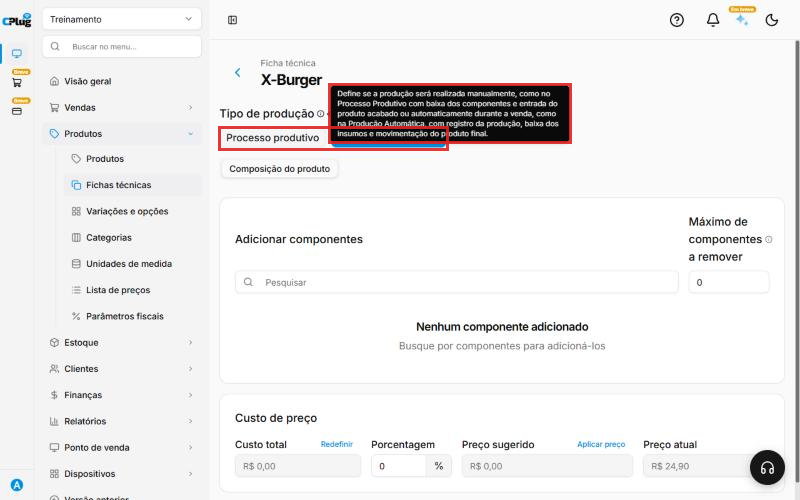
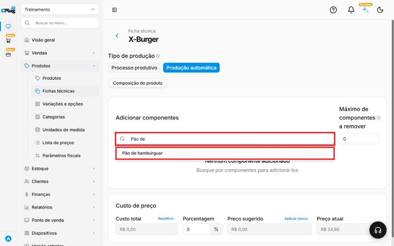
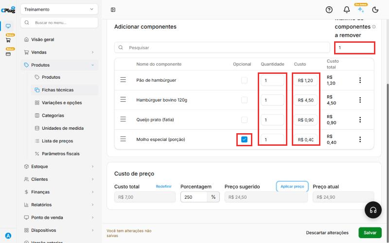
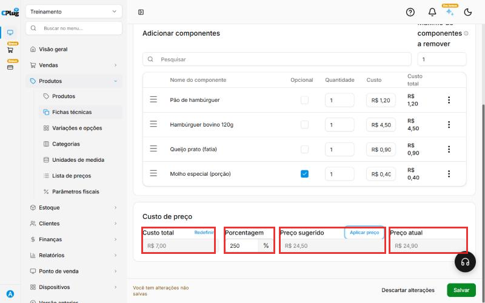
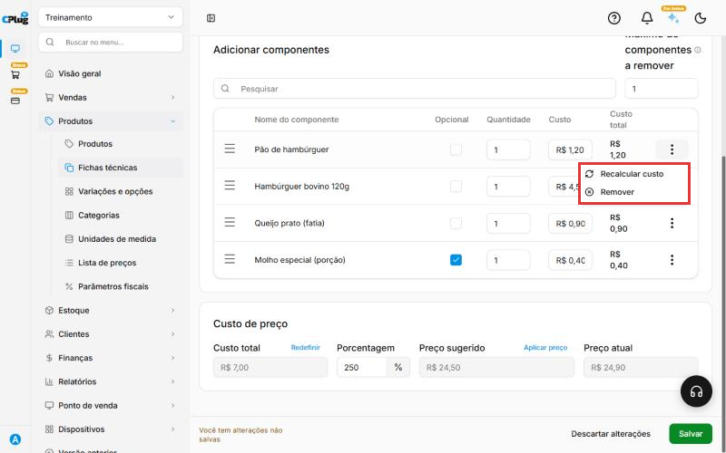
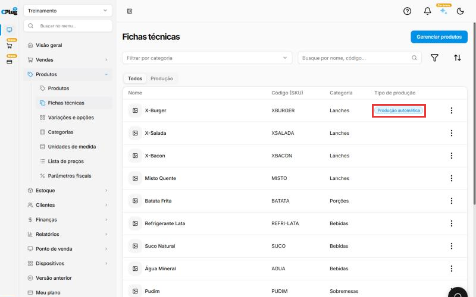

# Como montar uma ficha técnica

:material-clock-outline: 10 minutos · :material-format-list-numbered: 7 passos · :material-calendar-check: Atualizado em 30/10/2026

A **ficha técnica** é a "receita" do produto: quais ingredientes ele leva e em que quantidade. Com ela, o sistema:

- dá **baixa no estoque dos ingredientes** a cada venda (vendeu um X-Burger, sai um pão, um hambúrguer, uma fatia de queijo...);
- calcula o **custo** do produto;
- sugere um **preço de venda** a partir da margem que você quer ter.

Neste manual, montamos a ficha do **X-Burger** com quatro ingredientes.

!!! info "Antes de começar: cadastre os ingredientes como insumos"
    Cada ingrediente é cadastrado como um **produto** (veja [Como cadastrar um produto](cadastrar-produto.md)), com estas diferenças:

    - **Tipo de produto:** **Insumo**. É o que diz ao sistema que o produto é um ingrediente.
    - **Categoria:** crie uma categoria só para eles, como "Insumos".
    - **Unidade de medida:** a que você usa na receita (unidade, grama, quilo...).

    { loading=lazy }

Nos prints, o **quadrado vermelho** mostra onde você deve clicar ou digitar.

## Abra a ficha técnica do produto

No menu do lado esquerdo, clique em **Produtos** e depois em **Fichas técnicas**. A lista mostra todos os produtos.

Na linha do produto, clique nos **três pontinhos** e depois em **Editar**.

{ loading=lazy }

## Escolha o tipo de produção

No topo da ficha, escolha:

- **Produção automática:** o sistema dá baixa nos ingredientes **no momento da venda**. É o caso de lanches, pratos e bebidas preparados na hora.
- **Processo produtivo:** você **produz antes** (um bolo inteiro, uma panela de molho) e registra a produção. Os ingredientes saem do estoque e o produto pronto entra. Depois, a venda tira do estoque do produto pronto.

{ loading=lazy }

## Adicione os ingredientes

Em **Adicionar componentes**, clique em **Pesquisar**, digite parte do nome do ingrediente e clique nele na lista. Repita para cada ingrediente.

{ loading=lazy }

## Preencha quantidade, custo e opcionais

Para cada ingrediente da lista:

- **Quantidade:** quanto vai em **um** produto, na unidade do insumo. Exemplo: 1 pão, 1 hambúrguer, 1 fatia de queijo.
- **Custo:** quanto custa essa quantidade. **Confira sempre**: o valor pode vir zerado, mesmo com o custo cadastrado no insumo. Se vier, digite o custo.
- **Opcional:** marque os ingredientes que o cliente **pode pedir para tirar** (por exemplo, o molho).

Em **Máximo de componentes a remover**, informe quantos ingredientes opcionais o cliente pode tirar de uma vez. Exemplo: **1**.

{ loading=lazy }

## Confira o custo e o preço sugerido

Em **Custo de preço**:

- **Custo total:** a soma dos ingredientes. No exemplo, R$ 7,00.
- **Porcentagem:** quanto você quer ganhar **em cima do custo**. Exemplo: 250%.
- **Preço sugerido:** o custo mais a porcentagem. No exemplo, R$ 7,00 + 250% = **R$ 24,50**.
- **Preço atual:** o preço de venda de hoje.

Para trocar o preço de venda pelo preço sugerido, clique em **Aplicar preço**. Se não clicar, o preço atual continua igual.

{ loading=lazy }

## Use as opções de cada ingrediente

Nos **três pontinhos** no fim da linha do ingrediente:

- **Recalcular custo:** atualiza o custo do ingrediente.
- **Remover:** tira o ingrediente da ficha.

{ loading=lazy }

## Salve e confira

Clique em **Salvar**, no canto de baixo, à direita. Aparece a mensagem **Ficha técnica atualizada com sucesso**.

De volta à lista de fichas técnicas, o produto aparece com o **Tipo de produção** preenchido.

{ loading=lazy }

!!! warning "A ficha técnica só dá baixa se o insumo controlar estoque"
    No cadastro de cada insumo, deixe ligado **Controlar quantidade em estoque**. E lance o estoque inicial dos insumos, senão o saldo fica negativo a cada venda.

## Deu algum problema?

??? question "O custo dos ingredientes apareceu como R$ 0,00"
    Digite o custo de cada ingrediente na coluna **Custo** ou use **Recalcular custo** nos três pontinhos da linha. Confira o **Custo total** antes de salvar.

??? question "O ingrediente não aparece na pesquisa"
    Confira se ele foi cadastrado como produto na **mesma loja** e com o tipo **Insumo**.

??? question "Mudei a porcentagem e o preço de venda não mudou"
    O preço só muda quando você clica em **Aplicar preço**. Depois, clique em **Salvar**.

**Relacionados:** [Como cadastrar um produto](cadastrar-produto.md) · [Como cadastrar uma unidade de medida](cadastrar-unidade-de-medida.md)

ficha técnica receita composição ingredientes insumo insumos componentes baixa de estoque custo do produto preço sugerido margem porcentagem markup aplicar preço produção automática processo produtivo opcional sem cebola remover ingrediente
