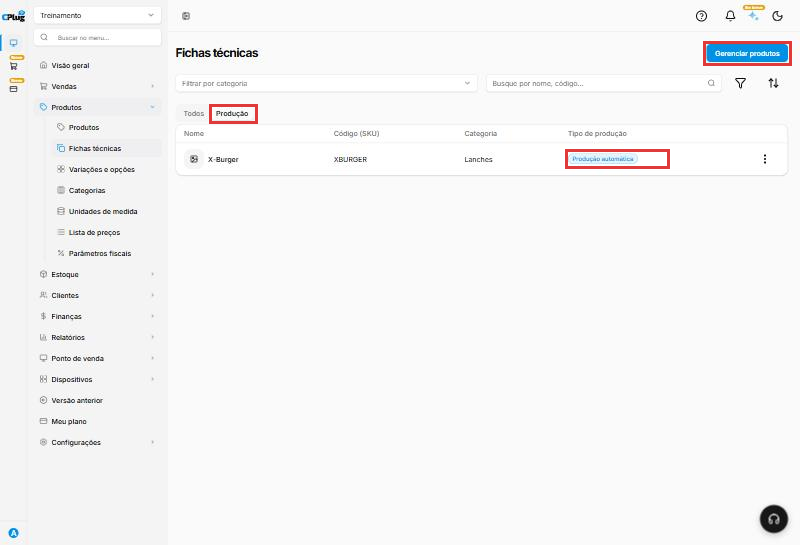
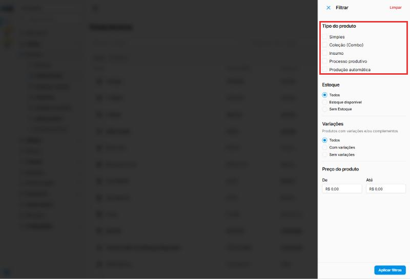
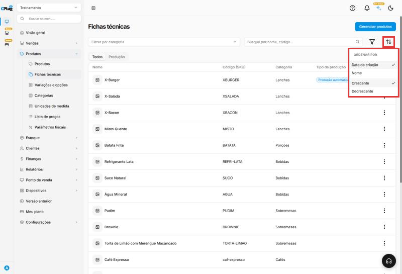
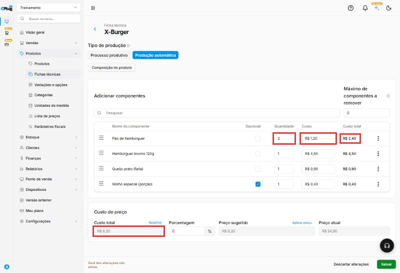
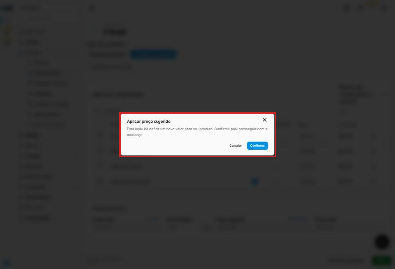
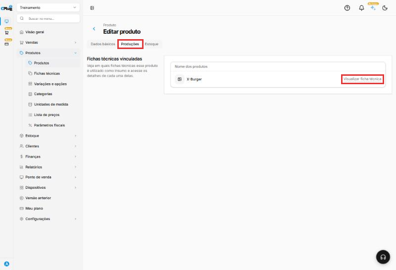

# Como montar uma ficha técnica

:material-clock-outline: 10 minutos · :material-format-list-numbered: 8 passos · :material-calendar-check: Atualizado em 31/10/2026

A **ficha técnica** é a "receita" do produto: quais ingredientes ele leva e em que quantidade. Com ela, o sistema:

- dá **baixa no estoque dos ingredientes** a cada venda (vendeu um X-Burger, sai um pão, um hambúrguer, uma fatia de queijo...);
- calcula o **custo** do produto;
- sugere um **preço de venda** a partir da margem que você quer ter.

Neste manual, montamos a ficha do **X-Burger** com quatro ingredientes.

!!! info "Antes de começar: cadastre os ingredientes como insumos"
    Cada ingrediente é cadastrado como um **produto** (veja [Como cadastrar um produto](cadastrar-produto.md)), com estas diferenças:

    - **Tipo de produto:** **Insumo**. É o que diz ao sistema que o produto é um ingrediente.
    - **Categoria:** crie uma categoria só para eles, como "Insumos".
    - **Unidade de medida:** a que você usa na receita (unidade, grama, quilo...).

    { loading=lazy }

Nos prints, o **quadrado vermelho** mostra onde você deve clicar ou digitar.

## Abra a ficha técnica do produto

No menu do lado esquerdo, clique em **Produtos** e depois em **Fichas técnicas**. A lista mostra todos os produtos.

Na linha do produto, clique nos **três pontinhos** e depois em **Editar**.

{ loading=lazy }

Outros recursos da lista:

- **Todos** e **Produção:** a aba **Produção** mostra só os produtos que já têm ficha técnica, com o **Tipo de produção** de cada um.
- **Gerenciar produtos:** abre a lista de **Produtos**, para cadastrar ou mudar produtos e insumos.
- **Filtrar por categoria** e a busca por nome ou código.
- O **funil** abre o painel **Filtrar**: por **Tipo do produto** (Simples, Coleção, Insumo, Processo produtivo, Produção automática), por **Estoque** (com ou sem estoque), por **Variações** e por faixa de **Preço**. Clique em **Aplicar filtros**.
- As **setas** ordenam a lista por **Data de criação** ou **Nome**, em ordem **Crescente** ou **Decrescente**.

{ loading=lazy }

{ loading=lazy }

{ loading=lazy }

## Escolha o tipo de produção

No topo da ficha, escolha:

- **Produção automática:** o sistema dá baixa nos ingredientes **no momento da venda**. É o caso de lanches, pratos e bebidas preparados na hora.
- **Processo produtivo:** você **produz antes** (um bolo inteiro, uma panela de molho) e registra a produção. Os ingredientes saem do estoque e o produto pronto entra. Depois, a venda tira do estoque do produto pronto.

No **Processo produtivo**, a coluna **Opcional** e o campo **Máximo de componentes a remover** somem: tirar um ingrediente a pedido do cliente só existe na venda, com a produção automática.

{ loading=lazy }

!!! warning "Trocou o tipo? Confira o máximo de ingredientes a remover"
    Ao trocar o tipo de produção, o **Máximo de componentes a remover** volta para **0**, mesmo que você volte para Produção automática. Digite o número de novo antes de salvar.

## Adicione os ingredientes

Em **Adicionar componentes**, clique em **Pesquisar**, digite parte do nome do ingrediente e clique nele na lista. Repita para cada ingrediente.

{ loading=lazy }

## Preencha quantidade, custo e opcionais

Para cada ingrediente da lista:

- **Quantidade:** quanto vai em **um** produto, na unidade do insumo. Exemplo: 1 pão, 1 hambúrguer, 1 fatia de queijo.
- **Custo:** o custo de **uma unidade** do insumo. Ele vem do cadastro do insumo, mas pode vir zerado: **confira sempre**. Se vier, digite o custo ou use **Recalcular custo** (passo 6).
- **Custo total:** a conta é feita sozinha: **Quantidade × Custo**. Exemplo: 2 pães de R$ 1,20 dão R$ 2,40.
- **Opcional:** marque os ingredientes que o cliente **pode pedir para tirar** (por exemplo, o molho).

Em **Máximo de componentes a remover**, informe quantos ingredientes opcionais o cliente pode tirar de uma vez. Exemplo: **1**.

A alça **≡**, no começo da linha, muda a ordem dos ingredientes.

{ loading=lazy }

{ loading=lazy }

## Confira o custo e o preço sugerido

Em **Custo de preço**:

- **Custo total:** a soma dos custos totais dos ingredientes. No exemplo, R$ 7,00.
- **Porcentagem:** quanto você quer ganhar **em cima do custo**. Digite o número inteiro: para 250%, digite **250**.
- **Preço sugerido:** o custo mais a porcentagem. No exemplo, R$ 7,00 + 250% = **R$ 24,50**.
- **Preço atual:** o preço de venda de hoje.
- **Redefinir:** apaga a Porcentagem e o Preço sugerido para recomeçar a conta. Não mexe nos custos.

Para trocar o preço de venda pelo preço sugerido, clique em **Aplicar preço**. Abre a janela **Aplicar preço sugerido**: clique em **Confirmar**. O **Preço atual** muda na tela, mas só fica gravado quando você clica em **Salvar**. Se clicar em **Descartar alterações**, o preço antigo continua.

A porcentagem serve só para a conta: ela não fica gravada na ficha. Na próxima vez que abrir, o campo volta para 0.

{ loading=lazy }

{ loading=lazy }

## Use as opções de cada ingrediente

Nos **três pontinhos** no fim da linha do ingrediente:

- **Recalcular custo:** troca o custo da linha pelo custo que está no cadastro do insumo. Use quando o custo veio zerado ou quando o custo do insumo mudou depois que a ficha foi montada. Exemplo: o custo do pão estava R$ 9,99 na ficha; depois do Recalcular custo, voltou para R$ 1,20, o custo do cadastro.
- **Remover:** tira o ingrediente da ficha.

{ loading=lazy }

## Salve e confira

Clique em **Salvar**, no canto de baixo, à direita. Aparece a mensagem **Ficha técnica atualizada com sucesso**. Para sair sem gravar nada, clique em **Descartar alterações**.

De volta à lista de fichas técnicas, o produto aparece com o **Tipo de produção** preenchido.

{ loading=lazy }

## Veja em quais fichas um insumo é usado

Abra o cadastro do insumo (**Produtos** → clique no nome dele) e clique na aba **Produções**. O quadro **Fichas técnicas vinculadas** lista os produtos que usam esse insumo. Clique em **Visualizar ficha técnica** para abrir a ficha.

Isso ajuda antes de mudar o custo ou excluir um insumo: você vê quais produtos vão ser afetados.

{ loading=lazy }

!!! warning "A ficha técnica só dá baixa se o insumo controlar estoque"
    No cadastro de cada insumo, deixe ligado **Controlar quantidade em estoque**. E lance o estoque inicial dos insumos, senão o saldo fica negativo a cada venda.

## Deu algum problema?

??? question "O custo dos ingredientes apareceu como R$ 0,00"
    Digite o custo de cada ingrediente na coluna **Custo** ou use **Recalcular custo** nos três pontinhos da linha. Confira o **Custo total** antes de salvar.

??? question "O ingrediente não aparece na pesquisa"
    Confira se ele foi cadastrado como produto na **mesma loja** e com o tipo **Insumo**.

??? question "Mudei a porcentagem e o preço de venda não mudou"
    O preço só muda quando você clica em **Aplicar preço**, confirma e depois clica em **Salvar**.

??? question "O custo total do ingrediente ficou maior do que eu esperava"
    O **Custo** é o de **uma unidade** do insumo, e o sistema multiplica pela **Quantidade**. Confira se a quantidade está na **mesma unidade de medida do insumo** (unidade, quilo, grama...).

??? question "Os clientes não conseguem mais tirar ingredientes"
    Confira o **Máximo de componentes a remover**. Ele volta para 0 quando o tipo de produção é trocado.

**Relacionados:** [Como cadastrar um produto](cadastrar-produto.md) · [Como cadastrar uma unidade de medida](cadastrar-unidade-de-medida.md)

ficha técnica receita composição ingredientes insumo insumos componentes baixa de estoque custo do produto preço sugerido margem porcentagem markup aplicar preço produção automática processo produtivo opcional sem cebola remover ingrediente recalcular custo redefinir custo total quantidade aplicar preço sugerido fichas técnicas vinculadas produções filtro ordenar
