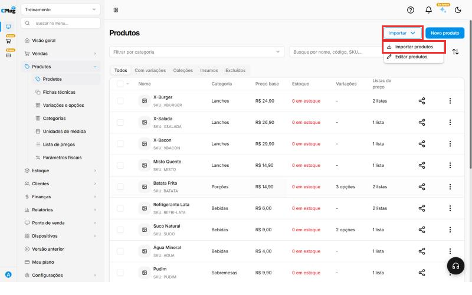
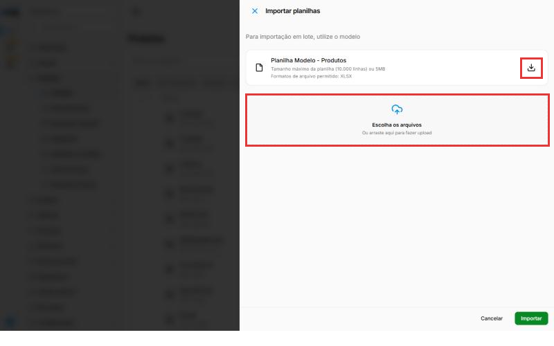
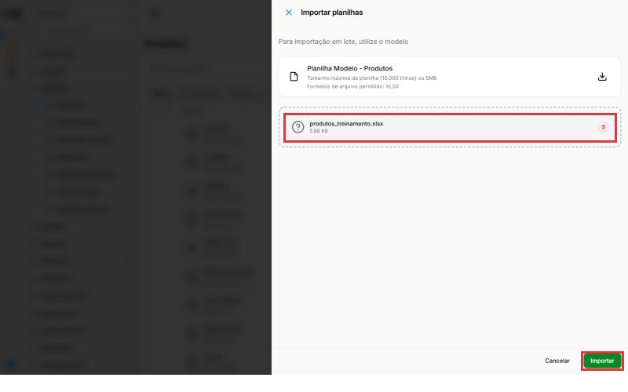
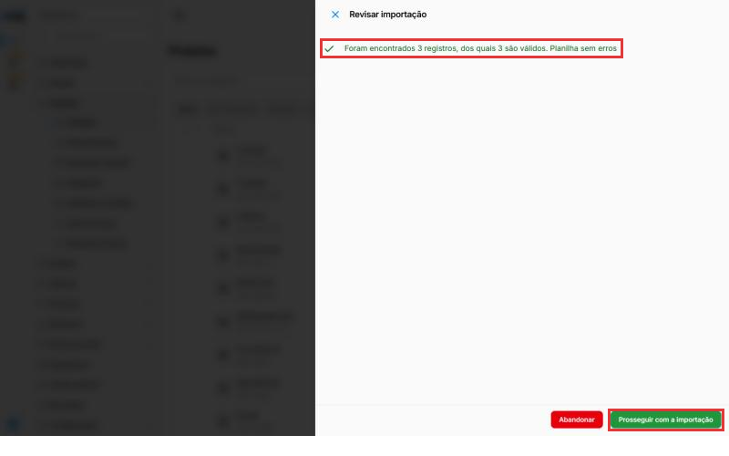
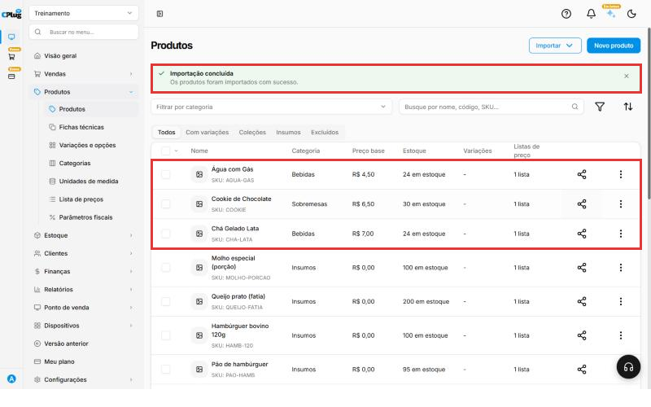
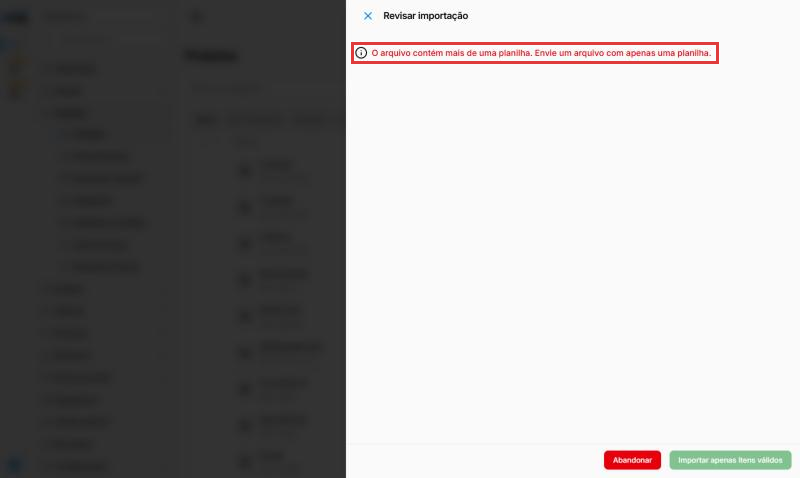

# Como importar produtos de uma planilha

:material-clock-outline: 15 minutos · :material-format-list-numbered: 7 passos · :material-calendar-check: Atualizado em 31/10/2026

Tem muitos produtos para cadastrar? Em vez de criar um por um, preencha a **planilha modelo** do sistema e envie tudo de uma vez. Cada linha da planilha vira um produto.

## Entenda o conceito

A importação é o jeito mais rápido de colocar o cardápio ou o catálogo inteiro no sistema. Ela é mais útil quando você está **começando a usar a CPlug** ou **vindo de outro sistema** e já tem a lista de produtos numa planilha.

**Como o sistema lê a planilha:**

- Cada **coluna** é um campo do cadastro do produto (nome, preço, categoria...). Por isso a primeira linha, com os nomes das colunas, não pode ser mudada.
- Cada **linha** é um produto novo.
- A **Categoria** e a **Unidade de Medida** são procuradas **pelo nome**. Se você escrever "Bebida" e no sistema estiver "Bebidas", o sistema não encontra. É por isso que elas precisam existir antes e ser escritas igual.
- O **Código** vira o **SKU** do produto: é a "identidade" dele. Por isso não pode se repetir.

**O que a importação já faz por você:**

- Cria os produtos com nome, categoria, preço e unidade.
- Lança o **Estoque inicial** no estoque. No teste, as quantidades 24, 30 e 24 apareceram na lista de produtos como "24 em estoque", "30 em estoque" e "24 em estoque".
- Coloca os produtos na **Lista Padrão** de preços.
- Grava os dados fiscais que estiverem na planilha, como **NCM**, **Origem** e **CFOP**.

**O que você completa depois:**

- Os **grupos de ICMS e PIS/COFINS**, se não vieram na planilha. Sem eles, o produto fica **Pendente** em **Parâmetros fiscais**. Veja [Como configurar os dados fiscais de um produto](parametros-fiscais.md).
- Foto, variações, adicionais e ficha técnica, pela tela do produto.

**Importar ou editar?** O botão **Importar** tem duas opções:

- **Importar produtos:** **cria produtos novos**. É o assunto deste manual.
- **Editar produtos:** **altera produtos que já existem**, usando outra planilha modelo, a **Planilha Modelo - Edição de Produtos**. Use essa opção para mudar preços ou dados de muitos produtos de uma vez.

**Como a importação acontece:** em três etapas. Primeiro o sistema **confere** a planilha, depois mostra o resultado para você **revisar**, e só então **importa**, em segundo plano. Enquanto isso, você pode continuar usando o sistema. O sistema faz **uma importação por vez**.

!!! info "Antes de começar"
    - As **categorias** e as **unidades de medida** que você vai usar na planilha precisam **já estar cadastradas**. Veja [Como cadastrar uma categoria](cadastrar-categoria.md) e [Como cadastrar uma unidade de medida](cadastrar-unidade-de-medida.md).
    - Você vai precisar de um programa de planilhas, como o **Excel** ou o **Google Planilhas**.
    - Os dados fiscais (NCM, origem, CFOP) quem informa é o **contador**.

Nos prints, o **quadrado vermelho** mostra onde você deve clicar ou digitar.

## Abra a importação de produtos

No menu do lado esquerdo, clique em **Produtos** e depois em **Produtos**. No canto de cima, à direita, clique em **Importar** e depois em **Importar produtos**.

{ loading=lazy }

## Baixe a planilha modelo

Abre o painel **Importar planilhas**. Clique na **setinha para baixo**, ao lado de **Planilha Modelo - Produtos**, para baixar o arquivo.

{ loading=lazy }

A planilha aceita até **10.000 linhas** (ou 5 MB) e precisa ser do tipo **XLSX**, o formato do Excel.

## Preencha a planilha

Abra o arquivo baixado. A **primeira linha** tem os nomes das colunas: **não apague nem mude essa linha**. Preencha um produto por linha, a partir da linha 2.

Exemplo com três produtos (mostrando só as colunas mais usadas):

| Nome | Código | Categoria | Estoque inicial | Valor de custo | Valor de venda | Unidade de Medida | Perecível | Código NCM | Código de Origem | CFOP Padrão |
| --- | --- | --- | --- | --- | --- | --- | --- | --- | --- | --- |
| Chá Gelado Lata | CHA-LATA | Bebidas | 24 | 2,80 | 7,00 | Unidade | Não | 22029900 | 0 | 5102 |
| Cookie de Chocolate | COOKIE | Sobremesas | 30 | 1,50 | 6,50 | Unidade | Sim | 19053100 | 0 | 5102 |
| Água com Gás | AGUA-GAS | Bebidas | 24 | 1,10 | 4,50 | Unidade | Não | 22011000 | 0 | 5102 |

O que vai em cada coluna:

- **Nome:** o nome do produto, como vai aparecer na venda.
- **Código:** um código curto e **diferente para cada produto**. Exemplo: CHA-LATA.
- **Categoria** e **Unidade de Medida:** escreva **igual** ao nome cadastrado no sistema. Exemplo: Bebidas, Unidade.
- **Estoque inicial:** quantas unidades você tem hoje. O sistema já lança essa entrada no estoque.
- **Valor de custo** e **Valor de venda:** quanto você paga e por quanto vende.
- **Tipo Insumo**, **Custo com valor fixo** e **Perecível:** responda **Sim** ou **Não**.
- **Código NCM**, **Código de Origem** e **CFOP Padrão:** os dados fiscais. **0** na origem quer dizer produto nacional. Confirme os códigos com o contador.

As outras colunas (código de barras, CEST, pesos, grupos de impostos, fornecedor, estoque mínimo e máximo...) são opcionais. **Deixe em branco o que você não souber.**

## Deixe a planilha com uma aba só

!!! warning "Importante: apague as abas extras"
    A planilha modelo vem com **três abas** embaixo: **Planilha1**, **Planilha2** e **Planilha3**. O sistema **só aceita arquivo com uma aba**.

    Antes de salvar, clique com o botão direito em **Planilha2** e escolha **Excluir**. Faça o mesmo com a **Planilha3**. Fica só a **Planilha1**, com os seus produtos.

Salve o arquivo no formato **XLSX** (no Excel, "Pasta de Trabalho do Excel"). No Google Planilhas, use **Arquivo → Fazer download → Microsoft Excel (.xlsx)**.

## Envie a planilha

Volte ao painel **Importar planilhas** e clique em **Escolha os arquivos** (ou arraste o arquivo para essa área). O nome do arquivo aparece no painel. Clique em **Importar**.

{ loading=lazy }

Aparece **Importação em andamento: Aguarde, estamos validando a planilha**. Isso pode levar **cerca de um minuto**. Você pode continuar usando o sistema enquanto isso.

## Revise e confirme

Quando a conferência termina, aparece **Revisar importação**, com quantos produtos foram encontrados e quantos estão certos. No exemplo: **Foram encontrados 3 registros, dos quais 3 são válidos. Planilha sem erros**.

Clique em **Prosseguir com a importação**.

{ loading=lazy }

Se alguma linha tiver erro, o sistema avisa e mostra o botão **Importar apenas itens válidos**: ele importa as linhas certas e deixa as erradas de fora. Corrija as linhas erradas e importe de novo depois.

## Confira os produtos

No topo da lista aparece **Importando produtos** e, quando termina, **Importação concluída**. Os produtos novos aparecem na lista com categoria, preço e estoque.

Dica: para ver os mais novos primeiro, clique no botão de **ordenar** (as duas setas, à direita da busca) e escolha **Data de criação** e **Decrescente**.

{ loading=lazy }

Pronto! Abra um dos produtos para conferir os dados. Se precisar, complete o cadastro (foto, variações, adicionais) pela tela do produto.

!!! warning "Depois de importar, confira os parâmetros fiscais"
    Abra **Produtos → Parâmetros fiscais**. Os produtos importados sem os grupos de ICMS e PIS/COFINS aparecem como **Pendente**. Use a **Edição em lote** para completar todos de uma vez antes de vender com nota.

!!! tip "Boas práticas"
    - **Faça um teste pequeno primeiro.** Importe 3 a 5 produtos, confira se ficaram certos e só depois envie a planilha completa. Um erro em 500 linhas dá muito mais trabalho para corrigir.
    - **Cadastre categorias e unidades antes** e copie os nomes exatamente como estão no sistema.
    - **Use códigos simples:** letras maiúsculas, números e hífen, sem espaços. Exemplo: CHA-LATA. Fica fácil de digitar e de achar depois.
    - **Escreva valores só com números e vírgula:** 7,00, e não "R$ 7,00".
    - **Peça os dados fiscais ao contador antes**, e já preencha na planilha. Assim os produtos chegam prontos para a nota.
    - **Guarde uma cópia da planilha.** Ela é o registro do que foi importado e ajuda se precisar refazer algo.
    - **Não envie a mesma planilha de novo** para corrigir algo: a importação cria produtos novos. Para mudar produtos que já existem, use **Importar → Editar produtos** ou a tela do produto.

## Deu algum problema?

??? question "Apareceu \"O arquivo contém mais de uma planilha\""
    A planilha tem mais de uma aba. Clique em **Abandonar** e confirme. Depois apague as abas **Planilha2** e **Planilha3**, salve e envie de novo (veja o passo **Deixe a planilha com uma aba só**).

    { loading=lazy }

??? question "Diz que já existe uma importação em andamento"
    O sistema faz uma importação por vez. Espere a atual terminar. Se ela travou ou você desistiu, abra **Importar → Importar produtos** e clique em **Abandonar**.

??? question "Algumas linhas ficaram com erro"
    Confira se a **Categoria** e a **Unidade de Medida** estão escritas igual ao cadastro, se o **Código** não se repete e se os valores são números. Corrija e importe só essas linhas de novo.

??? question "Preciso mudar o preço de muitos produtos de uma vez"
    Para isso existe a opção **Importar → Editar produtos**, que altera produtos que já existem, com a **Planilha Modelo - Edição de Produtos**. Não use a **Importar produtos** para isso: ela cria produtos novos. Para mudar o preço de uma lista de preços específica, use o **Atualizar em lote** da lista (veja [Como criar uma lista de preços](lista-de-precos.md)).

??? question "Importei, mas o produto aparece como Pendente nos parâmetros fiscais"
    A planilha não trouxe os grupos de **ICMS** e **PIS/COFINS**. Complete em **Produtos → Parâmetros fiscais**, de preferência com a **Edição em lote**.

??? question "O aviso \"Importação concluída\" não some da tela de produtos"
    É só um aviso: os produtos já foram importados e podem ser usados normalmente. Clique no **X**, à direita do aviso, para fechá-lo.

**Relacionados:** [Como cadastrar um produto](cadastrar-produto.md) · [Como configurar os dados fiscais de um produto](parametros-fiscais.md) · [Como dar entrada no estoque](../estoque/entrada-de-estoque.md)

importar produtos planilha excel xlsx importação em massa em lote cadastrar vários produtos de uma vez planilha modelo modelo de importação subir planilha upload estoque inicial ncm cfop código de origem abas mais de uma planilha erro importar apenas itens válidos editar produtos planilha de edição migrar de outro sistema sku pendente fiscal
