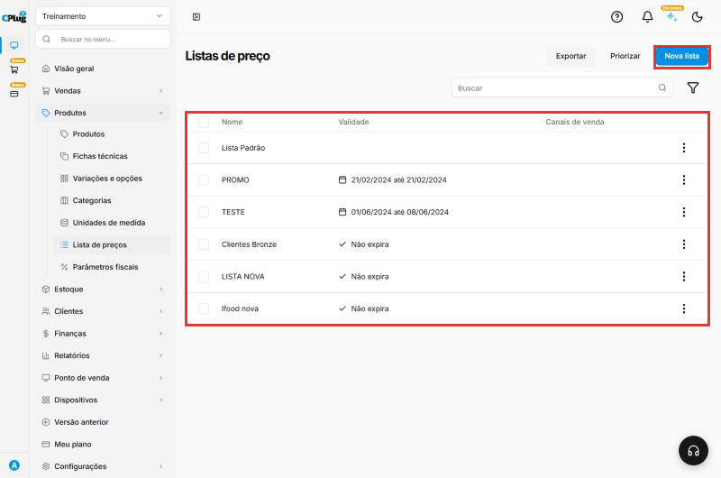
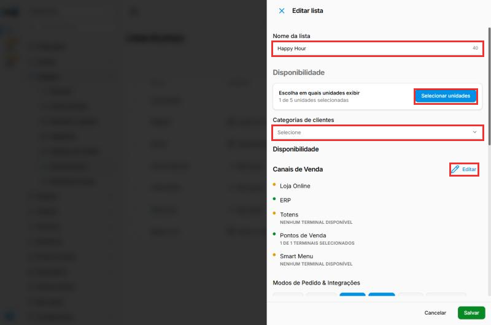
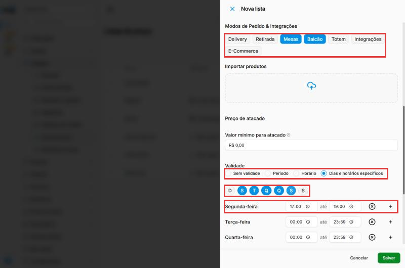
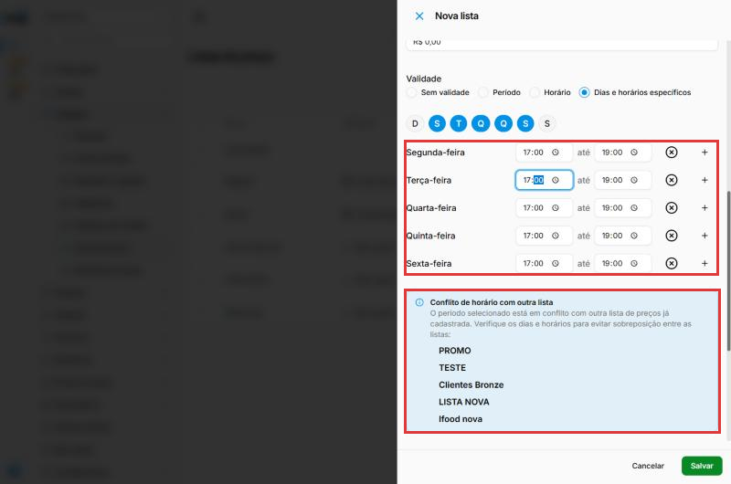
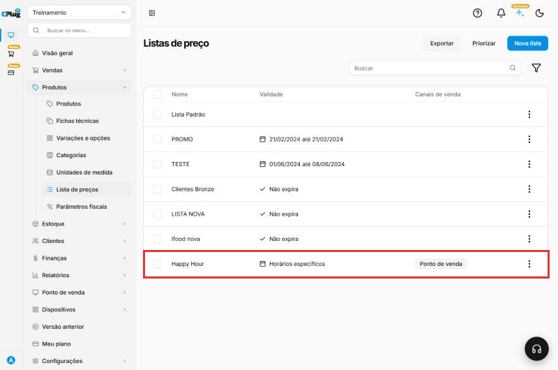
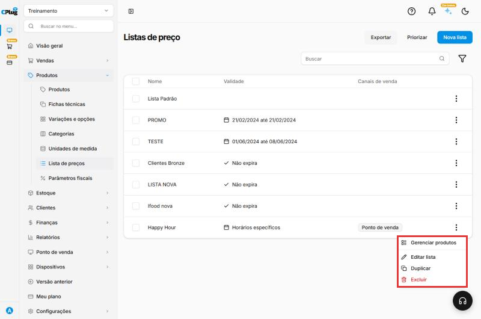
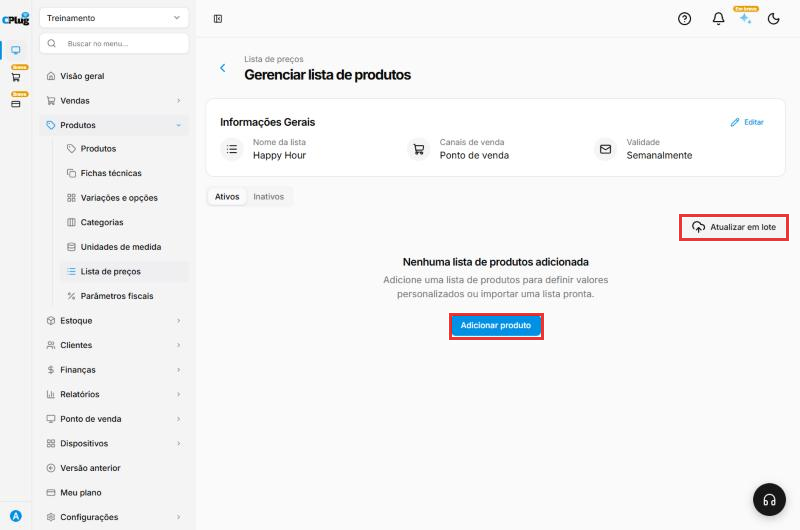
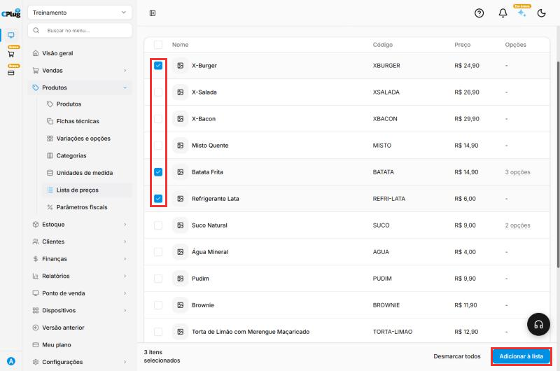
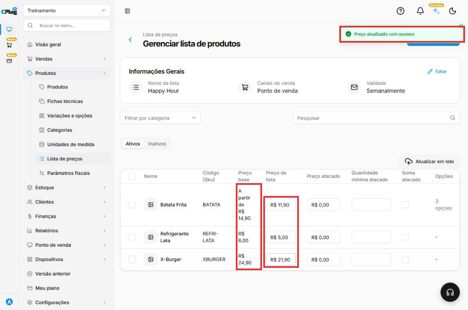
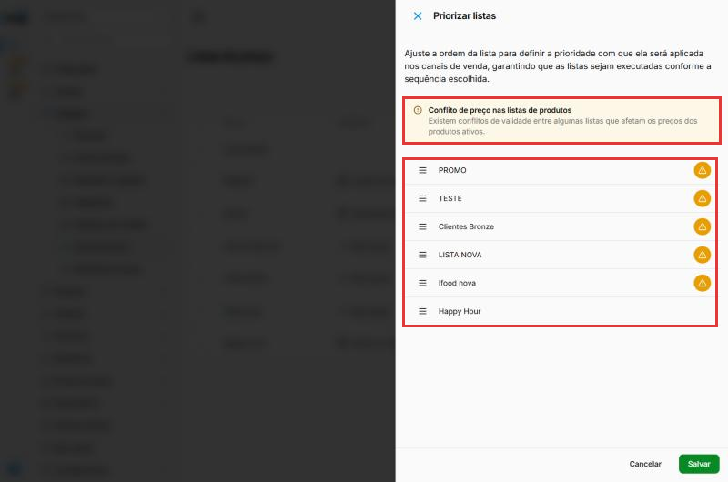

# Como criar uma lista de preços

:material-clock-outline: 10 minutos · :material-format-list-numbered: 8 passos · :material-calendar-check: Atualizado em 31/10/2026

A **lista de preços** permite cobrar **outro preço** pelo mesmo produto em situações específicas, sem mexer no preço normal. Exemplos:

- **Happy hour:** lanches e bebidas mais baratos de segunda a sexta, das 17h às 19h.
- **Delivery:** preço diferente para pedidos de entrega.
- **Clientes especiais:** preço menor para uma categoria de clientes.
- **Atacado:** preço menor a partir de uma quantidade.

Neste manual criamos a lista **Happy Hour**, com X-Burger, Batata Frita e Refrigerante Lata mais baratos.

Nos prints, o **quadrado vermelho** mostra onde você deve clicar ou digitar.

## Abra as listas de preço

No menu do lado esquerdo, clique em **Produtos** e depois em **Lista de preços**. A **Lista Padrão** é a dos preços normais dos produtos: todo produto novo entra nela. A tela mostra cada lista com a **Validade** (por exemplo, "Não expira" ou um período) e os **Canais de venda**. O botão **Exportar** gera um arquivo com as listas.

Clique em **Nova lista**, no canto de cima, à direita.

{ loading=lazy }

## Dê um nome e diga onde a lista vale

- **Nome da lista:** exemplo, "Happy Hour".
- **Selecionar unidades:** as lojas onde a lista vale. A loja atual já vem marcada.
- **Categorias de clientes:** para valer só para clientes de uma categoria (por exemplo, "Clientes VIP"), escolha aqui. Para valer para todos, deixe em branco.
- **Canais de Venda:** onde a lista vale (Loja Online, ERP, Totens, Pontos de Venda, Smart Menu). Clique em **Editar** para escolher os canais e os terminais.

{ loading=lazy }

## Escolha os modos de pedido e a validade

Role o formulário para baixo.

- **Modos de Pedido & Integrações:** clique para ligar (azul) ou desligar (branco) cada modo: Delivery, Retirada, Mesas, Balcão, Totem, Integrações e E-Commerce. No happy hour, deixamos só **Mesas** e **Balcão**.
- **Validade:** quando a lista vale.
    - **Sem validade:** vale sempre.
    - **Período:** entre duas datas (por exemplo, uma promoção de uma semana).
    - **Horário:** numa faixa de horário todos os dias.
    - **Dias e horários específicos:** escolha os dias da semana (D S T Q Q S S) e, para cada dia, o horário de início e de fim. No exemplo, de segunda a sexta, das 17:00 às 19:00.

{ loading=lazy }

## Confira o aviso de conflito

Se já existir outra lista valendo nos mesmos dias e horários, aparece o aviso **Conflito de horário com outra lista**, com o nome delas. Você pode salvar mesmo assim e depois definir qual lista tem prioridade (passo 8).

{ loading=lazy }

Clique em **Salvar**, no canto de baixo, à direita. A lista aparece na tela de listas, com a validade e o canal de venda.

{ loading=lazy }

## Adicione os produtos à lista

Nos **três pontinhos** da linha da lista, clique em **Gerenciar produtos**. (Ali também ficam **Editar lista**, **Duplicar** e **Excluir**.)

{ loading=lazy }

Na tela **Gerenciar lista de produtos**, clique em **Adicionar produto**.

{ loading=lazy }

## Escolha os produtos

Marque a caixinha de cada produto que vai ter preço diferente nesta lista. No rodapé, aparece quantos itens estão selecionados. Clique em **Adicionar à lista**.

{ loading=lazy }

## Defina os preços da lista

Para cada produto, a tabela mostra o **Preço base** (o preço normal) e o campo **Preço da lista**. Clique no **Preço da lista**, digite o novo preço e clique fora do campo. Aparece a mensagem **Preço atualizado com sucesso**: o preço já fica salvo.

No exemplo: Batata Frita R$ 11,90, Refrigerante Lata R$ 5,00 e X-Burger R$ 21,90.

{ loading=lazy }

Nas outras colunas:

- **Preço atacado** e **Quantidade mínima atacado:** a partir dessa quantidade, vale o preço de atacado. Exemplo: Refrigerante Lata a R$ 4,50 a partir de 12 latas. Como o Preço da lista, salva sozinho ao sair do campo, com a mensagem **Preço atualizado com sucesso**.
- **Soma atacado:** a caixinha marca o produto como elegível ao atacado (é o nome do campo no sistema). Na dúvida sobre como usar, fale com o suporte.
- **Opções:** em produtos com variações, quantas opções o produto tem.

No topo da tela ficam também:

- **Ativos** e **Inativos:** separam os produtos ativos e inativos da lista.
- **Atualizar em lote:** muda os preços por planilha. Clique em **Baixar modelo (.XLSX)**, preencha a planilha e envie em **Importar produtos**. Ligue **Considerar novos produtos da planilha?** se a planilha trouxer produtos que ainda não estão na lista. Depois clique em **Importar**.
- **Exportar produtos:** gera um arquivo com os produtos e preços da lista.
- **Editar**, em **Informações Gerais:** volta ao cadastro da lista (nome, canais, modos e validade).

## Defina a prioridade entre as listas

Quando duas listas valem ao mesmo tempo, o sistema usa a ordem de prioridade. Na tela de listas, clique em **Priorizar** e **arraste** as listas (pelos tracinhos à esquerda) para colocar em primeiro lugar a que deve valer. Clique em **Salvar**.

{ loading=lazy }

!!! tip "Produtos com variações"
    Para produtos com opções (como a Batata Frita P, M e G), a coluna **Opções** mostra quantas existem. O preço de cada opção pode ser diferente.

## Deu algum problema?

??? question "O caixa continua cobrando o preço normal"
    Confira: o **horário e o dia** da validade, o **canal de venda** (o terminal do caixa precisa estar marcado), o **modo de pedido** (Mesas, Balcão...) e a **prioridade** entre as listas.

??? question "Apareceu \"O preenchimento é obrigatório\" ao salvar"
    O **Nome da lista** está vazio. Role até o topo do formulário e preencha.

??? question "Quero mudar muitos preços de uma vez"
    Na tela **Gerenciar lista de produtos**, use **Atualizar em lote**.

**Relacionados:** [Como cadastrar um produto](cadastrar-produto.md) · [Como cadastrar um produto com variações](cadastrar-produto-com-variacoes.md)

lista de preços tabela de preço preço diferente happy hour promoção delivery atacado preço atacado quantidade mínima canal de venda modo de pedido validade horário dias específicos período prioridade priorizar conflito categoria de cliente gerenciar produtos preço base preço da lista soma atacado atualizar em lote planilha importar exportar ativos inativos
