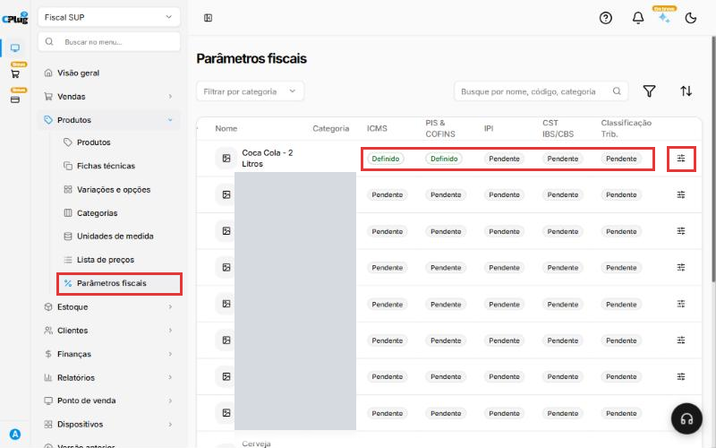
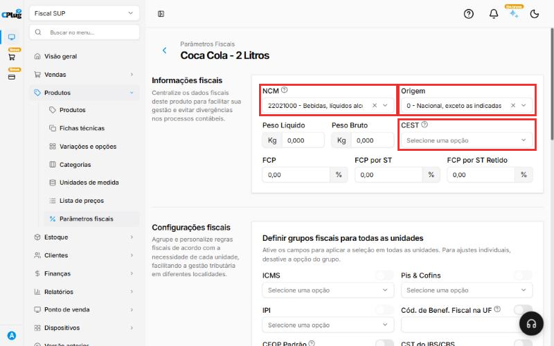
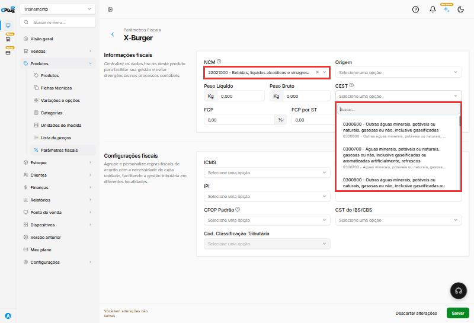
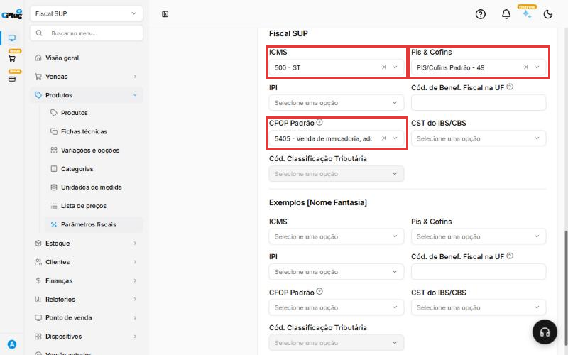
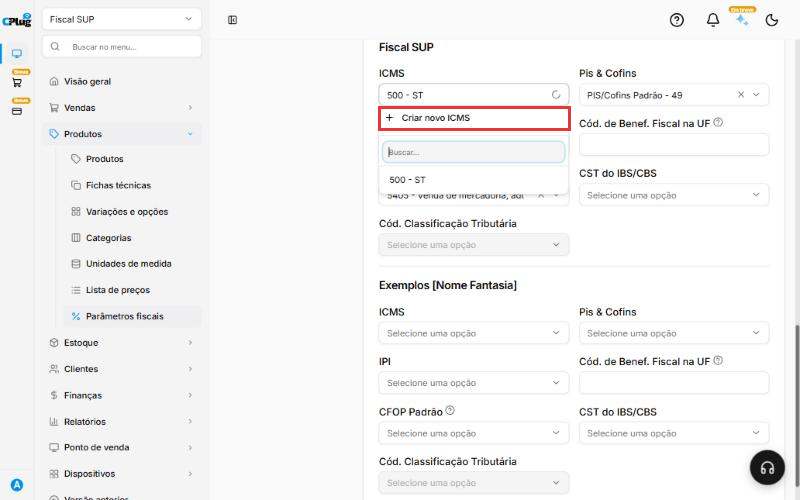
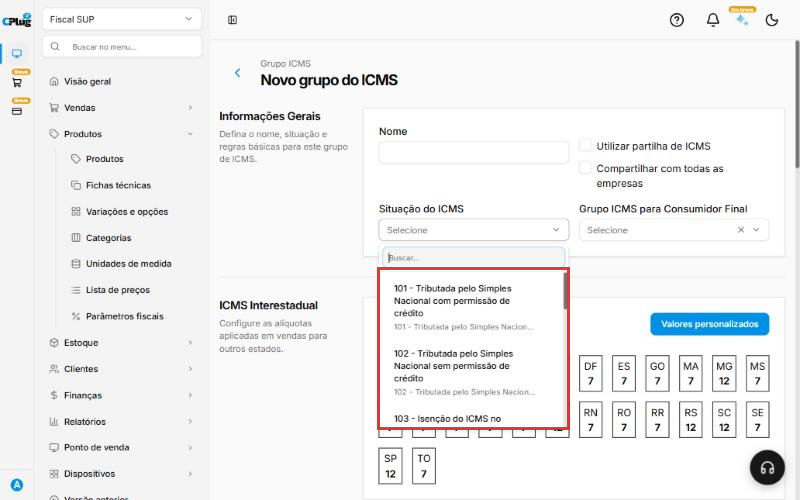
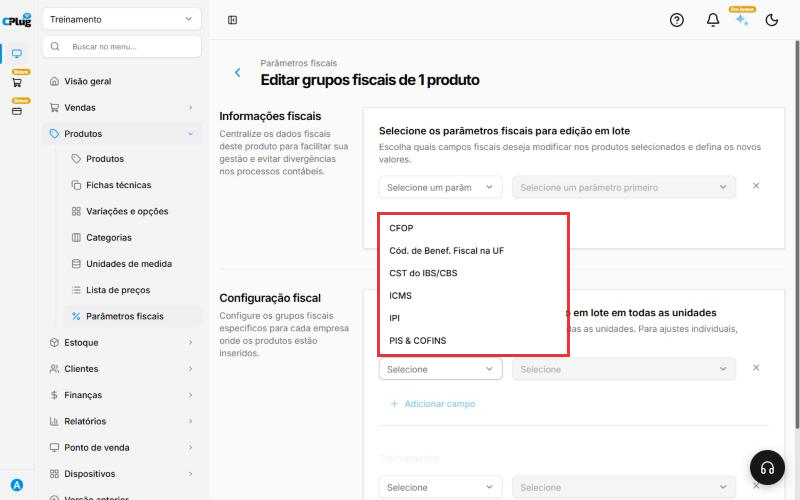

# Como configurar os dados fiscais de um produto

:material-clock-outline: 15 minutos (depois, 2 minutos por produto) · :material-format-list-numbered: 6 passos · :material-calendar-check: Atualizado em 31/10/2026

Todo produto vendido com **nota fiscal** (o cupom do caixa, NFC-e, ou a NF-e) precisa dos dados fiscais preenchidos. Sem eles, o produto até aparece no caixa, mas a nota é **recusada pela Sefaz** ou nem chega a ser emitida.

Esta é uma das principais causas de nota recusada. Vale a pena entender o conceito antes de preencher.

!!! warning "Quem define os códigos fiscais é o seu contador"
    Este manual mostra **onde** e **como** preencher. **Quais** códigos usar (NCM, CFOP, situação do ICMS, PIS/COFINS) depende do produto, do estado e do regime da sua empresa, e quem decide é o contador.

    Antes de começar, peça ao contador uma lista com, para cada produto: **NCM**, **CEST** (se tiver), **Origem**, **ICMS**, **PIS/COFINS** e **CFOP**.

## Entenda o conceito

Quando você vende com nota, o sistema **monta a nota fiscal** juntando três fontes de informação:

1. **Os dados da sua empresa:** CNPJ, endereço e regime tributário (Simples Nacional ou regime normal).
2. **Os dados do produto:** o que ele é (NCM), de onde vem (Origem) e se tem substituição tributária (CEST). Ficam em **Informações fiscais**.
3. **As regras de imposto:** como o ICMS, o PIS/COFINS e o IPI aparecem na nota, e o tipo de operação (CFOP). Ficam em **Configurações fiscais**.

A Sefaz confere tudo isso. Se um código estiver faltando ou não combinar com o outro, a nota é recusada.

### O que é um grupo fiscal

O ICMS, o PIS/COFINS e o IPI não são preenchidos produto por produto. Você cria um **grupo fiscal**, que guarda a regra do imposto, e escolhe esse grupo em cada produto.

Exemplo: o contador diz que quase todos os seus produtos usam o ICMS "102". Você cria **um** grupo chamado "Simples Nacional - 102" e escolhe esse grupo em todos esses produtos. Os refrigerantes, que têm substituição tributária, usam outro grupo, por exemplo "Bebidas com ST - 500".

É como uma etiqueta: o grupo diz "este produto segue a regra X". Por isso, cuidado ao alterar um grupo que já está em uso: confirme com o contador antes.

### O que é cada campo

Os exemplos abaixo são só para você reconhecer os códigos. **Não copie sem confirmar com o contador.**

| Campo | O que é, em palavras simples | Exemplo comum |
| --- | --- | --- |
| **NCM** | Código de 8 números que diz o que o produto é. É o mesmo em todo o Brasil. Define a tributação e a classificação do produto. | Refrigerante: 2202.10.00 |
| **CEST** | Código que identifica produtos com substituição tributária (ST). Só abre depois de escolher o NCM, e a lista mostra os CESTs ligados àquele NCM. Nem todo produto tem. | Depende do produto |
| **Origem** | De onde vem a mercadoria: nacional (códigos 0, 3, 4, 5 e 8) ou estrangeira (1, 2, 6 e 7). | 0 - Nacional |
| **Peso líquido** e **Peso bruto** | O peso do produto, em quilos. | Preencha se o contador pedir |
| **FCP** | Fundo de Combate à Pobreza: um adicional do ICMS cobrado em alguns estados e produtos. Há também o **FCP por ST** e o **FCP por ST retido**. | Em geral, 0,00 |
| **ICMS** | Grupo que diz como o ICMS aparece na nota. No Simples Nacional, os códigos têm 3 números (CSOSN); no regime normal, 2 números (CST). | 102 - Simples Nacional sem permissão de crédito |
| **Pis & Cofins** | Grupo que diz como o PIS e a COFINS aparecem na nota. | Definido pelo contador |
| **IPI** | Imposto de indústria. A maioria do comércio e da alimentação não usa. | Em geral, fica vazio |
| **Cód. de Benef. Fiscal na UF** | Código de benefício fiscal do seu estado. Tem 8 caracteres: a sigla do estado e mais 6 (exemplo do sistema: SP123456). | Só se o contador informar |
| **CFOP Padrão** | O tipo de operação da venda. | 5101 · 5102 · 5405 (veja abaixo) |
| **CST do IBS/CBS** e **Cód. Classificação Tributária** | Campos novos da reforma tributária. A classificação só abre depois de escolher o CST, e as opções dependem dele. | Preencha quando o contador orientar |

### Entendendo o CFOP de venda

O CFOP diz **que tipo de venda** está acontecendo. Os três mais comuns no comércio e na alimentação:

- **5101 - Venda de produção do estabelecimento:** o produto é **feito por você**, como o X-Burger preparado na cozinha.
- **5102 - Venda de mercadoria adquirida de terceiros:** o produto é **comprado pronto e revendido**, como um chocolate.
- **5405 - Venda de mercadoria com substituição tributária:** revenda de produto em que o imposto já foi recolhido antes, na compra, como acontece com muitos refrigerantes.

!!! danger "Na NFC-e (cupom do caixa) só valem alguns CFOPs"
    Segundo o próprio sistema, a NFC-e aceita apenas os CFOPs **5101, 5102, 5103, 5104, 5115, 5405, 5656, 5667 e 5933**. A lista do sistema também mostra o **5910** (bonificação, doação ou brinde) e o **5949** (outras saídas). Eles **não** servem para a NFC-e: use só com orientação do contador, em NF-e.

Nos prints, o **quadrado vermelho** mostra onde você deve clicar ou digitar.

## Abra a tela de parâmetros fiscais

No menu do lado esquerdo, clique em **Produtos** e depois em **Parâmetros fiscais**.

A lista mostra todos os produtos e a situação de cada imposto: **Definido** (já configurado) ou **Pendente** (falta configurar). Todo produto com **Pendente** em ICMS, PIS & COFINS ou CFOP pode dar problema na nota.

Para achar o que falta, clique no **funil** (Filtrar). Em **Grupos fiscais**, escolha **Pendentes** no ICMS, no Pis & Cofins ou no IPI e clique em **Aplicar filtros**. A lista mostra só os produtos que ainda precisam de atenção.

{ loading=lazy }

## Abra o produto

No fim da linha do produto, clique no **ícone de ajustes** (o desenho de três tracinhos com bolinhas). Se não aparecer, role a tabela para a direita.

Para encontrar um produto mais rápido, digite o nome na caixa de busca, no topo, ou escolha a categoria em **Filtrar por categoria**.

## Preencha as informações fiscais do produto

Na parte **Informações fiscais**:

- **NCM:** clique, digite o código ou parte do nome (ex.: "bebidas" ou "2202") e escolha a opção certa na lista.
- **Origem:** escolha de onde vem o produto. Na maioria dos casos, **0 - Nacional**.
- **CEST:** preencha só se o contador informar. O campo fica cinza até você escolher o NCM; depois, mostra só os CESTs que combinam com aquele NCM.

**Peso líquido**, **Peso bruto** e os campos de **FCP** só precisam ser preenchidos se o contador pedir.

{ loading=lazy }

{ loading=lazy }

## Escolha os grupos fiscais da sua loja

Role a tela até a parte **Configurações fiscais** e escolha:

- **ICMS:** o grupo de ICMS que o contador indicou.
- **Pis & Cofins:** o grupo de PIS e COFINS.
- **CFOP Padrão:** o tipo de operação, por exemplo 5101, 5102 ou 5405.
- **IPI:** só se a sua empresa usar.
- **Cód. de Benef. Fiscal na UF**, **CST do IBS/CBS** e **Cód. Classificação Tributária:** só com orientação do contador. A classificação fica cinza até você escolher o CST do IBS/CBS.

Se a empresa tem **mais de uma loja (filial)**, a tela mostra uma seção com o **nome de cada loja**. Escolha os grupos na seção da sua loja.

{ loading=lazy }

!!! tip "Tem várias lojas com as mesmas regras?"
    Com mais de uma loja, aparece no topo de **Configurações fiscais** o quadro **Definir grupos fiscais para todas as unidades**. Ligue a chave ao lado do campo (por exemplo, ICMS) e escolha o grupo uma vez só: ele vale para todas as lojas. Desligue a chave quando uma loja precisar de um grupo diferente, por exemplo, uma loja em outro estado.

## Se o grupo ainda não existe, crie

Se a sua empresa ainda não tem grupos, as listas de ICMS, Pis & Cofins e IPI aparecem **vazias**, com a mensagem "Nenhum resultado encontrado". É preciso criar os grupos uma primeira vez.

1. Clique na caixa do imposto (por exemplo, **ICMS**). No topo da lista, clique em **+ Criar novo ICMS**.

    { loading=lazy }

2. Em **Nome**, use um nome fácil de reconhecer, que diga a regra. Exemplo: "Simples Nacional - 102" ou "Bebidas com ST - 500".
3. Em **Situação do ICMS**, escolha o código que o contador indicou.

    { loading=lazy }

    { loading=lazy }

4. As **alíquotas por estado** (ICMS interestadual, ICMS padrão, FCP e ICMS ST) já vêm preenchidas. **Só altere com orientação do contador.**
5. Clique em **Salvar**. O grupo novo passa a aparecer na lista do produto.

O mesmo vale para **Pis & Cofins** e **IPI**: clique na caixa e use a opção **+ Criar novo**, no topo da lista.

## Clique em "Salvar"

Depois de preencher tudo, clique no botão verde **Salvar**, no canto de baixo, à direita. Para sair sem gravar, clique em **Descartar alterações**.

!!! success "Como saber que deu certo"
    Volte para **Produtos → Parâmetros fiscais**. O produto passa a mostrar **Definido** nas colunas que você preencheu. Faça uma venda de teste com nota e confira se ela é autorizada.

## Configurar vários produtos de uma vez

Se vários produtos usam os mesmos códigos (por exemplo, todos os refrigerantes), não precisa abrir um por um:

1. Na lista de **Parâmetros fiscais**, marque a caixinha do lado esquerdo de cada produto. Dica: filtre pela categoria antes, e marque todos de uma vez.
2. No rodapé, clique em **Edição em lote**.
3. Em **Informações fiscais**, clique em **Adicionar campo**, escolha o campo (por exemplo, **NCM**) e o valor.
4. Em **Configuração fiscal**, clique em **Adicionar campo**, escolha o grupo (por exemplo, **ICMS**) e a opção.
5. Clique em **Salvar**. Todos os produtos marcados recebem os mesmos dados.

{ loading=lazy }

!!! tip "Boas práticas"
    - **Comece pela planilha do contador.** Peça uma lista com os dados fiscais de cada produto, ou de cada categoria. Com ela em mãos, o trabalho é só copiar.
    - **Crie os grupos primeiro, depois os produtos.** Com os grupos prontos, preencher cada produto leva poucos segundos, e a **Edição em lote** resolve categorias inteiras.
    - **Dê nomes que expliquem a regra.** "Simples Nacional - 102" diz tudo; "Grupo 1" não diz nada e confunde quem vem depois.
    - **Produto novo já nasce com fiscal.** Sempre que cadastrar um produto, abra os parâmetros fiscais dele no mesmo dia. Assim ele nunca vai para o caixa com "Pendente".
    - **Confira os pendentes toda semana.** Use o filtro **Pendentes** para ver o que ficou para trás.
    - **Teste antes de vender.** Depois de configurar um tipo novo de produto, faça uma venda de teste com nota e confira se foi autorizada.
    - **Mudou de regime ou de contador?** Peça uma revisão dos grupos fiscais. Uma regra antiga num grupo afeta todos os produtos que usam esse grupo.

## Deu algum problema?

??? question "A nota foi recusada por causa do NCM"
    O NCM precisa ter 8 números e existir na tabela oficial. Confira o código com o contador, corrija no produto e emita a nota de novo.

??? question "A nota foi recusada por causa do CFOP"
    Confira se o CFOP do produto é um dos aceitos na NFC-e: **5101, 5102, 5103, 5104, 5115, 5405, 5656, 5667 ou 5933**. O 5910 e o 5949, por exemplo, não são aceitos no cupom do caixa.

??? question "O campo CEST está cinza e não abre"
    Escolha primeiro o **NCM**. O CEST só abre depois, e mostra apenas os códigos ligados ao NCM escolhido. Se a lista vier vazia, o NCM não tem CEST.

??? question "O campo Cód. Classificação Tributária está cinza"
    Escolha primeiro o **CST do IBS/CBS**. A classificação depende dele.

??? question "A lista de grupos (ICMS, Pis & Cofins) está vazia"
    Ainda não existe nenhum grupo para a sua loja. Crie o grupo pela opção **+ Criar novo**, no topo da lista, como no passo 5, com os dados que o contador passou.

??? question "Salvei, mas o produto continua \"Pendente\""
    Confira se você preencheu a seção da **loja certa**. Cada loja tem a própria seção em **Configurações fiscais**. Confira também se escolheu um grupo em cada imposto que aparece como Pendente.

??? question "Tenho lojas em estados diferentes"
    As regras podem mudar de um estado para outro. Desligue a opção **Definir grupos fiscais para todas as unidades** para esse imposto e escolha o grupo certo na seção de cada loja.

??? question "Não sei qual código usar"
    Quem define é o contador da sua empresa. O suporte da CPlug ajuda a encontrar **onde** preencher no sistema, mas não define a tributação dos produtos.

**Relacionados:** [Como cadastrar um produto](cadastrar-produto.md) · [Como cadastrar um cliente](../clientes/cadastrar-cliente.md)

fiscal tributação imposto ncm cest cfop cst csosn icms pis cofins ipi origem nota fiscal nfc-e nf-e rejeição recusada sefaz parâmetros fiscais grupo fiscal ibs cbs reforma tributária substituição tributária st fcp fundo de combate à pobreza benefício fiscal classificação tributária 5101 5102 5405 pendente definido edição em lote
