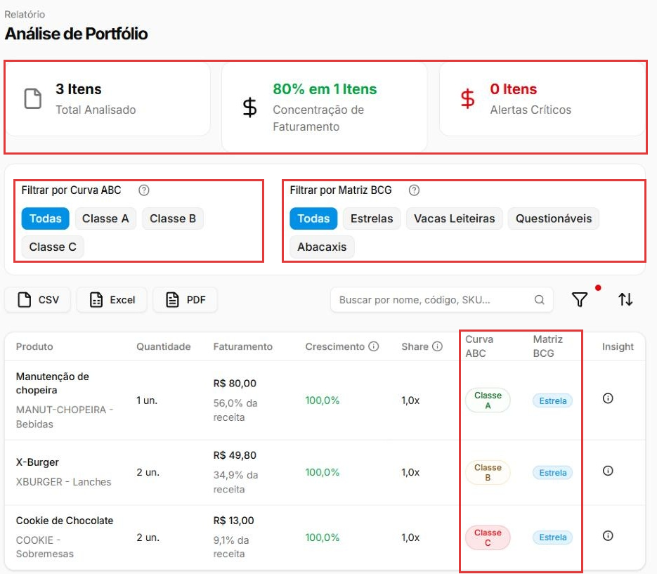
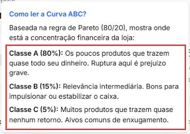
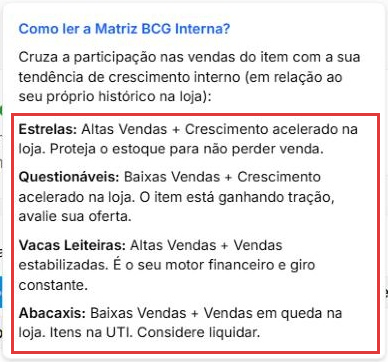
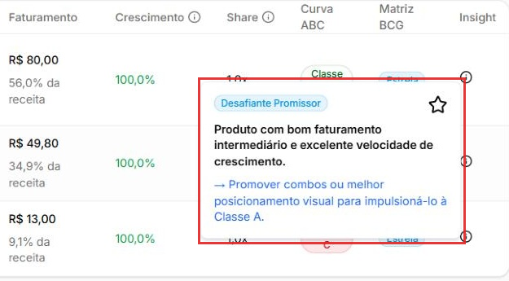

# Como usar a análise de portfólio (Curva ABC e Matriz BCG)

:material-clock-outline: 7 minutos · :material-format-list-numbered: 4 passos · :material-calendar-check: Atualizado em 28/11/2026

A **Análise de Portfólio** mostra quais produtos trazem mais dinheiro para a loja e como cada um está indo: crescendo, estável ou caindo. Ela classifica os produtos de duas formas, a **Curva ABC** e a **Matriz BCG**, e dá uma sugestão para cada um. Exemplo: o dono vê que um único produto responde por 56% do faturamento dos últimos 30 dias. Ele sabe que esse item merece atenção especial: se parar de vender, a loja perde mais da metade do faturamento.

## Entenda o conceito

**Curva ABC.** Separa os produtos pelo peso no faturamento, com base na regra de Pareto (80/20):

| Classe | O que quer dizer |
| --- | --- |
| **Classe A** (80%) | Os poucos produtos que trazem quase todo o dinheiro. Ruptura (faltar no estoque) aqui é prejuízo grave. |
| **Classe B** (15%) | Relevância intermediária. Bons para impulsionar ou estabilizar o caixa. |
| **Classe C** (5%) | Muitos produtos que trazem quase nenhum retorno. Alvos comuns de enxugamento. |

**Matriz BCG.** Cruza a participação do produto nas vendas com o crescimento dele na própria loja:

| Grupo | O que quer dizer |
| --- | --- |
| **Estrelas** | Altas vendas e crescimento acelerado. Proteja o estoque para não perder venda. |
| **Questionáveis** | Baixas vendas e crescimento acelerado. O item está ganhando tração: avalie a oferta. |
| **Vacas Leiteiras** | Altas vendas e vendas estabilizadas. É o motor financeiro, com giro constante. |
| **Abacaxis** | Baixas vendas e vendas em queda. São itens "na UTI": considere liquidar. |

**As colunas da tabela.** Para cada produto aparecem a **Quantidade** vendida, o **Faturamento** (com a parte dele na receita, por exemplo **56,0% da receita**), o **Crescimento** (a variação do faturamento em relação ao período anterior; negativo é queda), o **Share** (a participação do produto em relação ao líder da categoria, que fica com **1,0x**; a partir de 0,5 é alta dominância — por exemplo, **0,5x** quer dizer que o produto fatura metade do líder da categoria), a **Curva ABC**, a **Matriz BCG** e o **Insight** (ao passar o mouse no ⓘ, um resumo do produto e uma sugestão do que fazer).

**Os quadros do alto.** **Total Analisado** é quantos produtos entraram na análise. **Concentração de Faturamento** mostra quantos produtos formam a faixa dos 80% do faturamento, a Classe A (no exemplo, **80% em 1 Itens**: só um produto está na Classe A, e ele sozinho traz 56,0% da receita). **Alertas Críticos** mostra quantos alertas a análise encontrou (no exemplo, **0 Itens**); na dúvida sobre o que gera um alerta, fale com o suporte.

**De onde vêm os números.** A análise usa as vendas registradas. Use o resultado para repor o [estoque](estoque.md) e montar [promoções](../vendas/criar-promocao.md).

**Quando usar:** para decidir o que repor primeiro, o que promover e o que tirar do cardápio ou da prateleira. **Quando não usar:** para ver o total vendido em reais por dia ou por forma de pagamento; para isso, veja [Como ver o relatório de vendas](vendas.md).

!!! info "Antes de começar"
    - A análise usa as vendas do período escolhido (vem com os **últimos 30 dias**). Com poucas vendas, as classificações dizem pouco.
    - Os botões **CSV**, **Excel** e **PDF** servem para levar a análise para fora do sistema.

Nos prints, o **quadrado vermelho** mostra onde você deve clicar ou digitar.

## Abra a análise de portfólio

No menu do lado esquerdo, clique em **Relatórios** → **Financeiro** → **Análise de Portfólio**. No alto ficam os quadros de resumo; abaixo, os filtros por **Curva ABC** e por **Matriz BCG** e a tabela dos produtos, do maior para o menor faturamento.

{ loading=lazy }

## Entenda a Curva ABC e a Matriz BCG

Clique no **?** ao lado de **Filtrar por Curva ABC** para ver a explicação das classes. O **?** ao lado de **Filtrar por Matriz BCG** explica os quatro grupos. Clique fora da explicação para fechá-la.

{ loading=lazy }

{ loading=lazy }

Para ver só uma classe, clique nela: em **Classe A**, por exemplo, a tabela mostra só os produtos da Classe A. Clique em **Todas** para voltar a ver todos.

## Veja a sugestão de cada produto

Passe o mouse sobre o **ⓘ** da coluna **Insight** (não precisa clicar). Aparece um resumo do produto e uma sugestão. No exemplo, o X-Burger aparece como **Desafiante Promissor**: produto com bom faturamento intermediário e excelente velocidade de crescimento, com a sugestão de **promover combos ou melhor posicionamento visual para impulsioná-lo à Classe A**.

{ loading=lazy }

## Filtre, ordene ou busque produtos (opcional)

- **Funil:** abre o painel **Filtrar**. Em **Período**, escolha **Últimos 30 dias**, **Último trimestre** ou **Personalizado** (para escolher as datas de início e fim). Em **Categoria**, escolha uma categoria para ver só os produtos dela, como Lanches. O **Tipo de exibição** vem em **Por variação**; na dúvida sobre **Por produto (Agrupado)**, fale com o suporte. Clique em **Aplicar filtros**.
- **Setas (⇅):** escolhem a ordem da tabela: **Produto**, **Quantidade**, **Faturamento**, **Crescimento** ou **Share**, em ordem **Crescente** ou **Decrescente**.
- **Buscar por nome, código, SKU:** procura um produto na tabela.

!!! tip "Boas práticas"
    - **Nunca deixe faltar a Classe A:** são os poucos produtos que trazem a maior parte do dinheiro.
    - **Olhe a Classe C com calma:** antes de tirar um produto, veja se ele não atrai clientes que compram outras coisas.
    - **Acompanhe as Estrelas e as Questionáveis:** são os produtos em crescimento. Garanta estoque e destaque.
    - **Use um período maior:** **Último trimestre** dá uma visão mais estável que os últimos 30 dias, principalmente em lojas com poucas vendas.

## Deu algum problema?

??? question "Todos os produtos aparecem como Estrela"
    O crescimento é comparado com o período anterior. Se a loja começou a vender agora, todos crescem em relação a um período sem vendas. Com o tempo, a classificação fica mais útil.

??? question "Um produto não aparece na análise"
    Confira o período e a categoria no funil. Só entram produtos vendidos no período.

??? question "O número de Total Analisado não bate com a tabela"
    Depois de usar os filtros por Curva ABC ou Matriz BCG, o quadro **Total Analisado** pode continuar mostrando o número do filtro anterior. Confie na tabela. Se precisar do número certo no quadro, fale com o suporte.

??? question "Todos os produtos aparecem com Share 1,0x"
    O Share compara o produto com o líder da categoria dele. Se cada produto é o único vendido na sua categoria, todos ficam com **1,0x**.

**Relacionados:** [Como ver o relatório de vendas](vendas.md) · [Como ver o relatório de estoque](estoque.md) · [Como criar uma promoção](../vendas/criar-promocao.md) · [Guia dos relatórios: o que cada um mostra](guia-dos-relatorios.md)

análise de portfólio curva abc matriz bcg pareto 80/20 classe a classe b classe c estrelas vacas leiteiras questionáveis abacaxis produtos mais vendidos faturamento por produto crescimento share insight desafiante promissor concentração de faturamento alertas críticos mix de produtos
