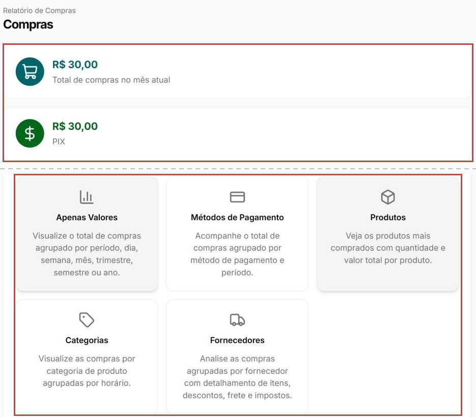
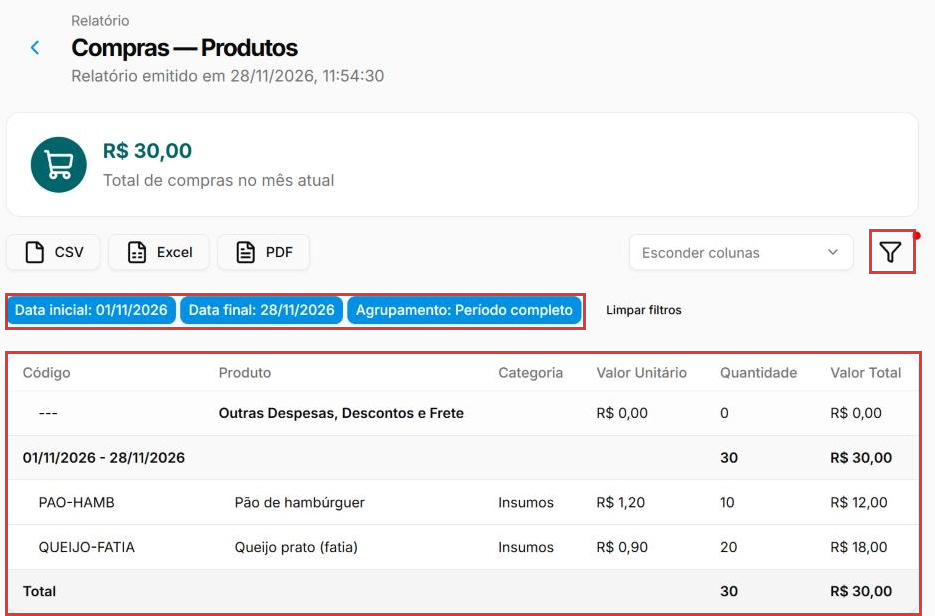

# Como ver o relatório de compras

:material-clock-outline: 5 minutos · :material-format-list-numbered: 3 passos · :material-calendar-check: Atualizado em 28/11/2026

O **relatório de compras** mostra quanto a loja comprou dos fornecedores num período e o quê: o total, as formas de pagamento, os produtos e os fornecedores. Exemplo: no fim do mês, o dono quer saber quanto gastou com insumos. Ele abre o relatório por **Produtos** e vê que comprou 10 pães a R$ 1,20 e 20 fatias de queijo a R$ 0,90, num total de **R$ 30,00**.

## Entenda o conceito

**De onde vêm os dados.** O relatório usa as compras lançadas em **Estoque** → **Compras** (veja [Como lançar uma compra](../estoque/lancar-compra.md)). Uma compra salva já entra no relatório, mesmo antes de ser marcada como recebida.

**Os quadros do alto.** **Total de compras no mês atual** soma as compras do mês. Abaixo, aparece o total por forma de pagamento usada no mês (no exemplo, só **PIX**, com R$ 30,00).

**Os tipos de relatório:**

| Tipo | O que mostra |
| --- | --- |
| **Apenas Valores** | O total das compras, agrupado por período, dia, dia da semana, semana, mês, trimestre, semestre e outros. |
| **Métodos de Pagamento** | O total das compras por forma de pagamento (no exemplo, **PIX** R$ 30,00). |
| **Produtos** | Cada produto comprado, com o **Valor Unitário**, a **Quantidade** e o **Valor Total**. Tem também a linha **Outras Despesas, Descontos e Frete**. |
| **Categorias** | As compras por categoria de produto, agrupadas por horário. |
| **Fornecedores** | As compras por fornecedor, com a **Data da Compra**, o **Valor dos Itens**, o **Desconto**, as **Outras Despesas**, os **Impostos**, o **Frete** e o **Valor Total**. |

**Compras × despesas.** Este relatório mostra o que foi **comprado**, mesmo que a compra ainda não tenha sido paga nem recebida. As contas a pagar dessas compras aparecem nas despesas (veja [Como ver o lucro e as despesas](lucro-e-despesas.md)).

**Quando usar:** para acompanhar quanto a loja gasta com mercadoria, comparar fornecedores e ver os produtos mais comprados. **Quando não usar:** para ver o que falta pagar, veja as despesas ou o [fluxo de caixa](fluxo-de-caixa.md); para saber o que já chegou ao estoque, veja [Como ver o relatório de estoque](estoque.md).

!!! info "Antes de começar"
    - As compras precisam estar lançadas em **Estoque** → **Compras**.

Nos prints, o **quadrado vermelho** mostra onde você deve clicar ou digitar.

## Abra o relatório e escolha o tipo

No menu do lado esquerdo, clique em **Relatórios** → **Financeiro** → **Compras**. No alto ficam os quadros do mês; abaixo, em **Tipo de relatórios**, clique no tipo que você quer. Para voltar à escolha do tipo, clique na seta **‹**, ao lado do título.

{ loading=lazy }

## Escolha o período e as opções

O relatório já abre com o mês atual, do dia 1º até hoje (no exemplo, 01/11/2026 a 28/11/2026); as etiquetas azuis mostram os filtros em uso. Para mudar, clique no **funil**. As opções mudam conforme o tipo:

- **Apenas Valores:** o **Agrupamento** decide o que cada linha soma. Vem **Por período** (a etiqueta mostra **Período completo**): uma linha só com o período inteiro. As outras opções são **Diário**, **Por dia da semana**, **Semanal**, **Mensal**, **Trimestral**, **Semestral** e mais algumas no fim da lista. Também tem a **Data inicial** e a **Data final**.
- **Categorias:** o **Agrupamento** (vem **Por hora**), a **Hora inicial**, as datas e as **Categorias**.
- **Fornecedores:** as datas, os **Fornecedores** e a opção **Exibir compras** (na dúvida sobre ela, fale com o suporte).

Clique em **Aplicar filtros**.

## Leia o resultado

No tipo **Produtos**, cada linha é um produto comprado, com o **Código**, o **Produto**, a **Categoria**, o **Valor Unitário**, a **Quantidade** e o **Valor Total**. A linha do período (no exemplo, **01/11/2026 - 28/11/2026**) soma os produtos daquele período, e a última linha é o **Total**. A **Quantidade** do total soma unidades diferentes (10 pães + 20 fatias = 30); para comparar, olhe o **Valor Total**. No exemplo: 10 × R$ 1,20 = R$ 12,00 de pão e 20 × R$ 0,90 = R$ 18,00 de queijo, total **R$ 30,00**.

Acima da tabela ficam **Esconder colunas** e os botões **CSV**, **Excel** e **PDF**, que servem para levar o relatório para fora do sistema.

{ loading=lazy }

!!! tip "Boas práticas"
    - **Compare fornecedores:** o tipo **Fornecedores** mostra quanto você comprou de cada um, com desconto, frete e impostos.
    - **Olhe o custo unitário:** no tipo **Produtos**, um valor unitário que sobe muito de um mês para outro pede uma conversa com o fornecedor.
    - **Lance todas as compras:** compra fora do sistema não aparece no relatório nem nas contas a pagar.

## Deu algum problema?

??? question "O relatório está zerado"
    Confira o período (o relatório abre do dia 1º do mês até hoje) e se as compras foram lançadas em **Estoque** → **Compras**.

??? question "O tipo Categorias não mostra nada"
    Confira o período, a **Hora inicial** e as **Categorias** escolhidas no funil. Se continuar aparecendo **Nenhum relatório gerado**, use o tipo **Produtos**, que também mostra a categoria de cada produto, e fale com o suporte.

??? question "Para que serve a linha Outras Despesas, Descontos e Frete?"
    É a linha reservada para outras despesas, descontos e frete das compras, que não pertencem a um produto. No exemplo, ela está zerada.

**Relacionados:** [Como lançar uma compra](../estoque/lancar-compra.md) · [Como ver o relatório de estoque](estoque.md) · [Como cadastrar um fornecedor](../estoque/cadastrar-fornecedor.md) · [Como ver o lucro e as despesas](lucro-e-despesas.md) · [Guia dos relatórios: o que cada um mostra](guia-dos-relatorios.md)

relatório de compras compras do mês quanto comprei compras por fornecedor compras por produto produtos mais comprados compras por forma de pagamento compras por categoria apenas valores agrupamento outras despesas descontos e frete impostos custo unitário
