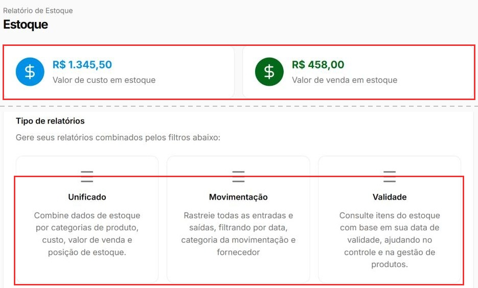
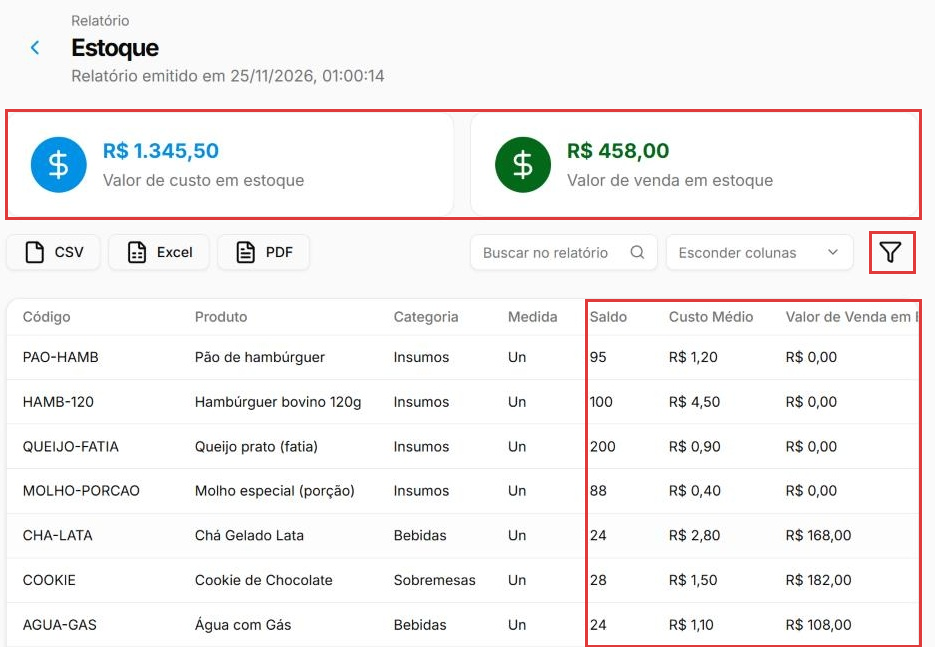
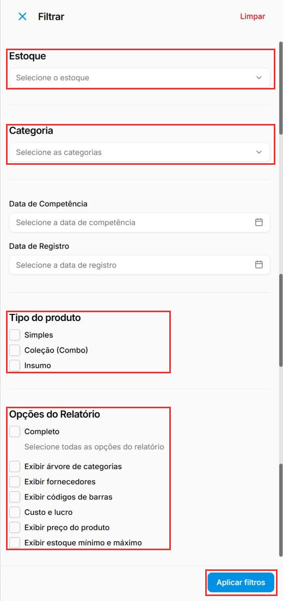
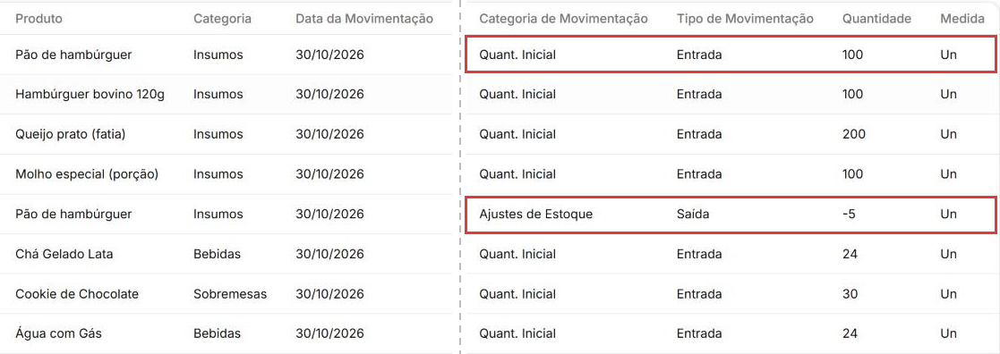

# Como ver o relatório de estoque

:material-clock-outline: 7 minutos · :material-format-list-numbered: 4 passos · :material-calendar-check: Atualizado em 28/11/2026

O **relatório de estoque** mostra o que a loja tem guardado e quanto isso vale: a quantidade de cada produto, o custo e o valor de venda. Também mostra as entradas e saídas de cada produto e a validade dos itens. Exemplo: no fim do mês, o dono quer saber quanto dinheiro está parado no estoque. Ele abre o relatório e vê que o estoque custou **R$ 1.345,50**.

## Entenda o conceito

**Os dois quadros do alto.** **Valor de custo em estoque** é quanto o estoque custou para a loja. **Valor de venda em estoque** é quanto ele renderia se fosse todo vendido pelo preço de venda. No exemplo, o valor de venda (R$ 458,00) é menor que o custo porque os insumos, como pão e queijo, não têm preço de venda: eles entram nos lanches, não são vendidos sozinhos.

**Os três tipos de relatório:**

| Tipo | O que mostra |
| --- | --- |
| **Unificado** | Uma linha por produto, com o **Saldo** (quantidade em estoque), o **Custo Médio** (quanto custou, em média, cada unidade) e o **Valor de Venda em Estoque**. Com as opções do relatório, mostra também fornecedores, códigos de barras, estoque mínimo e máximo, custo e lucro. |
| **Movimentação** | Cada entrada e saída do estoque, com a data, o estoque, a **Categoria de Movimentação** (por exemplo, **Quant. Inicial**, a quantidade lançada ao começar a usar o estoque, ou **Ajustes de Estoque**), o **Tipo de Movimentação** (**Entrada** ou **Saída**) e a **Quantidade**. |
| **Validade** | Os itens do estoque com a **Validade**, para controlar produtos que vencem. |

**Valor de venda em estoque.** É o saldo vezes o preço de venda. No exemplo, o **Chá Gelado Lata** tem 24 unidades a R$ 7,00: **R$ 168,00**.

**Quando usar:** para saber quanto vale o estoque, conferir o saldo de vários produtos de uma vez e rastrear de onde veio uma entrada ou saída. **Quando não usar:** para ver o saldo e o histórico de um produto só, use [Como consultar o saldo e o histórico do estoque](../estoque/saldo-do-estoque.md).

!!! info "Antes de começar"
    - Os valores dependem das entradas de estoque e do custo dos produtos (veja [Como dar entrada no estoque](../estoque/entrada-de-estoque.md)).

Nos prints, o **quadrado vermelho** mostra onde você deve clicar ou digitar.

## Abra o relatório e escolha o tipo

No menu do lado esquerdo, clique em **Relatórios** → **Logística** → **Estoque**. Abre a tela **Estoque**, com os dois quadros do alto. Em **Tipo de relatórios**, clique em **Unificado**, **Movimentação** ou **Validade**. Para voltar à escolha do tipo, clique na seta **‹**, ao lado do título.

{ loading=lazy }

## Leia o relatório unificado

No **Unificado**, cada linha é um produto, com o **Código**, o **Produto**, a **Categoria**, a **Medida**, o **Saldo**, o **Custo Médio** e o **Valor de Venda em Estoque**. A última linha, **Total**, soma tudo. Acima da tabela ficam **Buscar no relatório** e **Esconder colunas**. Os botões **CSV**, **Excel** e **PDF** servem para levar o relatório para fora do sistema.

{ loading=lazy }

## Escolha os filtros e as opções

Clique no **funil**. No painel **Filtrar**:

- **Estoque:** para ver só um estoque, se a loja tiver mais de um.
- **Categoria:** para ver só algumas categorias de produto.
- **Data de Competência** e **Data de Registro:** filtram por data; na dúvida sobre qual usar, fale com o suporte.
- **Tipo do produto:** para ver só os produtos de um tipo: **Simples**, **Coleção (Combo)** ou **Insumo** (ingredientes, como pão e queijo).
- **Opções do Relatório:** colunas a mais. **Completo** marca todas: **Exibir árvore de categorias**, **Exibir fornecedores**, **Exibir códigos de barras**, **Custo e lucro**, **Exibir preço do produto** e **Exibir estoque mínimo e máximo**.

Clique em **Aplicar filtros**.

{ loading=lazy }

Com **Completo**, a tabela ganha, entre outras, as colunas **Estoque Mín.**, **Estoque Máx.**, **Faltante p/ Mínimo**, **Fornecedores**, **Preço do Produto**, **Custo Estoque** e **Lucro**. No exemplo, o Chá Gelado Lata tem R$ 168,00 de valor de venda e R$ 67,20 de custo em estoque: lucro de **R$ 100,80**, ou 150% sobre o custo. Com tantas colunas, use **Esconder colunas** para tirar as que você não usa.

## Veja as movimentações

Clique na seta **‹** para voltar à escolha do tipo e clique em **Movimentação**. Abre **Movimentações de Estoque**, com os últimos 30 dias e todas as categorias de entrada e de saída escolhidas (as etiquetas acima da tabela mostram os filtros). Cada linha é uma movimentação. No exemplo, o pão de hambúrguer entrou com **Quant. Inicial** de 100 e também teve uma **Saída** de **-5** em **Ajustes de Estoque**, ficando com 95.

A tabela é larga: use a barra de rolagem embaixo dela para ver as colunas da direita.

{ loading=lazy }

!!! tip "Boas práticas"
    - **Acompanhe o valor parado:** o **Valor de custo em estoque** mostra quanto dinheiro está guardado em mercadoria. Estoque grande demais prende o dinheiro da loja.
    - **Use o estoque mínimo:** a opção **Exibir estoque mínimo e máximo** mostra as colunas **Estoque Mín.**, **Estoque Máx.** e **Faltante p/ Mínimo**, que ajudam a montar o pedido de compra. Se elas aparecem zeradas, os produtos estão sem estoque mínimo informado; na dúvida sobre onde informar, fale com o suporte.
    - **Use as movimentações para achar diferenças:** se o saldo não bate, veja as entradas e saídas do produto e procure ajustes ou saídas sem explicação.
    - **Confira os ajustes com um inventário:** veja [Como fazer um inventário](../estoque/inventario.md).

## Deu algum problema?

??? question "O valor de venda em estoque está zerado em alguns produtos"
    Esses produtos estão sem preço de venda, como acontece com os insumos. Para conferir, marque **Exibir preço do produto** nas Opções do Relatório. Se o produto deveria ter preço, confira o cadastro dele.

??? question "O lucro aparece -100% em alguns produtos"
    São produtos com valor de venda R$ 0,00, como os insumos: o relatório conta o custo e nenhuma venda.

??? question "O saldo de um produto está errado"
    Abra o tipo **Movimentação** e confira as entradas e saídas do produto. Para corrigir o saldo, faça um [inventário](../estoque/inventario.md) ou fale com o suporte.

??? question "A coluna Validade está em branco"
    A coluna fica em branco quando o produto não tem validade informada. Para saber como informar a validade dos produtos, fale com o suporte.

??? question "Não encontro uma categoria de movimentação"
    O relatório abre com todas as categorias escolhidas (no exemplo, 7 de entrada e 10 de saída). Se você tirou alguma nos filtros, abra os filtros e marque-a de novo. Para criar ou organizar categorias, veja [Como criar categorias de movimentação](../estoque/categorias-de-movimentacao.md).

**Relacionados:** [Como consultar o saldo e o histórico do estoque](../estoque/saldo-do-estoque.md) · [Como dar entrada no estoque](../estoque/entrada-de-estoque.md) · [Como fazer um inventário](../estoque/inventario.md) · [Como ver o lucro e as despesas](lucro-e-despesas.md)

relatório de estoque valor do estoque valor de custo em estoque valor de venda em estoque saldo custo médio unificado movimentação movimentações de estoque entradas e saídas validade vencimento estoque mínimo estoque máximo faltante para o mínimo fornecedores código de barras insumo combo ajuste de estoque quantidade inicial
