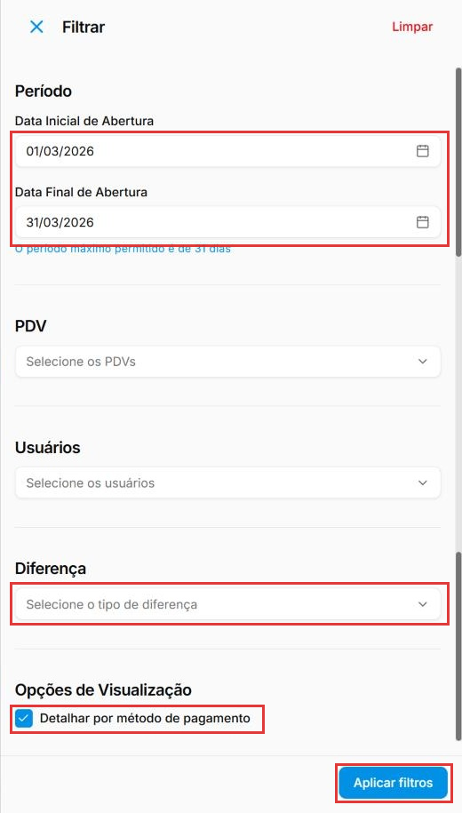
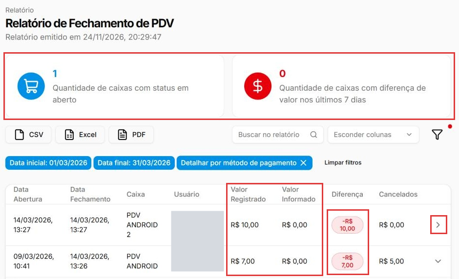
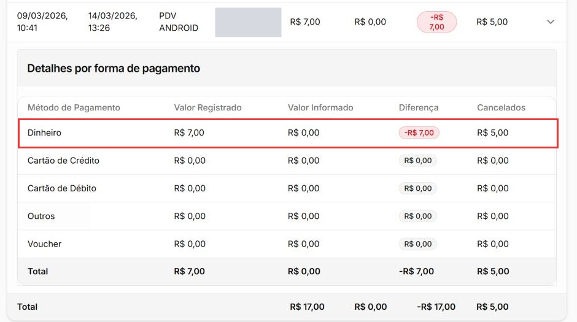

# Como ver o fechamento de caixa

:material-clock-outline: 6 minutos · :material-format-list-numbered: 4 passos · :material-calendar-check: Atualizado em 24/11/2026

O **relatório de fechamento de caixa** mostra cada caixa aberto no PDV (ponto de venda): quando abriu e fechou, quem operou, quanto o sistema registrou e quanto foi informado no fechamento. Exemplo: no fim do mês, o dono quer saber se algum caixa fechou com valor faltando. Ele escolhe o período e olha a coluna **Diferença**: valor negativo, em vermelho, é falta.

## Entenda o conceito

**Abrir e fechar o caixa.** No PDV, o operador **abre o caixa** no começo do turno e o **fecha** no fim. No fechamento, ele informa os valores de cada forma de pagamento (no dinheiro, o que contou na gaveta). Cada caixa, da abertura ao fechamento, vira uma linha deste relatório.

**As colunas principais:**

| Coluna | O que é |
| --- | --- |
| **Valor Registrado** | O valor que consta no sistema para aquele caixa. |
| **Valor Informado** | O valor que foi informado no fechamento. |
| **Diferença** | O informado menos o registrado. Valor negativo, em vermelho, é valor **faltando**. No exemplo, o caixa registrou R$ 7,00 e foi informado R$ 0,00: diferença de **-R$ 7,00**. |
| **Cancelados** | O valor que aparece como cancelado naquele caixa. Na dúvida sobre um valor, fale com o suporte. |

Um caixa que ainda não foi fechado aparece com **Em aberto** na **Data Fechamento**, no **Valor Informado** e na **Diferença**.

**Os dois quadros do alto.** **Quantidade de caixas com status em aberto** e **Quantidade de caixas com diferença de valor nos últimos 7 dias** são um alerta rápido. Eles não mudam com o período do filtro.

**Quando usar:** para conferir os fechamentos de caixa, achar diferenças e ver caixas que ficaram abertos. **Quando não usar:** para ver o total vendido no período; para isso, use o [relatório de vendas](vendas.md).

!!! info "Antes de começar"
    - O relatório só tem dados se a loja usa o PDV e abre o caixa nele. Sem caixas no período, aparece **Nenhum relatório gerado**.
    - O período é pela **data de abertura** do caixa e pode ter no máximo **31 dias**.

Nos prints, o **quadrado vermelho** mostra onde você deve clicar ou digitar.

## Abra o relatório

No menu do lado esquerdo, clique em **Relatórios** → **Financeiro** → **Fechamento de caixa**. Abre a tela **Relatório de Fechamento de PDV**. Ela já vem com o mês atual escolhido; os filtros em uso aparecem em etiquetas azuis (por exemplo, **Data inicial** e **Data final**).

## Escolha os filtros

Clique no **funil**, à direita, acima da tabela. Abre o painel **Filtrar**:

- **Período:** a **Data Inicial de Abertura** e a **Data Final de Abertura** (no máximo 31 dias). No exemplo, **01/03/2026** a **31/03/2026**.
- **PDV:** para ver só os caixas de um ou mais pontos de venda.
- **Usuários:** para ver só os caixas de um ou mais operadores.
- **Diferença:** **Falta**, **Sobra** ou **Sem diferença**, para ver só os caixas nessa situação.
- **Detalhar por método de pagamento:** já vem marcado. Deixe assim: é com ele marcado que a seta do passo 4 abre o detalhe por forma de pagamento.

Clique em **Aplicar filtros**.

{ loading=lazy }

## Leia a tabela

Cada linha é um caixa, com a **Data Abertura**, a **Data Fechamento**, o **Caixa** (o PDV), o **Usuário**, o **Valor Registrado**, o **Valor Informado**, a **Diferença** e os **Cancelados**. A última linha, **Total**, soma o período. No exemplo, os dois caixas de março fecharam com diferença: **-R$ 10,00** e **-R$ 7,00**.

Acima da tabela ficam **Buscar no relatório**, para procurar um texto, e **Esconder colunas**. Os botões **CSV**, **Excel** e **PDF** servem para levar o relatório para fora do sistema.

{ loading=lazy }

## Veja o detalhe por forma de pagamento

Clique na **seta** (**›**) no fim da linha do caixa. A seta vira **∨** e abre **Detalhes por forma de pagamento**, com uma linha para **Dinheiro**, **Cartão de Crédito**, **Cartão de Débito**, **Outros** e **Voucher**, cada uma com o registrado, o informado, a diferença e os cancelados. No exemplo, a diferença de -R$ 7,00 está toda no **Dinheiro**.

{ loading=lazy }

!!! tip "Boas práticas"
    - **Confira os fechamentos todo dia:** diferença pequena achada no mesmo dia é fácil de explicar; depois de semanas, fica difícil.
    - **Confira a coluna Diferença:** no fim do mês, veja os caixas com valor negativo, em vermelho.
    - **Olhe os quadros do alto:** se o quadro mostrar caixa em aberto depois do expediente, pode ser um caixa que alguém esqueceu de fechar.
    - **Veja a forma de pagamento:** o detalhe mostra se a diferença está no dinheiro, no cartão ou em outra forma, e ajuda a achar o motivo.

## Deu algum problema?

??? question "Apareceu Nenhum relatório gerado"
    Nenhum caixa foi aberto no período escolhido, ou nenhum atende aos filtros de PDV, usuário e diferença. Confira as datas (o período é pela data de **abertura**) e os filtros.

??? question "Não consigo escolher um período maior"
    O período pode ter no máximo 31 dias. Para ver vários meses, gere um mês de cada vez.

??? question "O quadro mostra caixa em aberto, mas ele não aparece na tabela"
    Os quadros do alto não dependem do período do filtro. A tabela mostra só os caixas abertos entre as datas escolhidas. Mude o período (pela data de abertura) para achar o caixa, que aparece com **Em aberto**.

??? question "O caixa aparece Em aberto"
    O caixa foi aberto e ainda não foi fechado no PDV. Peça ao operador para fechar o caixa.

??? question "A diferença está grande e não sei o motivo"
    Abra o detalhe por forma de pagamento para ver onde está a diferença. Se o valor informado estiver zerado, confira com o operador o que foi informado no fechamento. Se continuar a dúvida, fale com o suporte.

**Relacionados:** [Como configurar o terminal de vendas](../ponto-de-venda/configurar-terminal.md) · [Fechamento de caixa com vários PDVs](../suporte/pdv/fechamento-com-varios-pdvs.md) · [Como ver o relatório de vendas](vendas.md) · [Como usar o painel Visão geral](visao-geral.md)

fechamento de caixa fechar caixa abrir caixa relatório de fechamento de pdv caixa aberto caixa em aberto diferença de caixa falta sobra quebra de caixa valor registrado valor informado conferência de caixa operador pdv dinheiro cartão voucher cancelados
