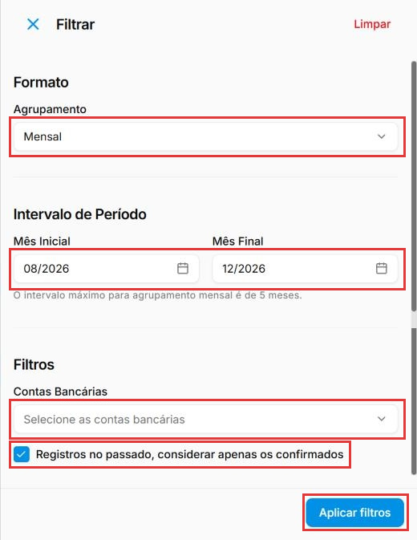
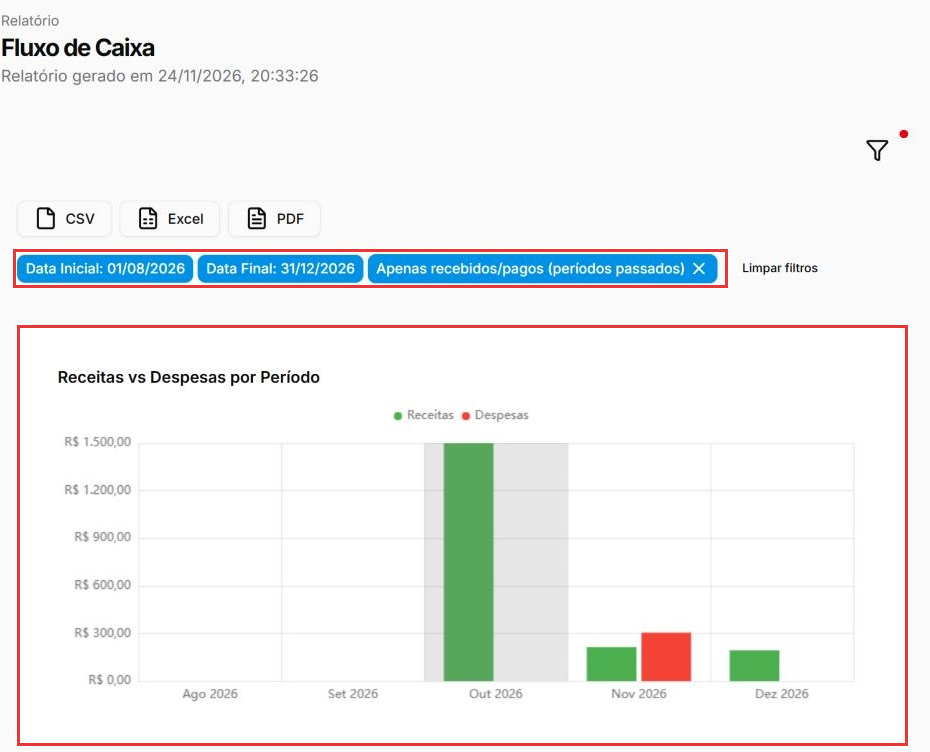
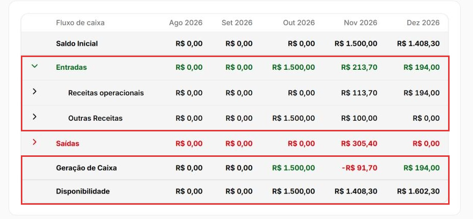

# Como ver o fluxo de caixa

:material-clock-outline: 7 minutos · :material-format-list-numbered: 4 passos · :material-calendar-check: Atualizado em 24/11/2026

O **fluxo de caixa** mostra o caminho do dinheiro da loja mês a mês: quanto havia no começo, quanto entrou, quanto saiu e quanto sobrou. Também mostra os meses que ainda vão chegar, com o que está previsto para entrar e sair. Exemplo: o dono quer saber se o dinheiro de dezembro vai dar para as contas. Ele gera o fluxo de agosto a dezembro e vê que novembro, até agora, está com R$ 1.408,30 e que dezembro tem R$ 194,00 previstos para entrar.

## Entenda o conceito

**As linhas do relatório.** Cada coluna é um período (no exemplo, um mês) e cada linha é uma parte da conta:

| Linha | O que é | No exemplo (novembro) |
| --- | --- | --- |
| **Saldo Inicial** | O dinheiro que havia no começo do período (a **Disponibilidade** do período anterior). | R$ 1.500,00 |
| **Entradas** | O que entrou: recebimentos e receitas. | R$ 213,70 |
| **Saídas** | O que saiu: pagamentos e despesas. | R$ 305,40 |
| **Geração de Caixa** | Entradas menos saídas: quanto sobrou (ou faltou) no período. Negativo, em vermelho, é que saiu mais do que entrou. | -R$ 91,70 |
| **Disponibilidade** | Saldo inicial mais a geração de caixa: o dinheiro no fim do período. | R$ 1.408,30 |

Confira a conta do exemplo: 1.500,00 + 213,70 − 305,40 = **1.408,30**. Essa disponibilidade vira o **Saldo Inicial** de dezembro.

**Detalhe por grupo.** A seta **›** ao lado de **Entradas** e de **Saídas** abre os grupos de receitas e despesas (por exemplo, **Receitas operacionais** e **Outras Receitas**). Alguns grupos também têm seta e abrem as contas de dentro, como **Faturamento com vendas de produtos**. Para organizar esses grupos, veja [Como organizar o plano de contas e os grupos financeiros](../financas/plano-de-contas.md).

**Passado e futuro.** A opção **Registros no passado, considerar apenas os confirmados** vem marcada. Com ela, nos períodos que já passaram (no exemplo, até novembro, o mês atual), o relatório conta só o que foi de fato recebido ou pago, e aparece a etiqueta **Apenas recebidos/pagos (períodos passados)**. No exemplo, ao desmarcar a opção, as **Entradas** de novembro passaram de R$ 213,70 para R$ 343,50, porque passaram a ser somados os lançamentos de novembro que ainda não tinham sido recebidos. Nos meses que ainda vão chegar, o relatório mostra o que está previsto (no exemplo, R$ 194,00 de entradas em dezembro).

**Quando usar:** para planejar o dinheiro dos próximos meses, ver se o caixa está crescendo ou diminuindo e se preparar para meses de muita despesa. **Quando não usar:** para ver o lucro (use o [relatório de resultados (DRE)](../financas/relatorio-de-resultados.md)) ou o movimento conta por conta (use o [extrato](../financas/extrato.md)).

!!! info "Antes de começar"
    - O relatório mostra os lançamentos financeiros (entradas e saídas) da loja. Quanto mais em dia estiverem os lançamentos, mais certo o fluxo (veja [Como lançar uma conta a pagar ou a receber](../financas/contas-a-pagar-e-receber.md)).
    - O período tem limite: até **31 dias** no agrupamento **Diário**, até **5 meses** no **Mensal** e até **3 anos** no **Anual**.

Nos prints, o **quadrado vermelho** mostra onde você deve clicar ou digitar.

## Abra o fluxo de caixa

No menu do lado esquerdo, clique em **Relatórios** → **Financeiro** → **Fluxo de caixa**. O relatório já abre com um período escolhido; os filtros em uso aparecem em etiquetas azuis acima do gráfico. Os botões **CSV**, **Excel** e **PDF**, acima das etiquetas, servem para levar o relatório para fora do sistema.

## Escolha o agrupamento e o período

Clique no **funil**, no alto, à direita. No painel **Filtrar**:

- **Agrupamento:** **Diário**, **Mensal** (uma coluna por mês, como no exemplo) ou **Anual**. Ao trocar, os campos do período mudam: **Data Inicial** e **Data Final** no Diário, **Mês Inicial** e **Mês Final** no Mensal, **Ano Inicial** e **Ano Final** no Anual.
- **Intervalo de Período:** o começo e o fim. No exemplo, **Mensal** de **08/2026** a **12/2026**.
- **Contas Bancárias:** para ver só uma ou algumas contas. Deixe em branco para ver todas.
- **Registros no passado, considerar apenas os confirmados:** deixe marcado para ver o dinheiro que de fato entrou e saiu nos meses que já passaram.

Clique em **Aplicar filtros**.

{ loading=lazy }

## Leia o gráfico

O gráfico **Receitas vs Despesas por Período** mostra, em cada período, uma barra verde (receitas) e uma vermelha (despesas). Passe o mouse sobre um período para ver os valores. No exemplo, outubro teve R$ 1.500,00 de receitas, e novembro teve mais despesas que receitas.

{ loading=lazy }

## Leia a tabela

Abaixo do gráfico fica a tabela. Clique na seta **›** de **Entradas** ou de **Saídas** para ver os grupos. No fim, **Geração de Caixa** mostra quanto sobrou ou faltou em cada período, e **Disponibilidade**, quanto havia no fim.

{ loading=lazy }

!!! tip "Boas práticas"
    - **Olhe para a frente:** inclua os próximos meses no período para ver o que está previsto e se preparar para meses apertados.
    - **Fique de olho na Geração de Caixa:** vários meses seguidos negativos indicam que está saindo mais dinheiro do que entrando.
    - **Mantenha os lançamentos em dia:** dê baixa nas contas pagas e recebidas. Assim o passado mostra o que aconteceu de verdade, e o futuro, só o que ainda falta.
    - **Use o mensal para planejar os próximos meses** e o diário para olhar um mês de perto.

## Deu algum problema?

??? question "O relatório está todo zerado"
    Confira o período e as contas bancárias escolhidas. Confira também a opção **Registros no passado, considerar apenas os confirmados**: marcada, ela deixa de fora os lançamentos de datas passadas que ainda não foram recebidos ou pagos. Se continuar zerado, fale com o suporte.

??? question "Não consigo escolher um período maior"
    Cada agrupamento tem um limite: 31 dias no **Diário**, 5 meses no **Mensal** e 3 anos no **Anual**. Para ver mais tempo, troque para um agrupamento maior.

??? question "Os valores mudam quando desmarco a opção dos confirmados"
    É esperado. Desmarcada, ela soma nos meses que já passaram também os lançamentos que ainda não foram recebidos ou pagos. Para ver o dinheiro que de fato entrou e saiu, deixe marcada.

??? question "A disponibilidade não bate com o saldo do banco"
    Confira se o campo **Contas Bancárias** está em branco (todas as contas) e se as contas pagas e recebidas tiveram baixa. Para conferir conta por conta, veja [Como consultar o extrato](../financas/extrato.md). Se a diferença continuar, fale com o suporte.

**Relacionados:** [Como lançar uma conta a pagar ou a receber](../financas/contas-a-pagar-e-receber.md) · [Como organizar o plano de contas e os grupos financeiros](../financas/plano-de-contas.md) · [Como ler o relatório de resultados (DRE)](../financas/relatorio-de-resultados.md) · [Como usar o painel Visão geral](visao-geral.md)

fluxo de caixa entradas e saídas saldo inicial geração de caixa disponibilidade previsão de caixa projeção dinheiro do mês receitas vs despesas planejamento financeiro diário mensal anual contas bancárias apenas confirmados recebidos pagos plano de contas
