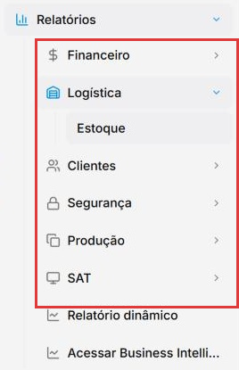

# Guia dos relatórios: o que cada um mostra

:material-clock-outline: 6 minutos · :material-format-list-numbered: 4 passos · :material-calendar-check: Atualizado em 28/11/2026

O menu **Relatórios** reúne todos os relatórios do sistema, separados por assunto. Este guia mostra o que cada um traz e quando usar, para você achar rápido o relatório certo. Exemplo: o dono quer saber quais produtos trazem mais faturamento. Pelo guia, ele vê que a **Análise de Portfólio** mostra o faturamento e a parte de cada produto na receita, e vai direto até ela.

## Entenda o conceito

**Grupos do menu.** Os relatórios ficam em grupos: **Financeiro**, **Logística**, **Clientes**, **Segurança**, **Produção** e **SAT**. Fora dos grupos ficam o **Relatório dinâmico** e o **Acessar Business Intelligence**.

**Tipos de relatório.** Muitos relatórios abrem numa tela com quadros de resumo e uma lista de **Tipo de relatórios**: você escolhe o tipo (por exemplo, em **Despesas**: **Resumido**, **Detalhado**, **Fornecedor** ou **Pagamentos**) e o resultado aparece. Para voltar à escolha do tipo, use a seta **‹** ao lado do título.

**Filtros.** Os relatórios novos têm o **funil**, que abre o painel **Filtrar**, e os botões **CSV**, **Excel** e **PDF**, para levar o relatório para fora do sistema. Alguns relatórios (**Vendas**, **Relatório dinâmico**, **KDS** e **Status** do SAT) abrem no formato do sistema antigo, dentro do ERP, com filtros e botões diferentes.

**Quando usar este guia:** quando você não sabe qual relatório responde à sua pergunta. **Quando não usar:** para um resumo rápido do dia, da semana ou do mês, use o [painel Visão geral](visao-geral.md).

!!! info "Antes de começar"
    - Os relatórios mostram os dados da empresa escolhida no canto de cima, à esquerda.
    - Sem movimento no período, o relatório aparece vazio (nos relatórios novos, com a mensagem **Nenhum relatório gerado**).

Nos prints, o **quadrado vermelho** mostra onde você deve clicar ou digitar.

## Abra o menu Relatórios

No menu do lado esquerdo, clique em **Relatórios**. Os grupos aparecem embaixo. Clique num grupo para ver os relatórios dele.

{ loading=lazy }

## Ache o relatório certo

Use as tabelas abaixo para escolher.

**Financeiro**

| Relatório | O que mostra | Manual |
| --- | --- | --- |
| **Análise de centro de custo** | As despesas do período por centro de custo, com o valor e a porcentagem de cada um e um gráfico de distribuição. | [Como usar centros de custo](../financas/centro-de-custo.md) |
| **Fechamento de caixa** | Cada caixa aberto no PDV, com o valor registrado, o informado e a diferença. | [Como ver o fechamento de caixa](fechamento-de-caixa.md) |
| **Vendas** | Quanto a loja vendeu, por período, forma de pagamento, produto e outras visões. | [Como ver o relatório de vendas](vendas.md) |
| **Despesas** | As contas a pagar, em resumo, detalhadas, por fornecedor ou por forma de pagamento. | [Como ver o lucro e as despesas](lucro-e-despesas.md) |
| **Lucro** | O valor recebido nas vendas menos o custo dos produtos (lucro bruto, sem descontar as despesas da loja). | [Como ver o lucro e as despesas](lucro-e-despesas.md) |
| **Compras** | O total das compras, por período, forma de pagamento, produto, categoria ou fornecedor. | [Como lançar uma compra](../estoque/lancar-compra.md) |
| **Fluxo de caixa** | O dinheiro que entrou e saiu e o que está previsto para entrar e sair, por dia, mês ou ano. | [Como ver o fluxo de caixa](fluxo-de-caixa.md) |
| **Relatório básico** | As vendas de um jeito mais simples: o total do mês e por forma de pagamento, e os tipos **Apenas Valores** (por período, dia, semana ou dia da semana), **Métodos de Pagamento** e **Produtos**. | Para mais visões, veja [Como ver o relatório de vendas](vendas.md) |
| **Análise de Portfólio** | Os produtos com quantidade, faturamento e a parte de cada um na receita, classificados pela **Curva ABC** (Classe A, B e C) e pela **Matriz BCG** (Estrelas, Vacas Leiteiras, Questionáveis e Abacaxis). Tem os quadros **Total Analisado**, **Concentração de Faturamento** e **Alertas Críticos** e uma coluna **Insight** por produto. Serve para apoiar decisões de compra e de venda; na dúvida sobre as classificações, fale com o suporte. | |
| **Promoção** | As vendas que usaram promoções e os vouchers (cupons) usados pelos clientes. | [Como criar uma promoção](../vendas/criar-promocao.md) |
| **Troca** | As trocas feitas: o valor devolvido e o valor levado em troca, por troca, forma de pagamento ou produto. | [Como configurar troca e devolução](../ponto-de-venda/troca-e-devolucao.md) |

**Logística, Clientes, Segurança, Produção e SAT**

| Grupo | Relatório | O que mostra | Manual |
| --- | --- | --- | --- |
| **Logística** | **Estoque** | O valor do estoque, o saldo de cada produto, as entradas e saídas e a validade. | [Como ver o relatório de estoque](estoque.md) |
| **Clientes** | **Crédito de clientes** | Cada movimentação na conta de crédito dos clientes (o saldo que a loja guarda para o cliente), por movimentação, forma de pagamento ou cliente, com as entradas, os estornos e o saldo final de cada um. | [Como configurar o terminal de vendas](../ponto-de-venda/configurar-terminal.md) |
| **Clientes** | **Atendimento de mesas** | O valor recebido em mesas no mês e os atendimentos de mesas e comandas: fechados, sem venda, cancelados, por garçom (com itens, cancelamentos, valor e comissão) e itens cancelados. | [Como usar comandas](../ponto-de-venda/comandas.md) |
| **Segurança** | **Logs de segurança** | Quem criou, alterou ou excluiu cada cadastro, e quando. | [Como ver os logs de segurança e o abandono de vendas](seguranca.md) |
| **Segurança** | **Abandono de vendas** | As vendas abandonadas registradas no PDV (veja a opção **Gravar abandono de venda no relatório** no manual do terminal), com filtro por período, usuários e produtos, dos últimos 6 meses. | [Como ver os logs de segurança e o abandono de vendas](seguranca.md) |
| **Produção** | **KDS** | O **Relatório de Produção KDS**, com o tempo médio de produção na tela da cozinha e filtros por intervalo, KDS e produtos. Abre no formato do sistema antigo. | [Como configurar a tela da cozinha (KDS)](../dispositivos/kds.md) |
| **SAT** | **Status** | A situação do equipamento SAT, com a data da consulta, o status e os dias sem comunicação. Só tem dados se a loja usa SAT. Abre no formato do sistema antigo. | |

**Fora dos grupos**

| Relatório | O que mostra | Manual |
| --- | --- | --- |
| **Relatório dinâmico** | Um relatório que você monta: escolhe a tabela, as colunas e os filtros. | [Como criar um relatório dinâmico](relatorio-dinamico.md) |
| **Acessar Business Intelligence** | Abre a tela **Acesso BI**, que pede **E-mail** e **Senha**. | |

## Abra o relatório e escolha o tipo

Clique no relatório no menu. Se a tela mostrar **Tipo de relatórios**, clique no tipo que você quer.

## Escolha o período

Nos relatórios com o **funil**, clique nele, escolha o período e as outras opções e clique em **Aplicar filtros**. Nos que abrem no formato do sistema antigo (como **Vendas**), preencha o intervalo nos filtros da própria tela e clique em **Buscar**.

!!! tip "Boas práticas"
    - **Comece pelo painel:** a [Visão geral](visao-geral.md) mostra o resumo; vá ao relatório quando precisar do detalhe.
    - **Compare períodos iguais:** mês com mês, semana com semana.
    - **Use o relatório dinâmico para o que falta:** se nenhum relatório pronto mostra o que você quer, monte o seu.
    - **Exporte para guardar:** nos relatórios que têm os botões **CSV**, **Excel** e **PDF**, use-os para arquivar ou mandar ao contador.

## Deu algum problema?

??? question "O relatório veio vazio"
    Confira o período, os filtros e a empresa escolhida. Sem movimento no período, o relatório fica vazio (nos relatórios novos, aparece **Nenhum relatório gerado**).

??? question "Não encontro um relatório no menu"
    Clique no grupo para abrir a lista dele (veja nas tabelas acima em qual grupo ele fica). Se mesmo assim ele não aparecer, fale com o suporte.

??? question "O BI pede e-mail e senha"
    A tela **Acesso BI** pede e-mail e senha. Se você não tem esse acesso, fale com o suporte.

**Relacionados:** [Como usar o painel Visão geral](visao-geral.md) · [Como ver o relatório de vendas](vendas.md) · [Como criar um relatório dinâmico](relatorio-dinamico.md)

guia dos relatórios lista de relatórios qual relatório usar achar o relatório certo menu relatórios financeiro logística clientes segurança produção sat centro de custo fechamento de caixa vendas despesas lucro compras fluxo de caixa relatório básico análise de portfólio curva abc matriz bcg promoção vouchers troca estoque crédito de clientes atendimento de mesas comandas garçom logs abandono de vendas kds status sat relatório dinâmico business intelligence bi
