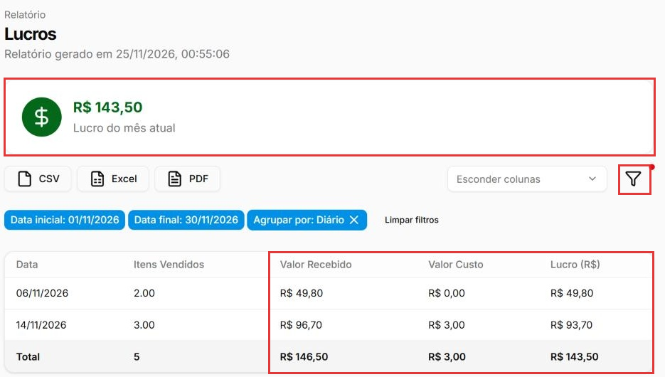
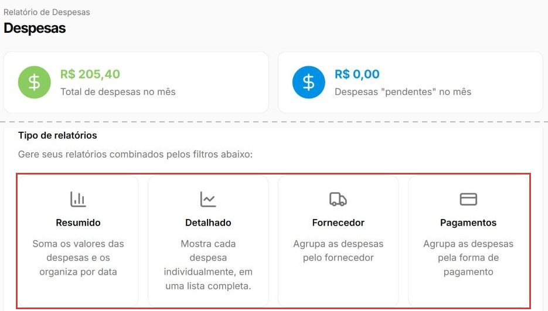
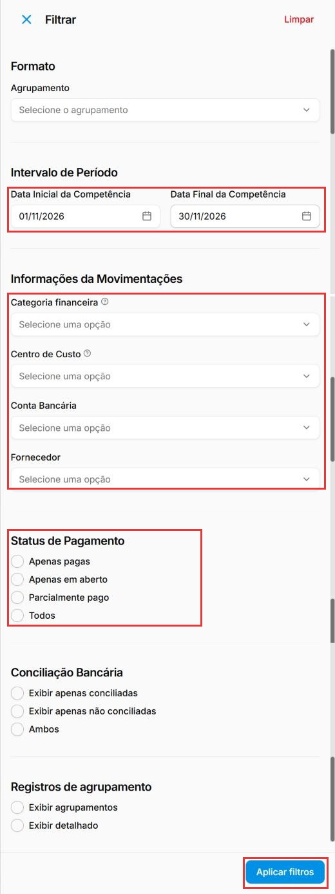
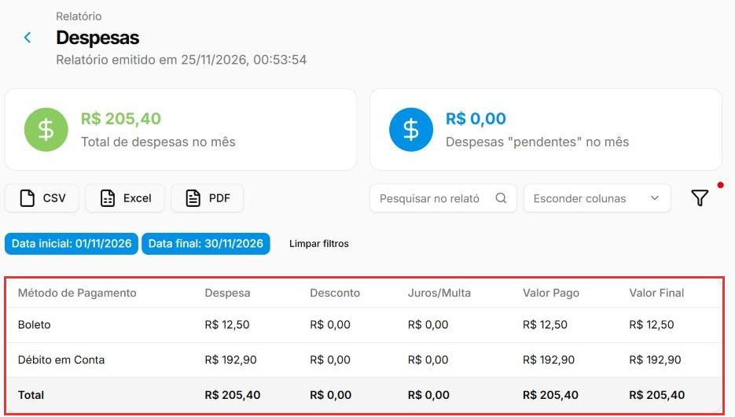

# Como ver o lucro e as despesas

:material-clock-outline: 7 minutos · :material-format-list-numbered: 4 passos · :material-calendar-check: Atualizado em 25/11/2026

O menu **Relatórios** → **Financeiro** tem dois relatórios que andam juntos: o de **Lucro**, que mostra quanto a loja ganhou nas vendas descontando o custo dos produtos, e o de **Despesas**, que mostra quanto a loja gastou. Exemplo: em novembro, o dono vê que as vendas deram **R$ 143,50** de lucro sobre o custo dos produtos e que as despesas do mês somaram **R$ 205,40**. Comparando os dois, ele tem uma primeira ideia de que as vendas ainda não pagam os gastos e confirma o resultado na DRE.

## Entenda o conceito

**O lucro deste relatório.** No relatório de **Lucros**, cada linha mostra os **Itens Vendidos**, o **Valor Recebido**, o **Valor Custo** e o **Lucro (R$)**, que é o valor recebido menos o custo. No exemplo: R$ 146,50 recebidos − R$ 3,00 de custo = **R$ 143,50** de lucro. Esse lucro **não desconta as despesas** da loja (aluguel, luz, tarifas); é o que se costuma chamar de **lucro bruto**.

**De onde vem o custo.** O **Valor Custo** é o custo dos produtos vendidos. Quando ele aparece **R$ 0,00**, como no dia 06/11 do exemplo, o lucro do dia fica igual ao valor recebido. Se isso acontecer, confira o custo dos produtos (veja [Como cadastrar um produto](../produtos/cadastrar-produto.md)) e, se ele estiver certo, fale com o suporte.

**As despesas.** O relatório de **Despesas** lista as contas a pagar da loja, inclusive as parcelas das compras (no exemplo, **Compra 19 (1/2)**). Ele tem quatro tipos:

| Tipo | O que mostra | No exemplo |
| --- | --- | --- |
| **Resumido** | Soma os valores das despesas e os organiza por data. | R$ 205,40 no período de 01/11 a 30/11. |
| **Detalhado** | Cada despesa em uma linha, com competência, vencimento, pagamento, categoria financeira, fornecedor, descrição, status e valores. | Conta de luz R$ 180,00, tarifa R$ 12,90 e uma compra de R$ 12,50. |
| **Fornecedor** | Agrupa as despesas pelo fornecedor. | A compra aparece no fornecedor dela (R$ 12,50); as despesas sem fornecedor aparecem como **Não informado** (R$ 192,90). |
| **Pagamentos** | Agrupa as despesas pela forma de pagamento. | **Boleto** R$ 12,50 e **Débito em Conta** R$ 192,90. |

**Os quadros do alto.** Na tela de Despesas, **Total de despesas no mês** e **Despesas "pendentes" no mês** dão um resumo rápido do mês atual.

**Lucro × DRE.** Para ver o resultado completo da loja, com as vendas, os custos **e** as despesas na mesma conta, use o [relatório de resultados (DRE)](../financas/relatorio-de-resultados.md).

**Quando usar:** para saber quanto as vendas de cada dia (ou semana, mês...) deixaram de lucro sobre o custo e para acompanhar os gastos por categoria, fornecedor ou forma de pagamento. **Quando não usar:** para o resultado final do mês (use a DRE) ou para ver o dinheiro que entrou, saiu e vai entrar (use o [fluxo de caixa](fluxo-de-caixa.md)).

!!! info "Antes de começar"
    - Para o lucro ficar certo, os produtos precisam ter custo.
    - Para as despesas aparecerem, elas precisam estar lançadas em contas a pagar (veja [Como lançar uma conta a pagar ou a receber](../financas/contas-a-pagar-e-receber.md)) ou vir de uma compra (veja [Como lançar uma compra](../estoque/lancar-compra.md)).

Nos prints, o **quadrado vermelho** mostra onde você deve clicar ou digitar.

## Veja o lucro das vendas

No menu do lado esquerdo, clique em **Relatórios** → **Financeiro** → **Lucro**. Abre o relatório **Lucros**, com o mês atual. No alto aparece o **Lucro do mês atual**; abaixo, a tabela com uma linha por dia (**Agrupar por: Diário**) e o **Total**.

Para mudar o período ou o agrupamento, clique no **funil**, à direita. No painel **Filtrar**, escolha o **Agrupamento** (**Período**, **Diário**, **Semanal**, **Mensal**, **Trimestral**, **Semestral** ou **Anual**), a **Data Inicial** e a **Data Final** e, se precisar, **Empresas** (para quem tem mais de uma loja na conta) e **Usuários**. O agrupamento decide o que cada linha soma: em **Diário**, uma linha por dia, como no exemplo. Clique em **Aplicar filtros**.

{ loading=lazy }

## Abra o relatório de despesas e escolha o tipo

No menu, clique em **Relatórios** → **Financeiro** → **Despesas**. Em **Tipo de relatórios**, clique no tipo que você quer: **Resumido**, **Detalhado**, **Fornecedor** ou **Pagamentos**. O relatório abre com o mês atual. Para voltar à escolha do tipo, clique na seta **‹**, ao lado do título.

{ loading=lazy }

## Filtre as despesas

Clique no **funil**. No painel **Filtrar**:

- **Intervalo de Período:** a **Data Inicial da Competência** e a **Data Final da Competência**.
- **Informações da Movimentações:** **Categoria financeira** (veja [Como organizar o plano de contas e os grupos financeiros](../financas/plano-de-contas.md)), **Centro de Custo** (veja [Como usar centros de custo](../financas/centro-de-custo.md)), **Conta Bancária** e **Fornecedor**, para ver só uma parte das despesas.
- **Status de Pagamento:** **Apenas pagas** (já quitadas), **Apenas em aberto** (ainda a pagar), **Parcialmente pago** (pagas em parte) ou **Todos**.
- **Conciliação Bancária:** **Exibir apenas conciliadas**, **Exibir apenas não conciliadas** ou **Ambos**. Conciliada é a despesa já conferida com o extrato do banco (veja [Como fazer a conciliação bancária](../financas/conciliacao-bancaria.md)).
- **Formato** (**Agrupamento**) e **Registros de agrupamento** mudam a forma de mostrar as linhas; na dúvida, fale com o suporte.

Clique em **Aplicar filtros**.

{ loading=lazy }

## Leia o resultado

A tabela muda conforme o tipo. No tipo **Pagamentos**, cada linha é uma forma de pagamento, com a **Despesa**, o **Desconto**, os **Juros/Multa**, o **Valor Pago** e o **Valor Final**, e o **Total** no fim. No exemplo, **Boleto** R$ 12,50 e **Débito em Conta** R$ 192,90, total **R$ 205,40**. Como não houve desconto nem juros e tudo foi pago, a **Despesa**, o **Valor Pago** e o **Valor Final** têm o mesmo valor.

Acima da tabela ficam **Pesquisar no relatório** e **Esconder colunas**. Os botões **CSV**, **Excel** e **PDF** servem para levar o relatório para fora do sistema.

{ loading=lazy }

!!! tip "Boas práticas"
    - **Confira o custo dos produtos:** com o custo zerado, o lucro fica igual ao valor recebido.
    - **Compare lucro e despesas do mesmo período:** dá uma ideia rápida se as vendas estão pagando os gastos. Para o resultado certo do mês, use a [DRE](../financas/relatorio-de-resultados.md).
    - **Use categoria e fornecedor:** lance as despesas com categoria financeira e fornecedor. Assim os tipos **Detalhado** e **Fornecedor** mostram para onde o dinheiro vai.
    - **Confira as despesas em aberto:** o filtro **Apenas em aberto** mostra o que ainda falta pagar.

## Deu algum problema?

??? question "O lucro está igual ao valor vendido"
    Confira se os produtos vendidos têm custo (veja [Como cadastrar um produto](../produtos/cadastrar-produto.md)). Se tiverem e o lucro continuar igual ao valor recebido, fale com o suporte.

??? question "O lucro deste relatório é diferente do lucro da DRE"
    É esperado. Este relatório desconta só o custo dos produtos. A DRE também desconta as despesas da loja. Veja [Como ler o relatório de resultados (DRE)](../financas/relatorio-de-resultados.md).

??? question "Uma despesa não aparece no relatório"
    Confira o período: ele é pela **data de competência**. Confira também os filtros de status, conciliação, categoria e fornecedor. A despesa precisa estar lançada em contas a pagar.

??? question "O fornecedor aparece como Não informado"
    A despesa foi lançada sem fornecedor. Informe-o no lançamento (veja [Como lançar uma conta a pagar ou a receber](../financas/contas-a-pagar-e-receber.md)); se ele ainda não existir, cadastre-o antes (veja [Como cadastrar um fornecedor](../estoque/cadastrar-fornecedor.md)).

**Relacionados:** [Como ler o relatório de resultados (DRE)](../financas/relatorio-de-resultados.md) · [Como lançar uma conta a pagar ou a receber](../financas/contas-a-pagar-e-receber.md) · [Como ver o fluxo de caixa](fluxo-de-caixa.md) · [Como ver o relatório de vendas](vendas.md)

lucro lucros lucro bruto margem custo valor custo valor recebido lucro do mês despesas gastos relatório de despesas resumido detalhado fornecedor pagamentos boleto débito em conta despesas pendentes contas a pagar categoria financeira centro de custo conciliação conciliadas apenas pagas em aberto custo zerado quanto gastei contas pagas
