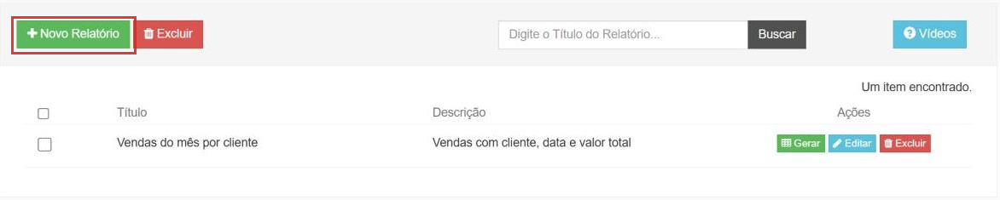
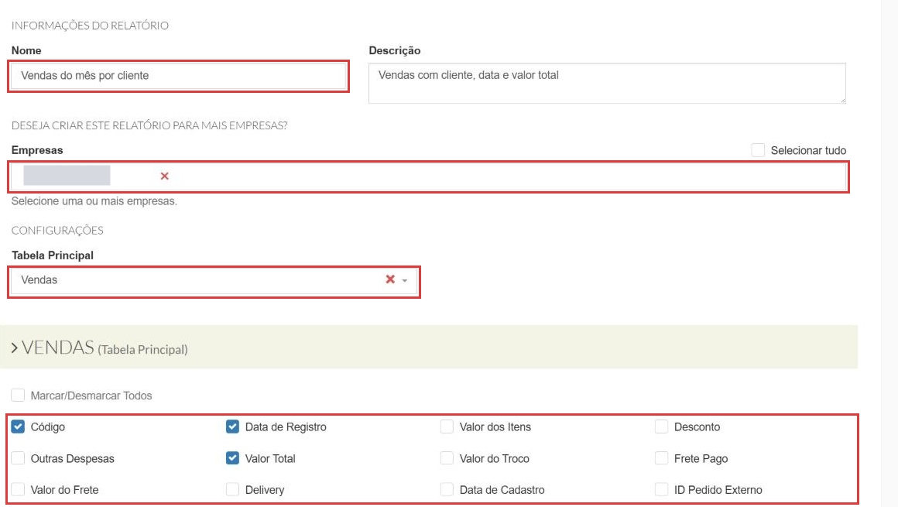
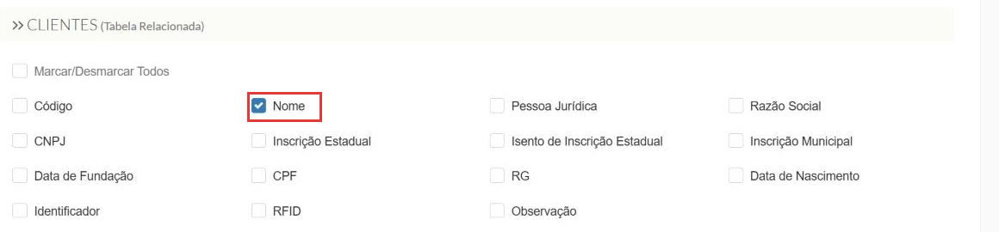
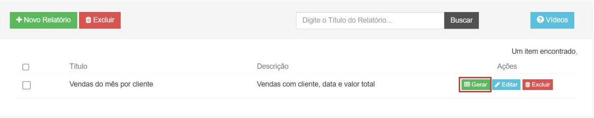
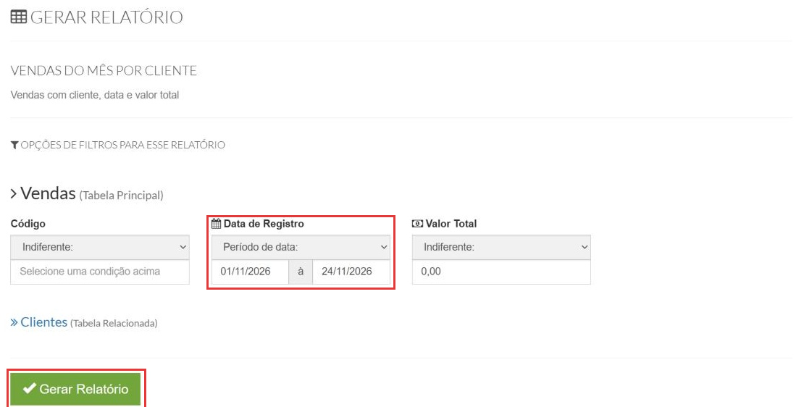
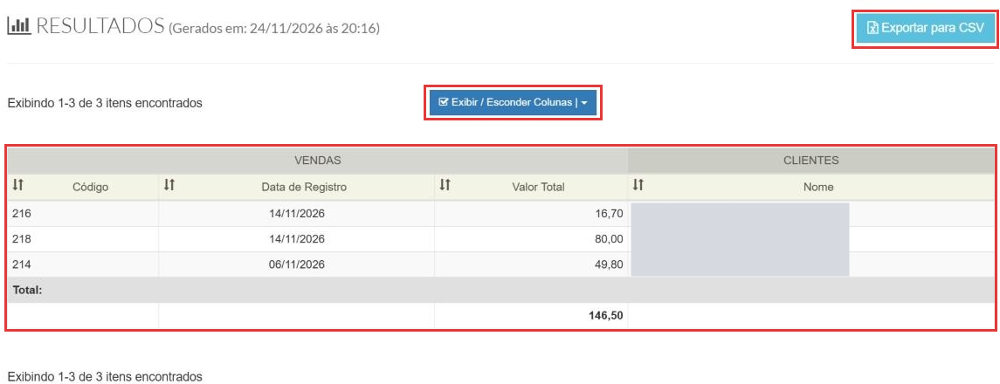

# Como criar um relatório dinâmico

:material-clock-outline: 8 minutos · :material-format-list-numbered: 5 passos · :material-calendar-check: Atualizado em 24/11/2026

O **relatório dinâmico** é um relatório que você mesmo monta: escolhe de onde vêm os dados e quais colunas aparecem. Exemplo: o dono quer uma lista simples das vendas do mês com o código, a data, o valor e o nome do cliente. Se nenhum relatório pronto mostra exatamente isso, ele cria o relatório **Vendas do mês por cliente** uma vez e, depois, só gera de novo quando precisa.

## Entenda o conceito

**Montar uma vez, gerar sempre.** O relatório dinâmico fica salvo na lista com o nome que você deu. Cada vez que você clica em **Gerar**, escolhe os filtros (por exemplo, o período) e vê os dados atualizados.

**Tabela principal e tabelas relacionadas.** Pense nas tabelas como as "fichas" do sistema:

- A **tabela principal** é o assunto do relatório. No exemplo, a tabela principal é **Vendas**, e cada linha do resultado é uma venda. A lista tem várias opções, como **Vendas**, **Clientes**, **Produtos** e **Contas a Pagar**.
- As **tabelas relacionadas** trazem informações ligadas ao registro principal. Numa venda, por exemplo, aparecem **Clientes**, **Produtos Vendidos**, **Pagamentos da venda**, **Vendedores** e outras. No exemplo, a tabela **Clientes** traz o nome do cliente de cada venda.

**Colunas.** Em cada tabela, marque as caixas das informações que você quer ver. Cada caixa marcada vira uma coluna no resultado. **Marcar/Desmarcar Todos** marca ou desmarca todas as caixas da tabela.

**Filtros.** Na hora de gerar, cada coluna escolhida ganha um filtro, com uma condição e um valor. A condição **Indiferente** não filtra nada. As outras mudam conforme o tipo da coluna:

- **Textos** (como o nome do cliente): **Igual a**, **Contém** (o texto tem esse trecho) e **Diferente de**.
- **Números e valores:** **Igual a**, **Diferente de**, **Maior que**, **Menor que**, **Maior igual que** (maior ou igual a) e **Menor igual que** (menor ou igual a). Por exemplo, **Valor Total** com **Maior que** 50,00 serve para ver só as vendas acima de R$ 50,00.
- **Datas:** **Período de data**, com a data inicial e a final.

**Quando usar:** quando você precisa de uma lista que os relatórios prontos não mostram, com as colunas do seu jeito. **Quando não usar:** para o total de vendas por forma de pagamento ou por produto, o [relatório de vendas](vendas.md) já traz isso pronto.

!!! info "Antes de começar"
    - Pense no que você quer ver: qual é o assunto (a tabela principal) e quais informações (as colunas).
    - A tela abre no formato do sistema antigo, dentro do ERP.

Nos prints, o **quadrado vermelho** mostra onde você deve clicar ou digitar.

## Abra o relatório dinâmico e clique em Novo Relatório

No menu do lado esquerdo, clique em **Relatórios** → **Relatório dinâmico**. A tela mostra os relatórios já criados (para achar um, digite o título na busca e clique em **Buscar**). Clique em **Novo Relatório**.

{ loading=lazy }

## Dê um nome e escolha a tabela principal

Em **Informações do relatório**:

- **Nome:** o nome que vai aparecer na lista (no exemplo, **Vendas do mês por cliente**).
- **Descrição:** um lembrete do que o relatório mostra (no exemplo, **Vendas com cliente, data e valor total**).
- **Empresas:** a tela pergunta **Deseja criar este relatório para mais empresas?**. A empresa em que você está já vem escolhida. Se você tem mais de uma loja, escolha em quais o relatório vai ficar salvo, ou marque **Selecionar tudo**.

Em **Configurações**, escolha a **Tabela Principal** (no exemplo, **Vendas**). Abaixo aparece a tabela escolhida, com as caixas das colunas. Marque as que você quer; no exemplo, **Código**, **Data de Registro** e **Valor Total**.

{ loading=lazy }

## Marque as colunas das tabelas relacionadas e salve

Desça a tela: cada **tabela relacionada** tem as suas caixas. Marque as colunas que você quer delas; no exemplo, em **Clientes**, a coluna **Nome**. Deixe desmarcadas as tabelas de que não precisa.

No fim da tela, clique em **Salvar**. Aparece a mensagem **Ok! Relatório ... inserido com sucesso.**, e o relatório entra na lista.

{ loading=lazy }

## Gere o relatório com os filtros

Na lista, clique em **Gerar** na linha do relatório.

{ loading=lazy }

A tela **Gerar relatório** mostra as **Opções de filtros para esse relatório**, uma para cada coluna escolhida, separadas por tabela. Escolha a condição e preencha o valor de cada filtro que quiser usar; deixe os outros em **Indiferente**. No exemplo, em **Data de Registro**, escolha **Período de data** e preencha de **01/11/2026** a **24/11/2026**.

Os filtros das tabelas relacionadas aparecem recolhidos, com o nome da tabela (no exemplo, **» Clientes**). Clique no nome para ver os filtros dela.

Clique em **Gerar Relatório**.

{ loading=lazy }

## Leia o resultado

Abaixo dos filtros aparece **Resultados**, com a data e a hora em que foi gerado e quantos itens foram encontrados (no exemplo, 3). A tabela mostra as colunas agrupadas pela tabela de origem (**Vendas** e **Clientes**). No exemplo, a coluna **Valor Total** tem a soma na linha **Total** (R$ 146,50).

- Clique no nome de uma coluna (onde estão as setas) para ordenar a tabela por ela. No exemplo, clicar em **Valor Total** deixa as vendas da menor para a maior.
- **Exibir / Esconder Colunas** abre a lista das colunas, cada uma com uma marca. Clique numa coluna para tirá-la da tela; clique de novo para ela voltar.
- **Exportar para CSV** serve para levar o resultado para fora do sistema, num arquivo CSV (formato que abre em planilhas, como o Excel).

{ loading=lazy }

!!! tip "Boas práticas"
    - **Dê nomes claros:** "Vendas do mês por cliente" diz mais que "Relatório 1". A descrição ajuda quem usar depois.
    - **Escolha poucas colunas:** só as que você vai usar. O resultado fica mais fácil de ler.
    - **Crie uma vez e reaproveite:** não monte o mesmo relatório de novo; use **Gerar** e troque só os filtros.
    - **Para mudar as colunas,** use **Editar** na lista: abre a tela **Editar relatório**, com as caixas como você deixou. Assim você não cria outro relatório igual.

## Deu algum problema?

??? question "O resultado veio vazio"
    Confira os filtros: um período sem movimento, ou filtros demais, podem não trazer nenhum registro. Deixe em **Indiferente** os filtros de que não precisa e gere de novo.

??? question "Falta uma coluna no resultado"
    Na lista, clique em **Editar** no relatório, marque a caixa da coluna na tabela certa e clique em **Salvar**. Depois, gere de novo. Confira também se a coluna não foi escondida em **Exibir / Esconder Colunas**.

??? question "Não sei qual tabela principal escolher"
    Pense no que cada linha do resultado deve ser: uma venda (**Vendas**), um cliente (**Clientes**), um produto (**Produtos**) e assim por diante. Se não encontrar a informação que precisa, fale com o suporte.

??? question "Como apago um relatório que não uso mais?"
    Na lista, clique em **Excluir** na linha do relatório. Antes, confira se ninguém da equipe usa esse relatório.

**Relacionados:** [Como ver o relatório de vendas](vendas.md)

relatório dinâmico relatório personalizado criar relatório montar relatório meu relatório escolher colunas tabela principal tabela relacionada filtros gerar relatório exportar csv planilha excel vendas por cliente lista de vendas
