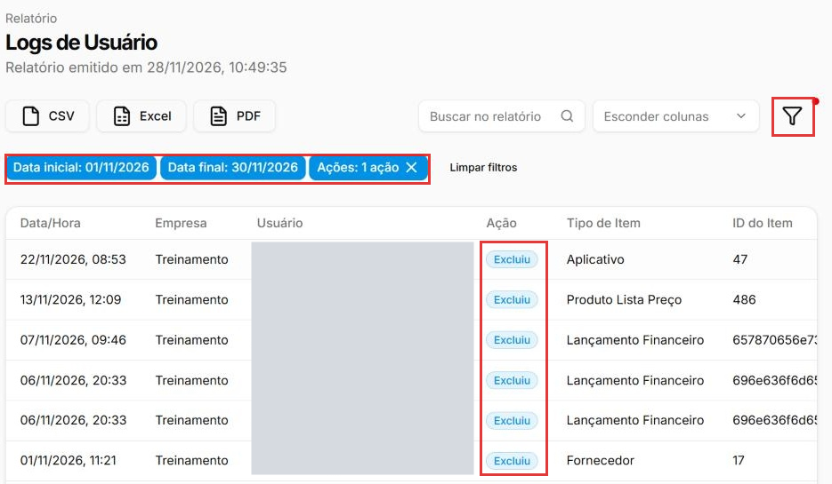
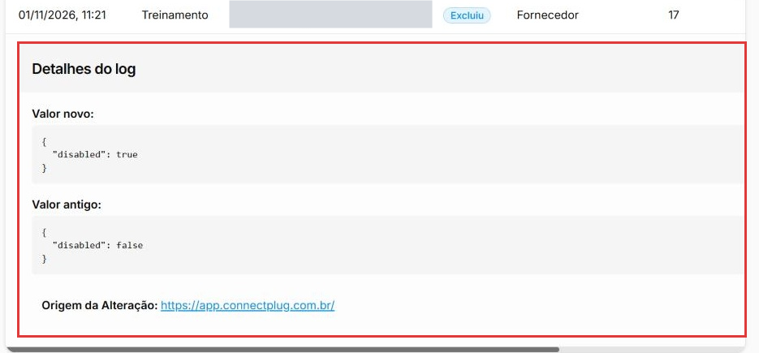
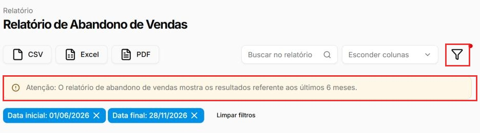

# Como ver os logs de segurança e o abandono de vendas

:material-clock-outline: 6 minutos · :material-format-list-numbered: 4 passos · :material-calendar-check: Atualizado em 28/11/2026

O menu **Relatórios** → **Segurança** tem dois relatórios: os **Logs de segurança**, que registram quem fez cada mudança no sistema, e o **Abandono de vendas**. Exemplo: um fornecedor sumiu da lista de cadastros. O dono abre os logs, filtra pelas exclusões e descobre a data, a hora e o usuário que excluiu o fornecedor.

## Entenda o conceito

**O que é um log.** Um log é um registro automático. Quando alguém cria, altera ou exclui um cadastro (um fornecedor, um lançamento financeiro, uma configuração do PDV, um preço de lista), o sistema guarda uma linha com:

| Coluna | O que mostra |
| --- | --- |
| **Data/Hora** | Quando a mudança aconteceu. |
| **Empresa** | Em qual empresa (loja) foi feita. |
| **Usuário** | Quem fez. |
| **Ação** | O que foi feito: **Criou**, **Atualizou** ou **Excluiu**. No filtro, as ações se chamam **Criação**, **Atualização**, **Exclusão** e **Restauração**. |
| **Tipo de Item** e **ID do Item** | O que foi mexido (por exemplo, **Fornecedor**) e o código dele no sistema: um número (como 17) ou um código longo de letras e números. |
| **IP** | O endereço da internet de onde veio a mudança. |

**Os detalhes.** A seta **›** no fim da linha abre **Detalhes do log**. O **Valor antigo** mostra como o cadastro era antes; o **Valor novo**, como ficou. Eles aparecem num formato técnico, entre chaves. A **Origem da Alteração** mostra o endereço de onde a mudança foi feita (no exemplo, o sistema aberto no navegador). No exemplo, a exclusão do fornecedor aparece como `"disabled": true` no valor novo e `"disabled": false` no valor antigo; `disabled` quer dizer "desativado".

**Abandono de vendas.** É um relatório à parte, com filtro por período, usuários e produtos, e mostra só os últimos 6 meses.

**Quando usar:** para descobrir quem mexeu num preço de lista, excluiu um cadastro ou alterou uma configuração, e quando. **Quando não usar:** para ver vendas ou dinheiro; para isso, veja [Como ver o relatório de vendas](vendas.md).

!!! info "Antes de começar"
    - Os logs mostram o nome dos usuários. Por isso, cada pessoa da equipe deve ter o próprio usuário (veja [Como cadastrar um usuário](../configuracoes/cadastrar-usuario.md)).

Nos prints, o **quadrado vermelho** mostra onde você deve clicar ou digitar.

## Abra os logs de segurança

No menu do lado esquerdo, clique em **Relatórios** → **Segurança** → **Logs de segurança**. Abre o relatório **Logs de Usuário**, com o mês atual: os registros mais novos aparecem primeiro.

No alto, **Relatório emitido em** mostra quando a lista foi gerada. **Buscar no relatório** procura um texto na lista, **Esconder colunas** tira as colunas que você não usa, e **CSV**, **Excel** e **PDF** levam o relatório para fora do sistema.

## Filtre o que você procura

Clique no **funil**, à direita. No painel **Filtrar**, escolha:

- **Período:** a **Data Inicial** e a **Data Final**.
- **Usuários:** para ver só o que uma pessoa fez.
- **Tipo de Ação:** **Criação**, **Atualização**, **Exclusão** ou **Restauração**.
- **Tipo de Item:** o tipo de cadastro, como **Aplicativo**, **Transportadora**, **Empresa**, **Configuração do PDV**, **Cliente**, **Produto**, **Fornecedor** e outros. A lista tem busca: digite para achar o tipo. Na tabela, alguns nomes aparecem abreviados (por exemplo, **Config. PDV** é a **Configuração do PDV**).

Clique em **Aplicar filtros**. Os filtros em uso aparecem como etiquetas acima da tabela. No exemplo, **Ações: 1 ação** mostra que um tipo de ação está escolhido (**Exclusão**): a coluna **Ação** só mostra **Excluiu**.

{ loading=lazy }

## Veja os detalhes de um registro

A tabela é larga: use a barra de rolagem embaixo dela até ver a coluna **IP** e a seta **›** no fim da linha. Clique na seta (clicar no meio da linha não abre). Os **Detalhes do log** aparecem logo abaixo da linha, com o **Valor novo**, o **Valor antigo** e a **Origem da Alteração**.

{ loading=lazy }

## Consulte o abandono de vendas

No menu, clique em **Relatórios** → **Segurança** → **Abandono de vendas**. Abre o **Relatório de Abandono de Vendas**, com o aviso de que ele mostra os resultados dos **últimos 6 meses**.

O relatório abre vazio, com **Nenhum relatório gerado**: as datas começam em branco. Clique no **funil**, escolha o **Período** (**Data Inicial** e **Data Final**, dentro dos últimos 6 meses) e, se quiser, os **Usuários** e os **Produtos**. Clique em **Aplicar filtros**. Se não houver registros no período, a mensagem **Nenhum relatório gerado** continua. Na dúvida sobre o que entra neste relatório na sua loja, fale com o suporte.

{ loading=lazy }

!!! tip "Boas práticas"
    - **Um usuário por pessoa:** se várias pessoas usam o mesmo login, o log não mostra quem fez a mudança de verdade.
    - **Filtre antes de procurar:** comece pelo **Tipo de Ação** e pelo **Tipo de Item**; a lista fica bem menor.
    - **Confira os logs depois de mudanças grandes:** depois de ajustar preços ou configurações, veja se só as mudanças esperadas aparecem.
    - **Dê a cada pessoa só o acesso de que ela precisa:** veja [Como criar perfis de acesso](../configuracoes/perfis-de-acesso.md).

## Deu algum problema?

??? question "Não encontro a mudança que procuro"
    Confira o período e os filtros. Tente tirar o filtro de **Usuários** e procurar pelo **Tipo de Item** e pela **Ação**.

??? question "Não aparecem a coluna IP e a seta de detalhes"
    A tabela é mais larga que a tela. Use a barra de rolagem embaixo dela para ver as colunas da direita.

??? question "A coluna IP mostra um traço (-)"
    Algumas linhas aparecem sem IP. A mudança continua registrada: use a **Data/Hora** e o **Usuário** para identificá-la.

??? question "Uma exclusão aparece como disabled nos detalhes"
    No exemplo, excluir o fornecedor gravou `"disabled": true` (desativado). Para saber se um cadastro excluído pode voltar, fale com o suporte.

??? question "O relatório de abandono de vendas está vazio"
    Ele abre vazio até você escolher as datas no **funil**. Escolha um período dentro dos últimos 6 meses e clique em **Aplicar filtros**. Se continuar aparecendo **Nenhum relatório gerado**, não há registros nesse período. Na dúvida, fale com o suporte.

**Relacionados:** [Como cadastrar um usuário](../configuracoes/cadastrar-usuario.md) · [Como criar perfis de acesso](../configuracoes/perfis-de-acesso.md) · [Como ver o relatório de vendas](vendas.md)

logs de segurança logs de usuário auditoria quem alterou quem excluiu histórico de alterações rastrear mudanças criou atualizou excluiu restauração tipo de item ip valor antigo valor novo origem da alteração disabled desativado abandono de vendas vendas abandonadas
