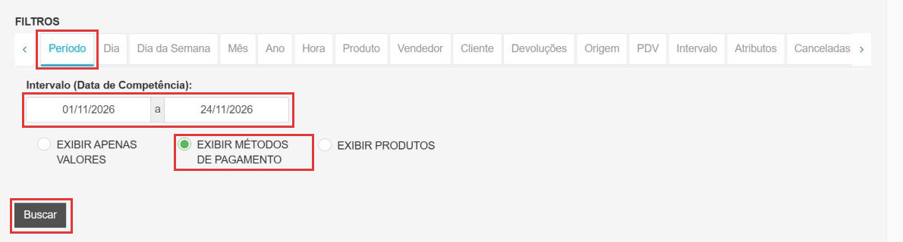
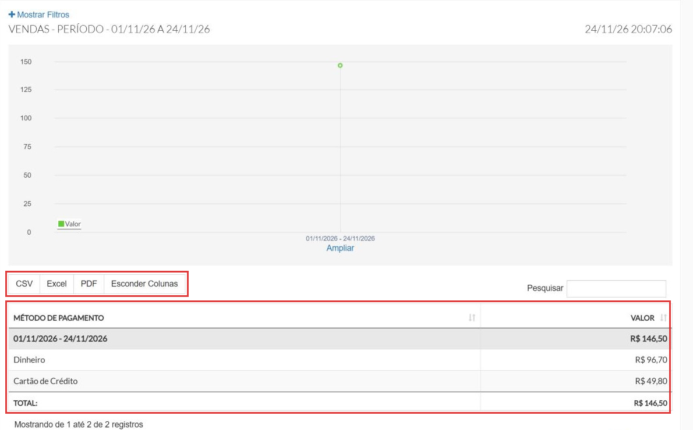
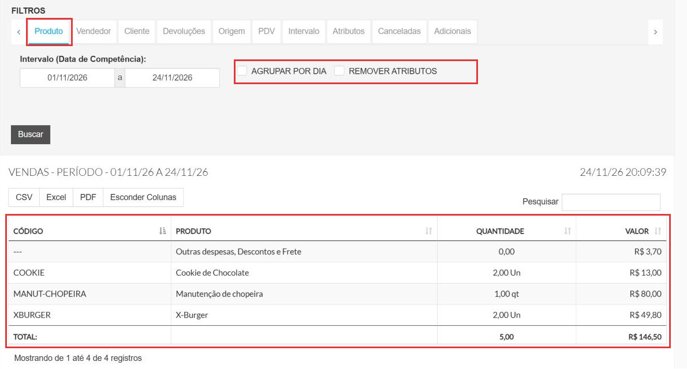

# Como ver o relatório de vendas

:material-clock-outline: 6 minutos · :material-format-list-numbered: 4 passos · :material-calendar-check: Atualizado em 24/11/2026

O **relatório de vendas** mostra quanto a loja vendeu num período, com várias visões: por forma de pagamento, por produto e outras. Exemplo: no meio do mês, o dono quer acompanhar quanto vendeu em dinheiro e em cartão de 01/11 até hoje (24/11). Ele escolhe o período, pede para exibir as formas de pagamento e vê o total de cada uma.

## Entenda o conceito

**Resumo do mês.** No alto da tela aparece **Vendas no mês de** (mês atual), com o total e o valor de cada forma de pagamento, e o botão **Mais informações**.

**Abas de filtro.** Em **Filtros**, cada aba é uma visão do relatório: **Período**, **Dia**, **Dia da Semana**, **Mês**, **Ano**, **Hora**, **Produto**, **Vendedor**, **Cliente**, **Devoluções**, **Origem**, **PDV**, **Intervalo**, **Atributos**, **Canceladas** e **Adicionais**. Todas pedem o **Intervalo (Data de Competência)**, e algumas têm opções próprias. Se não vir uma aba, use as setas **‹** e **›** nas pontas da barra. Por exemplo:

| Aba | Opções da aba | O que o resultado mostra (no exemplo) |
| --- | --- | --- |
| **Período** | **Exibir apenas valores**, **Exibir métodos de pagamento** ou **Exibir produtos** | Com **Exibir métodos de pagamento**: o valor de cada forma de pagamento e o total. |
| **Produto** | **Agrupar por dia** e **Remover atributos** | O **Código**, o **Produto**, a **Quantidade** e o **Valor** de cada produto vendido. |

**Vendas × extrato × DRE.** Este relatório mostra o que foi **vendido**. O dinheiro que entrou na conta fica no extrato (veja [Como consultar o extrato](../financas/extrato.md)), e o lucro, no relatório de resultados (veja [Como ler o relatório de resultados (DRE)](../financas/relatorio-de-resultados.md)).

**Quando usar:** para acompanhar as vendas do mês, comparar períodos e ver os produtos que mais vendem. **Quando não usar:** para conferir o dinheiro que entrou no banco (use o extrato) ou o lucro (use a DRE).

!!! info "Antes de começar"
    - A tela abre no formato do sistema antigo, dentro do ERP.
    - O resultado tem os botões **CSV**, **Excel** e **PDF**, para levar o relatório para fora do sistema.

Nos prints, o **quadrado vermelho** mostra onde você deve clicar ou digitar.

## Abra o relatório de vendas

No menu do lado esquerdo, clique em **Relatórios** → **Financeiro** → **Vendas**. No alto aparece o resumo **Vendas no mês de** (mês atual); abaixo ficam os **Filtros**.

## Escolha a visão e o período

Em **Filtros**, clique na aba da visão que você quer (no exemplo, **Período**). Em **Intervalo (Data de Competência)**, preencha a data inicial e, depois do **a**, a final (no exemplo, **01/11/2026** a **24/11/2026**). Escolha as opções da aba; no exemplo, **Exibir métodos de pagamento**. Clique em **Buscar**.

{ loading=lazy }

## Leia o resultado

Abaixo dos filtros aparece o relatório, com o título (no exemplo, **Vendas - Período - 01/11/26 a 24/11/26**, com o intervalo buscado) e a data e a hora em que foi gerado. Ele traz:

- um **gráfico** do valor no período, com o link **Ampliar**;
- a **tabela**, que no exemplo mostra cada forma de pagamento (**Dinheiro** R$ 96,70 e **Cartão de Crédito** R$ 49,80) e o **Total** (R$ 146,50);
- os botões **CSV**, **Excel** e **PDF** e o **Esconder Colunas**;
- a caixa **Pesquisar**, que procura na tabela, e a escolha de quantos resultados aparecem por página.

Para mudar a busca, clique em **Mostrar Filtros**.

{ loading=lazy }

## Veja as vendas por produto (opcional)

Clique na aba **Produto**, preencha o mesmo intervalo e clique em **Buscar**. A tabela mostra o **Código**, o **Produto**, a **Quantidade** e o **Valor** de cada produto vendido no período, com o **Total** (o título do relatório continua mostrando o intervalo buscado). A aba tem as opções **Agrupar por dia** e **Remover atributos**; na dúvida sobre elas, fale com o suporte.

No exemplo, a tabela também tem a linha **Outras despesas, Descontos e Frete**, com R$ 3,70, que entra no total (13,00 + 80,00 + 49,80 + 3,70 = 146,50).

As outras abas também pedem o intervalo e o **Buscar**; algumas têm opções próprias.

{ loading=lazy }

!!! tip "Boas práticas"
    - **Compare períodos iguais:** mês com mês, semana com semana. Fica mais fácil ver se as vendas subiram.
    - **Confira as formas de pagamento:** compare o valor de cada forma com o fechamento do caixa. No cartão, o banco recebe com a taxa descontada e em outra data (veja [Como cadastrar as taxas do cartão](../financas/taxas-do-cartao.md)).
    - **Veja os produtos campeões:** a aba **Produto** ajuda a decidir o que repor e o que promover.

## Deu algum problema?

??? question "O relatório veio vazio"
    Confira o **Intervalo (Data de Competência)**: as duas datas precisam estar preenchidas e o período precisa ter vendas.

??? question "O valor está diferente do que entrou no caixa"
    O relatório mostra o que foi vendido no intervalo. O caixa e o banco podem ter datas e valores diferentes (no cartão, por exemplo, entra o valor com a taxa descontada). Para conferir o caixa, use o fechamento de caixa, em **Relatórios** → **Financeiro** → **Fechamento de caixa**. Se a diferença continuar, fale com o suporte.

??? question "Para que serve a linha Outras despesas, Descontos e Frete?"
    É uma linha da visão **Produto** com valores das vendas que não são de um produto. No exemplo, ela tem R$ 3,70 e entra no total. Para saber de onde vem um valor dessa linha, fale com o suporte.

??? question "Os filtros sumiram depois da busca"
    Clique em **Mostrar Filtros**, acima do título do relatório.

**Relacionados:** [Como consultar o extrato](../financas/extrato.md) · [Como ler o relatório de resultados (DRE)](../financas/relatorio-de-resultados.md)

relatório de vendas vendas do mês quanto vendi vendas por período vendas por produto produtos mais vendidos vendas por forma de pagamento dinheiro cartão vendas por dia vendas por vendedor vendas por cliente data de competência exibir métodos de pagamento exibir produtos agrupar por dia exportar relatório csv excel pdf
