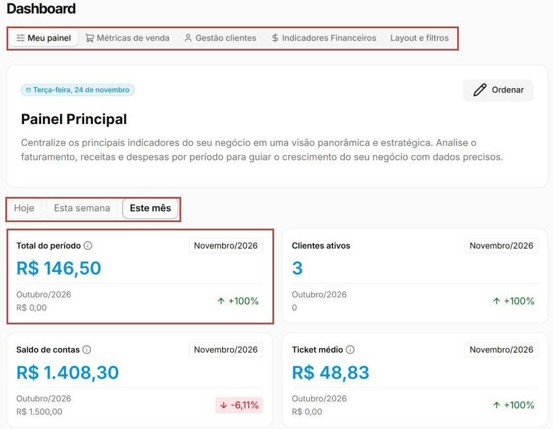
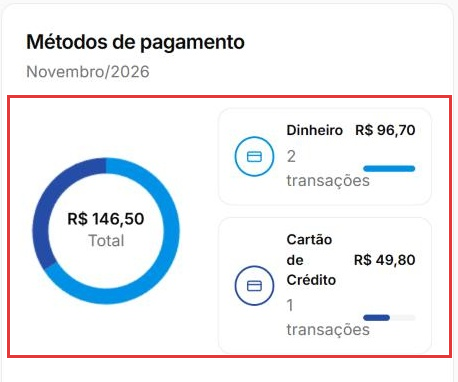
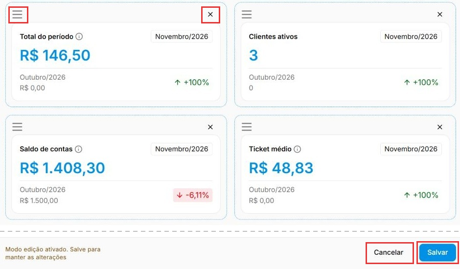

# Como usar o painel Visão geral

:material-clock-outline: 6 minutos · :material-format-list-numbered: 4 passos · :material-calendar-check: Atualizado em 24/11/2026

O **painel Visão geral** (o **Dashboard**) fica no menu **Visão geral**. Ele junta os números mais importantes da loja: quanto vendeu, quantos clientes estão ativos, quanto tem nas contas, o que falta receber e pagar. Exemplo: toda manhã, o dono abre o painel, escolhe **Este mês** e vê, num relance, o total vendido no mês e se ele está maior ou menor que no mês passado.

## Entenda o conceito

**Abas do painel.** O painel tem quatro visões, uma em cada aba:

| Aba | O que mostra |
| --- | --- |
| **Meu painel** | O **Painel Principal**, com todos os quadros das outras três abas juntos: vendas, clientes e finanças. |
| **Métricas de venda** | O **Histórico de vendas**: total, ticket médio, maior venda, cancelamentos, vendas por hora, produtos e categorias mais vendidos, formas de pagamento, canais de venda (**Integrações**) e **Venda delivery**. |
| **Gestão clientes** | A **Gestão de clientes**: clientes ativos, regulares e novos, receita por segmento, o **Top 5 clientes**, a distribuição por ticket médio e a qualidade do cadastro (telefones e e-mails não cadastrados e contatos sem registro). |
| **Indicadores Financeiros** | Os **Indicadores financeiros**: saldo das contas, a receber, a pagar, geração de caixa, **Receita vs Despesa**, **Projeção de fluxo**, geração líquida de caixa e disponibilidade acumulada. |

A quinta aba, **Layout e filtros**, mostra os **Indicadores ativos**, as listas de **Card** e **Gráficos e tabelas** de cada aba e as opções de **Layout e colunas**. Na dúvida sobre essas opções, fale com o suporte.

**Cartões e comparação.** Os quadros pequenos (cartões) mostram o número do período escolhido e, embaixo, o do período anterior, com a diferença em porcentagem: **seta verde para cima** quando subiu, **seta vermelha para baixo** quando caiu. No exemplo, com **Este mês**, o **Total do período** de novembro (R$ 146,50) aparece com o de outubro (R$ 0,00) embaixo. Quando o período anterior está zerado, o cartão mostra **+100%**. Outro exemplo: o **Saldo de contas** caiu de R$ 1.500,00 para R$ 1.408,30 e aparece **-6,11%**, com a seta vermelha.

**O que cada cartão considera.** O **ⓘ** ao lado do nome explica o cálculo. Os principais:

- **Total do período** e **Ticket médio:** consideram todas as vendas, sem descontar trocas e devoluções. O **ticket médio** é o valor médio de cada venda (o total dividido pelo número de vendas). No exemplo, R$ 146,50 em 3 vendas dá **R$ 48,83**.
- **Saldo de contas:** não conta lançamentos com pagamento futuro.
- **A receber** e **A pagar:** somam os lançamentos que ainda não foram pagos ou recebidos.
- **Geração de caixa:** considera só os valores que já entraram ou saíram de fato.
- **Receita vs Despesa:** considera só os valores já pagos ou recebidos. **Projeção de fluxo:** inclui os lançamentos vencidos.

**Quando usar:** para acompanhar a loja no dia a dia, num relance. **Quando não usar:** para conferir venda por venda ou montar listas detalhadas; para isso, use os relatórios do menu **Relatórios**, como o [relatório de vendas](vendas.md) e o [relatório dinâmico](relatorio-dinamico.md).

!!! info "Antes de começar"
    - O painel mostra os dados da empresa escolhida no canto de cima, à esquerda. Se você tem mais de uma loja, confira qual está escolhida.
    - Os números vêm das vendas e dos lançamentos financeiros. Se a loja ainda não tem movimento, muitos quadros aparecem zerados ou com **Nenhum dado para exibir**.

Nos prints, o **quadrado vermelho** mostra onde você deve clicar ou digitar.

## Abra o painel e escolha a aba

No menu do lado esquerdo, clique em **Visão geral**. Se aparecer a janela **Bem-vindo(a)!**, clique em **Pular** para fechar ou em **Próximo** para fazer o tour. O painel abre na aba **Meu painel**. Para outra visão, clique na aba (**Métricas de venda**, **Gestão clientes** ou **Indicadores Financeiros**).

No alto do painel podem aparecer avisos de novidades do sistema. Eles não mudam os números; use as setas ao lado para ver os outros avisos.

## Escolha o período

Abaixo do título da aba, clique em **Hoje**, **Esta semana** ou **Este mês**. Os cartões mudam para o período escolhido, que aparece no canto de cada cartão (por exemplo, **Novembro/2026**). Embaixo, aparece o período anterior para comparar (em **Esta semana**, a semana passada; em **Este mês**, o mês passado).

No exemplo, com **Este mês**, o **Total do período** é **R$ 146,50** em novembro, contra **R$ 0,00** em outubro: **+100%**.

{ loading=lazy }

## Leia os gráficos

Desça a tela para ver os gráficos e tabelas da aba. Por exemplo, em **Métodos de pagamento**, o círculo mostra o total do mês e, ao lado, o valor e o número de transações de cada forma de pagamento. No exemplo, **R$ 146,50** no total: **Dinheiro** R$ 96,70 (2 transações) e **Cartão de Crédito** R$ 49,80 (1 transação).

Passe o mouse sobre o **ⓘ** de um quadro para ver o que ele considera.

{ loading=lazy }

## Organize os quadros (opcional)

Clique em **Ordenar**, no canto direito do quadro com o título da aba, na altura da data. O painel entra no **modo de edição**: cada quadro ganha o **≡**, no canto esquerdo, e o **×**, no canto direito. No fim da tela aparece **Modo edição ativado. Salve para manter as alterações**, com os botões **Cancelar** e **Salvar**.

Para sair do modo de edição sem mudar nada, clique em **Cancelar**. Na dúvida sobre como reorganizar os quadros, fale com o suporte.

{ loading=lazy }

!!! tip "Boas práticas"
    - **Olhe o painel todo dia:** poucos minutos bastam para ver se as vendas estão no ritmo e se há contas para pagar.
    - **Lembre que o período atual ainda não terminou:** em **Esta semana**, por exemplo, a semana de 23/11 a 29/11 é comparada com a de 16/11 a 22/11 inteira. No começo da semana ou do mês, é normal o número ficar abaixo do período anterior. Para uma comparação justa, olhe de novo no fim do período.
    - **Use a qualidade do cadastro:** na aba **Gestão clientes**, veja a porcentagem de telefones e e-mails não cadastrados e complete os cadastros (veja [Como cadastrar um cliente](../clientes/cadastrar-cliente.md)).

## Deu algum problema?

??? question "O painel está todo zerado"
    Confira o período (**Hoje**, **Esta semana** ou **Este mês**) e a empresa escolhida no canto de cima, à esquerda. Se não houve vendas nem lançamentos no período, os quadros ficam zerados.

??? question "O total do painel é diferente do relatório de vendas"
    O **Total do período** considera todas as vendas, sem descontar trocas e devoluções. Confira também se o período é o mesmo nos dois. Se a diferença continuar, fale com o suporte.

??? question "O saldo de contas não bate com o banco"
    O **Saldo de contas** não conta lançamentos com pagamento futuro. Para conferir conta por conta, veja [Como consultar o extrato](../financas/extrato.md).

??? question "Entrei no modo de edição sem querer"
    Clique em **Cancelar**, no fim da tela, para sair do modo de edição.

??? question "Apareceu uma janela de boas-vindas"
    É um tour rápido pelas ferramentas do sistema. Clique em **Próximo** para fazer o tour ou em **Pular** para fechar.

**Relacionados:** [Como ver o relatório de vendas](vendas.md) · [Como consultar o extrato](../financas/extrato.md) · [Como ler o relatório de resultados (DRE)](../financas/relatorio-de-resultados.md)

visão geral dashboard painel painel principal tela inicial indicadores métricas de venda gestão de clientes indicadores financeiros total do período ticket médio maior venda saldo de contas a receber a pagar geração de caixa receita vs despesa projeção de fluxo métodos de pagamento top 5 produtos top 5 clientes hoje esta semana este mês ordenar organizar quadros layout e filtros
