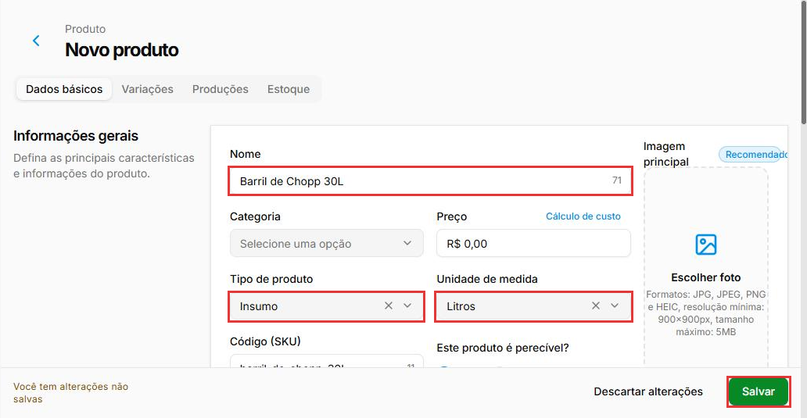
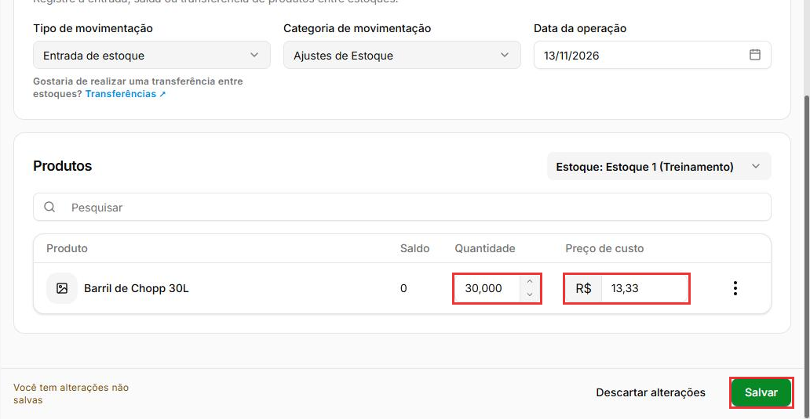
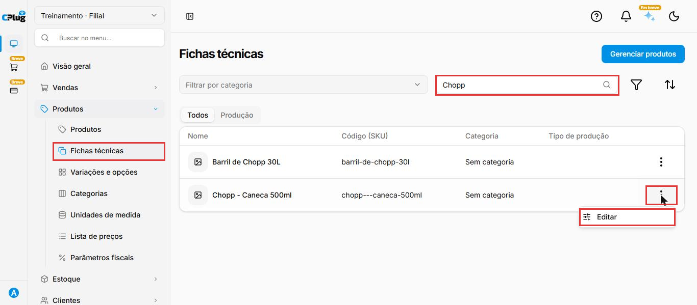
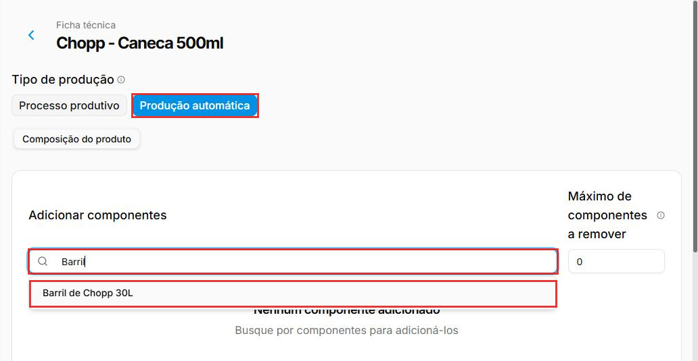
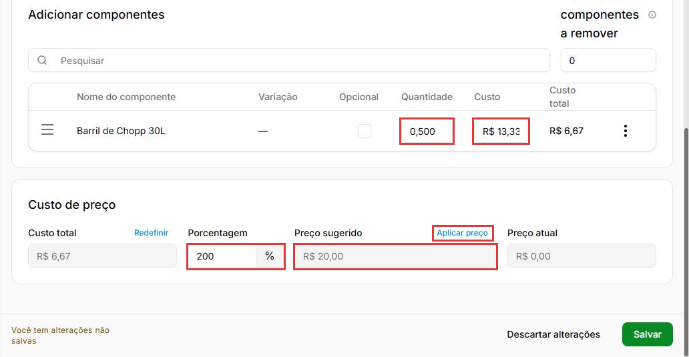
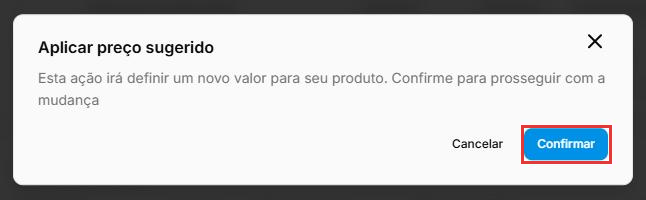
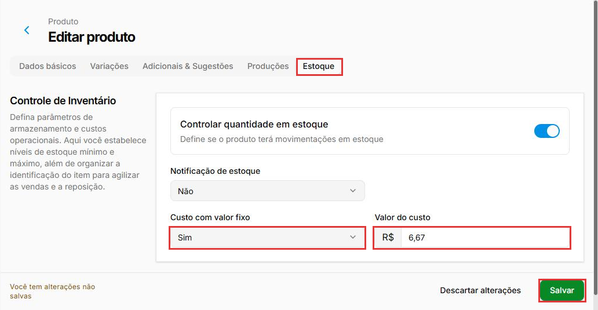

# Como cadastrar o chopp com baixa em litros do barril

:material-clock-outline: 15 minutos · :material-format-list-numbered: 6 passos · :material-tag-outline: ERP 2.0 · :material-calendar-check: Atualizado em 13/11/2026

O bar compra o chopp em **barril** e vende em **caneca**. Para o estoque saber que cada caneca de 500 ml tira meio litro do barril, o barril é cadastrado como **insumo em litros** e a caneca ganha uma **ficha técnica** com esse meio litro. Exemplo: um barril de 30 litros que custou R$ 400,00 sai a R$ 13,33 o litro; a caneca de 500 ml custa R$ 6,67 e, com 200% em cima do custo, é vendida a R$ 20,00.

## Entenda o conceito

São dois produtos, ligados pela ficha técnica:

| Produto | Tipo | Unidade | Para que serve | Exemplo |
| --- | --- | --- | --- | --- |
| **Barril** | **Insumo** | **Litros** | Recebe a entrada da compra e guarda o saldo em litros. Não é vendido. | Barril de Chopp 30L |
| **Caneca** | **Simples** | **Quantidade** | É o que o atendente vende. A ficha técnica diz quanto do barril vai em cada uma. | Chopp - Caneca 500ml |

- **Ficha técnica:** a receita do produto. Na caneca, o único componente é o barril, com **0,500** litro.
- **Produção automática:** o tipo de ficha em que os componentes saem do estoque **na hora da venda**. É o caso do chopp, servido na hora.
- **Custo do componente:** vem do custo do insumo. Por isso a entrada do barril precisa ter o **preço de custo por litro**.
- **Unidade da caneca:** a caneca é vendida por unidade (1 caneca), por isso a unidade dela é **Quantidade**, e não litro.

**Quando não usar:** chopp ou cerveja em garrafa ou lata, revendidos do jeito que chegam, não precisam de ficha técnica. Cadastre como produto **Simples** (veja [Como cadastrar um produto](../../produtos/cadastrar-produto.md)).

!!! info "Antes de começar"
    - Tenha em mãos o valor pago no barril e quantos litros ele tem.
    - Neste manual, a entrada do barril é feita pela **entrada de estoque**, já em litros.
    - Se ainda não cadastrou fichas técnicas, veja [Como montar a ficha técnica](../../produtos/ficha-tecnica.md).

Nos prints, o **quadrado vermelho** mostra onde você deve clicar ou digitar.

## Cadastre o barril como insumo em litros

No menu do lado esquerdo, clique em **Produtos**, depois em **Produtos** e em **Novo produto**. Preencha:

- **Nome:** por exemplo, **Barril de Chopp 30L**.
- **Categoria:** opcional. Se usar, algo como **Insumos**.
- **Tipo de produto:** **Insumo**. A lista tem **Coleção**, **Insumo** e **Simples**.
- **Unidade de medida:** **Litros**. Digite "Lit" na busca da lista para achar.

O **Código (SKU)** é preenchido sozinho a partir do nome. Na aba **Estoque**, **Controlar quantidade em estoque** já vem ligado: deixe assim, porque é ele que faz o barril ter saldo para baixar. Clique em **Salvar**. Aparece **Produto cadastrado com sucesso!**.

{ loading=lazy }

## Dê entrada no barril em litros

Em **Estoque > Estoque**, nos **três pontinhos** do estoque, clique em **Registrar entrada**. Em **Categoria de movimentação**, escolha o motivo da entrada (veja [Como dar entrada no estoque](../../estoque/entrada-de-estoque.md)). Em **Produtos**, clique em **Pesquisar**, digite "Barril" e clique nele. Preencha:

- **Quantidade:** os litros do barril. O campo tem três casas decimais: para 30 litros, digite **30000** e ele mostra **30,000**.
- **Preço de custo:** o valor de **um litro**. Exemplo: R$ 400,00 ÷ 30 litros = **13,33**.

Clique em **Salvar**. O sistema volta para a lista de estoques.

{ loading=lazy }

## Cadastre a caneca

Em **Produtos > Produtos > Novo produto**, cadastre a caneca como um produto comum:

- **Nome:** por exemplo, **Chopp - Caneca 500ml**.
- **Tipo de produto:** **Simples**.
- **Unidade de medida:** **Quantidade** (já vem assim).

Clique em **Salvar**. Aparece **Produto cadastrado com sucesso!**. O preço de venda pode ficar em R$ 0,00 por enquanto: ele é aplicado pela ficha técnica no passo 5.

## Abra a ficha técnica e adicione o barril

No menu, clique em **Produtos** e depois em **Fichas técnicas**. Busque "Chopp" e, nos **três pontinhos** da caneca, clique em **Editar**.

{ loading=lazy }

Em **Tipo de produção**, deixe **Produção automática** (já vem marcada). Em **Adicionar componentes**, clique em **Pesquisar**, digite "Barril" e clique no barril.

{ loading=lazy }

## Informe o meio litro e aplique o preço

Na linha do barril:

- **Quantidade:** os litros de uma caneca. Vem **1,000**; para 500 ml, digite **500** e o campo mostra **0,500**.
- **Custo:** vem do custo do barril (R$ 13,33 o litro). O **Custo total** da linha é calculado sozinho: 0,500 × R$ 13,33 = **R$ 6,67**.

Em **Custo de preço**, digite a **Porcentagem** em cima do custo. Exemplo: **200**. O **Preço sugerido** fica **R$ 20,00**. Clique em **Aplicar preço**. Os outros campos da ficha estão explicados em [Como montar a ficha técnica](../../produtos/ficha-tecnica.md).

{ loading=lazy }

Na janela **Aplicar preço sugerido**, clique em **Confirmar**. O **Preço atual** passa a ser R$ 20,00. Clique em **Salvar**. Aparece **Ficha técnica atualizada com sucesso!**.

{ loading=lazy }

## Defina um custo próprio para a caneca

Para a caneca ter um custo próprio no cadastro, abra o cadastro dela (**Produtos > Produtos**, clique no nome) e vá na aba **Estoque**:

- **Custo com valor fixo:** **Sim**. Com **Sim**, aparece o campo **Valor do custo**.
- **Valor do custo:** o custo de uma caneca. Exemplo: **6,67**.

Deixe as outras opções como vieram. Clique em **Salvar**. Aparece **Produto atualizado com sucesso!**.

{ loading=lazy }

!!! warning "O Valor do custo é digitado por você"
    Quando o barril mudar de preço, refaça a conta e troque o **Valor do custo** da caneca. Exemplo: barril de R$ 450,00 com 30 litros dá R$ 15,00 o litro, e a caneca de 500 ml passa a custar R$ 7,50.

!!! tip "Boas práticas"
    - **Uma caneca por tamanho:** cadastre "Chopp - Caneca 300ml" e "Chopp - Caneca 500ml", cada uma com a sua quantidade na ficha (0,300 e 0,500).
    - **Espuma:** a ficha não tem campo de perda. Para considerar a espuma, coloque um pouco a mais na quantidade. Exemplo: 0,520.
    - **Confira o custo na ficha** depois de cada compra. Se a linha do barril estiver com custo antigo ou zerado, use **Recalcular custo** nos três pontinhos da linha.

## Deu algum problema?

??? question "Não acho Produção automática no Tipo de produto"
    No ERP 2.0, o **Tipo de produto** da caneca é **Simples**. A produção automática é escolhida na **ficha técnica** (Produtos > Fichas técnicas > Editar), em **Tipo de produção**.

??? question "Digitei 30 e a quantidade ficou 0,030"
    Os campos **Quantidade** da entrada e da ficha têm três casas decimais. Para 30 litros, digite **30000**; para meio litro, **500**.

??? question "O custo do barril veio R$ 0,00 na ficha"
    A entrada do barril foi feita sem **Preço de custo**. Corrija a entrada errada (veja [Como dar entrada no estoque](../../estoque/entrada-de-estoque.md)) e lance de novo com o preço por litro. Na ficha, digite o custo na coluna **Custo** ou use **Recalcular custo**.

??? question "O lucro do chopp aparece errado nos relatórios"
    Confira se a caneca tem o **Custo com valor fixo** preenchido (passo 6). Se continuar, fale com o suporte.

**Relacionados:** [Como montar a ficha técnica](../../produtos/ficha-tecnica.md) · [Como cadastrar um produto](../../produtos/cadastrar-produto.md) · [Como dar entrada no estoque](../../estoque/entrada-de-estoque.md)

chopp barril caneca copo litros ml insumo produção automática ficha técnica componentes baixa de estoque custo fixo custo com valor fixo valor do custo lucro bebida fracionada aplicar preço porcentagem 30000 0,500
