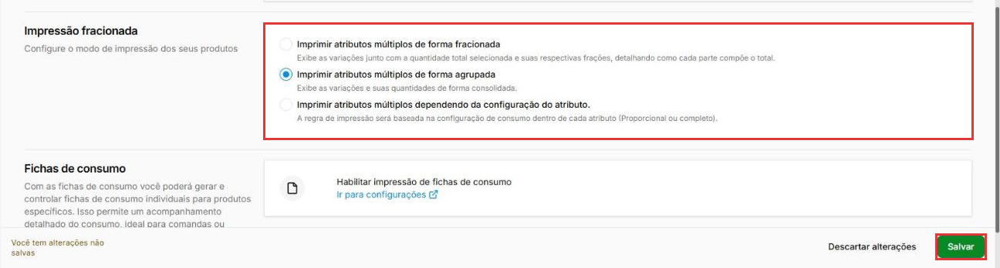

# Como escolher a impressão fracionada ou agrupada dos atributos

:material-clock-outline: 3 minutos · :material-format-list-numbered: 3 passos · :material-tag-outline: ERP 2.0 e ERP Legado · :material-calendar-check: Atualizado em 13/11/2026

Quando o cliente escolhe mais de uma opção no mesmo produto, como dois sabores numa pizza ou vários adicionais num lanche, o pedido impresso pode mostrar cada parte com a sua fração ou mostrar tudo consolidado. Exemplo: numa pizza meio calabresa, meio frango, a pizzaria quer ver as frações; numa hamburgueria, a cozinha prefere os adicionais inteiros.

## Entenda o conceito

**Atributos múltiplos** são as opções escolhidas num mesmo item, como sabores e adicionais. No ERP 2.0, eles são as **variações** cadastradas em **Produtos > Variações e opções** (ex.: Sabor da pizza). A configuração **Impressão fracionada** decide como eles aparecem no pedido impresso:

| Opção na tela | O que a tela diz | Quando usar |
| --- | --- | --- |
| **Imprimir atributos múltiplos de forma fracionada** | "Exibe as variações junto com a quantidade total selecionada e suas respectivas frações, detalhando como cada parte compõe o total." | Pizzarias e produtos divididos em partes |
| **Imprimir atributos múltiplos de forma agrupada** | "Exibe as variações e suas quantidades de forma consolidada." | Hamburguerias e restaurantes, quando a fração confunde a cozinha |
| **Imprimir atributos múltiplos dependendo da configuração do atributo.** | "A regra de impressão será baseada na configuração de consumo dentro de cada atributo (Proporcional ou completo)." | Só com orientação do suporte |

**Quando não mexer:** se a cozinha já lê bem os pedidos como saem hoje, deixe como está. Sem orientação do suporte, escolha uma das duas primeiras opções.

!!! info "Antes de começar"
    - É preciso ter acesso às configurações do ponto de venda.
    - A terceira opção depende de uma configuração de consumo em cada atributo. Antes de usá-la, fale com o suporte para conferir como os atributos da loja estão configurados.

Nos prints, o **quadrado vermelho** mostra onde você deve clicar ou digitar.

## Abra Recibos e notas impressas

No menu do lado esquerdo, clique em **Ponto de venda**, depois em **Configurações** e em **Recibos e notas impressas**. Role a tela até a seção **Impressão fracionada** ("Configure o modo de impressão dos seus produtos").

## Escolha o modo de impressão

Marque uma das três opções, conforme a tabela acima. Assim que você muda a opção, o rodapé avisa **Você tem alterações não salvas**.

{ loading=lazy }

## Salve a alteração

Clique em **Salvar**, no canto de baixo, à direita. **Descartar alterações** volta para a opção anterior. Se o PDV continuar imprimindo do jeito antigo, fale com o suporte.

!!! note "No ERP Legado"
    A mesma configuração fica na **engrenagem** > **Configurações do PDV** > aba **Configurações do PDV**, no grupo **IMPRESSÃO**, em **Impressão fracionada**. As três opções são as mesmas do ERP 2.0.

!!! tip "Boas práticas"
    - **Pergunte a quem prepara os pedidos** antes de trocar: é a cozinha que lê o pedido impresso.
    - **Depois de trocar, confira o primeiro pedido impresso** antes do movimento começar.

## Deu algum problema?

??? question "Troquei a opção, mas o pedido continua saindo do jeito antigo"
    Confira se clicou em **Salvar**. Se continuar, fale com o suporte.

??? question "Não sei qual opção a loja usa hoje"
    Abra **Recibos e notas impressas** e veja qual opção está marcada em **Impressão fracionada**. Só olhar não muda nada; se mexer sem querer, clique em **Descartar alterações**.

??? question "Onde configuro o consumo Proporcional ou completo do atributo?"
    Fale com o suporte antes de usar a terceira opção. Ele confere como os atributos da loja estão configurados.

**Relacionados:** [Gerenciamento e restrição de impressões no PDV](restringir-impressoes.md) · [Como cadastrar um produto com variações](../../produtos/cadastrar-produto-com-variacoes.md) · [Como cadastrar variações](../../produtos/cadastrar-variacoes.md)

impressão fracionada agrupada atributos múltiplos adicionais sabores pizza meio a meio frações cupom de pedido cozinha recibos e notas impressas configuração de consumo proporcional completo
