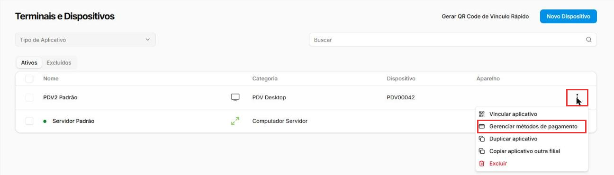
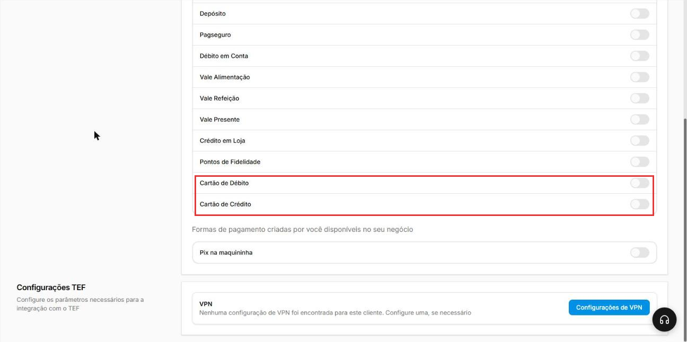

# Como escolher as formas de pagamento de cada aparelho

:material-clock-outline: 3 minutos · :material-format-list-numbered: 2 passos · :material-tag-outline: ERP 2.0 · :material-calendar-check: Atualizado em 16/11/2026

Cada aparelho cadastrado no ERP tem a sua própria lista de formas de pagamento. A tela diz para que ela serve: "Selecione os métodos de pagamento que deseja disponibilizar no dispositivo". Exemplo: quando uma POS (a maquininha com o aplicativo da CPlug) não pede o cartão ao fechar a venda, um dos pontos a conferir são as chaves **Cartão de Débito** e **Cartão de Crédito** desse aparelho.

## Entenda o conceito

Os aparelhos ficam em **Dispositivos > Terminais & Dispositivos**, cada um com o nome que a loja deu (coluna **Nome**). A coluna **Categoria** mostra o tipo, como **PDV Desktop**, **PDV Móvel** ou **Atendimento mobile**.

A opção do menu se chama **Gerenciar métodos de pagamento** e mostra as formas de pagamento em dois grupos:

| Grupo na tela | O que tem |
| --- | --- |
| **Formas de pagamento disponíveis no seu negócio** | As formas padrão: PIX, Dinheiro, Boleto, vales, **Cartão de Débito**, **Cartão de Crédito** e outras |
| **Formas de pagamento criadas por você disponíveis no seu negócio** | As formas que a loja cadastrou (veja [Como cadastrar formas de pagamento](../../financas/formas-de-pagamento.md)) |

À direita de cada forma fica uma **chave**, o botão de ligar e desligar. A chave grava assim que você clica: aparece o aviso "Atualizando pagamento..." no canto de cima, à direita, e não há botão **Salvar**.

Na mesma tela fica a seção **Configurações TEF**, com o botão **Configurações de VPN** (veja [Configuração e instalação do TEF (ERP 2.0)](tef-erp2.md)).

**Quando mexer:** quando quiser mudar as formas de pagamento de um aparelho. Se está tudo certo, deixe como está.

!!! info "Antes de começar"
    - Entre no ERP com um usuário que veja o menu **Dispositivos**.
    - Saiba o nome do aparelho no ERP. Se a loja tem vários, confira qual está com o problema.

Nos prints, o **quadrado vermelho** mostra onde você deve clicar ou digitar.

## Abra os métodos de pagamento do aparelho

No menu do lado esquerdo, clique em **Dispositivos** e depois em **Terminais & Dispositivos**. Encontre o aparelho pelo nome (se a lista for longa, use o campo **Buscar**), clique nos **três pontos** no fim da linha e em **Gerenciar métodos de pagamento**.

{ loading=lazy }

## Ligue as formas que o aparelho vai aceitar

A tela abre com o nome do aparelho no topo. Role até o fim do primeiro grupo, onde ficam **Cartão de Débito** e **Cartão de Crédito**, e clique nas chaves das formas que o aparelho deve aceitar. As formas criadas pela loja ficam logo abaixo, no segundo grupo. Cada clique já grava.

{ loading=lazy }

!!! note "No ERP Legado"
    Para liberar as formas de pagamento de um aparelho no ERP Legado, fale com o suporte.

!!! tip "Boas práticas"
    - **Confira as chaves de cada aparelho** quando a loja tiver mais de um: cada aparelho tem a sua tela, com o nome dele no topo.
    - **Depois de mudar, acompanhe a próxima venda** no aparelho e confira se as formas de pagamento estão certas.

## Deu algum problema?

??? question "Liguei as chaves, mas a POS continua sem pedir o cartão"
    Se o menu de três pontos do aparelho tiver a opção **Sincronizar aplicativo**, use-a e teste de novo. Se continuar, fale com o suporte e diga o nome do aparelho e quais chaves estão ligadas.

??? question "Liguei uma chave por engano"
    Clique de novo na chave para desligar. Ela também grava na hora.

??? question "A forma de pagamento que a loja criou não aparece"
    Confira se ela está cadastrada, como em [Como cadastrar formas de pagamento](../../financas/formas-de-pagamento.md). Se estiver e não aparecer, fale com o suporte.

**Relacionados:** [Como cadastrar formas de pagamento](../../financas/formas-de-pagamento.md) · [Configuração e instalação do TEF (ERP 2.0)](tef-erp2.md)

pos maquininha pdv móvel atendimento mobile pdv desktop não pede cartão não pede aproximação cartão de débito cartão de crédito gerenciar métodos de pagamento formas de pagamento do aparelho terminais e dispositivos chave ligar desligar sincronizar aplicativo
