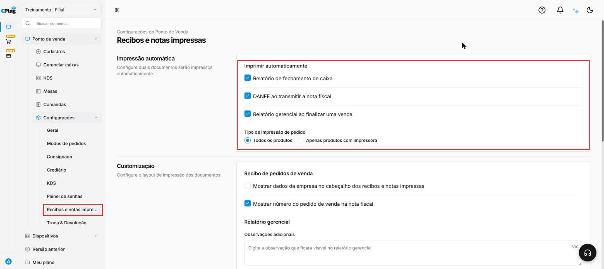
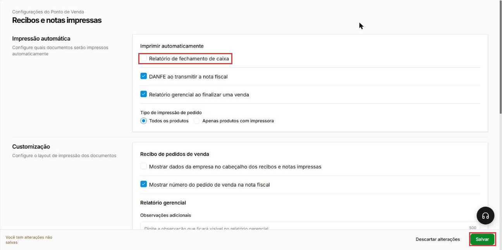

# Como escolher o que o PDV imprime automaticamente

:material-clock-outline: 3 minutos · :material-format-list-numbered: 3 passos · :material-tag-outline: ERP 2.0 e ERP Legado · :material-calendar-check: Atualizado em 16/11/2026

Alguns documentos o PDV imprime sozinho, sem o operador pedir. Pelo ERP, você escolhe quais deles saem automaticamente. Exemplo: se a loja não usa o relatório de fechamento de caixa impresso, pode desmarcar essa opção.

## Entenda o conceito

A configuração fica em **Recibos e notas impressas**, na seção **Impressão automática**. Em **Imprimir automaticamente** há três caixas, uma para cada documento:

- **Relatório de fechamento de caixa**;
- **DANFE ao transmitir a nota fiscal** (o DANFE é a versão impressa da nota fiscal);
- **Relatório gerencial ao finalizar uma venda**.

Caixa marcada quer dizer que o documento sai automaticamente; desmarcada, que não sai sozinho.

Logo abaixo fica o **Tipo de impressão de pedido**, com duas opções: **Todos os produtos** ou **Apenas produtos com impressora**. Antes de trocar essa opção, fale com o suporte para entender o efeito na sua loja.

Na mesma tela ficam outras seções: **Customização** (layout dos documentos), **QR Code de engajamento**, **Impressão fracionada** (veja [Como escolher a impressão fracionada ou agrupada dos atributos](impressao-de-atributos.md)) e **Fichas de consumo**.

**Quando mexer:** quando a loja quer que um desses documentos pare de sair sozinho, ou passe a sair. Se a loja está satisfeita com o que o PDV imprime hoje, deixe como está.

!!! info "Antes de começar"
    É preciso ter acesso às configurações do ponto de venda.

Nos prints, o **quadrado vermelho** mostra onde você deve clicar ou digitar.

## Abra Recibos e notas impressas

No menu do lado esquerdo, clique em **Ponto de venda**, depois em **Configurações** e em **Recibos e notas impressas**. A primeira seção da tela é a **Impressão automática**.

{ loading=lazy }

## Marque o que deve sair sozinho

Em **Imprimir automaticamente**, deixe marcados os documentos que o PDV deve imprimir sozinho e desmarque os que não devem sair. O **Tipo de impressão de pedido** fica como está, a não ser que o suporte oriente outra coisa. Assim que você muda uma opção, o rodapé avisa **Você tem alterações não salvas**.

{ loading=lazy }

## Salve a alteração

Clique em **Salvar**, no canto de baixo, à direita. **Descartar alterações** volta para como estava antes.

!!! note "No ERP Legado"
    As configurações de impressão do PDV ficam na **engrenagem** > **Configurações do PDV** > aba **Configurações do PDV**, no grupo **IMPRESSÃO**. Se não encontrar a opção que procura, fale com o suporte.

!!! tip "Boas práticas"
    - **Combine com quem usa os papéis** antes de desmarcar: alguém pode usar o relatório de fechamento na conferência do caixa.
    - **Depois de mudar, confira a próxima venda ou o próximo fechamento** no PDV, para ver se saiu só o que você deixou marcado.

## Deu algum problema?

??? question "Desmarquei, mas o PDV continua imprimindo"
    Confira se clicou em **Salvar**. Se o PDV já estava aberto, tente sincronizar: no menu de três barras do PDV, clique em **Sincronizar** (atalho **Ctrl + S**). Se continuar, fale com o suporte.

??? question "Não sei o que a loja usa hoje"
    Abra **Recibos e notas impressas** e veja o que está marcado. Só olhar não muda nada; se mexer sem querer, clique em **Descartar alterações**.

??? question "O PDV não imprime nada, nem o que está marcado"
    Confira se a impressora está ligada e cadastrada no ERP (veja [Como cadastrar uma impressora de rede direta no ERP 2.0](../perifericos/impressora-rede-erp2.md)). Se continuar, fale com o suporte.

**Relacionados:** [Como escolher a impressão fracionada ou agrupada dos atributos](impressao-de-atributos.md) · [Como cadastrar uma impressora de rede direta no ERP 2.0](../perifericos/impressora-rede-erp2.md) · [Como configurar o terminal de vendas](../../ponto-de-venda/configurar-terminal.md)

impressão automática imprimir automaticamente imprime sozinho parar de imprimir desligar impressão economizar papel bobina cupom nota impressa fechar caixa relatório de fechamento de caixa danfe ao transmitir a nota fiscal relatório gerencial ao finalizar uma venda tipo de impressão de pedido todos os produtos apenas produtos com impressora sincronizar recibos e notas impressas
