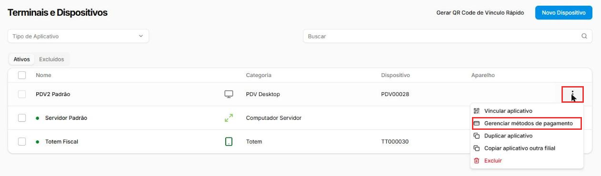
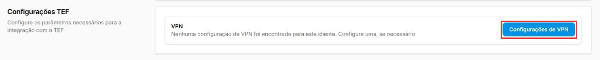
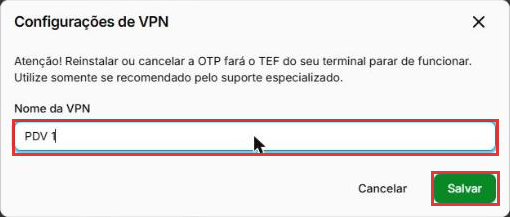

# Como configurar o TEF no ERP 2.0 e instalar no PDV

:material-clock-outline: 6 minutos · :material-format-list-numbered: 6 passos · :material-tag-outline: ERP 2.0 · TEF · PDV · :material-calendar-check: Atualizado em 17/11/2026

Com o **TEF**, o PDV (o caixa no computador) trabalha junto com o **Pinpad**, o aparelho do cartão ligado ao computador. A configuração tem uma parte no ERP e outra no computador do caixa, e costuma ser feita com o suporte acompanhando. Exemplo: a loja contratou o TEF para o caixa 1; com o suporte, você cria a VPN do terminal no ERP e depois faz a instalação do TEF no PDV.

## Entenda o conceito

| Parte | Onde fica | O que tem |
| --- | --- | --- |
| **VPN** | **Dispositivos > Terminais & Dispositivos** > três pontos do terminal > **Gerenciar métodos de pagamento** > seção **Configurações TEF** | O botão **Configurações de VPN**, que abre a janela onde se dá o **Nome da VPN**. |
| **Instalação do TEF** | No PDV: **Área administrativa > Operações TEF > Instalação** | O gateway (**SITEF** ou **SMARTTEF**), os dados do TEF (como **OTP** e **ID da Empresa**) e o botão **INSTALAR**. |

A janela da VPN fala em **OTP**, um código do TEF que também aparece na tela de instalação do PDV. Pelo aviso da própria janela, reinstalar ou cancelar a OTP "fará o TEF do seu terminal parar de funcionar" e a janela deve ser usada "somente se recomendado pelo suporte especializado".

**Quando usar:** na primeira configuração do TEF de um terminal, com o suporte acompanhando. **Quando não usar:** se o TEF do terminal já funciona, não salve a VPN de novo sem orientação do suporte.

!!! warning "Antes de começar"
    - O TEF precisa estar contratado e liberado para a loja. Se ainda não está, fale com o suporte antes de começar.
    - Tenha o contrato da operadora cadastrado em **Finanças**, com a taxa de cada bandeira, como em [Como cadastrar as taxas do cartão](../../financas/taxas-do-cartao.md).
    - Tenha um usuário de gerente ou administrador do PDV, para entrar na **Área administrativa**.
    - Deixe o **Pinpad** ligado no computador do caixa.

Nos prints, o **quadrado vermelho** mostra onde você deve clicar ou digitar.

## Abra os métodos de pagamento do terminal

No ERP, no menu do lado esquerdo, clique em **Dispositivos** e depois em **Terminais & Dispositivos**. Encontre o terminal do caixa pelo nome (a coluna **Categoria** mostra **PDV Desktop**), clique nos **três pontos** no fim da linha e em **Gerenciar métodos de pagamento**.

{ loading=lazy }

## Abra as Configurações de VPN

A tela abre com o nome do terminal no topo e as formas de pagamento dele (veja [Como escolher as formas de pagamento de cada aparelho](metodos-de-pagamento-na-pos.md)). Role até o fim, até **Configurações TEF**. Sem VPN criada, aparece "Nenhuma configuração de VPN foi encontrada para este cliente". Clique em **Configurações de VPN**.

{ loading=lazy }

## Dê o nome da VPN e salve

Faça este passo só com o suporte acompanhando, como pede o aviso da janela. Em **Nome da VPN**, digite um nome que identifique o caixa na loja. Exemplo: "PDV 1" ou "Caixa Balcão". Clique em **Salvar**. Se aparecer alguma mensagem de erro, anote o texto e fale com o suporte.

Se abriu a janela por engano, clique em **Cancelar**: nada é gravado.

{ loading=lazy }

## Sincronize o PDV

No computador do caixa, com o PDV aberto, clique no menu de três barras, no canto de cima, à esquerda, e em **Sincronizar** (atalho **Ctrl + S**). Se a loja tem um **Computador Servidor** (o CPServer), o suporte orienta a sincronizá-lo antes.

## Abra a instalação do TEF

No mesmo menu de três barras, clique em **Área administrativa** (atalho **F11**) e entre com o usuário de gerente ou administrador. No menu da esquerda, abra **Operações TEF** e depois **Instalação**.

## Confira os dados e instale

Em **Selecione o gateway**, deixe marcado o gateway que o suporte indicar (a tela oferece **SITEF** e **SMARTTEF**). Confira se o **Servidor** é `127.0.0.1`. A tela também mostra **CPF/CNPJ**, **OTP**, **Ponto de Captura**, **ID da Empresa**, **Porta** e **Porta USB (opcional)**. Se **CPF/CNPJ**, **OTP**, **Ponto de Captura** ou **ID da Empresa** estiverem vazios, fale com o suporte antes de seguir. Não altere esses campos por conta própria.

Clique no botão azul **INSTALAR**, no rodapé, e aguarde. Se aparecer uma mensagem de erro, anote o texto e fale com o suporte.

!!! note "No ERP Legado"
    A VPN fica em outro lugar, em **Ponto de Venda > Aplicativos**. Veja [Configuração e instalação da integração TEF (ERP Legado)](tef-erp1.md).

!!! tip "Boas práticas"
    - **Use um nome de VPN que diga qual é o caixa** (ex.: "PDV 1", "Caixa Balcão"), para o suporte achar o terminal certo.
    - **Faça a primeira venda no cartão com o suporte acompanhando**, logo depois da instalação.
    - **Não salve a VPN de um terminal que já funciona** sem o suporte pedir.

## Deu algum problema?

??? question "O TEF parou depois de mexer na VPN"
    O aviso da janela diz que reinstalar ou cancelar a OTP faz o TEF do terminal parar. Fale com o suporte e informe o nome do terminal.

??? question "O PDV não pede o cartão no Pinpad"
    Confira se o Pinpad está ligado ao computador. Se a aproximação falhar, veja [Falha na aproximação de cartão no PINPAD (SiTef)](../pdv/falha-aproximacao-pinpad.md). Se continuar, fale com o suporte e informe o nome do terminal.

??? question "Não encontro Operações TEF no PDV"
    Confira se entrou na **Área administrativa** com um usuário de gerente ou administrador. Se a opção não aparecer, fale com o suporte.

**Relacionados:** [Como escolher as formas de pagamento de cada aparelho](metodos-de-pagamento-na-pos.md) · [Como cadastrar as taxas do cartão](../../financas/taxas-do-cartao.md) · [Configuração e instalação da integração TEF (ERP Legado)](tef-erp1.md) · [Falha na aproximação de cartão no PINPAD (SiTef)](../pdv/falha-aproximacao-pinpad.md)

tef erp 2 erp 2.0 sitef smarttef pinpad cartão integrado vpn nome da vpn configurações de vpn configurações tef otp gerenciar métodos de pagamento terminais e dispositivos contrato de cartões operações tef instalação instalar área administrativa f11 sincronizar ctrl s cpserver credenciamento caixa não pede cartão
