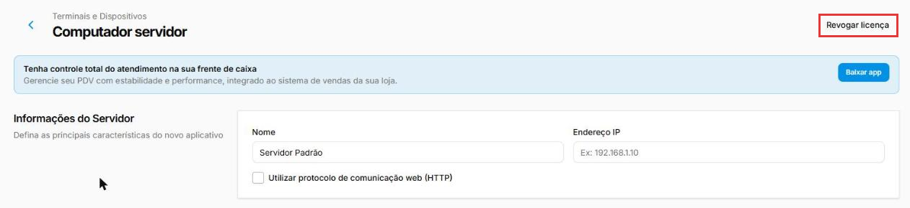
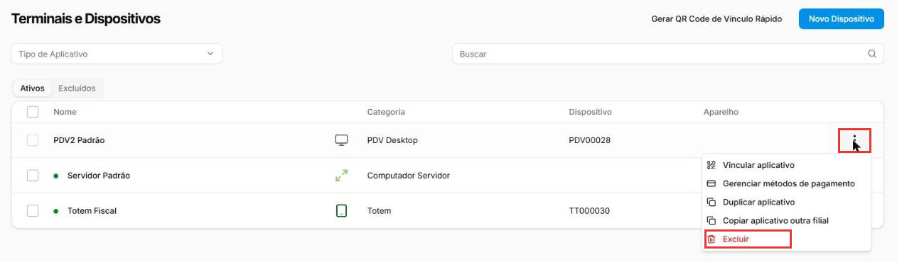
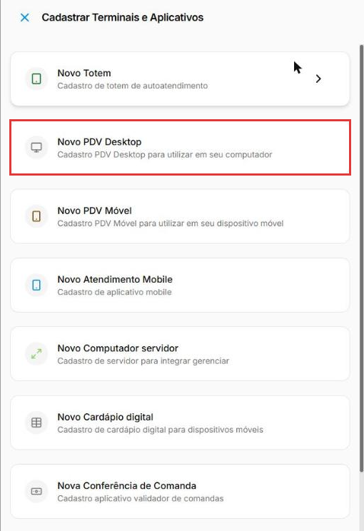
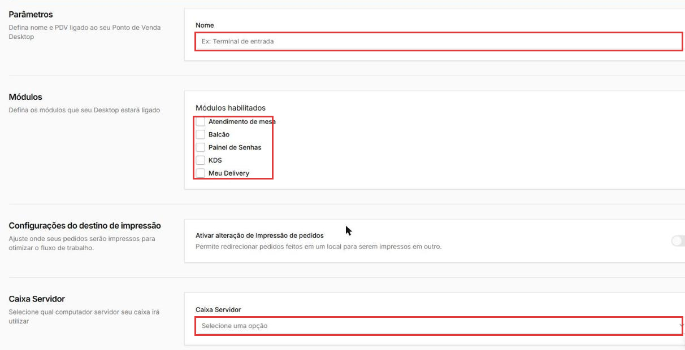
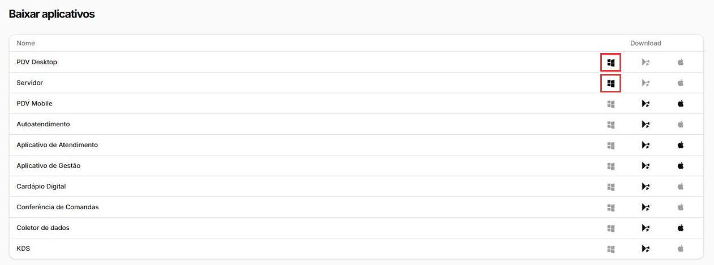
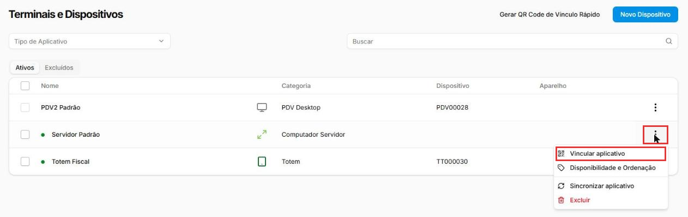

# Como trocar o computador servidor da loja no ERP 2.0

:material-clock-outline: 40 minutos · :material-format-list-numbered: 9 passos · :material-tag-outline: ERP 2.0 · Infraestrutura · Banco de dados · :material-calendar-check: Atualizado em 17/11/2026

Quando o computador servidor da loja precisa ser trocado, o servidor novo começa do zero: a máquina antiga é limpa, a licença dela é revogada no ERP e os aplicativos são instalados e vinculados de novo na máquina nova. Exemplo: o servidor da loja queimou a placa ou ficou lento demais, e um computador novo vai assumir o lugar dele.

## Entenda o conceito

O **computador servidor** é o computador da loja que guarda os dados locais e conversa com os caixas. Nele ficam:

| Peça | O que é | Onde aparece no computador |
| --- | --- | --- |
| **CPServer** | O aplicativo **Servidor** da CPlug. | Roda como o serviço do Windows **CPServerService**. |
| **MongoDB** | O banco de dados local do servidor. | Programa instalado (ex.: **MongoDB 3.2.22**) que roda como o serviço **MongoDB**, com os dados na pasta `C:\data`. |
| **PDV Desktop** | O aplicativo do caixa. | No computador onde o caixa está instalado, a pasta `ConnectPlug PDV`, dentro de `%appdata%`. |

No ERP, cada um aparece em **Dispositivos > Terminais & Dispositivos**: o servidor com a categoria **Computador Servidor** e o caixa com a categoria **PDV Desktop**.

**Quando usar:** quando o servidor vai ser trocado por outro computador (defeito, lentidão extrema ou banco corrompido). **Quando não usar:** se o problema é só um caixa travado, fale com o suporte antes: esta troca refaz tudo.

!!! danger "Antes de começar"
    - Confirme com a loja se há **mesas, comandas ou entregas (delivery) abertas**. Esses dados ficam no servidor local e **se perdem** na troca. Só comece depois de fechar todas as movimentações.
    - Faça a troca com o suporte acompanhando. **Revogar licença** e **Excluir** não têm volta pela tela.
    - Tenha um usuário de administrador no Windows dos dois computadores.
    - Se a loja tem mais de um caixa, combine com o suporte: cada caixa precisa ser refeito.
    - Se a máquina antiga queimou ou não liga, pule os passos 1 a 3 (veja **Deu algum problema?**).

Nos prints, o **quadrado vermelho** mostra onde você deve clicar ou digitar.

## Pare o servidor e o banco na máquina antiga

Na máquina servidora antiga, feche o PDV. Pressione **Windows + R**, digite `services.msc` e pressione **Enter**. Na lista de serviços, clique com o botão direito em **CPServerService** e em **Parar**. Faça o mesmo no serviço **MongoDB**.

## Desinstale o MongoDB da máquina antiga

Abra o **Painel de Controle** > **Programas** > **Desinstalar um programa**. Encontre o **MongoDB** na lista (o nome tem a versão, como **MongoDB 3.2.22**) e desinstale.

## Renomeie as pastas antigas

No Explorador de Arquivos, abra o disco `C:` e renomeie a pasta `data` para `data.old`.

Depois, entre no Windows com o mesmo usuário que usa o caixa, pressione **Windows + R**, digite `%appdata%` e pressione **Enter**. Renomeie a pasta `ConnectPlug PDV` para `ConnectPlug PDV.old`. Renomear, em vez de apagar, guarda uma cópia caso o suporte precise dela.

## Revogue a licença do servidor no ERP

No ERP, no menu do lado esquerdo, clique em **Dispositivos** e depois em **Terminais & Dispositivos**. Clique no nome do servidor (categoria **Computador Servidor**). Na página **Computador servidor**, clique em **Revogar licença**, no canto de cima, à direita. Se aparecer uma mensagem de confirmação, leia e confirme.

{ loading=lazy }

Na mesma página fica o campo **Endereço IP** do servidor. Como a máquina nova terá outro IP, confira esse campo com o suporte.

## Exclua o PDV Desktop antigo

Antes de excluir, abra o PDV Desktop antigo (clique no nome dele) e anote o **Nome**, os **Módulos habilitados** e as **Configurações do destino de impressão**. Anote também as formas de pagamento ligadas (três pontos > **Gerenciar métodos de pagamento**).

Volte para **Terminais & Dispositivos**. Na linha do **PDV Desktop** antigo, clique nos **três pontos** e em **Excluir**. Se aparecer uma mensagem de confirmação, leia e confirme.

{ loading=lazy }

## Cadastre o novo PDV Desktop

Clique em **Novo Dispositivo**, no canto de cima, à direita. No painel **Cadastrar Terminais e Aplicativos**, escolha **Novo PDV Desktop**.

{ loading=lazy }

Na tela **PDV Desktop**, preencha com o que você anotou:

- **Nome:** o nome do caixa. Exemplo: "Caixa 1".
- **Módulos habilitados:** marque os mesmos do caixa antigo. A tela oferece **Atendimento de mesa**, **Balcão**, **Painel de Senhas**, **KDS** e **Meu Delivery**.
- **Configurações do destino de impressão:** ligue **Ativar alteração de Impressão de pedidos** só se estava ligado no caixa antigo.
- **Caixa Servidor:** o computador servidor da loja (ex.: **Servidor Padrão**).

Clique em **Salvar**, no rodapé.

{ loading=lazy }

Depois, ligue de novo as formas de pagamento do caixa (veja [Como escolher as formas de pagamento de cada aparelho](metodos-de-pagamento-na-pos.md)). Se o caixa usa TEF, fale com o suporte (veja [Como configurar o TEF no ERP 2.0 e instalar no PDV](tef-erp2.md)).

## Instale os aplicativos na máquina nova

Na máquina nova, entre no ERP e clique em **Dispositivos** e depois em **Baixar aplicativos**. Baixe o instalador do **Servidor** e o do **PDV Desktop** pelo ícone do **Windows** de cada linha. Assim você sempre pega a versão mais recente.

{ loading=lazy }

## Confira a instalação

Instale os dois na máquina nova. Se tiver dúvida em alguma tela do instalador, ou se o **MongoDB** não aparecer em **Programas instalados** depois, fale com o suporte.

## Vincule o servidor e o caixa

Em **Terminais & Dispositivos**, clique nos **três pontos** do servidor e em **Vincular aplicativo**. Siga as instruções da tela com o suporte acompanhando. Depois, faça o mesmo no PDV Desktop novo.

{ loading=lazy }

!!! note "No ERP Legado"
    Os cadastros do servidor e do caixa ficam em **Ponto de Venda > Aplicativos**. Veja [Migração e troca de servidor local (ERP Legado / CPlug Server)](trocar-servidor-erp1.md).

!!! tip "Boas práticas"
    - **Combine a troca para um horário sem movimento**, com todas as mesas, comandas e entregas fechadas.
    - **Dê um IP fixo ao servidor novo** (veja [Configuração de IP fixo no Windows (servidor e PDVs)](../infraestrutura/ip-fixo-no-windows.md)).
    - **Guarde as pastas `.old`** por alguns dias, até confirmar que está tudo certo.

## Deu algum problema?

??? question "A máquina antiga queimou ou não liga"
    Pule os passos 1 a 3. Comece pelo ERP: revogue a licença do servidor (passo 4), refaça o PDV Desktop (passos 5 e 6) e siga para a máquina nova (passos 7 a 9).

??? question "A máquina nova veio de outra loja (outra conta no mesmo computador)"
    O computador tem arquivos da conta anterior. Com o suporte acompanhando, pare o servidor e o MongoDB (passo 1) e renomeie as pastas (passo 3) com o nome da loja antiga (ex.: `data.loja_antiga.old` e `ConnectPlug PDV.loja_antiga.old`). Depois, entre no ERP da **nova conta** e faça os passos 4 a 9.

??? question "Não consigo renomear uma pasta"
    A pasta está em uso. Para a pasta `data`, confira se os serviços **CPServerService** e **MongoDB** foram parados (passo 1). Para a pasta `ConnectPlug PDV`, feche o PDV. Se continuar, fale com o suporte.

??? question "O caixa não conecta no servidor novo"
    Confira se os dois aplicativos foram vinculados (passo 9) e se o servidor tem IP fixo. Se continuar, fale com o suporte e informe o nome do servidor e do caixa.

**Relacionados:** [Migração e troca de servidor local (ERP Legado / CPlug Server)](trocar-servidor-erp1.md) · [Configuração de IP fixo no Windows (servidor e PDVs)](../infraestrutura/ip-fixo-no-windows.md) · [Como escolher as formas de pagamento de cada aparelho](metodos-de-pagamento-na-pos.md) · [Como configurar o TEF no ERP 2.0 e instalar no PDV](tef-erp2.md)

trocar servidor migração computador servidor computador novo formatar cplug server cpserver cpserverservice services.msc parar serviço mongodb banco corrompido pasta data appdata connectplug pdv revogar licença excluir pdv desktop novo dispositivo novo pdv desktop módulos habilitados caixa servidor baixar aplicativos instalador vincular aplicativo endereço ip mesas comandas delivery perdidos
