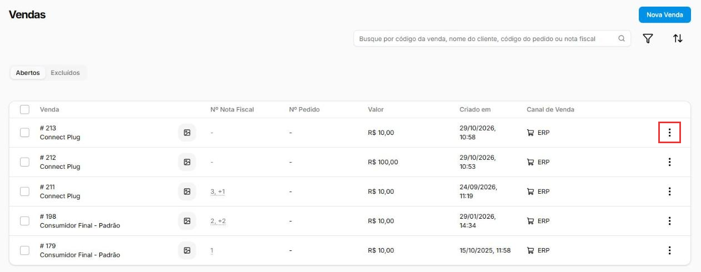
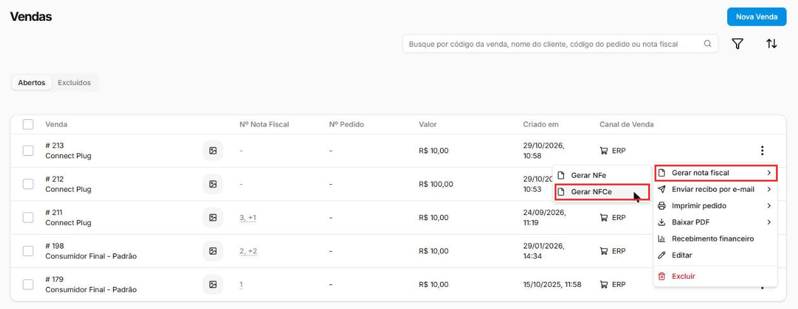
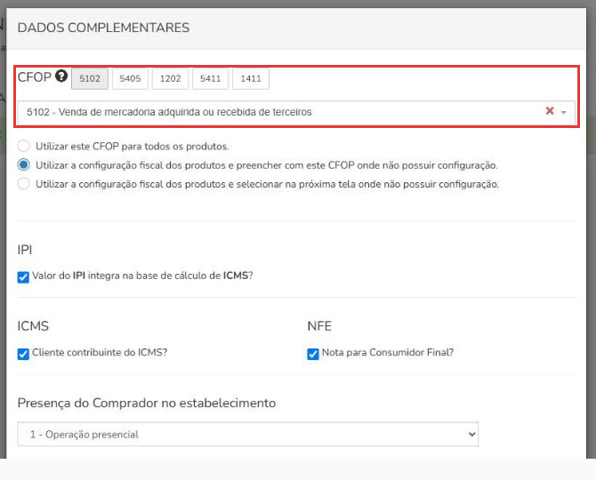
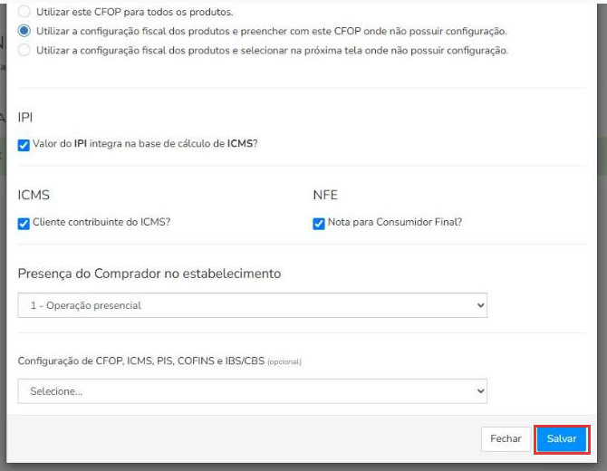
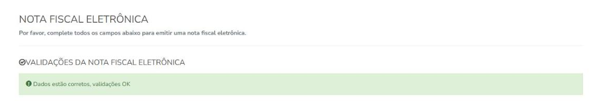
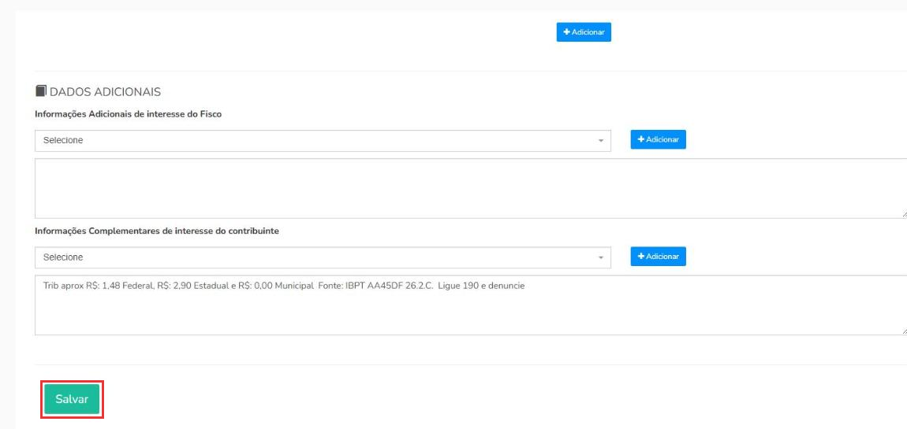
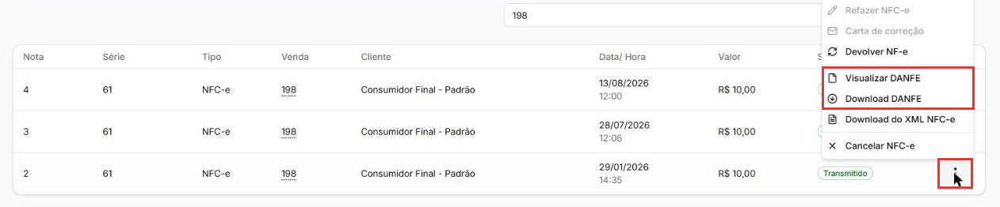

# Como emitir a NFC-e de uma venda que ficou sem nota

:material-clock-outline: 4 minutos · :material-format-list-numbered: 5 passos · :material-tag-outline: ERP 2.0 · Faturamento · Fiscal · :material-calendar-check: Atualizado em 17/11/2026

Às vezes uma venda fica sem a NFC-e (a nota fiscal do consumidor). Você pode gerar essa nota depois, pelo ERP, a partir da própria venda. Exemplo: o contador avisa que uma venda não tem nota; você encontra a venda na lista, gera a NFC-e e acompanha a nota na lista de notas.

## Entenda o conceito

O caminho passa por duas telas do ERP:

| Tela | Onde fica | Para que serve aqui |
| --- | --- | --- |
| **Vendas** | **Vendas > Vendas** | Encontrar a venda sem nota e gerar a NFC-e dela. A coluna **Nº Nota Fiscal** mostra o número das notas da venda, ou um traço (**-**) quando ela não tem nota. |
| **NF-e de Saída** | **Vendas > NF-e** | Lista as notas, NF-e e NFC-e (coluna **Tipo**), com o número da venda (coluna **Venda**) e o **Status** de cada uma: **Transmitido**, **Pendente**, **Cancelado** ou **Inutilizado**. |

O DANFE é a versão impressa da nota fiscal.

**Quando usar:** quando a venda já existe no ERP e ficou sem NFC-e. Se a coluna **Nº Nota Fiscal** da venda mostra um número, ela já tem nota: não gere outra, veja a nota em **Vendas > NF-e**.

!!! warning "Antes de começar"
    - Confira se a venda está mesmo sem nota (traço na coluna **Nº Nota Fiscal**), para não emitir a nota duas vezes.
    - Qual **CFOP** usar e se vale emitir a nota de uma venda de outro mês é decisão do **contador**. Uma nota transmitida agora entra no mês atual (veja [Inutilização e transmissão de notas](inutilizacao-e-transmissao.md)).
    - Venda feita no PDV desktop que não aparece mais no histórico do caixa também pode ser emitida pelo ERP, como abaixo. O tamanho desse histórico fica em **Ponto de venda > Configurações > Geral**: a caixa **Limitar exibição de vendas no histórico do PDV** limita o histórico ao número do campo **Número de vendas no histórico do PDV (até 200)**.

Nos prints, o **quadrado vermelho** mostra onde você deve clicar ou digitar.

## Encontre a venda sem nota

No menu do lado esquerdo, clique em **Vendas** e depois em **Vendas**. Se a lista for longa, use a busca do topo: ela aceita código da venda, nome do cliente, código do pedido ou nota fiscal. Confira se a coluna **Nº Nota Fiscal** da venda mostra um traço (**-**) e clique nos **três pontos** no fim da linha.

{ loading=lazy }

## Gere a NFC-e da venda

No menu da venda, clique em **Gerar nota fiscal** e depois em **Gerar NFCe**. Abre a tela **Nova NFCe**, com a janela **DADOS COMPLEMENTARES** por cima.

{ loading=lazy }

## Preencha os dados complementares

No topo da janela, escolha o **CFOP** pelos atalhos (por exemplo, **5102**) ou pela lista **Selecione**. Deixe marcada a opção que já vem, **Utilizar a configuração fiscal dos produtos e preencher com este CFOP onde não possuir configuração**: cada produto usa o CFOP do próprio cadastro, e o CFOP escolhido aqui só entra nos produtos sem configuração fiscal.

{ loading=lazy }

Role a janela até o fim. As demais opções (**IPI**, **ICMS**, **Nota para Consumidor Final?**, **Presença do Comprador no estabelecimento** e a configuração opcional) já vêm preenchidas: mude só se o contador orientar. Clique em **Salvar**.

{ loading=lazy }

## Confira e salve a nota

A tela **Nova NFCe** mostra a nota preenchida com os dados da venda: cliente, itens, totais e pagamento. No topo, em **VALIDAÇÕES DA NOTA FISCAL ELETRÔNICA**, aparece a mensagem **Dados estão corretos, validações OK**.

{ loading=lazy }

Confira os dados, role até o fim da tela e clique no botão verde **Salvar** para gravar a nota.

{ loading=lazy }

## Acompanhe a nota em Vendas > NF-e

No menu, clique em **Vendas** e depois em **NF-e**. Encontre a nota pelo número da venda, na coluna **Venda** (a busca **Número da nota ou venda** ajuda), e confira o **Status**.

Os **três pontos** da nota reúnem as ações: **Transmitir NFC-e**, para enviar a nota, e, com a nota **Transmitido**, **Visualizar DANFE** e **Download DANFE**. As ações que não valem para o status da nota aparecem apagadas.

{ loading=lazy }

!!! tip "Boas práticas"
    - **Confira a lista de vendas toda semana** e procure vendas com traço (**-**) na coluna **Nº Nota Fiscal**. Resolver dentro do mês da venda evita diferença com o contador.
    - **Antes de gerar uma nota nova, procure a venda em Vendas > NF-e** (coluna **Venda**): se já existir uma nota dela, fale com o suporte antes de gerar outra.

## Deu algum problema?

??? question "A nota foi rejeitada ao transmitir"
    Veja o motivo da rejeição e siga [Como resolver uma nota fiscal rejeitada](../../vendas/nota-rejeitada.md).

??? question "A venda precisa de NF-e, não de NFC-e"
    No passo 2, escolha **Gerar NFe** no lugar de **Gerar NFCe** e siga [Como emitir uma NF-e de venda (dentro e fora do estado)](../../vendas/emitir-nfe.md).

??? question "Não sei se a venda é deste mês ou de um mês já fechado"
    Veja a coluna **Criado em**, na lista de vendas. Se for de um mês já fechado, fale com o contador antes de emitir (veja [Inutilização e transmissão de notas](inutilizacao-e-transmissao.md)).

??? question "Não encontro a opção Gerar NFCe ou a nota não fica certa"
    Fale com o suporte e informe o número da venda.

**Relacionados:** [Inutilização e transmissão de notas](inutilizacao-e-transmissao.md) · [Como resolver uma nota fiscal rejeitada](../../vendas/nota-rejeitada.md) · [Como cancelar, inutilizar ou corrigir uma nota fiscal](../../vendas/cancelar-nota.md) · [Como emitir uma NF-e de venda (dentro e fora do estado)](../../vendas/emitir-nfe.md)

nfc-e não emitida venda sem nota emitir nota depois nota do consumidor cupom fiscal histórico de vendas gerar nota fiscal gerar nfce traço nº nota fiscal dados complementares cfop 5102 nota para consumidor final validações ok transmitir nfc-e pendente transmitido danfe visualizar danfe download danfe limitar exibição de vendas no histórico do pdv 200 vendas competência contador
