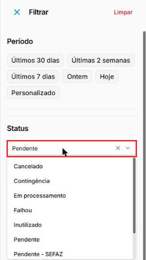
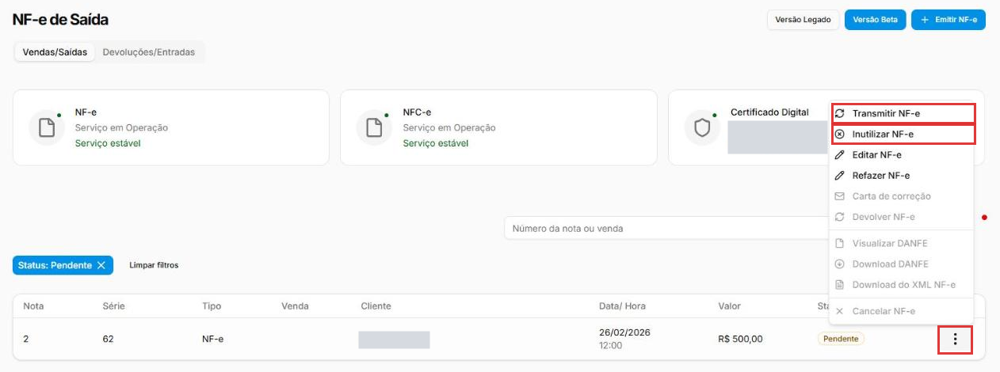
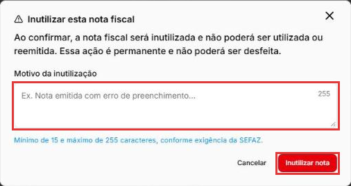

# Como transmitir ou inutilizar uma nota que ficou pendente

:material-clock-outline: 4 minutos · :material-format-list-numbered: 4 passos · :material-tag-outline: ERP 2.0 · Faturamento · Fiscal · :material-calendar-check: Atualizado em 17/11/2026

Às vezes uma nota fica parada sem autorização da Sefaz, com o status **Pendente**. Ela precisa de uma decisão: transmitir ou inutilizar. Exemplo: o contador avisa que o total das vendas não bate com o total das notas autorizadas; você procura as notas pendentes, vê de que mês elas são e, com o contador, decide o que fazer com cada uma.

## Entenda o conceito

As notas ficam em **Vendas > NF-e** (tela **NF-e de Saída**), com o **Status** de cada uma. Dois status mostram nota que não foi autorizada:

- **Pendente:** a nota foi salva, mas ainda não foi enviada à Sefaz. É dela que este manual trata.
- **Falhou:** a nota foi enviada e a Sefaz recusou. Veja o motivo e o que fazer em [Como resolver uma nota fiscal rejeitada](../../vendas/nota-rejeitada.md).

Para uma nota **Pendente**, há dois caminhos:

| Caminho | O que acontece | Quando costuma ser usado |
| --- | --- | --- |
| **Transmitir** | A nota é enviada à Sefaz. | A venda aconteceu e precisa da nota. |
| **Inutilizar** | Pelo aviso do próprio ERP, a nota "não poderá ser utilizada ou reemitida" e a ação "é permanente". | A nota não vai ser usada, por exemplo porque outra nota foi emitida no lugar. |

Numa nota de um mês já fechado, a decisão é do **contador**: ele diz se a nota ainda deve ser transmitida ou se deve ser inutilizada, e como registrar essa venda na contabilidade.

Também pode acontecer de a sequência pular um número sem que exista nota nele (ex.: a nota 100 e depois a 102). Esse número também precisa ser inutilizado, mas isso não é feito pela lista de notas: fale com o suporte e informe o número e a série.

**Quando usar:** sempre que aparecer nota com status **Pendente** na lista.

**Quando não usar:** nota com status **Transmitido** já foi autorizada. Para anulá-la, o caminho é o cancelamento (veja [Como cancelar, inutilizar ou corrigir uma nota fiscal](../../vendas/cancelar-nota.md)).

!!! warning "Antes de começar"
    - Fale com o **contador** antes de transmitir ou inutilizar uma nota de um mês já fechado.
    - Confira o número da nota antes de inutilizar: depois de inutilizada, ela não pode ser usada nem emitida de novo.

Nos prints, o **quadrado vermelho** mostra onde você deve clicar ou digitar.

## Encontre as notas pendentes

No menu do lado esquerdo, clique em **Vendas** e depois em **NF-e**. Clique no ícone de **funil**, à direita do campo **Número da nota ou venda**. No painel **Filtrar**, escolha em **Status** a opção **Pendente** e clique em **Aplicar filtros**, no fim do painel. Deixe o **Período** sem escolher, para ver as notas de todos os meses.

{ loading=lazy }

O campo **Status** aceita um status por vez. Para ver as notas recusadas, repita com **Falhou**. Para voltar à lista completa, clique em **Limpar filtros**.

## Veja de que mês é cada nota

Na lista filtrada, a coluna **Data/ Hora** mostra a data da nota. Anote o número (coluna **Nota**) e a data das notas de meses já fechados e leve ao contador antes de seguir.

## Escolha a ação no menu da nota

Clique nos **três pontos** no fim da linha da nota:

- **Transmitir NF-e** envia a nota à Sefaz. Depois, confira a coluna **Status** na lista. Se a nota for recusada, siga [Como resolver uma nota fiscal rejeitada](../../vendas/nota-rejeitada.md).
- **Inutilizar NF-e** abre a janela de inutilização (próximo passo).

{ loading=lazy }

O menu também tem **Editar NF-e** e **Refazer NF-e**, para corrigir a nota antes de transmitir (veja [Como resolver uma nota fiscal rejeitada](../../vendas/nota-rejeitada.md)). As ações que não valem para uma nota pendente, como **Cancelar NF-e** e **Visualizar DANFE**, aparecem apagadas.

## Inutilize a nota com o motivo

Abre a janela **Inutilizar esta nota fiscal**. Em **Motivo da inutilização**, escreva o motivo, com no mínimo 15 e no máximo 255 caracteres. Exemplo: "Venda emitida em outra nota, número não utilizado". Clique em **Inutilizar nota**. Se mudou de ideia, clique em **Cancelar**: a nota continua como estava.

{ loading=lazy }

Depois de inutilizada, a nota passa para o status **Inutilizado** (veja também [Como cancelar, inutilizar ou corrigir uma nota fiscal](../../vendas/cancelar-nota.md)).

!!! tip "Boas práticas"
    - **Confira as notas Pendente e Falhou uma vez por semana**, pelo filtro de **Status**, e sempre alguns dias antes do fim do mês. Resolver dentro do mês da venda evita diferença com o contador.
    - **Mande ao contador os arquivos das notas inutilizadas** junto com os do mês (veja [Como enviar os documentos fiscais para a contabilidade](../../financas/contabilidade.md)).

## Deu algum problema?

??? question "A sequência das notas pulou um número"
    Se não existe nota com aquele número na lista, não há menu para inutilizar. Fale com o suporte e informe o número que falta e a série.

??? question "Transmiti e a nota foi recusada"
    Veja o motivo e siga [Como resolver uma nota fiscal rejeitada](../../vendas/nota-rejeitada.md).

??? question "Não encontro a opção Inutilizar NF-e"
    A opção **Inutilizar NF-e** aparece ativa nas notas **Pendente**. Se a nota está **Transmitido**, ela já foi autorizada: o caminho é o cancelamento (veja [Como cancelar, inutilizar ou corrigir uma nota fiscal](../../vendas/cancelar-nota.md)). Em outro status, fale com o suporte.

??? question "A nota está com um status que não conheço"
    Além de **Pendente** e **Falhou**, o filtro de **Status** tem opções como **Contingência**, **Em processamento**, **Pendente - SEFAZ** e **Uso Denegado**. **Pendente - SEFAZ** é diferente de **Pendente**. Se uma nota ficar parada num desses status, fale com o suporte e informe o número da nota.

**Relacionados:** [Como cancelar, inutilizar ou corrigir uma nota fiscal](../../vendas/cancelar-nota.md) · [Como resolver uma nota fiscal rejeitada](../../vendas/nota-rejeitada.md) · [Como emitir a NFC-e de uma venda que ficou sem nota](emitir-nfce-pelo-historico.md) · [Como enviar os documentos fiscais para a contabilidade](../../financas/contabilidade.md)

inutilizar inutilização inutilizar nf-e inutilizar nota motivo da inutilização número pulado sequência de notas buraco nota pendente nota parada nota não transmitida nota com erro falhou transmitir nf-e transmitir nota antiga mês fechado contador total das vendas não bate nf-e de saída filtro status pendente sefaz uso denegado contingência
