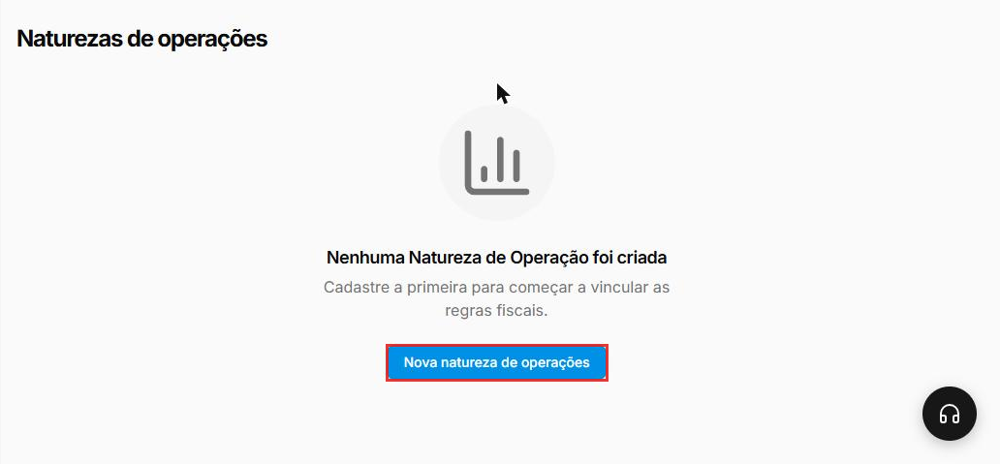
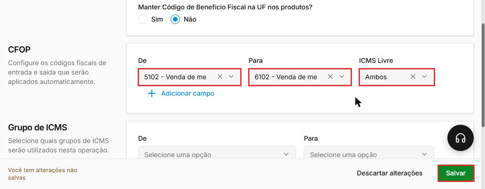
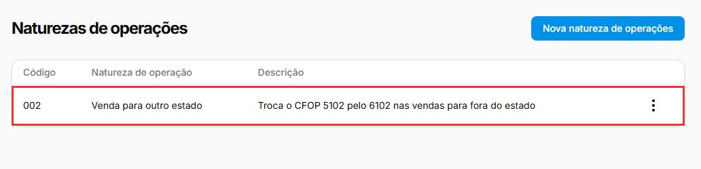
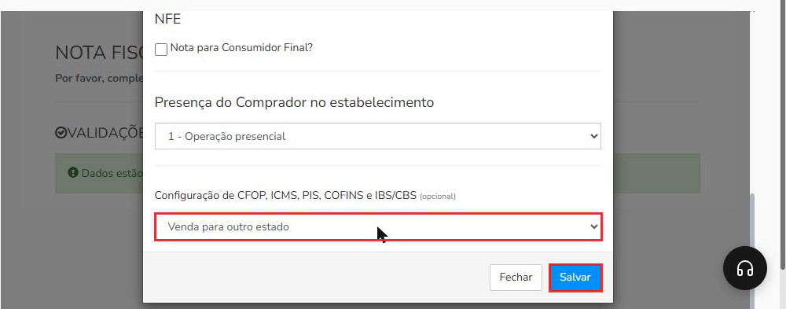
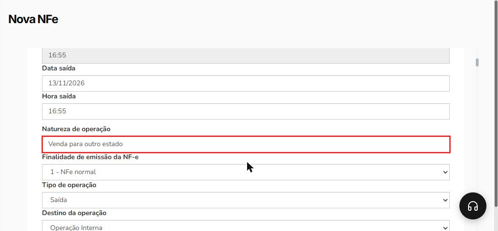
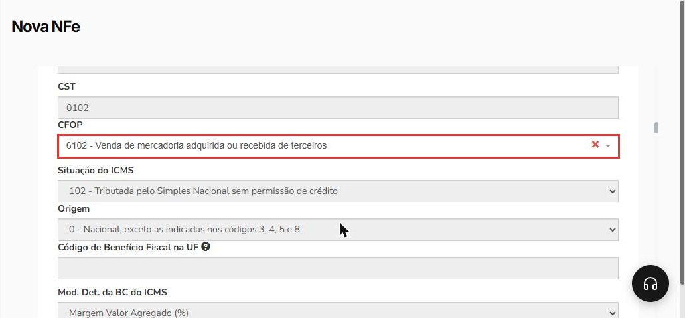

# Como usar a natureza de operação na NF-e gerada a partir da venda

:material-clock-outline: 6 minutos · :material-format-list-numbered: 5 passos · :material-tag-outline: ERP 2.0 · Faturamento · :material-calendar-check: Atualizado em 13/11/2026

Quando uma venda precisa sair numa NF-e com outro CFOP, você não precisa trocar o código item por item. A **natureza de operação** guarda a regra de troca, e você só a escolhe ao gerar a nota. Exemplo: a loja vende para uma empresa de outro estado; os produtos usam o CFOP **5102** (venda dentro do estado), e a natureza "Venda para outro estado" troca o 5102 por **6102** na nota. Confirme os códigos da sua operação com o contador.

## Entenda o conceito

O cadastro do produto guarda os códigos fiscais da operação mais comum da loja. A natureza de operação funciona como uma **tabela de tradução** que só entra em ação na nota em que você a escolhe:

| Peça | Onde fica | O que faz |
| --- | --- | --- |
| **Natureza de operação** | **Configurações > Fiscal > Natureza de Operações** | Guarda o nome da operação e as regras de troca. Ganha um código (ex.: 002). |
| **Regra De → Para** | Seções **CFOP**, **Grupo de ICMS** e **Grupo de PIS/COFINS** da natureza | "Onde estiver **este** código no produto, use **aquele** na nota." |
| **Configuração de CFOP, ICMS, PIS, COFINS e IBS/CBS** | Último campo da janela **DADOS COMPLEMENTARES**, ao gerar a NF-e | É onde você escolhe a natureza para aquela nota. O nome cita IBS/CBS, mas o cadastro da natureza tem regras só de CFOP, Grupo de ICMS e Grupo de PIS/COFINS. |

Os detalhes de cada campo do cadastro estão em [Como configurar a natureza de operação](../../configuracoes/natureza-de-operacao.md). O CFOP e os grupos que a regra **De** procura são os do cadastro do produto: veja [Como configurar os dados fiscais de um produto](../../produtos/parametros-fiscais.md).

**Quando não usar:** se a venda segue a operação de sempre (o mesmo CFOP do cadastro dos produtos), deixe o campo da natureza em branco. Ele é opcional.

!!! warning "Antes de começar"
    - Quais naturezas criar e quais códigos usar é decisão do **contador**. Este manual mostra **onde** cadastrar e **como** aplicar.
    - A empresa precisa estar pronta para emitir NF-e: dados da empresa e do cliente, certificado digital, série fiscal e dados fiscais dos produtos. Se faltar algo, a tela da nota mostra avisos em vermelho com o botão **Corrigir agora**, e a janela **DADOS COMPLEMENTARES** não abre.
    - Numa venda para outro estado, a venda precisa estar com o cliente certo, cadastrado com o endereço completo.

Nos prints, o **quadrado vermelho** mostra onde você deve clicar ou digitar.

## Abra o cadastro de naturezas

No menu do lado esquerdo, clique em **Configurações**, depois em **Fiscal** e em **Natureza de Operações**. Se a loja ainda não tiver nenhuma, a tela mostra "Nenhuma Natureza de Operação foi criada". Clique em **Nova natureza de operações**.

{ loading=lazy }

## Crie a regra de troca

Em **Informações gerais**, preencha o **Nome** (ex.: "Venda para outro estado") e, se quiser, a **Descrição**. Deixe **Manter Código de Benefício Fiscal na UF nos produtos?** em **Não**, a não ser que o contador oriente outra coisa.

Em **CFOP**, monte a troca:

- **De:** o CFOP que está no cadastro dos produtos. Exemplo: **5102**.
- **Para:** o CFOP que a nota deve usar. Exemplo: **6102**.
- **ICMS Livre:** **Ambos**, **Não** ou **Sim**, conforme o contador. No exemplo, **Ambos**.

Para mais uma troca, clique em **Adicionar campo**. As seções **Grupo de ICMS** e **Grupo de PIS/COFINS** têm os mesmos campos **De** e **Para**: preencha só se a operação também mudar os impostos. Clique em **Salvar**, no canto de baixo, à direita.

{ loading=lazy }

## Confira a natureza na lista

Depois de salvar, a natureza aparece na lista com o **código**, o nome e a descrição. Pelos **três pontos** da linha você pode **Editar** a natureza depois.

{ loading=lazy }

## Gere a NF-e e escolha a natureza

No menu, clique em **Vendas** e depois em **Vendas**. Na linha da venda, clique nos **três pontos**, em **Gerar nota fiscal** e em **Gerar NFe**. A tela **Nova NFe** abre com a janela **DADOS COMPLEMENTARES** por cima. Nela:

- **CFOP:** escolha um CFOP pelos atalhos ou pela lista **Selecione**. Exemplo: **5102**, o mesmo CFOP do campo **De** da regra. O campo é obrigatório: sem ele, aparece "Selecione um item da lista".
- Deixe marcada a opção que já vem, **Utilizar a configuração fiscal dos produtos e preencher com este CFOP onde não possuir configuração**. Assim, cada produto usa o CFOP do próprio cadastro, e o CFOP escolhido aqui só entra nos produtos sem configuração fiscal.
- **Configuração de CFOP, ICMS, PIS, COFINS e IBS/CBS (opcional):** no fim da janela, escolha a natureza. Exemplo: **Venda para outro estado**.

Clique em **Salvar**, no rodapé da janela.

{ loading=lazy }

## Confira a nota antes de transmitir

A nota abre preenchida. Confira três pontos:

- O campo **Natureza de operação** mostra o nome da natureza escolhida.

{ loading=lazy }

- O **Destino da operação**, logo abaixo, não muda sozinho com a natureza. No exemplo, continuou **Operação Interna**. Numa venda para outro estado, ajuste esse campo como explica [Como emitir uma NF-e de venda](../../vendas/emitir-nfe.md).
- Em **ITENS**, o **CFOP** dos produtos que estão na regra **De** já vem trocado. No exemplo, **6102 - Venda de mercadoria adquirida ou recebida de terceiros**.

{ loading=lazy }

Com tudo certo, siga a emissão como em [Como emitir uma NF-e de venda](../../vendas/emitir-nfe.md).

!!! tip "Boas práticas"
    - **Peça ao contador a lista de operações** da loja e crie uma natureza para cada uma, com nomes que dizem a operação.
    - **Cubra todos os CFOPs dos seus produtos:** se uns usam 5102 e outros 5405, crie uma regra para cada um com **Adicionar campo**.
    - **Confira a primeira nota com o contador** antes de transmitir, sempre que criar uma natureza nova.

## Deu algum problema?

??? question "O campo da natureza não aparece na janela Dados complementares"
    O campo **Configuração de CFOP, ICMS, PIS, COFINS e IBS/CBS** só aparece quando a empresa tem pelo menos uma natureza cadastrada. Confira em **Configurações > Fiscal > Natureza de Operações** se você está na empresa certa e cadastre a natureza (passos 1 a 3).

??? question "Apareceu \"Selecione um item da lista\" ao salvar a janela"
    O **CFOP** do topo da janela é obrigatório, mesmo escolhendo uma natureza. Escolha um CFOP pelos atalhos ou pela lista e salve de novo.

??? question "A janela Dados complementares não abriu e apareceram avisos vermelhos"
    Falta algum dado para emitir NF-e (empresa, cliente, certificado, produtos ou série). Clique em **Corrigir agora** em cada aviso. Se não souber o que preencher, fale com o suporte ou com o contador.

??? question "A nota abriu com o CFOP do cadastro, sem a troca"
    Confira se a natureza foi escolhida na janela **DADOS COMPLEMENTARES**, se a regra **De** tem o mesmo CFOP do cadastro do produto e se o CFOP escolhido no topo da janela é o mesmo do campo **De**. Se o produto usa outro CFOP, crie mais uma regra com **Adicionar campo**.

**Relacionados:** [Como configurar a natureza de operação](../../configuracoes/natureza-de-operacao.md) · [Como configurar os dados fiscais de um produto](../../produtos/parametros-fiscais.md) · [Como emitir uma NF-e de venda](../../vendas/emitir-nfe.md) · [NF-e referenciando NFC-e (CFOP 5929/6929)](nfe-referenciando-nfce.md)

natureza de operação de para cfop 5102 6102 venda para outro estado interestadual grupo de icms pis cofins ibs cbs dados complementares gerar nfe nota a partir da venda troca de cfop destino da operação
