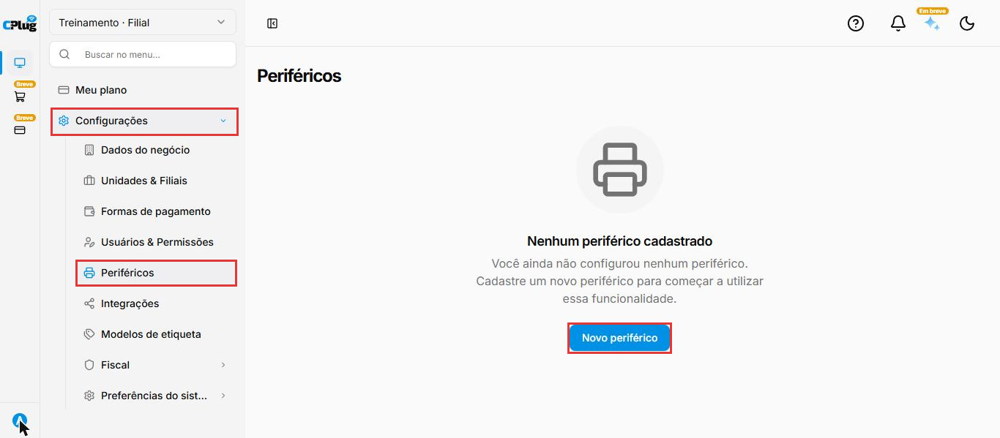
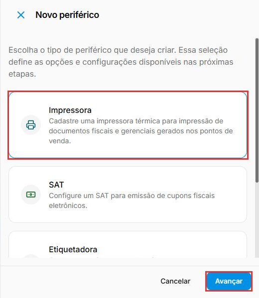
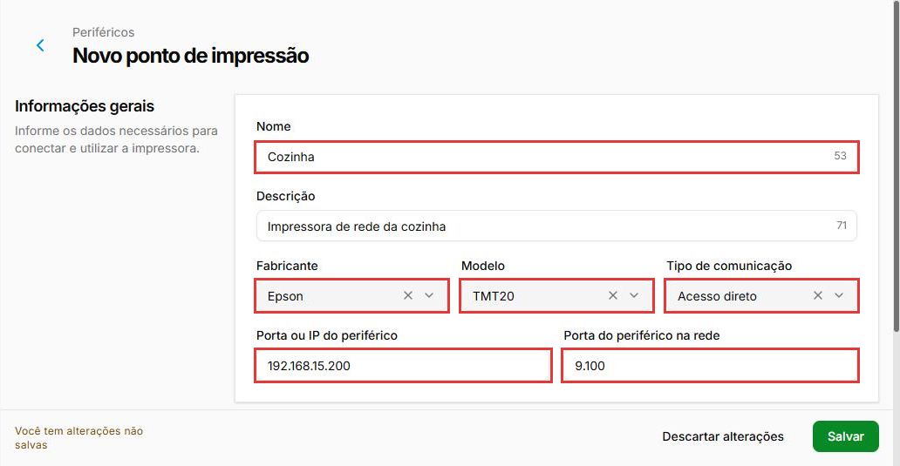
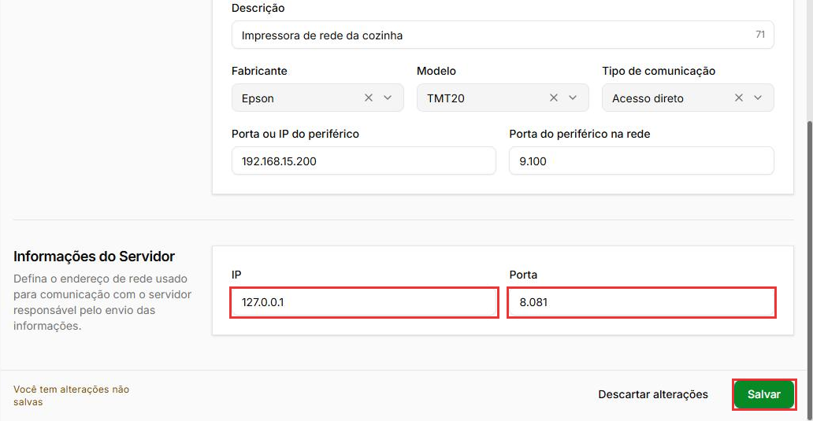

# Como cadastrar uma impressora de rede direta no ERP 2.0

:material-clock-outline: 5 minutos · :material-format-list-numbered: 4 passos · :material-tag-outline: ERP 2.0 · :material-calendar-check: Atualizado em 13/11/2026

A impressora da cozinha ou do bar costuma ficar longe do caixa, ligada só no cabo de rede. Nesse caso, o cadastro aponta direto para o **IP da impressora**, sem driver nem compartilhamento do Windows. Exemplo: a impressora **Cozinha**, uma Epson TMT20 (TM-T20) no IP `192.168.15.200`.

## Entenda o conceito

O cadastro da impressora no ERP se chama **ponto de impressão**. O que define como o sistema chega até ela é o campo **Porta ou IP do periférico**, junto com o **Tipo de comunicação**:

| Como a impressora está ligada | O que vai em Porta ou IP do periférico | Exemplo | Manual |
| --- | --- | --- | --- |
| No cabo de rede, com IP próprio | O IP fixo da impressora | `192.168.15.200` | Este manual |
| Na USB do computador | O caminho do compartilhamento do Windows | `\\127.0.0.1\caixa` | [Impressora USB no ERP 2.0](impressora-usb-erp2.md) |
| Na rede, mas instalada com driver no Windows | O caminho do compartilhamento do Windows | `\\127.0.0.1\cozinha` | [Impressora de rede com spooler no ERP 2.0](impressora-spooler-erp2.md) |

Nos três casos, o **Tipo de comunicação** é **Acesso direto**. A tela também tem as opções **DLL**, **Serial**, **Spooler** e **USB**; para elas, fale com o suporte.

Outros termos da tela:

- **Porta do periférico na rede:** a porta em que a impressora recebe os dados. Já vem preenchida com `9.100`. Deixe como veio.
- **Informações do Servidor:** o computador que envia a impressão. Já vem com **IP** `127.0.0.1` (o próprio computador) e **Porta** `8.081`.
- **IP fixo:** um endereço que não muda. Se o roteador trocar o IP da impressora, o cadastro aponta para um endereço errado e a impressão pode parar de sair.
- **Mesma faixa:** os três primeiros números do IP iguais. Exemplo: `192.168.15.50` e `192.168.15.200`.

**Quando não usar este manual:** se a impressora está na USB ou instalada com driver no Windows. Nesses casos, use os manuais da tabela acima.

!!! info "Antes de começar"
    - A impressora está ligada pelo cabo de rede no **mesmo roteador** (ou switch, o aparelho que distribui os cabos de rede) do computador do caixa.
    - Você sabe o **IP fixo da impressora**, na **mesma faixa** do computador. O IP da impressora é fixado na própria impressora ou no roteador. Se não souber fazer, fale com o suporte ou com quem cuida da rede da loja.
    - Para fixar o IP do computador, veja [Configuração de IP fixo no Windows](../infraestrutura/ip-fixo-no-windows.md).

Nos prints, o **quadrado vermelho** mostra onde você deve clicar ou digitar.

## Abra os periféricos

No menu do lado esquerdo, clique em **Configurações** e depois em **Periféricos**. Se ainda não houver nenhum, a tela mostra **Nenhum periférico cadastrado**. Clique em **Novo periférico**.

{ loading=lazy }

## Escolha o tipo Impressora

Abre a janela **Novo periférico**, com os tipos **Impressora**, **SAT** e **Etiquetadora**. Clique em **Impressora** ("Cadastre uma impressora térmica para impressão de documentos fiscais e gerenciais gerados nos pontos de venda") e depois em **Avançar**.

{ loading=lazy }

## Preencha os dados da impressora

Abre a tela **Novo ponto de impressão**. Em **Informações gerais**:

- **Nome:** como a equipe chama a impressora, com até 60 caracteres. Exemplo: **Cozinha**.
- **Descrição:** opcional, com até 100 caracteres. Exemplo: "Impressora de rede da cozinha". O número no canto do campo mostra quantos caracteres ainda cabem.
- **Fabricante:** a marca do equipamento. A lista traz, por exemplo, Bematech, Daruma, Elgin, Epson, Gertec, Jetway e POS (58mm).
- **Modelo:** só fica disponível depois de escolher o fabricante. Exemplo: com **Epson**, aparece **TMT20**. Se o modelo exato não estiver na lista, fale com o suporte.
- **Tipo de comunicação:** **Acesso direto**.
- **Porta ou IP do periférico:** o IP da impressora, como aparece nela. Exemplo: `192.168.15.200`.
- **Porta do periférico na rede:** deixe `9.100`, como veio.

{ loading=lazy }

## Confira o servidor e salve

Em **Informações do Servidor**, deixe **IP** `127.0.0.1` e **Porta** `8.081`, como vieram.

Clique em **Salvar**, no canto de baixo, à direita. Enquanto não salvar, o rodapé avisa **Você tem alterações não salvas**; **Descartar alterações** desfaz o que foi preenchido.

{ loading=lazy }

!!! warning "Não troque o 127.0.0.1 sem falar com o suporte"
    Se a impressão precisar sair também pelo aplicativo de mesas ou por outro computador, o IP do servidor pode mudar. Nesses casos, fale com o suporte antes de alterar.

!!! tip "Boas práticas"
    - **Dê nome pelo lugar**, não pela marca: "Cozinha", "Bar", "Caixa 1". Fica fácil para a equipe saber qual impressora é qual.
    - **Anote o IP de cada impressora** numa etiqueta colada nela. Ajuda muito quando o roteador é trocado.
    - **Peça a quem cuida da rede** para reservar o IP da impressora no roteador, para nenhum outro aparelho usar o mesmo endereço.

## Deu algum problema?

??? question "Salvei, mas a impressão não sai"
    Confira se a impressora está ligada, com papel e com o cabo de rede conectado, e se o IP em **Porta ou IP do periférico** é o mesmo da impressora. Se continuar, fale com o suporte.

??? question "Funcionava e parou depois que o roteador foi trocado ou reiniciado"
    O IP da impressora pode ter mudado. Confira o IP atual da impressora e, se for diferente, corrija em **Porta ou IP do periférico**. Se continuar, fale com o suporte.

??? question "O campo Modelo está bloqueado"
    Escolha primeiro o **Fabricante**. A lista de modelos depende dele.

??? question "A porta aparece como 9.100 e o servidor como 8.081. Está certo?"
    Sim. A tela mostra os números com ponto. Deixe como vieram.

**Relacionados:** [Impressora de rede (Ethernet) no ERP Legado](impressora-rede-erp1.md) · [Impressora de rede com spooler no ERP 2.0](impressora-spooler-erp2.md) · [Impressora USB no ERP 2.0](impressora-usb-erp2.md) · [Configuração de IP fixo no Windows](../infraestrutura/ip-fixo-no-windows.md)

impressora de rede ethernet cabo de rede ip fixo erp 2 periféricos novo periférico novo ponto de impressão 9100 8081 127.0.0.1 acesso direto sem driver cozinha bar epson tmt20 tm-t20 bematech elgin daruma
