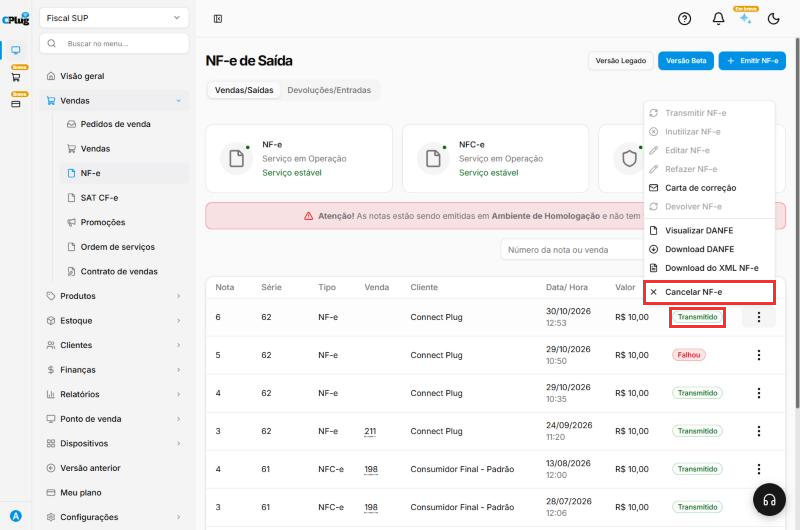
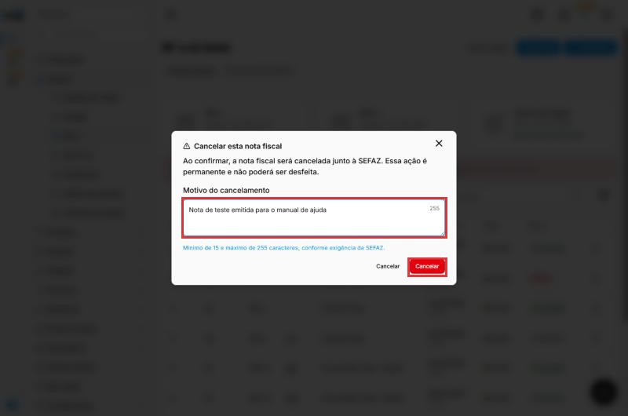
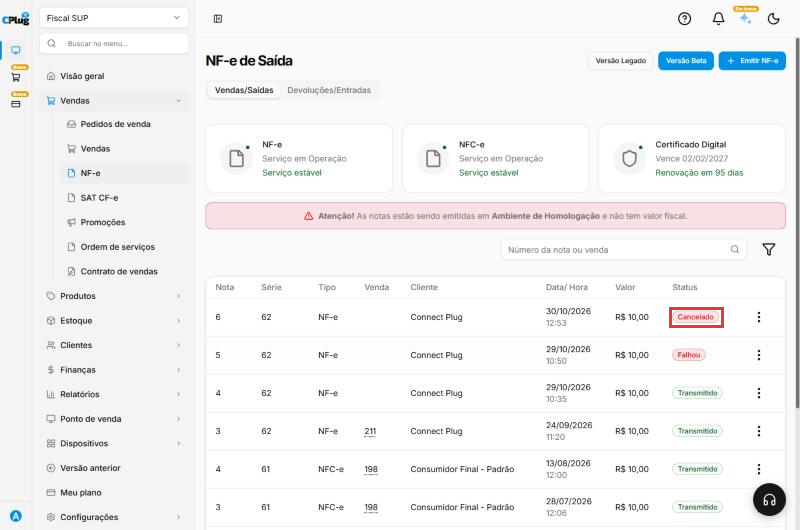
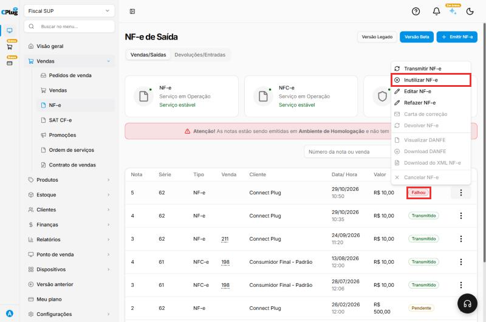
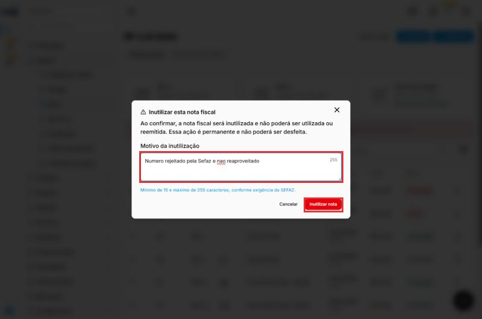
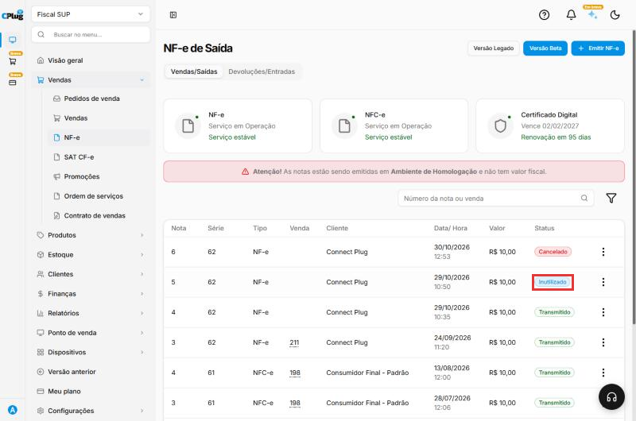
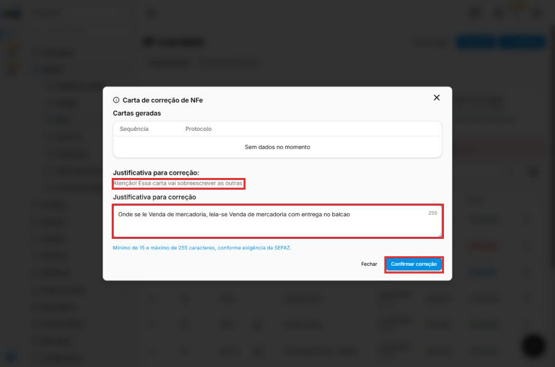
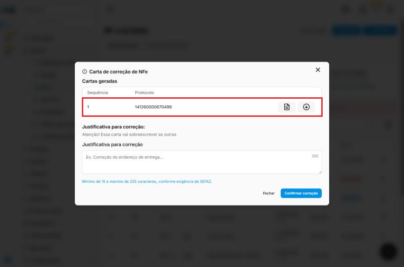
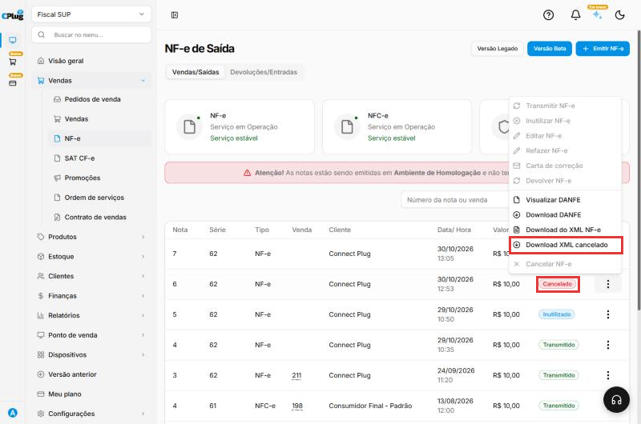

# Como cancelar, inutilizar ou corrigir uma nota fiscal

:material-clock-outline: 3 minutos · :material-format-list-numbered: 6 passos · :material-calendar-check: Atualizado em 30/10/2026

São duas situações diferentes:

| | **Cancelar** | **Inutilizar** |
| --- | --- | --- |
| **Quando usar** | A nota **foi autorizada** (status **Transmitido**), mas a venda não aconteceu ou a nota saiu errada. | A nota **não foi autorizada** (status **Falhou** ou **Pendente**) e você não vai mais usar esse número. |
| **O que acontece** | A nota perde a validade na Sefaz. | O **número** é marcado na Sefaz como "pulado de propósito". |
| **Prazo** | Curto. Para NF-e, em geral até **24 horas** depois da autorização. Para NFC-e, o prazo costuma ser **menor**. Passou do prazo, fale com o contador. | Faça assim que perceber o número pulado. |

!!! danger "As duas ações não podem ser desfeitas"
    Depois de cancelada ou inutilizada, a nota **não volta**. Confira se é a nota certa antes de confirmar.

Nos prints, o **quadrado vermelho** mostra onde você deve clicar ou digitar.

## Cancelar: abra a opção na nota autorizada

Em **Vendas → NF-e**, encontre a nota com o status **Transmitido**. Nos **três pontinhos**, clique em **Cancelar NF-e**.

{ loading=lazy }

## Cancelar: informe o motivo e confirme

Em **Motivo do cancelamento**, escreva por que a nota está sendo cancelada, com **15 a 255 caracteres** (exigência da Sefaz). Exemplo: "Venda desfeita a pedido do cliente".

Clique em **Cancelar** (o botão vermelho).

{ loading=lazy }

## Cancelar: confira o status

A nota passa para o status **Cancelado**.

{ loading=lazy }

## Inutilizar: abra a opção na nota não autorizada

Encontre a nota com o status **Falhou** (ou **Pendente**) que não vai ser usada. Nos **três pontinhos**, clique em **Inutilizar NF-e**.

{ loading=lazy }

## Inutilizar: informe o motivo e confirme

Em **Motivo da inutilização**, escreva o motivo com **15 a 255 caracteres**. Exemplo: "Número rejeitado pela Sefaz e não reaproveitado".

Clique em **Inutilizar nota**.

{ loading=lazy }

## Inutilizar: confira o status

A nota passa para o status **Inutilizado**.

{ loading=lazy }

## Erro pequeno de texto? Use a carta de correção

Se a nota foi **autorizada** com um erro **só de texto** (por exemplo, um endereço com letra trocada ou uma informação complementar), não precisa cancelar: emita uma **Carta de correção (CC-e)**.

!!! warning "O que a carta de correção não corrige"
    Valores, impostos, quantidades, datas, CFOP, e os dados de quem vendeu e de quem comprou (CNPJ, CPF, razão social). Nesses casos, cancele a nota e emita outra.

1. Nos **três pontinhos** da nota autorizada, clique em **Carta de correção**.
2. Em **Justificativa para correção**, escreva a correção completa, com **15 a 255 caracteres**. Exemplo: "Onde se lê X, leia-se Y".
3. Clique em **Confirmar correção**.

{ loading=lazy }

!!! info "Cada carta nova substitui a anterior"
    A Sefaz considera só a **última** carta de correção. Se precisar corrigir mais alguma coisa, a nova carta deve repetir **todas** as correções, inclusive as da carta anterior.

Ao abrir de novo a **Carta de correção**, a lista **Cartas geradas** mostra a **sequência** e o **protocolo** da Sefaz, com botões para ver e baixar a carta.

{ loading=lazy }

## Arquivos da nota cancelada

Uma nota cancelada continua com a **DANFE** e o **XML** disponíveis, e ganha a opção **Download XML cancelado**: é o comprovante do cancelamento na Sefaz. Envie esse arquivo ao contador junto com os XMLs do mês.

{ loading=lazy }

## Deu algum problema?

??? question "A opção Cancelar NF-e está apagada"
    Só dá para cancelar nota **autorizada** (Transmitido). Para notas com **Falhou** ou **Pendente**, use **Inutilizar NF-e**.

??? question "A Sefaz recusou o cancelamento por prazo"
    O prazo para cancelar já passou. Fale com o **contador**: em alguns estados é possível um cancelamento fora do prazo, por outro caminho.

??? question "O motivo não foi aceito"
    O texto precisa ter **no mínimo 15 caracteres**. Escreva uma frase completa.

**Relacionados:** [Como emitir uma NF-e de venda](emitir-nfe.md) · [Como resolver uma nota fiscal rejeitada](nota-rejeitada.md)

cancelar nota cancelar nf-e cancelamento inutilizar inutilização número pulado nota não autorizada prazo de cancelamento 24 horas motivo do cancelamento carta de correção cc-e sefaz cancelado inutilizado
