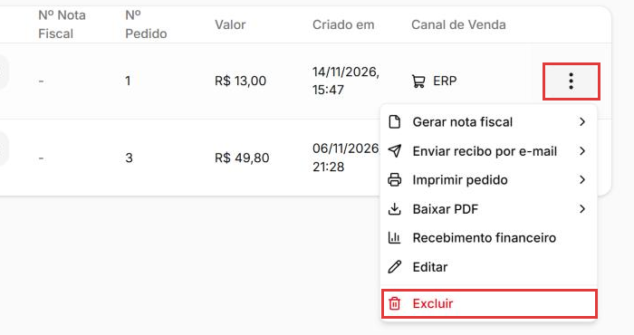
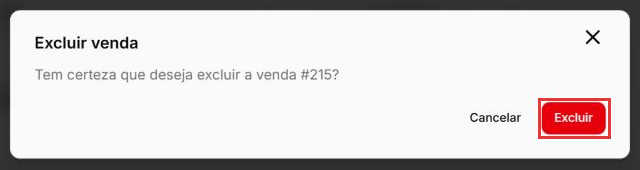
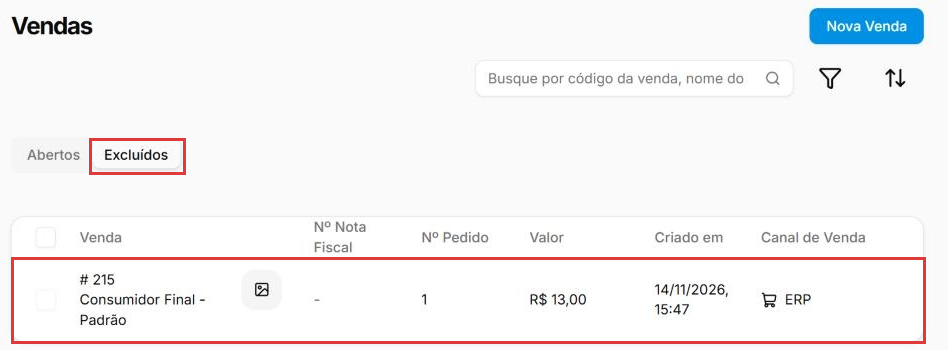

# Como cancelar uma venda

:material-clock-outline: 4 minutos · :material-format-list-numbered: 4 passos · :material-calendar-check: Atualizado em 14/11/2026

Às vezes uma venda precisa ser desfeita: foi lançada duas vezes, o cliente desistiu antes de levar ou o valor saiu todo errado. No sistema, cancelar uma venda é **excluir** a venda. Exemplo: uma venda de 2 Cookies de Chocolate (R$ 13,00, em dinheiro) foi lançada por engano no ERP. Ao excluir, os 2 cookies voltam para o estoque e o recebimento de R$ 13,00 sai da lista de **Finanças → Lançamentos**.

## Entenda o conceito

**O que acontece quando você exclui uma venda** (exemplo de uma venda lançada no ERP, paga em dinheiro):

| Onde | Antes de excluir | Depois de excluir |
| --- | --- | --- |
| **Estoque** | A venda tirou os produtos do estoque (Cookie de Chocolate: de 30 para 28). | Os produtos voltam (Cookie de Chocolate: de novo 30). |
| **Financeiro** | O recebimento da venda aparece em **Finanças → Lançamentos** (R$ 13,00, **Pago**). | O recebimento some da lista de **Lançamentos**. |
| **Tela Vendas** | A venda fica na aba **Abertos**. | A venda passa para a aba **Excluídos**. |

**Não tem volta.** Na aba **Excluídos** a venda só pode ser consultada: não há opção para restaurá-la. Se você excluir por engano, vai precisar lançar a venda de novo.

**Quando usar:** a venda foi lançada errada ou em duplicidade, ou foi desfeita antes de o cliente levar a mercadoria.

**Quando não usar:**

- **Para corrigir só um detalhe:** excluir desfaz a venda inteira. Se só uma informação está errada, fale com o suporte antes de excluir.
- **Quando a venda tem nota fiscal emitida:** a nota é um documento enviado à Sefaz e tem o próprio cancelamento, com prazo. Não exclua por aqui: cancele a nota pelo caminho da nota, dentro do prazo (veja [Como cancelar, inutilizar ou corrigir uma nota fiscal](cancelar-nota.md)), e fale com o contador ou o suporte antes de mexer na venda.
- **Quando o cliente devolveu a mercadoria depois de levar:** com nota fiscal, o caminho é a nota de devolução (veja [Como emitir uma NF-e de devolução](nfe-de-devolucao.md)). Sem nota fiscal, fale com o suporte antes de excluir.

!!! warning "Antes de começar"
    Confira se é mesmo a venda certa (código, cliente, valor e data). A exclusão não pede motivo e não pode ser desfeita. Venda com nota fiscal não se cancela por aqui.

Nos prints, o **quadrado vermelho** mostra onde você deve olhar ou clicar.

## Encontre a venda e abra o menu

No menu do lado esquerdo, clique em **Vendas** e depois em **Vendas**. Encontre a venda pela busca ou pelos filtros (veja [Como consultar uma venda](consultar-venda.md)). Na linha da venda, clique nos **três pontinhos** (⋮) e depois em **Excluir**, a última opção, em vermelho.

{ loading=lazy }

## Confirme a exclusão

Abre a janela **Excluir venda**, com a pergunta "Tem certeza que deseja excluir a venda #215?". Confira se o número é o da venda que você quer cancelar.

Para excluir, clique em **Excluir**. Aparece a mensagem **Venda excluída com sucesso**, e a venda sai da aba **Abertos**. Se abriu a janela por engano, a janela também tem os botões **Cancelar** e **X**.

{ loading=lazy }

## Confira a venda na aba Excluídos

Clique na aba **Excluídos**. A venda aparece lá, com o mesmo código, cliente, valor e data. Nessa aba a venda fica só para consulta: a linha não tem o menu de três pontinhos.

{ loading=lazy }

## Confira o estoque e o financeiro

Para ter certeza de que tudo voltou ao lugar:

- **Estoque:** em **Estoque → Estoque**, na linha do estoque da loja, clique nos **três pontinhos** (⋮) e em **Balanço**. Procure o produto. A quantidade vendida voltou para o saldo. No exemplo, o Cookie de Chocolate voltou de 28 para 30. Veja [Como consultar o saldo e o histórico do estoque](../estoque/saldo-do-estoque.md).
- **Financeiro:** em **Finanças → Lançamentos**, o recebimento da venda não aparece mais. Confira também o saldo da conta bancária em que a venda entrou (veja [Como cadastrar uma conta bancária](../financas/conta-bancaria.md)). Se não bater com o dinheiro que está de fato no caixa ou no banco, fale com o suporte antes de lançar qualquer ajuste.

!!! tip "Boas práticas"
    - **Combine quem pode excluir:** excluir venda mexe no estoque e no financeiro. Deixe a tarefa com o gerente ou o responsável pelo caixa.
    - **Anote o motivo:** o sistema não pede justificativa. Registre fora dele (ou numa planilha) o código da venda, o motivo e quem excluiu.
    - **Uma venda por vez:** confira o número na janela de confirmação antes de clicar em **Excluir**.

## Deu algum problema?

??? question "Excluí a venda errada. Dá para desfazer?"
    Não. A venda excluída fica na aba **Excluídos** só para consulta, sem opção de restaurar. Lance a venda de novo em **Vendas → Vendas → Nova Venda**, com os mesmos produtos, cliente e pagamento. A venda nova recebe outro código, e a excluída continua na aba **Excluídos**: por isso a mesma compra pode aparecer duas vezes, uma em cada aba.

??? question "Excluí a venda, mas o cliente já tinha pagado. E o dinheiro?"
    O recebimento da venda sai da lista de **Lançamentos**. Depois de devolver o dinheiro ao cliente, confira o saldo da conta em que a venda entrou. Se ele não bater com o dinheiro que está de fato no caixa ou no banco, fale com o suporte antes de lançar qualquer ajuste, para não registrar a devolução duas vezes.

??? question "A venda foi feita no PDV, no cartão ou parcelada"
    O exemplo deste manual é uma venda lançada no ERP e paga em dinheiro. Para vendas do PDV, no cartão ou parceladas, depois de excluir, confira o estoque e os lançamentos em **Finanças → Lançamentos**. Se algo não bater, fale com o suporte.

??? question "Onde está o botão Cancelar venda?"
    Na tela **Vendas**, cancelar uma venda é a opção **Excluir**, no menu de três pontinhos (⋮) de cada venda.

??? question "A venda tem nota fiscal. Posso só excluir a venda?"
    Não comece pela venda. A nota fiscal foi enviada à Sefaz e precisa ser cancelada pelo caminho da nota, dentro do prazo. Veja [Como cancelar, inutilizar ou corrigir uma nota fiscal](cancelar-nota.md) e fale com o seu contador.

**Relacionados:** [Como consultar uma venda](consultar-venda.md) · [Como cancelar, inutilizar ou corrigir uma nota fiscal](cancelar-nota.md) · [Como emitir uma NF-e de devolução](nfe-de-devolucao.md) · [Como consultar o saldo e o histórico do estoque](../estoque/saldo-do-estoque.md)

cancelar venda excluir venda apagar venda desfazer venda venda lançada errado venda duplicada estornar venda devolver estoque vendas excluídas restaurar venda
