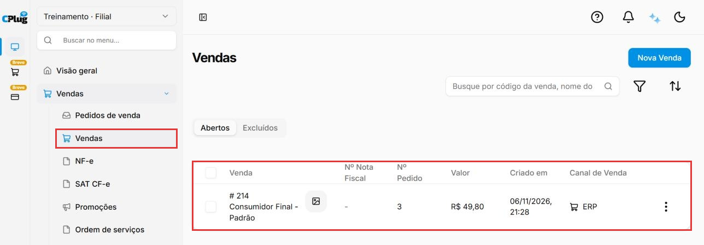
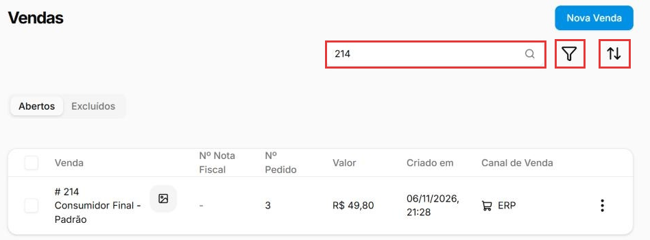
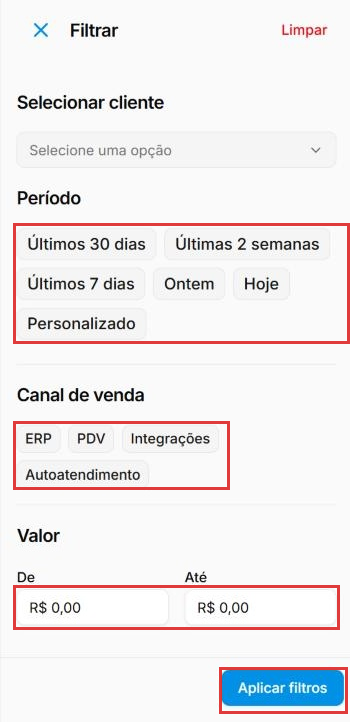
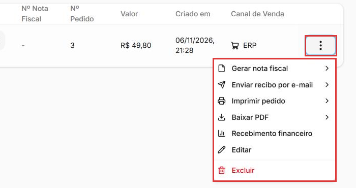
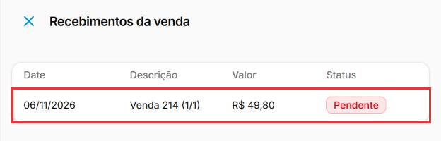
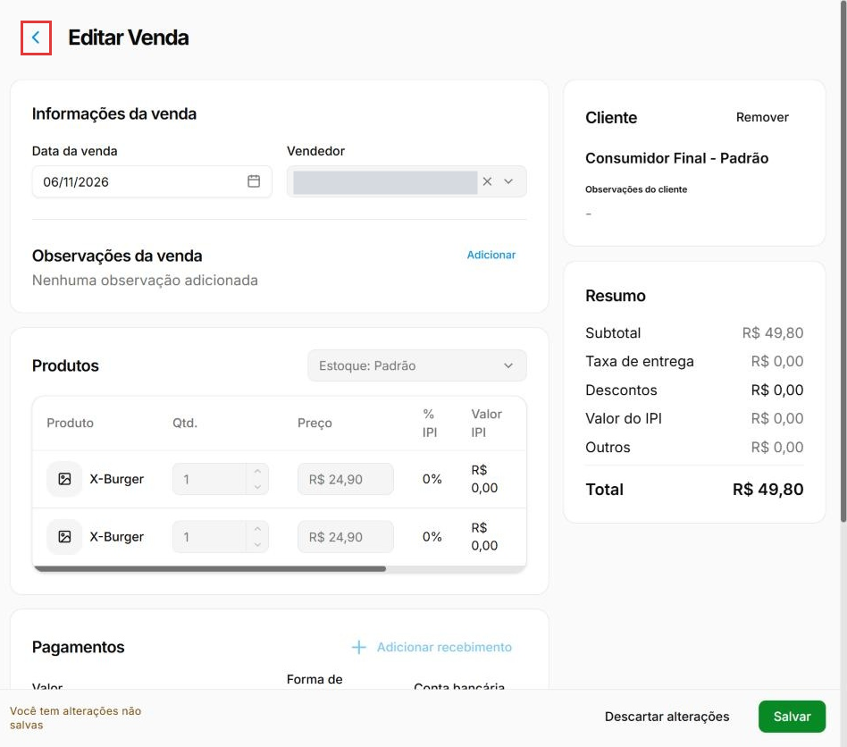

# Como consultar uma venda

:material-clock-outline: 6 minutos · :material-format-list-numbered: 6 passos · :material-calendar-check: Atualizado em 14/11/2026

A tela **Vendas** reúne todas as vendas da loja, de qualquer canal: as feitas no ERP, no PDV, por integrações e no autoatendimento. É nela que você encontra uma venda para tirar uma dúvida do cliente, gerar a nota fiscal, mandar o recibo ou conferir se o dinheiro já entrou. Exemplo: o cliente liga perguntando de uma compra de dois X-Burgers no dia 06/11. Em segundos você acha a venda, vê o valor de R$ 49,80 e, abrindo a venda, a forma de pagamento.

## Entenda o conceito

**Venda e pedido de venda não são a mesma coisa.** O **pedido de venda** é a negociação: o que o cliente quer levar, ainda podendo mudar. A **venda** é o que foi de fato vendido. Quando o pedido é concluído, ele gera uma venda: no exemplo deste manual, o pedido de venda **# 115** gerou a venda **# 214**.

**Cada venda tem um código próprio**, mostrado com **#** na coluna **Venda** (exemplo: **# 214**). É por esse código que você busca, e é ele que aparece nos recebimentos da venda (**Venda 214 (1/1)**).

**Termos da lista:**

| Coluna | O que mostra |
| --- | --- |
| **Venda** | O código da venda (# 214) e o nome do cliente. Sem cliente informado, aparece **Consumidor Final - Padrão**. |
| **Nº Nota Fiscal** | O número da nota fiscal da venda. Um traço (**-**) indica venda sem nota. |
| **Nº Pedido** | Um número de controle da venda. Atenção: ele **não** é o número do pedido de venda. Exemplo: a venda # 214 mostra **3** nesta coluna, mas o pedido de venda que deu origem a ela é o **# 115**. |
| **Valor** | O total da venda. |
| **Criado em** | Data e hora da venda. |
| **Canal de Venda** | Por onde a venda entrou: **ERP**, **PDV**, **Integrações** ou **Autoatendimento**. |

**Abertos e Excluídos.** As vendas válidas ficam na aba **Abertos**. As vendas excluídas ficam separadas, na aba **Excluídos**.

!!! info "Antes de começar"
    Confira no alto do menu se você está na loja certa: cada loja tem as suas vendas. Para trocar, veja [Como trocar de empresa ou loja](../primeiros-passos/trocar-de-empresa.md).

Nos prints, o **quadrado vermelho** mostra onde você deve clicar ou digitar.

## Abra a lista de vendas

No menu do lado esquerdo, clique em **Vendas** e depois em **Vendas**. A tela mostra as vendas da aba **Abertos**, com o código, o cliente, o valor, a data e o canal de cada uma.

O ícone de imagem ao lado do cliente é a miniatura dos produtos da venda. Quando o produto não tem foto, aparece só o desenho de uma imagem.

{ loading=lazy }

## Busque uma venda

No campo **Busque por código da venda, nome do cliente, código do pedido ou nota fiscal**, digite o que você sabe da venda. A lista se atualiza sozinha. A busca encontra a venda por:

- **código da venda**: digite só o número, sem o **#** (exemplo: **214**);
- **nome do cliente** (exemplo: **Consumidor**);
- **código do pedido**, que aqui é o número da coluna **Nº Pedido** (exemplo: **3**).

O número do **pedido de venda** (# 115, no exemplo) não encontra a venda nesta busca. Se você só tem esse número, procure o pedido em **Vendas → Pedidos de venda**.

Ao lado da busca ficam dois botões: o **funil** abre os filtros (próximo passo) e as **setas** mudam a ordem da lista. Em **ORDENAR POR**, a lista é ordenada pela **Criação** (data da venda). Ela já vem em **Decrescente**, com as vendas mais novas no alto. Escolha **Crescente** para começar pelas mais antigas.

{ loading=lazy }

## Filtre a lista

Clique no **funil**. Abre o painel **Filtrar**, com quatro filtros:

- **Selecionar cliente:** mostra só as vendas de um cliente.
- **Período:** **Últimos 30 dias**, **Últimas 2 semanas**, **Últimos 7 dias**, **Ontem**, **Hoje** ou **Personalizado** (você escolhe as datas).
- **Canal de venda:** **ERP**, **PDV**, **Integrações** ou **Autoatendimento**. Útil, por exemplo, para separar o que foi vendido no caixa (**PDV**) do que foi lançado no sistema (**ERP**).
- **Valor:** mostra só as vendas entre um valor **De** e um valor **Até**. Os campos têm máscara de dinheiro: para R$ 50,00, digite **5000**.

Clique em **Aplicar filtros**. Acima da lista aparece uma etiqueta com cada filtro em uso (exemplo: **Valor mínimo: R$ 50,00** ou **Canal de venda: PDV**). Se nenhuma venda atender aos filtros, a lista mostra **Sem dados no momento**. Para voltar a ver tudo, clique em **Limpar filtros**, ao lado das etiquetas.

{ loading=lazy }

## Use o menu da venda

Na linha da venda, clique nos **três pontinhos** (⋮). O menu tem as ações do dia a dia:

| Ação | Para que serve |
| --- | --- |
| **Gerar nota fiscal** | Abre as opções **Gerar NFe** e **Gerar NFCe**. Para entender a diferença entre as duas notas e os dados de uma NF-e, veja [Como emitir uma NF-e de venda](emitir-nfe.md). Na dúvida sobre qual nota emitir, fale com o seu contador. |
| **Enviar recibo por e-mail** | Manda o recibo para o cliente, **sem preço** ou **com preço**. |
| **Imprimir pedido** | Imprime o pedido da venda, **sem preço** ou **com preço**. |
| **Baixar PDF** | Baixa o pedido em PDF, **sem preço** ou **com preço**. O arquivo vem com o código da venda no nome (exemplo: **venda-214.pdf**). |
| **Recebimento financeiro** | Mostra os recebimentos da venda (próximo passo). |
| **Editar** | Abre a venda para alteração. Para só consultar os detalhes, veja o último passo. |
| **Excluir** | Exclui (cancela) a venda. Não faz parte da consulta: cuidado para não clicar por engano. Veja [Como cancelar uma venda](cancelar-venda.md). |

**Sem preço ou com preço?** Escolha **sem preço** quando o documento for para quem só precisa conferir os itens, como a separação, a entrega ou a cozinha, e **com preço** quando for para o cliente.

{ loading=lazy }

## Confira o recebimento da venda

No menu da venda, clique em **Recebimento financeiro**. Abre o painel **Recebimentos da venda**, com uma linha por parcela: a data, a descrição (exemplo: **Venda 214 (1/1)**, ou seja, parcela 1 de 1), o valor e o **Status** (a coluna da data aparece como **Date**).

O status diz se o dinheiro já entrou. **Pendente** quer dizer que a parcela ainda não foi dada como recebida no financeiro. Isso é comum em vendas no cartão, porque a operadora paga depois.

A mesma parcela aparece em **Finanças → Lançamentos** como uma conta a **Receber**, com o cliente, a data e o valor da venda. É a mesma conta, mas com outro nome de status: lá ela aparece como **A Vencer** antes da data e como **Vencido** depois dela, enquanto ninguém registrar o recebimento. No painel da venda, continua **Pendente**. Para registrar, veja [Como lançar uma conta a pagar ou a receber](../financas/contas-a-pagar-e-receber.md).

{ loading=lazy }

## Veja os detalhes da venda

Para ver tudo o que foi vendido, clique na linha da venda. Abre a tela **Editar Venda**:

- **Informações da venda:** a data da venda, o vendedor e as observações.
- **Produtos:** os itens, com quantidade e preço.
- **Pagamentos:** a forma de pagamento, a conta bancária, a bandeira do cartão e as parcelas.
- **Cliente** e **Resumo:** o cliente da venda e os totais (subtotal, taxa de entrega, descontos, IPI, outros e total).

Os campos desta tela podem ser alterados: se você só quer consultar, não mexa neles. Mesmo sem você mudar nada, a barra de baixo mostra **Você tem alterações não salvas**. Não clique em **Salvar**: volte para a lista pela **seta para a esquerda** (**<**), ao lado de **Editar Venda**. A venda continua como estava.

{ loading=lazy }

!!! tip "Boas práticas"
    - **Peça o código da venda** ao cliente ou busque pelo nome dele. São os jeitos mais rápidos de achar a venda.
    - **Consulte sem alterar:** para só olhar uma venda, use o menu ⋮ (recebimento, PDF) ou abra a venda e volte pela seta, sem salvar.
    - **Separe por canal:** no fim do dia, filtre por **PDV** e por **ERP** para conferir o que entrou por cada lado.
    - **Acompanhe os pendentes:** vendas no cartão ficam com recebimento **Pendente** até alguém registrar o recebimento em **Finanças → Lançamentos**. Confira com o extrato da operadora.

## Deu algum problema?

??? question "Busquei pelo número do pedido e a venda não apareceu"
    A busca da tela Vendas encontra pelo **código da venda** (o número depois do #), pelo **nome do cliente** e pelo número da coluna **Nº Pedido**. O número do **pedido de venda** não encontra a venda. Procure o pedido em **Vendas → Pedidos de venda**, ou busque a venda pelo nome do cliente.

??? question "O número da coluna Nº Pedido é diferente do número do meu pedido de venda"
    É assim mesmo: a coluna **Nº Pedido** da tela Vendas mostra um número de controle da venda, que não é o número do pedido de venda. Para encontrar a venda, use o código com **#** ou esse número da coluna.

??? question "Abri a venda e apareceu \"Você tem alterações não salvas\", mas não mudei nada"
    O aviso aparece ao abrir a tela **Editar Venda**, mesmo sem alteração. Se você só estava consultando, volte pela **seta para a esquerda** (**<**) ao lado do título, sem clicar em **Salvar**.

??? question "Apliquei um filtro e a lista ficou vazia"
    A mensagem **Sem dados no momento** quer dizer que nenhuma venda atende a todos os filtros juntos. Exemplo: filtrar **PDV** numa loja que só vendeu pelo ERP. Clique em **Limpar filtros**, acima da lista, para ver todas as vendas.

??? question "A venda não aparece na lista"
    Confira três coisas: se você está na **loja certa** (cada loja tem as suas vendas), se não há um **filtro** ou texto na busca escondendo a venda e se ela não foi excluída (veja a aba **Excluídos**).

**Relacionados:** [Como emitir uma NF-e de venda](emitir-nfe.md) · [Como lançar uma conta a pagar ou a receber](../financas/contas-a-pagar-e-receber.md) · [Como trocar de empresa ou loja](../primeiros-passos/trocar-de-empresa.md)

consultar venda encontrar venda buscar venda histórico de vendas lista de vendas código da venda filtrar vendas canal de venda pdv erp recibo por e-mail imprimir pedido baixar pdf segunda via recebimento financeiro pendente editar venda vendas excluídas
