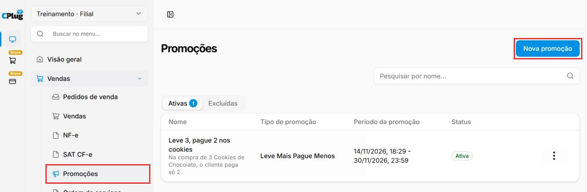
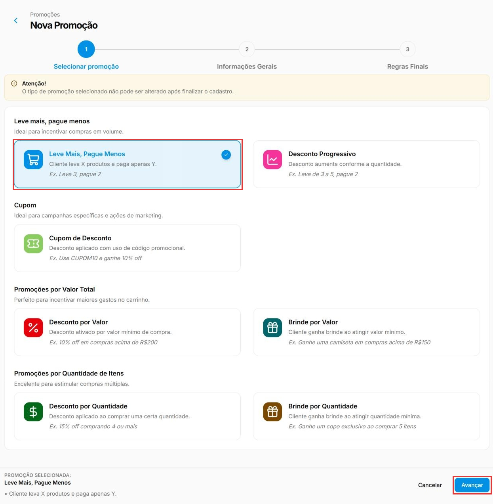
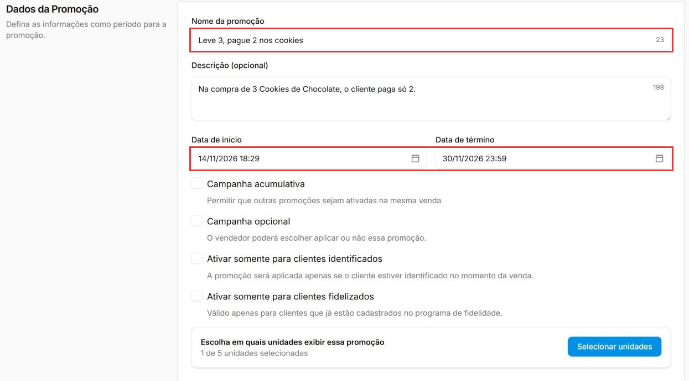
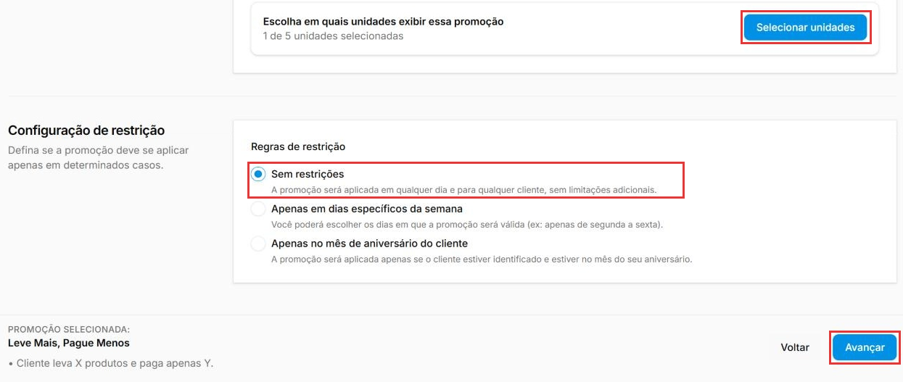
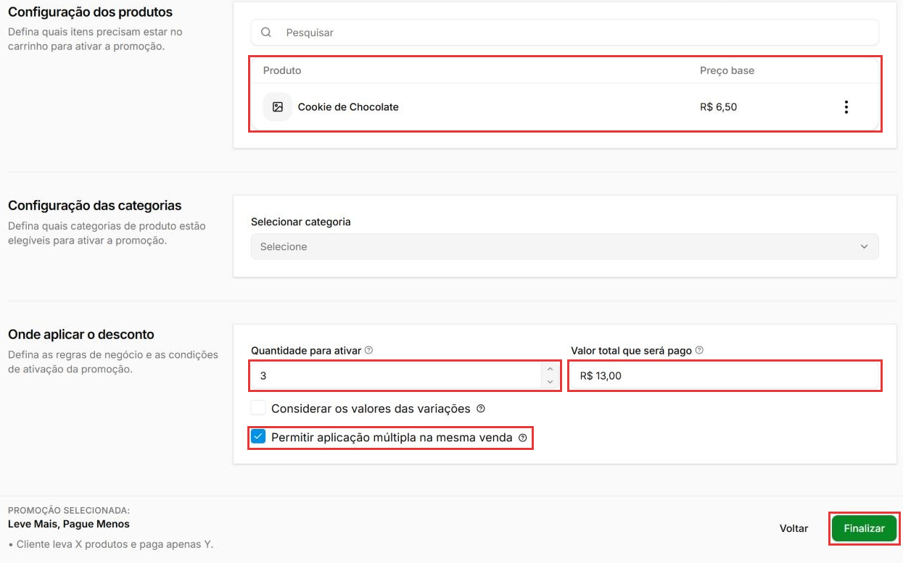
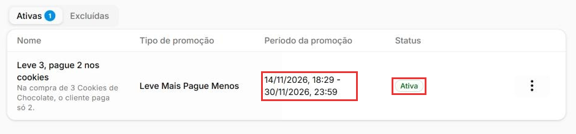

# Como criar uma promoção

:material-clock-outline: 8 minutos · :material-format-list-numbered: 6 passos · :material-calendar-check: Atualizado em 14/11/2026

Promoção é a regra que dá vantagem ao cliente quando ele compra de um certo jeito: levar mais unidades, gastar acima de um valor ou usar um cupom. Exemplo: na segunda quinzena do mês, quem leva 3 Cookies de Chocolate (R$ 6,50 cada) paga só 2, ou seja, R$ 13,00 em vez de R$ 19,50. Você cadastra a regra uma vez, com início e fim, e o desconto entra nas vendas feitas no **PDV** (o caixa).

## Entenda o conceito

**Os tipos de promoção.** O tipo é escolhido no começo e **não pode ser trocado depois**. Se escolher errado, exclua a promoção e crie outra. A tela agrupa os tipos assim:

| Grupo | Tipo | O que faz |
| --- | --- | --- |
| **Leve mais, pague menos** | **Leve Mais, Pague Menos** | O cliente leva X produtos e paga apenas Y. Ex.: leve 3, pague 2. |
| | **Desconto Progressivo** | O desconto aumenta conforme a quantidade. Ex.: leve de 3 a 5, pague 2. |
| **Cupom** | **Cupom de Desconto** | Desconto aplicado com um código promocional. Ex.: use CUPOM10 e ganhe 10% de desconto. |
| **Promoções por Valor Total** | **Desconto por Valor** | Desconto quando a compra passa de um valor mínimo. Ex.: 10% de desconto acima de R$ 200. |
| | **Brinde por Valor** | Brinde quando a compra passa de um valor mínimo. Ex.: uma camiseta em compras acima de R$ 150. |
| **Promoções por Quantidade de Itens** | **Desconto por Quantidade** | Desconto ao comprar uma certa quantidade. Ex.: 15% de desconto comprando 4 ou mais. |
| | **Brinde por Quantidade** | Brinde ao atingir uma quantidade mínima. Ex.: um copo ao comprar 5 itens. |

Este manual mostra o passo a passo completo com o tipo **Leve Mais, Pague Menos**. Os outros tipos também passam pelas três etapas, mas os campos podem mudar conforme o tipo.

**As três etapas do cadastro.** Toda promoção passa por **Selecionar promoção** (o tipo), **Informações Gerais** (nome, período, lojas e restrições) e **Regras Finais** (produtos e condição para ativar).

**Quando usar:** campanhas com começo e fim que dependem de uma condição na compra (quantidade, valor, cupom), como queima de estoque ou data comemorativa. **Quando não usar:** preço diferente que vale sempre num canal, num horário ou para um grupo de clientes. Para isso, use uma [lista de preços](../produtos/lista-de-precos.md).

!!! info "Antes de começar"
    Os produtos da promoção precisam estar cadastrados (veja [Como cadastrar um produto](../produtos/cadastrar-produto.md)). Confira também em que loja você está: a promoção já vem marcada para ela.

!!! warning "A promoção vale só no PDV"
    As promoções são aplicadas **apenas nas vendas feitas no PDV** (o caixa). Nas telas do ERP, **Vendas → Vendas → Nova Venda** e **Vendas → Pedidos de venda → Novo Pedido**, a promoção não entra: nelas, 3 Cookies de Chocolate continuam custando R$ 19,50 mesmo com a promoção ativa. Para o PDV, veja [Como configurar o terminal de vendas](../ponto-de-venda/configurar-terminal.md).

Nos prints, o **quadrado vermelho** mostra onde você deve olhar ou clicar.

## Abra a tela e clique em Nova promoção

No menu do lado esquerdo, clique em **Vendas** e depois em **Promoções**. A aba **Ativas** mostra as promoções cadastradas, com o nome, o tipo, o período e o status. As excluídas ficam na aba **Excluídas**. Para achar uma promoção pelo nome, use **Pesquisar por nome**.

Clique em **Nova promoção**, no canto de cima.

{ loading=lazy }

## Escolha o tipo de promoção

Na etapa **Selecionar promoção**, clique no cartão do tipo que você quer. O cartão escolhido fica azul, com um sinal de confirmação, e o nome aparece na barra de baixo, em **Promoção selecionada**. Leia o aviso amarelo: o tipo não pode ser alterado depois que a promoção for cadastrada.

No exemplo, escolha **Leve Mais, Pague Menos** e clique em **Avançar**.

{ loading=lazy }

## Dê nome e período à promoção

Na etapa **Informações Gerais**, preencha o quadro **Dados da Promoção**:

- **Nome da promoção** (até 50 caracteres): o nome que aparece na lista de promoções. Exemplo: "Leve 3, pague 2 nos cookies".
- **Descrição (opcional)** (até 255 caracteres): a regra explicada em uma frase.
- **Data de início** e **Data de término**: clique no campo e escolha o dia no calendário. O calendário também tem **Hora** e **Minuto**: a promoção vale entre a data e a hora de início e a data e a hora de término. No exemplo, de **14/11/2026 18:29** até **30/11/2026 23:59**. Para a promoção valer o dia inteiro do término, use 23:59.

Logo abaixo ficam quatro opções. Deixe todas desmarcadas se não tiver certeza e, se marcar alguma, faça uma venda de teste no PDV antes de divulgar a promoção:

- **Campanha acumulativa:** permite que outras promoções sejam ativadas na mesma venda.
- **Campanha opcional:** o vendedor escolhe se aplica ou não a promoção.
- **Ativar somente para clientes identificados:** a promoção só vale se o cliente for informado na venda.
- **Ativar somente para clientes fidelizados:** só vale para clientes do programa de fidelidade.

{ loading=lazy }

## Escolha as lojas e as restrições

Ainda na etapa **Informações Gerais**:

- **Escolha em quais unidades exibir essa promoção:** mostra quantas lojas estão marcadas (no exemplo, **1 de 5 unidades selecionadas**, a loja em que você está). Para incluir outras lojas da sua conta, clique em **Selecionar unidades**, marque as lojas (ou **Selecionar todas as lojas**) e clique em **Salvar**.
- **Regras de restrição:** **Sem restrições** (vale em qualquer dia, para qualquer cliente), **Apenas em dias específicos da semana** (aparecem os botões **D S T Q Q S S** para marcar os dias) ou **Apenas no mês de aniversário do cliente** (só vale com o cliente identificado na venda e no mês do aniversário dele).

No exemplo, deixe **Sem restrições** e clique em **Avançar**.

{ loading=lazy }

## Defina os produtos e a regra

Na etapa **Regras Finais**:

- **Configuração dos produtos:** digite o nome do produto em **Pesquisar** e clique nele. Ele entra na lista com o **Preço base**. No exemplo, **Cookie de Chocolate**, R$ 6,50.
- **Configuração das categorias:** em **Selecionar categoria** você indica categorias de produtos que também ativam a promoção (a tela diz: "Defina quais categorias de produto estão elegíveis para ativar a promoção").

No quadro **Onde aplicar o desconto**:

- **Quantidade para ativar:** quantas unidades precisam estar na compra para a promoção valer. No exemplo, **3**.
- **Valor total que será pago:** quanto o cliente paga por essa quantidade. Para "leve 3, pague 2" de um produto de R$ 6,50, o valor é o preço de 2 unidades: **R$ 13,00** (o campo tem máscara de dinheiro: digite **1300**).
- **Considerar os valores das variações:** marque para que o valor dos atributos do produto entre no cálculo da promoção (por exemplo, um tamanho maior com preço diferente). Na dúvida, deixe desmarcada.
- **Permitir aplicação múltipla na mesma venda:** marque para a promoção se repetir quando o cliente levar o dobro, o triplo e assim por diante. A própria tela dá o exemplo: com a regra "10 por R$ 150,00", quem leva 20 paga R$ 150,00 × 2; quem leva 21 paga R$ 150,00 × 2 mais o preço de uma unidade. No exemplo do print, a opção está marcada.

Confira tudo e clique em **Finalizar**. Para corrigir uma etapa anterior antes de finalizar, use **Voltar**: o que você já preencheu continua lá.

{ loading=lazy }

## Confira a promoção na lista

Aparece a mensagem **Promoção salva com sucesso!** e a promoção entra na aba **Ativas**, com o tipo, o **Período da promoção** e o status **Ativa**.

Nos **três pontinhos** (⋮) da promoção ficam **Editar** e **Excluir**. Em **Editar**, o cadastro abre nas mesmas três etapas, com o tipo travado. Em **Excluir**, o sistema pergunta "Tem certeza que deseja excluir a promoção?"; ao confirmar, a promoção vai para a aba **Excluídas**, com o status **Excluída**.

{ loading=lazy }

!!! tip "Boas práticas"
    - **Teste antes de divulgar:** faça uma venda de teste no PDV e confira o desconto.
    - **Venda pelo PDV:** a promoção só vale no caixa. Vendas lançadas pelo ERP (Nova Venda ou pedido de venda) saem sem o desconto da promoção.
    - **Sempre com data de término:** promoção esquecida no ar vira prejuízo. Defina o fim já no cadastro.
    - **Nome claro:** use um nome que diga a regra ("Leve 3, pague 2 nos cookies"), para a equipe entender sem abrir o cadastro.
    - **Cuidado com promoções somadas:** a **Campanha acumulativa** permite mais de uma promoção na mesma venda. Só marque se a margem aguentar.
    - **Confira as contas:** em "leve X, pague Y", o **Valor total que será pago** é o preço das unidades pagas, e não o desconto.

## Deu algum problema?

??? question "Criei a promoção, mas o desconto não aparece na venda"
    Confira primeiro onde você está vendendo: a promoção vale só nas vendas do **PDV**. Nas telas **Nova Venda** e **Novo Pedido** do ERP ela não é aplicada. Depois confira o período (a promoção só vale entre a data e a hora de início e de término), a loja (campo **Escolha em quais unidades exibir essa promoção**), as restrições (dias da semana, aniversário, cliente identificado) e a quantidade da regra. Se tudo estiver certo e o desconto não aparecer, fale com o suporte.

??? question "Escolhi o tipo errado. Dá para trocar?"
    Não. O tipo não pode ser alterado depois do cadastro. Exclua a promoção e crie outra com o tipo certo.

??? question "Quero encerrar a promoção antes da data de término"
    Exclua a promoção nos **três pontinhos** (⋮) e confirme. Ela vai para a aba **Excluídas**.

??? question "Alguns dias aparecem apagados no calendário da data de término"
    É assim mesmo: na data de término, os dias anteriores ao início ficam bloqueados. A promoção vale do início para a frente.

**Relacionados:** [Como criar uma lista de preços](../produtos/lista-de-precos.md) · [Como criar um pedido de venda](pedido-de-venda.md) · [Como cadastrar um produto](../produtos/cadastrar-produto.md)

promoção criar promoção leve mais pague menos leve 3 pague 2 desconto progressivo cupom de desconto desconto por valor brinde por valor desconto por quantidade brinde por quantidade campanha acumulativa campanha opcional clientes fidelizados aniversário do cliente dias da semana aplicação múltipla período da promoção pdv caixa promoção não aparece na venda
