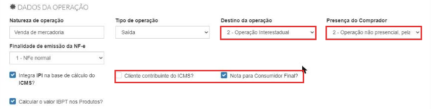
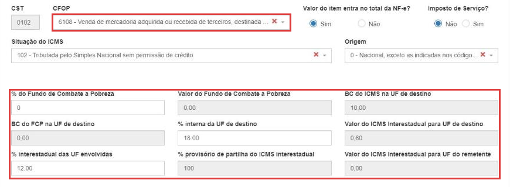

# Como emitir uma NF-e de venda (dentro e fora do estado)

:material-clock-outline: 15 minutos · :material-format-list-numbered: 10 passos · :material-calendar-check: Atualizado em 31/10/2026

A **NF-e** (nota fiscal eletrônica, modelo 55) é a nota usada principalmente em vendas para **empresas** (com CNPJ), em vendas **com entrega** e em vendas para **outro estado**. No caixa do dia a dia, o cupom é a **NFC-e**, emitido pelo PDV, e ele **só serve para vendas dentro do estado**.

Este manual mostra a **emissão manual** de uma NF-e, do começo ao fim, e o que muda quando o cliente é de **outro estado**.

!!! warning "Antes de emitir, confira três coisas"
    1. A empresa está configurada para emitir notas: certificado, série e impostos. Veja [Como configurar a emissão de notas fiscais](../configuracoes/emissao-de-notas.md).
    2. O **cliente** tem cadastro completo: CPF ou CNPJ, Inscrição estadual (se tiver) e endereço. Veja [Como cadastrar um cliente](../clientes/cadastrar-cliente.md).
    3. Os **produtos** têm os dados fiscais: NCM, origem, ICMS, PIS/COFINS e CFOP. Veja [Como configurar os dados fiscais de um produto](../produtos/parametros-fiscais.md).

## Entenda o conceito

### Venda estadual × interestadual

O que define se a venda é **estadual** ou **interestadual** é onde o **cliente** está, comparado com a sua loja:

| | **Estadual** (operação interna) | **Interestadual** |
| --- | --- | --- |
| **Cliente** | No **mesmo estado** da loja. | Em **outro estado**. |
| **Destino da operação** | **1 - Operação Interna** | **2 - Operação Interestadual** |
| **CFOP começa com** | **5** (ex.: 5102, 5405) | **6** (ex.: 6102, 6108) |
| **ICMS** | Alíquota do seu estado. | Alíquota **interestadual** (ex.: 12%) e, para consumidor final, o **DIFAL**. |

### Contribuinte ou consumidor final?

Fora do estado, o imposto depende de **quem compra**:

- **Contribuinte do ICMS** (empresa com Inscrição Estadual, que vai revender ou industrializar): CFOP como **6102**. O DIFAL não é cobrado na sua nota: o imposto do estado de destino fica por conta do comprador. (A venda interestadual para contribuinte não foi testada neste manual.)
- **Não contribuinte / consumidor final** (pessoa física, ou empresa sem IE que vai usar o produto): CFOP como **6108** e **DIFAL**.

### O que é o DIFAL

O **DIFAL** (diferencial de alíquota) é a parte do ICMS que fica com o **estado do cliente** quando você vende para um **consumidor final de outro estado**. É a diferença entre a alíquota interna do estado de destino e a alíquota interestadual.

No teste (loja no PR, cliente em SP, venda de R$ 10,00): alíquota interna de SP **18%**, interestadual **12%** → DIFAL de **6%** = **R$ 0,60** para SP. O sistema calcula sozinho quando você marca **Nota para Consumidor Final**.

!!! danger "Simples Nacional e DIFAL: confirme com o contador"
    O sistema calculou o DIFAL mesmo numa empresa do Simples Nacional. Se a sua empresa precisa ou não recolher esse valor depende da situação dela e do estado de destino. **Pergunte ao seu contador** antes de vender para fora do estado.

Nos prints, o **quadrado vermelho** mostra onde você deve clicar ou digitar. Os dados do cliente aparecem cobertos de cinza de propósito.

## Abra a tela de NF-e

No menu do lado esquerdo, clique em **Vendas** e depois em **NF-e**. A tela **NF-e de Saída** mostra:

- se os serviços da Sefaz para **NF-e** e **NFC-e** estão funcionando;
- até quando vale o **certificado digital**;
- um aviso vermelho quando o sistema está em **Homologação** (ambiente de teste, as notas **não têm valor fiscal**);
- as abas **Vendas/Saídas** e **Devoluções/Entradas**, com o **Status** de cada nota.

Clique em **Emitir NF-e**, no canto de cima, à direita.

{ loading=lazy }

## Confira as validações e a numeração

No topo da emissão, o sistema confere os **dados do emitente** (a sua empresa). Se aparecer **Dados da Emitente estão corretos**, siga em frente. Se aparecer algum aviso, corrija antes de continuar.

A **Série** e o **Número** vêm preenchidos com o próximo número livre. Não mude, a não ser que o contador oriente.

{ loading=lazy }

## Escolha o cliente

Em **Dados do cliente**, clique em **Cliente** e escolha o cliente na lista. O sistema preenche sozinho os dados do cadastro, inclusive o endereço e o **estado**.

{ loading=lazy }

Confira os dados que vieram, principalmente:

- **CNPJ** ou **CPF**;
- **Indicação de Inscrição Estadual**: **1 - Contribuinte ICMS** (empresa com IE), **2 - Contribuinte isento** ou **9 - Não contribuinte** (pessoa física e empresas sem IE);
- **Inscrição Estadual**, quando for contribuinte;
- **endereço completo**, com CEP. Ao digitar o CEP, o sistema completa rua, bairro e cidade.

{ loading=lazy }

!!! warning "Venda para pessoa física: use o cadastro do cliente"
    No teste, preencher uma **pessoa física** direto na nota, sem escolher um cliente cadastrado, fez o sistema enviar a pessoa como **contribuinte**, e a Sefaz recusou (Rejeição 728). Escolhendo um **cliente cadastrado**, a indicação veio certa (**9 - Não contribuinte**) e a nota foi autorizada. **Cadastre o cliente antes** e escolha-o na lista.

## Preencha os dados da operação

Em **Dados da operação**:

- **Natureza de operação:** o tipo de operação, por extenso. Exemplo: "Venda de mercadoria".
- **Tipo de operação:** **Saída**, para venda.
- **Destino da operação:** **1 - Operação Interna** (cliente no mesmo estado) ou **2 - Operação Interestadual** (cliente em outro estado).
- **Presença do Comprador:** **1 - Operação presencial** (cliente na loja) ou a opção que corresponde à venda (internet, telefone...).
- **Finalidade de emissão:** **1 - NF-e normal**, para uma venda comum.
- **Cliente contribuinte do ICMS?** e **Nota para Consumidor Final?:** marque de acordo com quem compra. Para pessoa física: **desmarque** contribuinte e **marque** consumidor final.

{ loading=lazy }

Exemplo de venda **interestadual** pela internet, para consumidor final:

{ loading=lazy }

## Informe o transporte

Na parte de **transporte**, em **Modalidade do frete**:

- **9 - Sem frete:** o cliente levou a mercadoria na hora (sem entrega).
- **0 - Contratação do Frete por conta do Remetente (CIF):** a sua empresa paga a entrega.
- **1 - Contratação do Frete por conta do Destinatário (FOB):** o cliente paga a entrega.

{ loading=lazy }

## Adicione os produtos

Em **Itens**, clique em **Produto** e escolha o produto. O sistema traz o código, a descrição, o valor e os **dados fiscais** do cadastro. Se o produto tem **variações** (tamanho, sabor), abre uma janela para escolher a opção; clique em **Selecionar**.

{ loading=lazy }

Confira a **Qtdade**, o **Vl. unitário** e o **NCM**.

{ loading=lazy }

## Confira o CFOP e os impostos do item

Mais abaixo no item:

- **CFOP:** nos testes ele veio **vazio**: escolha o CFOP da venda. Digite o número para achar mais rápido.
    - Dentro do estado: **5102** (venda comum) ou **5405** (produto com substituição tributária, ICMS 500 no Simples).
    - Fora do estado: **6102** (para contribuinte) ou **6108** (para não contribuinte / consumidor final).
- **Situação do ICMS** e **Origem:** vêm do cadastro do produto. Confira.

{ loading=lazy }

{ loading=lazy }

Na venda **interestadual para consumidor final**, aparece também o grupo do **DIFAL**, já calculado: **% interna da UF de destino**, **% interestadual das UF envolvidas**, **% provisório de partilha** e **Valor do ICMS Interestadual para UF de destino**.

{ loading=lazy }

Para mais um produto, use o botão de adicionar item.

## Preencha o pagamento

Em **Dados do pagamento**:

- **Forma de Pagamento:** **0 - À Vista** ou **1 - À Prazo**.
- **Meio de Pagamento:** como o cliente pagou (Dinheiro, Pix, cartão, boleto...).
- **Valor do Pagamento:** vem com o total da nota. Se o cliente pagou com mais de uma forma, use **Adicionar outro pagamento**.

{ loading=lazy }

!!! warning "Fatura é opcional, mas precisa bater"
    Os **Dados da fatura** são opcionais. Se preencher, o valor líquido da fatura precisa ser **igual à soma das parcelas**. Senão, a Sefaz recusa a nota (Rejeição 851).

## Salve a nota

No fim do formulário, clique em **Salvar**. Aparece **NFE inserida com sucesso**, e a nota entra na lista com o status **Pendente**: está salva, mas **ainda não foi enviada à Sefaz**.

{ loading=lazy }

{ loading=lazy }

## Transmita para a Sefaz

Volte para **Vendas → NF-e**. Na linha da nota **Pendente**, clique nos **três pontinhos** e depois em **Transmitir NF-e**. Aguarde a mensagem **Transmitindo**.

{ loading=lazy }

Quando a Sefaz autoriza, o status muda para **Transmitido**.

{ loading=lazy }

## Depois de autorizada

Nos **três pontinhos** da nota autorizada você tem:

- **Visualizar DANFE** e **Download DANFE:** o documento impresso da nota, para entregar ao cliente e acompanhar a mercadoria.
- **Download do XML NF-e:** o arquivo da nota. Envie ao cliente quando ele pedir (empresas precisam do XML).
- **Carta de correção:** corrige pequenos erros de texto, sem mudar valores, impostos ou quem vendeu e comprou.
- **Devolver NF-e:** quando o cliente devolve a mercadoria. Veja [Como emitir uma NF-e de devolução](nfe-de-devolucao.md).
- **Cancelar NF-e:** veja [Como cancelar, inutilizar ou corrigir uma nota fiscal](cancelar-nota.md).

{ loading=lazy }

!!! tip "Boas práticas"
    - **Cadastre o cliente antes de emitir**, com CPF/CNPJ, IE e endereço completos. A nota puxa tudo do cadastro e evita recusa.
    - **Confira o estado do cliente** antes de escolher o destino e o CFOP: o primeiro número do CFOP (5 ou 6) precisa combinar com o destino (1 ou 2).
    - **Pergunte ao contador** quais CFOPs e situações de ICMS a sua empresa usa, dentro e fora do estado, e deixe esses dados no cadastro dos produtos.
    - **Venda para outro estado não sai no PDV** com NFC-e: emita a NF-e.
    - **Teste em Homologação** quando for emitir um tipo de nota pela primeira vez.
    - **Envie o XML ao cliente empresa** logo depois da autorização.

## Deu algum problema?

??? question "O status ficou como Falhou"
    A Sefaz recusou a nota. Passe o mouse sobre **Falhou** para ver o motivo. Veja [Como resolver uma nota fiscal rejeitada](nota-rejeitada.md).

??? question "Rejeição 728: NF-e sem informação da IE do destinatário"
    A nota foi enviada como se o cliente fosse **contribuinte**, mas sem Inscrição Estadual. Isso aconteceu no teste ao preencher uma pessoa física direto na nota. **Escolha o cliente cadastrado** na lista (ou cadastre-o antes) e confira a **Indicação de Inscrição Estadual**: **9 - Não contribuinte** para pessoa física.

??? question "O CFOP veio vazio"
    Escolha o CFOP na lista do item: 5xxx dentro do estado, 6xxx para outro estado. Para não precisar escolher toda vez, peça ao contador e preencha o CFOP nos [dados fiscais do produto](../produtos/parametros-fiscais.md).

??? question "Não apareceu o DIFAL na venda para outro estado"
    No teste, o grupo do DIFAL apareceu calculado com o destino **2 - Operação Interestadual** e a nota marcada como **Nota para Consumidor Final**. Confira esses dois campos. Para cliente contribuinte (com IE), o DIFAL não é cobrado na sua nota.

??? question "A nota ficou como Pendente"
    Ela foi salva, mas não transmitida. Use **Transmitir NF-e** nos três pontinhos.

??? question "Apareceu o aviso de Homologação"
    A empresa está no ambiente de **teste**: as notas não têm valor fiscal. Para emitir de verdade, o **Ambiente de Geração** precisa estar em **Produção**. Veja [Como configurar a emissão de notas fiscais](../configuracoes/emissao-de-notas.md).

**Relacionados:** [Como emitir uma NF-e de devolução](nfe-de-devolucao.md) · [Como resolver uma nota fiscal rejeitada](nota-rejeitada.md) · [Como cancelar, inutilizar ou corrigir uma nota fiscal](cancelar-nota.md) · [Como cadastrar um cliente](../clientes/cadastrar-cliente.md)

emitir nf-e nota fiscal eletrônica modelo 55 emissão manual nota de venda venda estadual venda interestadual outro estado fora do estado operação interna operação interestadual destino da operação difal diferencial de alíquota consumidor final contribuinte não contribuinte indicação de inscrição estadual cfop 5102 5405 6102 6108 transmitir sefaz pendente transmitido autorizada danfe xml natureza de operação frete sem frete forma de pagamento à vista à prazo fatura homologação produção rejeição 728
