# Como emitir uma NF-e de venda

:material-clock-outline: 10 minutos · :material-format-list-numbered: 10 passos · :material-calendar-check: Atualizado em 30/10/2026

A **NF-e** (nota fiscal eletrônica, modelo 55) é a nota usada principalmente em vendas para **empresas** (com CNPJ) e em vendas com entrega. No caixa do dia a dia, o cupom é a **NFC-e**, emitido pelo PDV.

Este manual mostra a **emissão manual** de uma NF-e, preenchendo a nota do começo ao fim.

!!! warning "Antes de emitir, confira três coisas"
    1. A empresa está configurada para emitir notas: certificado, série e impostos. Veja [Como configurar a emissão de notas fiscais](../configuracoes/emissao-de-notas.md).
    2. O **cliente** tem cadastro completo: CPF ou CNPJ, Inscrição estadual (se tiver) e endereço. Veja [Como cadastrar um cliente](../clientes/cadastrar-cliente.md).
    3. Os **produtos** têm os dados fiscais: NCM, origem, ICMS, PIS/COFINS e CFOP. Veja [Como configurar os dados fiscais de um produto](../produtos/parametros-fiscais.md).

Nos prints, o **quadrado vermelho** mostra onde você deve clicar ou digitar. Os dados do cliente aparecem cobertos de cinza de propósito.

## Abra a tela de NF-e

No menu do lado esquerdo, clique em **Vendas** e depois em **NF-e**. A tela **NF-e de Saída** mostra:

- se os serviços da Sefaz para **NF-e** e **NFC-e** estão funcionando;
- até quando vale o **certificado digital**;
- um aviso vermelho quando o sistema está em **Homologação** (ambiente de teste, as notas **não têm valor fiscal**);
- a lista de notas, com o **Status** de cada uma.

Clique em **Emitir NF-e**, no canto de cima, à direita.

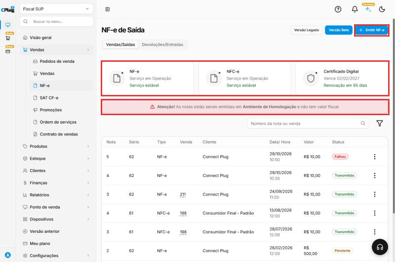{ loading=lazy }

## Confira as validações e a numeração

No topo da emissão, o sistema confere os **dados do emitente** (a sua empresa). Se aparecer **Dados da Emitente estão corretos**, siga em frente. Se aparecer algum aviso, corrija antes de continuar.

A **Série** e o **Número** vêm preenchidos com o próximo número livre. Não mude, a não ser que o contador oriente.

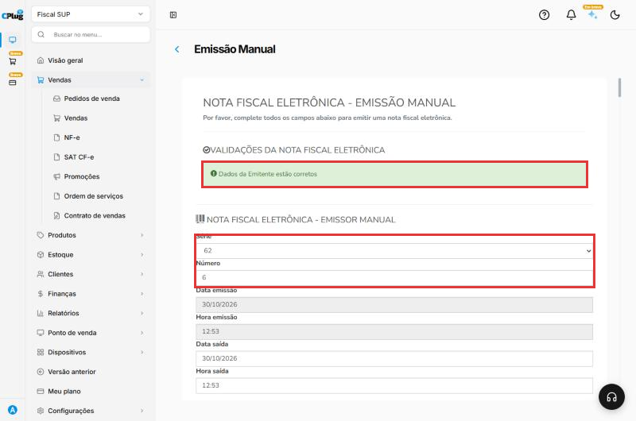{ loading=lazy }

## Escolha o cliente

Em **Dados do cliente**, clique em **Cliente** e escolha o cliente na lista. O sistema preenche sozinho os dados do cadastro.

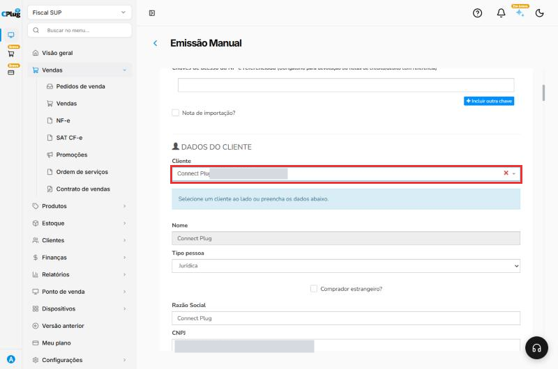{ loading=lazy }

Confira os dados que vieram, principalmente:

- **CNPJ** ou **CPF**;
- **Indicação de Inscrição Estadual**: **1 - Contribuinte ICMS** (empresa com IE), **2 - Contribuinte isento** ou **9 - Não contribuinte** (pessoa física e empresas sem IE);
- **Inscrição Estadual**, quando for contribuinte;
- **endereço completo**, com CEP.

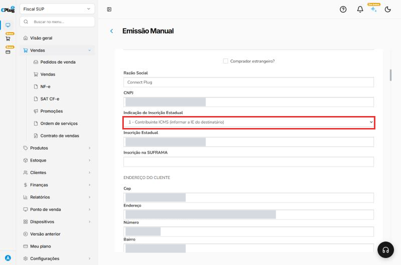{ loading=lazy }

## Preencha os dados da operação

Em **Dados da operação**:

- **Natureza de operação:** o tipo de operação, por extenso. Exemplo: "Venda de mercadoria".
- **Tipo de operação:** **Saída**, para venda.
- **Destino da operação:** **1 - Operação Interna** (cliente no mesmo estado) ou **2 - Interestadual**.
- **Presença do Comprador:** **1 - Operação presencial** (cliente na loja) ou a opção que corresponde à venda (internet, telefone...).
- **Finalidade de emissão:** **1 - NF-e normal**, para uma venda comum.

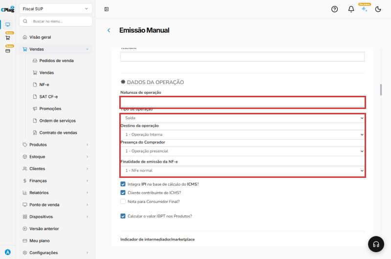{ loading=lazy }

## Informe o transporte

Na parte de **transporte**, em **Modalidade do frete**:

- **9 - Sem frete:** o cliente levou a mercadoria na hora (sem entrega).
- **0 - Contratação do Frete por conta do Remetente (CIF):** a sua empresa paga a entrega.
- **1 - Contratação do Frete por conta do Destinatário (FOB):** o cliente paga a entrega.

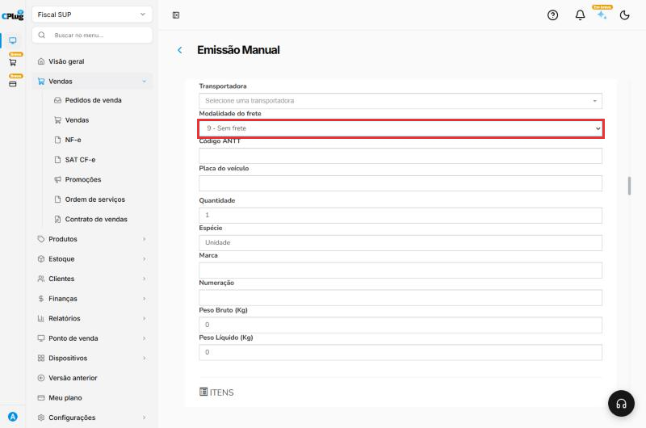{ loading=lazy }

## Adicione os produtos

Em **Itens**, clique em **Produto** e escolha o produto. O sistema traz o código, a descrição, o valor e os **dados fiscais** do cadastro.

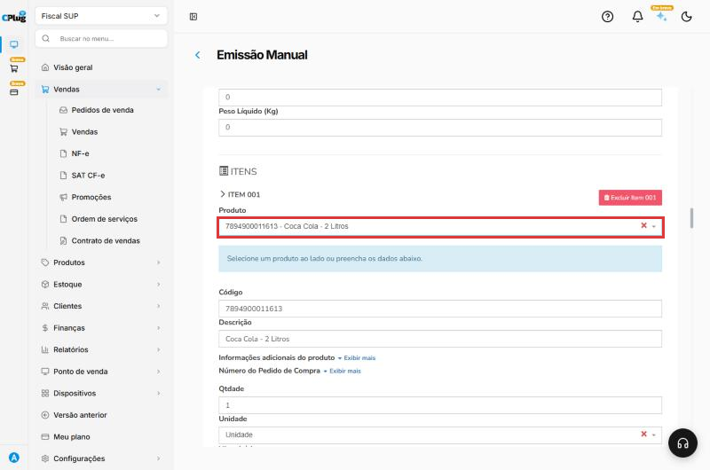{ loading=lazy }

Confira a **Qtdade**, o **Vl. unitário** e o **NCM**.

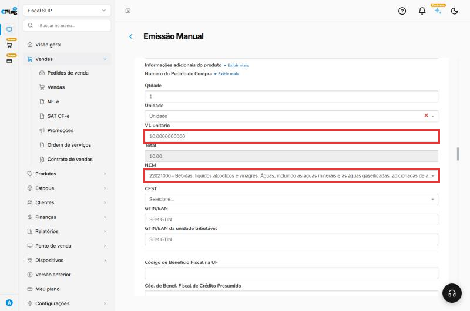{ loading=lazy }

## Confira o CFOP e os impostos do item

Mais abaixo no item:

- **CFOP:** se vier vazio, escolha o CFOP da venda. Digite o número para achar mais rápido. Exemplo: **5102** para venda comum dentro do estado; **5405** para produto com substituição tributária (ICMS 500 no Simples).
- **Situação do ICMS** e **Origem:** vêm do cadastro do produto. Confira.

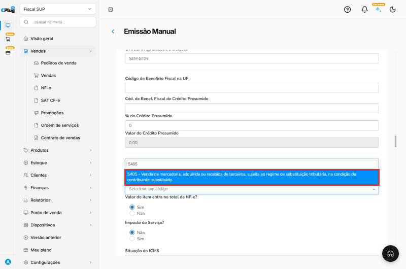{ loading=lazy }

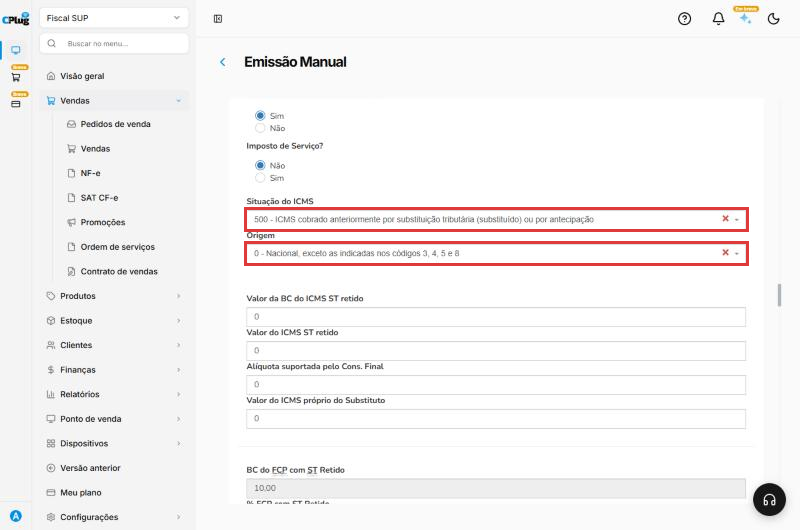{ loading=lazy }

Para mais um produto, use o botão de adicionar item.

## Preencha o pagamento

Em **Dados do pagamento**:

- **Forma de Pagamento:** **0 - À Vista** ou **1 - À Prazo**.
- **Meio de Pagamento:** como o cliente pagou (Dinheiro, Pix, cartão, boleto...).
- **Valor do Pagamento:** vem com o total da nota. Se o cliente pagou com mais de uma forma, use **Adicionar outro pagamento**.

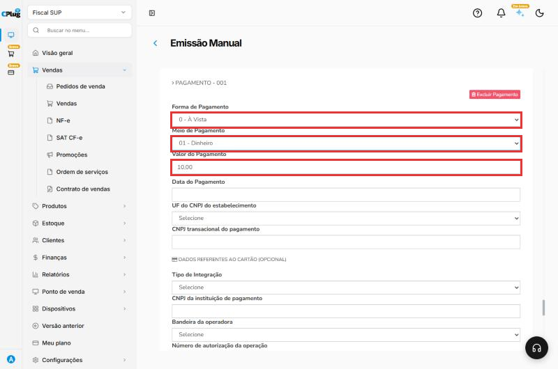{ loading=lazy }

!!! warning "Fatura é opcional, mas precisa bater"
    Os **Dados da fatura** são opcionais. Se preencher, o valor líquido da fatura precisa ser **igual à soma das parcelas**. Senão, a Sefaz recusa a nota (Rejeição 851).

## Salve a nota

No fim do formulário, clique em **Salvar**. Aparece **NFE inserida com sucesso**, e a nota entra na lista com o status **Pendente**: está salva, mas **ainda não foi enviada à Sefaz**.

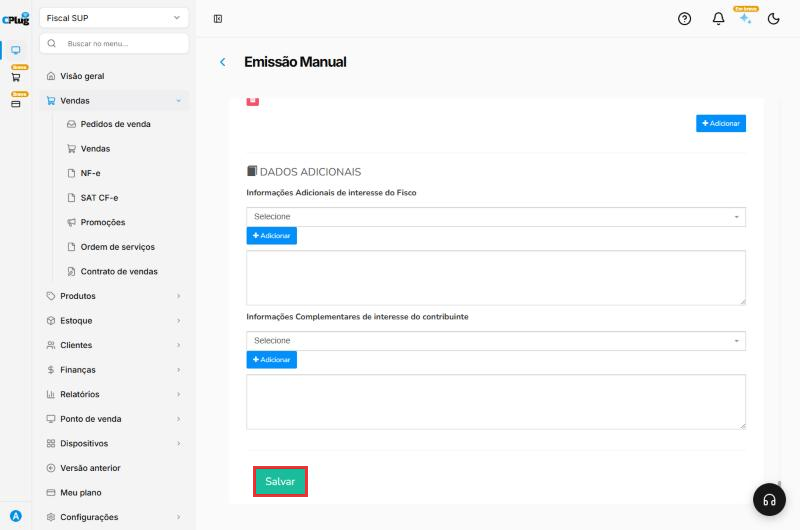{ loading=lazy }

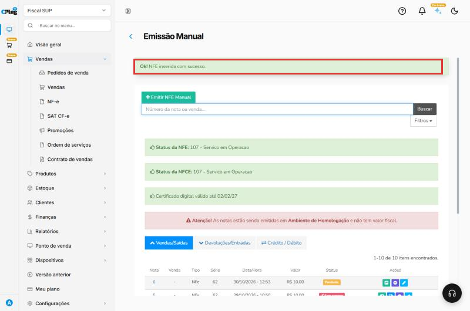{ loading=lazy }

## Transmita para a Sefaz

Volte para **Vendas → NF-e**. Na linha da nota **Pendente**, clique nos **três pontinhos** e depois em **Transmitir NF-e**. Aguarde a mensagem **Transmitindo**.

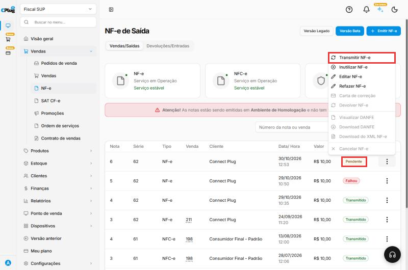{ loading=lazy }

Quando a Sefaz autoriza, o status muda para **Transmitido**.

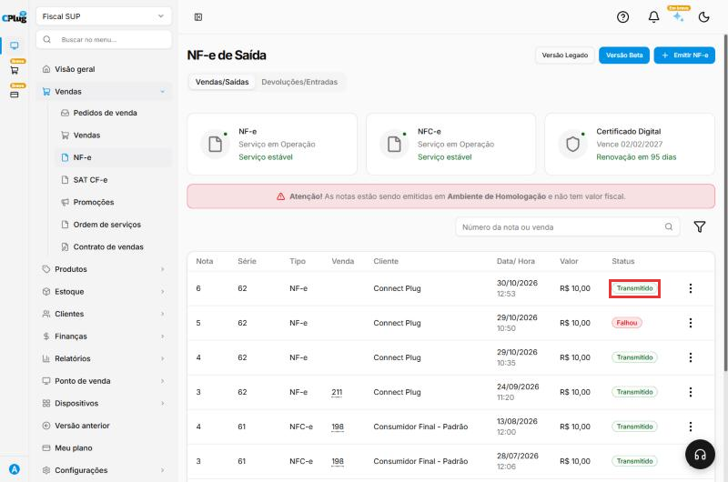{ loading=lazy }

## Depois de autorizada

Nos **três pontinhos** da nota autorizada você tem:

- **Visualizar DANFE** e **Download DANFE:** o documento impresso da nota, para entregar ao cliente.
- **Download do XML NF-e:** o arquivo da nota. Envie ao cliente quando ele pedir (empresas precisam do XML).
- **Carta de correção:** corrige pequenos erros de texto, sem mudar valores, impostos ou quem vendeu e comprou.
- **Cancelar NF-e:** veja [Como cancelar ou inutilizar uma nota fiscal](cancelar-nota.md).

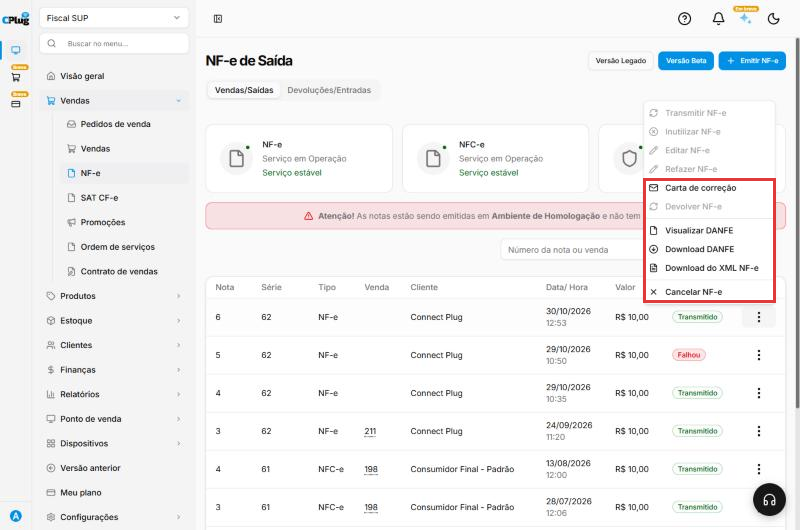{ loading=lazy }

## Deu algum problema?

??? question "O status ficou como Falhou"
    A Sefaz recusou a nota. Passe o mouse sobre **Falhou** para ver o motivo. Veja [Como resolver uma nota fiscal rejeitada](nota-rejeitada.md).

??? question "A nota ficou como Pendente"
    Ela foi salva, mas não transmitida. Use **Transmitir NF-e** nos três pontinhos.

??? question "Apareceu o aviso de Homologação"
    A empresa está no ambiente de **teste**: as notas não têm valor fiscal. Para emitir de verdade, o **Ambiente de Geração** precisa estar em **Produção**. Veja [Como configurar a emissão de notas fiscais](../configuracoes/emissao-de-notas.md).

**Relacionados:** [Como resolver uma nota fiscal rejeitada](nota-rejeitada.md) · [Como cancelar ou inutilizar uma nota fiscal](cancelar-nota.md) · [Como cadastrar um cliente](../clientes/cadastrar-cliente.md)

emitir nf-e nota fiscal eletrônica modelo 55 emissão manual nota de venda transmitir sefaz pendente transmitido autorizada danfe xml natureza de operação cfop 5102 5405 frete sem frete forma de pagamento à vista à prazo fatura homologação produção
