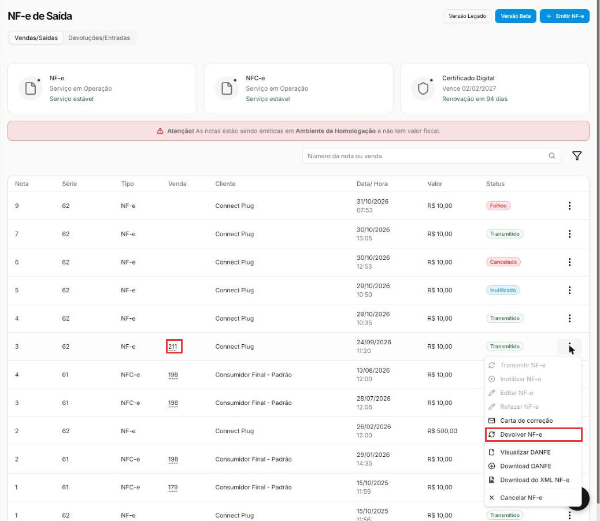
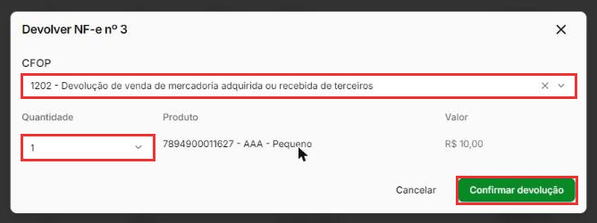
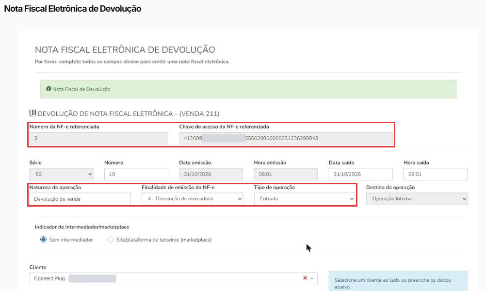
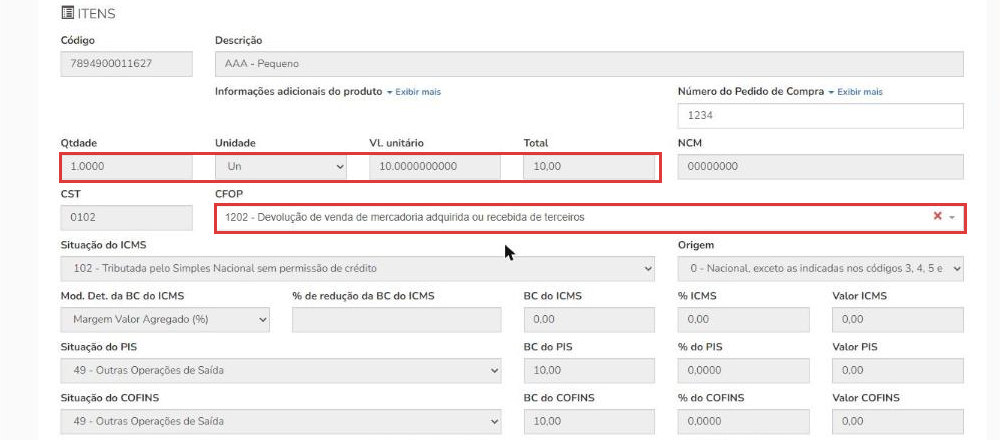
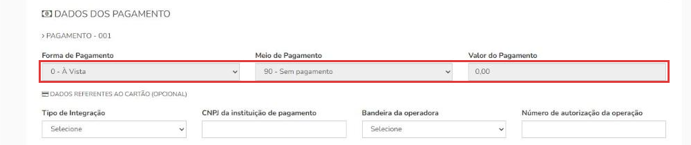
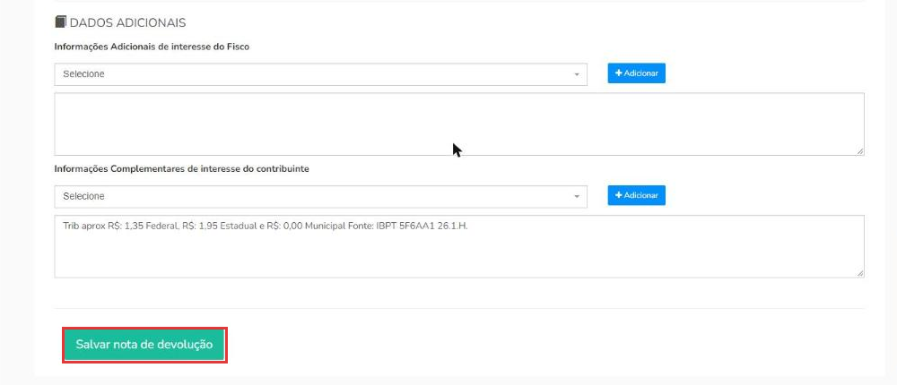
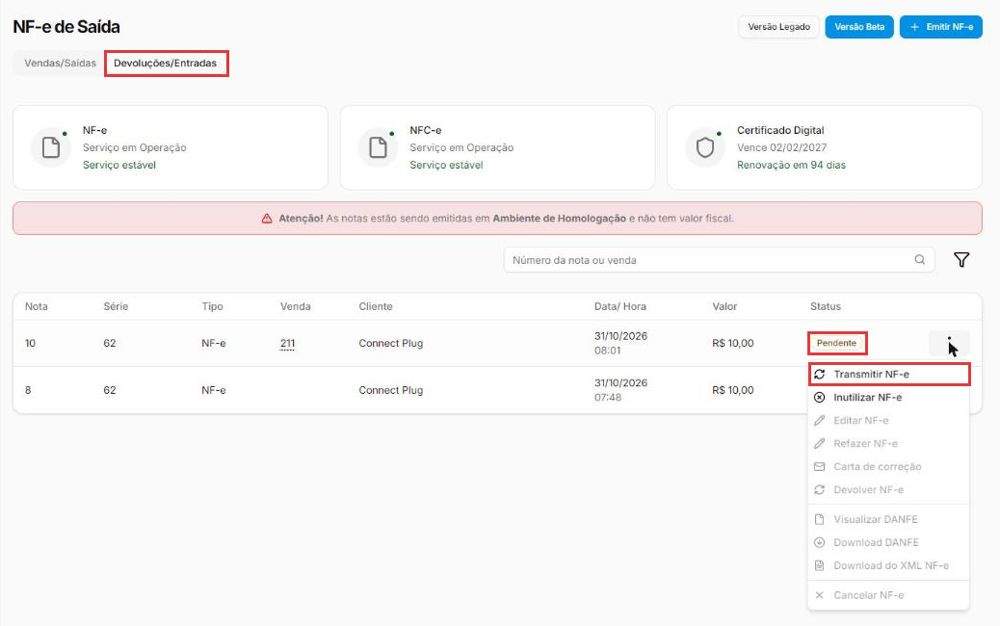
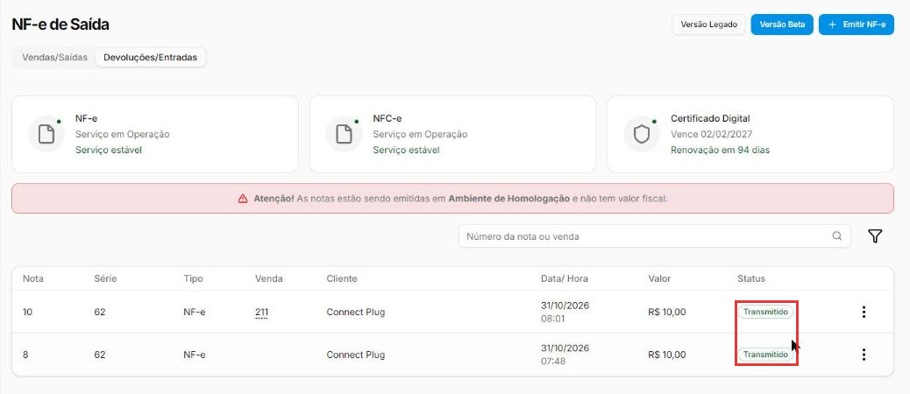

# Como emitir uma NF-e de devolução

:material-clock-outline: 15 minutos · :material-format-list-numbered: 7 passos · :material-calendar-check: Atualizado em 31/10/2026

Quando uma mercadoria **volta**, a operação fiscal precisa ser desfeita com uma nota própria: a **NF-e de devolução**. Ela "anula" a nota original, total ou parcialmente, e por isso sempre **aponta para ela** pela chave de acesso.

Este manual mostra os dois caminhos: o atalho **Devolver NF-e**, que preenche quase tudo sozinho, e a **emissão manual**, para os casos em que o atalho não existe.

!!! danger "Devolução mexe com impostos: alinhe com o contador"
    O CFOP, a situação do ICMS e quem deve emitir a nota mudam de empresa para empresa. Use os exemplos deste manual para entender o caminho no sistema, mas **confirme os códigos com o seu contador** antes de emitir de verdade.

## Entenda o conceito

### Os dois sentidos da devolução

| | Devolução de **venda** | Devolução de **compra** |
| --- | --- | --- |
| **O que aconteceu** | O **cliente** devolveu algo que você vendeu. | **Você** devolve ao **fornecedor** algo que comprou. |
| **Tipo de operação** | **Entrada** (a mercadoria volta para a loja). | **Saída** (a mercadoria sai da loja). |
| **Nota referenciada** | A sua NF-e de venda. | A NF-e que o fornecedor emitiu para você. |
| **Destinatário** | O cliente. | O fornecedor, **o mesmo que emitiu a nota original**. |
| **Onde aparece no sistema** | Aba **Devoluções/Entradas**. | Aba **Vendas/Saídas**. |

!!! note "Cliente com Inscrição Estadual"
    Quando o cliente é uma **empresa contribuinte do ICMS**, em geral é **ele** quem emite a nota de devolução para você, e a sua loja só recebe essa nota. Confirme a regra com o contador.

### As quatro peças que fazem uma nota ser de devolução

1. **Finalidade de emissão: 4 - Devolução de mercadoria.** É ela que diz à Sefaz que a nota é uma devolução.
2. **Chave de acesso da NF-e referenciada.** Os 44 números da nota original. É **obrigatória**: sem ela, não existe devolução.
3. **CFOP de devolução.** Ele segue uma lógica simples:
    - começa com **1** (entrada) ou **5** (saída) dentro do estado;
    - começa com **2** (entrada) ou **6** (saída) para outro estado.

    | Situação | Dentro do estado | Outro estado |
    | --- | --- | --- |
    | Devolução de venda comum | 1202 | 2202 |
    | Devolução de venda com substituição tributária (ICMS ST) | 1411 | 2411 |
    | Devolução de compra comum | 5202 | 6202 |
    | Devolução de compra com substituição tributária | 5411 | 6411 |

4. **Pagamento: 90 - Sem pagamento**, com valor **0,00**. A devolução não é uma venda nova; o dinheiro (troca, estorno) é resolvido fora da nota.

Os **produtos, quantidades e valores** são os mesmos da nota original. Na devolução **parcial**, só mudam as quantidades.

### Atalho ou emissão manual?

| | Atalho **Devolver NF-e** | **Emissão manual** |
| --- | --- | --- |
| **Quando aparece** | Só nas notas **geradas a partir de uma venda** (com número na coluna **Venda**). | Sempre, pelo botão **Emitir NF-e**. |
| **O que preenche** | Nota e chave referenciadas, cliente, produtos, finalidade, tipo, pagamento. | Nada: você preenche tudo. |
| **Use para** | Devolução de venda feita pelo sistema. | Notas avulsas, devolução de compra ao fornecedor e qualquer caso sem o atalho. |

Nos prints, o **quadrado vermelho** mostra onde você deve clicar ou digitar. Dados de clientes e CNPJs aparecem cobertos de cinza de propósito.

## Encontre a nota original

No menu do lado esquerdo, clique em **Vendas** e depois em **NF-e**. Na aba **Vendas/Saídas**, ache a nota que vai ser devolvida. Ela precisa estar **Transmitido** (autorizada) e ter um número na coluna **Venda**.

Clique nos **três pontinhos** da nota e em **Devolver NF-e**.

{ loading=lazy }

## Escolha o CFOP e as quantidades

Na janela **Devolver NF-e**:

- **CFOP:** a lista mostra os CFOPs de entrada. Digite o número para filtrar. Exemplo: **1202** para a devolução de uma venda comum dentro do estado.
- **Quantidade:** quanto de cada produto está voltando. A lista vai de **0** até a quantidade vendida. Para devolver só parte da nota, diminua a quantidade; para deixar um produto de fora, escolha **0**.

Clique em **Confirmar devolução**. Sem o CFOP, o botão não faz nada.

{ loading=lazy }

## Confira o cabeçalho da nota

Abre a tela **Nota Fiscal Eletrônica de Devolução**, já preenchida:

- **Número da NF-e referenciada** e **Chave de acesso da NF-e referenciada:** a nota original. Ficam travados.
- **Natureza de operação:** "Devolução de venda".
- **Finalidade de emissão da NF-e:** **4 - Devolução de mercadoria**.
- **Tipo de operação:** **Entrada**.
- **Cliente:** o mesmo da venda, com os dados do cadastro.

O **Número** da nova nota é o próximo da série: a devolução usa a mesma numeração das notas de venda.

{ loading=lazy }

## Confira os itens

Os produtos vêm da nota original, com **quantidade, valor, NCM e impostos travados**, para garantir que a devolução seja igual à venda. O **CFOP** escolhido na janela já aparece em cada item.

{ loading=lazy }

## Confira o pagamento

Em **Dados do pagamento**, o sistema já coloca **90 - Sem pagamento**, com valor **0,00**, e trava o campo. É o certo para devolução.

{ loading=lazy }

## Salve a nota de devolução

No fim da tela, clique em **Salvar nota de devolução**. Aparece **NFE inserida com sucesso** e a nota entra na aba **Devoluções/Entradas** como **Pendente**: salva, mas ainda não enviada à Sefaz.

{ loading=lazy }

!!! warning "Esta tela vale uma vez só"
    Se você sair da tela de devolução sem salvar, ou tentar abri-la de novo, aparece **"A devolução expirou ou é inválida. Reinicie pela listagem."** Volte para **Vendas → NF-e** e clique em **Devolver NF-e** de novo.

## Transmita para a Sefaz

Em **Vendas → NF-e**, clique na aba **Devoluções/Entradas**. Nos **três pontinhos** da nota **Pendente**, clique em **Transmitir NF-e**.

{ loading=lazy }

Quando a Sefaz autoriza, o status muda para **Transmitido**. Pronto: a devolução está registrada.

{ loading=lazy }

## Devolução pela emissão manual

Use este caminho quando o atalho **Devolver NF-e** está apagado (nota avulsa, sem venda) ou para devolver mercadoria ao **fornecedor**. O formulário é o mesmo da venda (veja [Como emitir uma NF-e de venda](emitir-nfe.md)); mudam estes campos:

1. Em **Vendas → NF-e**, clique em **Emitir NF-e**.
2. Em **Chaves de acesso da NF-e referenciada**, cole os **44 números** da nota original. Se a devolução juntar mais de uma nota, use **Incluir outra chave**.
3. Em **Cliente**, escolha quem vai receber a nota:
    - devolução de venda: o **cliente** que comprou;
    - devolução de compra: o **fornecedor** que emitiu a nota original.
4. Em **Dados da operação**:
    - **Natureza de operação:** "Devolução de venda" ou "Devolução de compra".
    - **Tipo de operação:** **Entrada** (devolução de venda) ou **Saída** (devolução de compra).
    - **Finalidade de emissão da NF-e:** **4 - Devolução de mercadoria**.
5. Em **Itens**, coloque os mesmos produtos, quantidades e valores da nota original. Escolha o **CFOP de devolução**: na nota manual, ele vem **vazio**.
6. Confira a **Situação do PIS** e a **Situação do COFINS**. O produto pode trazer um código de **saída**, como "49 - Outras Operações de Saída". Na devolução de venda, que é uma **entrada**, troque pelo código que o contador indicar. No teste, usamos "99 - Outras Operações".
7. Em **Dados do pagamento**, escolha **90 - Sem pagamento** e deixe o valor em **0,00**.
8. Clique em **Salvar** e depois transmita, como no último passo acima.

!!! tip "Boas práticas"
    - **Prefira o atalho** sempre que ele existir: ele copia os itens e os impostos da venda e evita erro de digitação.
    - **Devolva exatamente o que voltou.** Quantidade e valor iguais aos da nota original; na devolução parcial, só a parte devolvida.
    - **Tenha a chave da nota original à mão** antes de começar. Ela está no DANFE e no XML.
    - **Na devolução de compra, o destinatário é o fornecedor** que emitiu a nota original. Qualquer outro gera recusa.
    - **Confira o estoque e o financeiro depois.** A nota cuida da parte fiscal; a troca, o estorno ou o crédito do cliente são feitos à parte.
    - **Guarde o DANFE da devolução** junto com o da venda: um explica o outro numa fiscalização.

## Deu algum problema?

??? question "A opção Devolver NF-e está apagada"
    O atalho só funciona nas notas **geradas a partir de uma venda** (com número na coluna **Venda**). Para notas avulsas, use a [emissão manual](#devolucao-pela-emissao-manual).

??? question "Cliquei em Confirmar devolução e nada aconteceu"
    Falta escolher o **CFOP**. Escolha na lista e confirme de novo.

??? question "Apareceu \"A devolução expirou ou é inválida\""
    A tela de devolução vale uma vez só. Volte para **Vendas → NF-e** e clique em **Devolver NF-e** de novo.

??? question "Rejeição 1194: Destinatário da NF-e deve ser igual ao Emitente da NF referenciada"
    Na devolução de **compra**, o destinatário precisa ser **o fornecedor que emitiu a nota original**. Confira se o cliente escolhido é esse fornecedor e se a chave é mesmo da nota dele.

??? question "Quero devolver só parte da nota"
    No atalho, diminua a **Quantidade** de cada produto na janela **Devolver NF-e** (ou escolha **0** para deixar o produto de fora). Na emissão manual, coloque só os itens e as quantidades devolvidas.

??? question "Não acho a nota de devolução na lista"
    A devolução de **venda** é uma nota de **entrada**: ela fica na aba **Devoluções/Entradas**. A devolução de **compra** é de **saída** e fica em **Vendas/Saídas**.

??? question "A Sefaz recusou a nota"
    Passe o mouse sobre o status **Falhou** para ver o motivo. Veja [Como resolver uma nota fiscal rejeitada](nota-rejeitada.md).

??? question "Fui editar a devolução rejeitada e a chave referenciada sumiu"
    No teste, ao abrir **Editar NF-e** (ou **Refazer NF-e**) de uma devolução, o campo **Chaves de acesso da NF-e referenciada** veio vazio. Cole a chave de novo antes de salvar e transmitir.

**Relacionados:** [Como emitir uma NF-e de venda](emitir-nfe.md) · [Como resolver uma nota fiscal rejeitada](nota-rejeitada.md) · [Como cancelar, inutilizar ou corrigir uma nota fiscal](cancelar-nota.md)

nf-e de devolução nota de devolução devolver nf-e devolução de venda devolução de compra devolução ao fornecedor cliente devolveu troca finalidade 4 devolução de mercadoria chave de acesso referenciada nota referenciada cfop 1202 2202 1411 2411 5202 6202 5411 6411 sem pagamento 90 rejeição 1194 devolução parcial devoluções entradas nota de entrada
