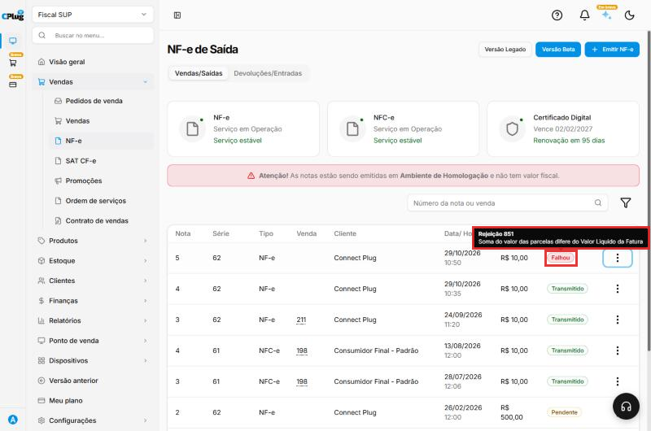
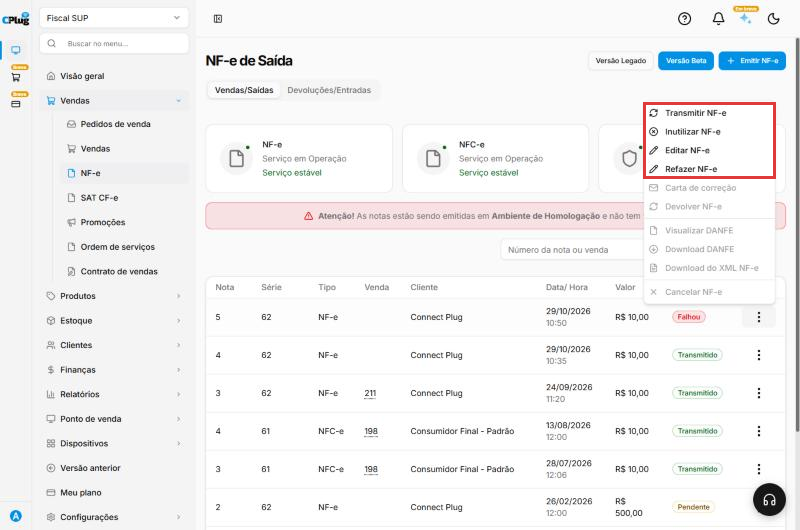
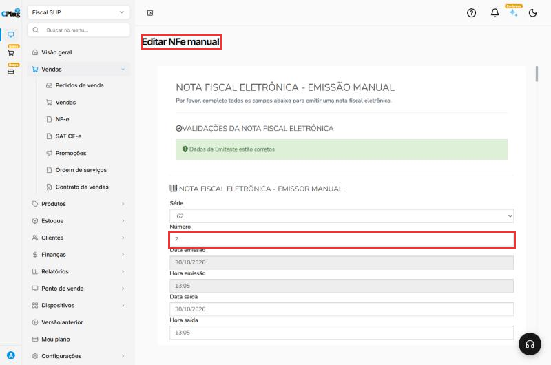
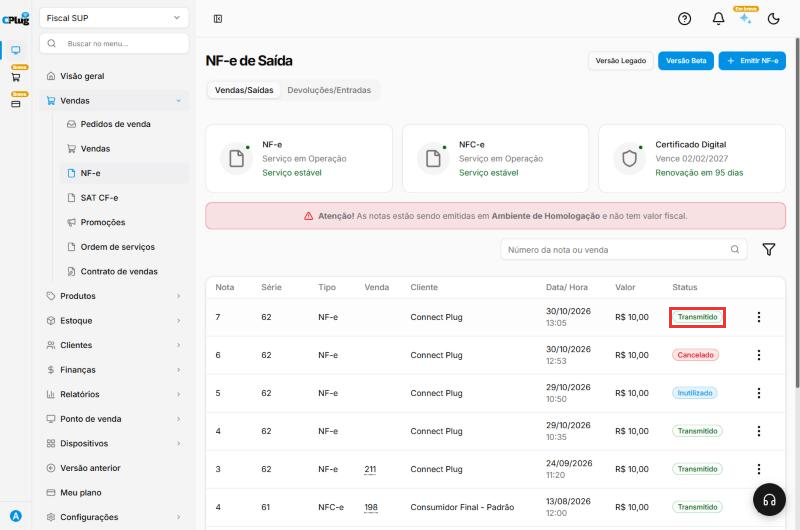
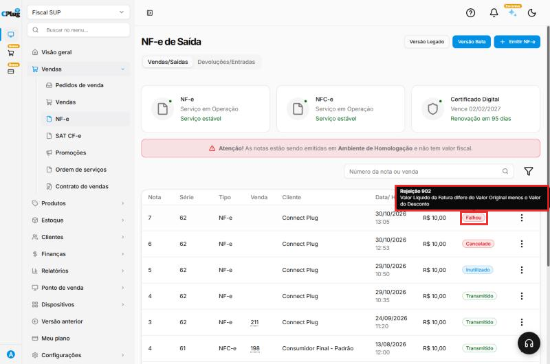
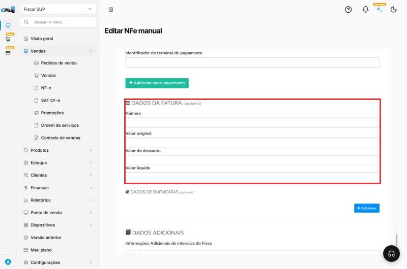

# Como resolver uma nota fiscal rejeitada

:material-clock-outline: 5 minutos · :material-format-list-numbered: 3 passos e um exemplo · :material-calendar-check: Atualizado em 30/10/2026

Quando a Sefaz **recusa** uma nota, ela aparece com o status **Falhou**. A nota **não foi autorizada**: não tem valor fiscal e precisa ser corrigida e transmitida de novo.

Toda rejeição tem um **número** e uma **mensagem** que dizem exatamente o que está errado.

Nos prints, o **quadrado vermelho** mostra onde você deve clicar.

## Veja o motivo da rejeição

Em **Vendas → NF-e**, encontre a nota com o status **Falhou** e **passe o mouse** sobre ele. Aparece o número e a mensagem da rejeição.

No exemplo: **Rejeição 851 - Soma do valor das parcelas difere do Valor Líquido da Fatura**.

{ loading=lazy }

## Corrija o problema

Use a tabela de rejeições comuns, mais abaixo, para entender o que corrigir. Em geral, o erro está em um destes lugares:

- no **cadastro do cliente** (CPF/CNPJ, Inscrição estadual, endereço);
- nos **dados fiscais do produto** (NCM, CFOP, ICMS);
- na **configuração fiscal da empresa** (regime, certificado, série);
- nos **dados da própria nota** (pagamento, fatura, frete).

Se o erro estava no cadastro (cliente, produto ou empresa), **corrija o cadastro primeiro**.

Depois, nos **três pontinhos** da nota, clique em **Editar NF-e**.

{ loading=lazy }

Abre a tela **Editar NFe manual**, com a nota preenchida e o **mesmo número**. Acerte o que a mensagem indica e clique em **Salvar**, no fim da tela. Aparece a mensagem de que a NF-e foi atualizada com sucesso.

{ loading=lazy }

## Transmita de novo

Volte para **Vendas → NF-e**. Nos **três pontinhos** da nota, clique em **Transmitir NF-e**. Se a correção resolveu, o status muda para **Transmitido**.

{ loading=lazy }

## Exemplo completo: Rejeição 902

1. A nota saiu com uma **fatura** de valor original R$ 10,00 e valor líquido R$ 5,00, sem desconto. A Sefaz recusou: **Rejeição 902 - Valor Líquido da Fatura difere do Valor Original menos o Valor do Desconto**.

    { loading=lazy }

2. Em **Editar NF-e**, os **Dados da fatura** foram apagados (a fatura é opcional, e a venda era à vista). A nota foi salva.

    { loading=lazy }

3. Em **Transmitir NF-e**, a nota foi **autorizada** (status Transmitido).

!!! info "E o Refazer NF-e?"
    A opção **Refazer NF-e** aparece em notas com falha ou pendentes. Para corrigir uma nota rejeitada, o caminho deste manual é **Editar NF-e** e depois **Transmitir NF-e**.

!!! warning "Não vai corrigir? Inutilize o número"
    Se você desistiu dessa nota (por exemplo, emitiu outra no lugar), **inutilize o número** dela. Assim a Sefaz sabe que esse número foi pulado de propósito. Veja [Como cancelar, inutilizar ou corrigir uma nota fiscal](cancelar-nota.md).

## Rejeições mais comuns

| Mensagem (resumida) | O que fazer |
| --- | --- |
| **Soma do valor das parcelas difere do Valor Líquido da Fatura** (851) | Acerte os **Dados da fatura** para bater com a soma das parcelas do pagamento, ou deixe a fatura em branco. |
| **Valor Líquido da Fatura difere do Valor Original menos o Valor do Desconto** (902) | Na fatura, o **valor líquido** precisa ser o **valor original menos o desconto**. Corrija ou deixe a fatura em branco. |
| **Duplicidade de NF-e** | O número já foi usado. Confira a **série e o número atual** em Configurações → Fiscal → Série de NF. |
| **CSOSN incompatível com o regime** / **CST incompatível** | O **regime tributário** da empresa não combina com o código de ICMS do produto. Simples Nacional usa CSOSN (3 números); regime normal usa CST (2 números). |
| **IE do destinatário inválida** ou **não informada** | Confira a **Inscrição estadual** e o **Indicador de IE** no cadastro do cliente. |
| **NCM inexistente** | Corrija o **NCM** do produto em Parâmetros fiscais. |
| **CFOP não permitido / incompatível** | Confira o **CFOP**: 5xxx para dentro do estado, 6xxx para outro estado. |
| **Certificado vencido** ou **assinatura inválida** | Envie um certificado válido em Configurações → Fiscal → Certificado digital. |
| **Endereço / município do destinatário** | Complete o **endereço com CEP** no cadastro do cliente. |

Quem define os códigos fiscais corretos (NCM, CFOP, CST/CSOSN) é o **contador**. Na dúvida, mande para ele a mensagem da rejeição.

## Deu algum problema?

??? question "Corrigi e continua dando a mesma rejeição"
    Confira se a correção foi feita **no lugar certo**. Por exemplo, corrigir o cadastro do cliente não muda uma nota que já foi salva: edite a nota também.

??? question "A rejeição fala em certificado ou em serviço indisponível"
    No topo da tela **NF-e de Saída**, confira se os serviços da Sefaz estão **em operação** e se o **certificado** está válido. Se a Sefaz estiver fora do ar, tente de novo mais tarde.

**Relacionados:** [Como emitir uma NF-e de venda](emitir-nfe.md) · [Como cancelar, inutilizar ou corrigir uma nota fiscal](cancelar-nota.md) · [Como configurar os dados fiscais de um produto](../produtos/parametros-fiscais.md)

nota rejeitada rejeição falhou nota recusada sefaz erro na nota 851 parcelas fatura duplicidade csosn cst incompatível ie inválida ncm inexistente cfop certificado vencido corrigir nota transmitir de novo editar nf-e
