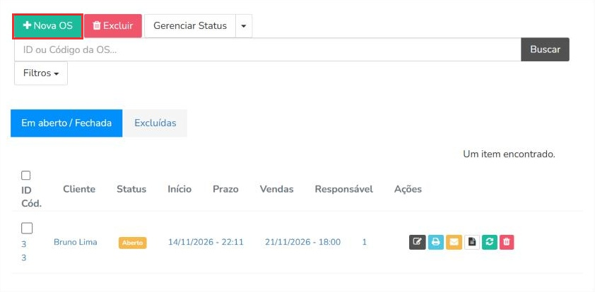
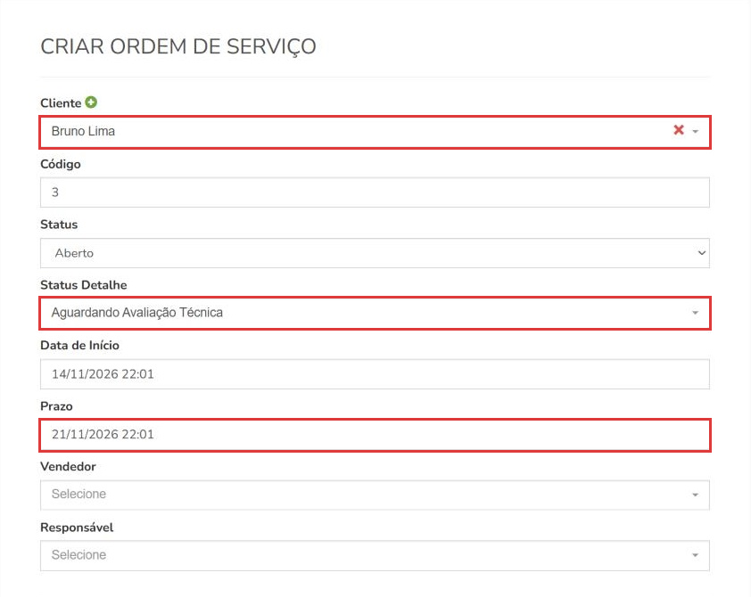
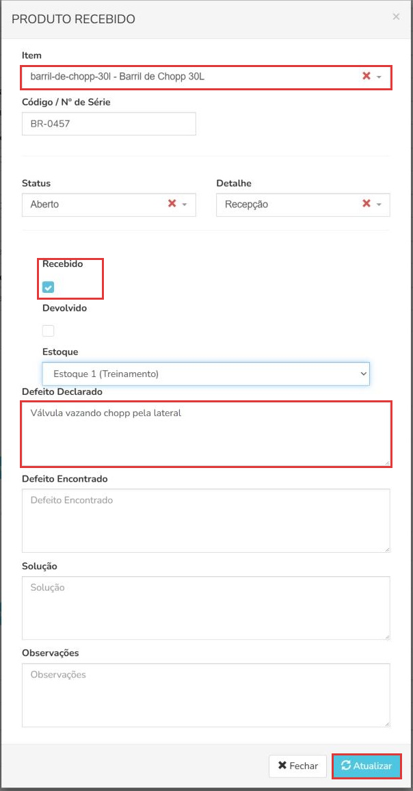
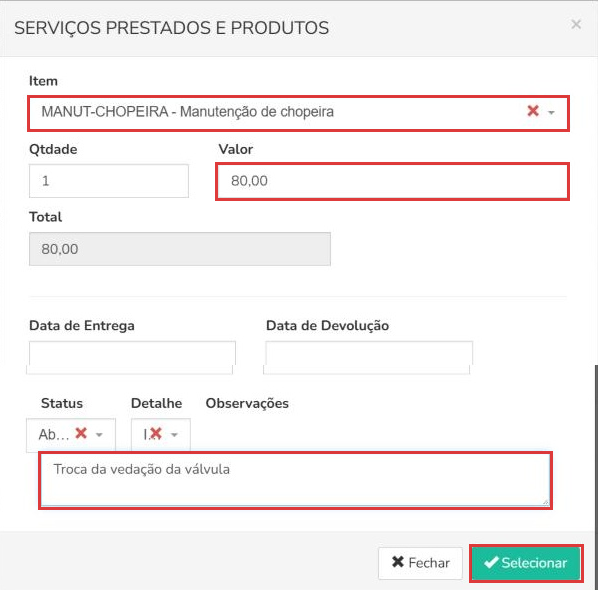
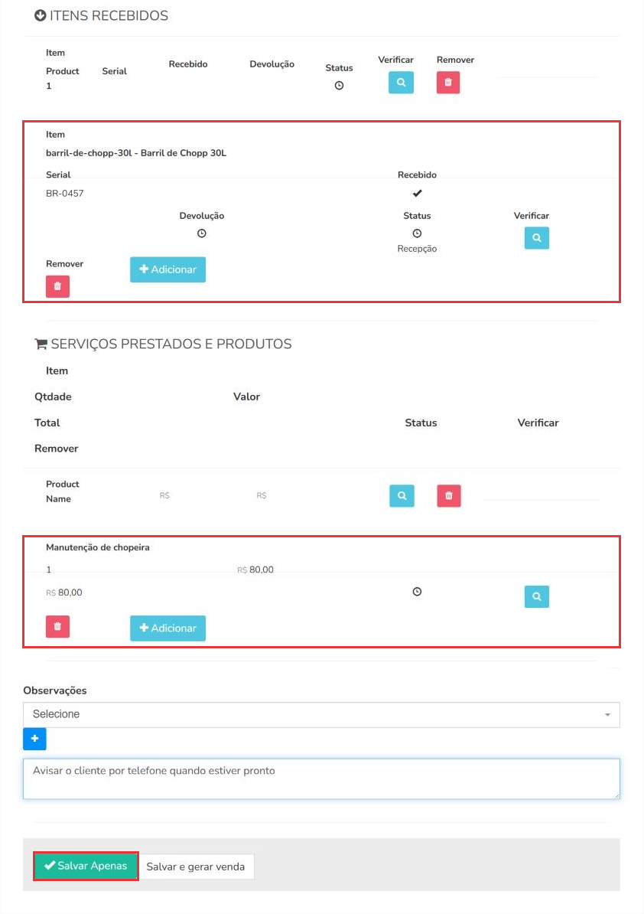
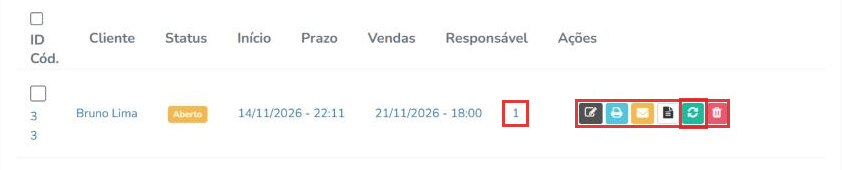

# Como abrir uma ordem de serviço

:material-clock-outline: 10 minutos · :material-format-list-numbered: 7 passos · :material-calendar-check: Atualizado em 14/11/2026

A **ordem de serviço** (OS) registra um conserto ou uma manutenção do começo ao fim. Exemplo: o cliente Bruno Lima trouxe um barril de chopp com a válvula vazando. Você abre a OS na hora, anota o que ele deixou e qual é o defeito, lança o serviço de manutenção (R$ 80,00) e, quando o barril estiver pronto, gera a venda a partir da OS, sem digitar tudo de novo.

## Entenda o conceito

Uma OS tem duas listas, e é importante não confundir as duas:

| Lista | O que é | Exemplo |
| --- | --- | --- |
| **Itens recebidos** | O que o **cliente deixou** com você para consertar. É dele, não é vendido. | O barril de chopp do cliente, número de série BR-0457, com "válvula vazando chopp pela lateral". |
| **Serviços prestados e produtos** | O que você **cobra**: a mão de obra e as peças. É isso que vira venda. | 1 Manutenção de chopeira, R$ 80,00. |

**OS não é venda.** A cobrança acontece quando você usa **Gerar Venda**: a venda nasce com os itens de **Serviços prestados e produtos** e aparece em **Vendas → Vendas**. Os itens recebidos não entram na venda.

**O estoque do item recebido.** O equipamento do cliente é escolhido da sua própria lista de produtos. Por isso, ao registrar o item recebido, existe o campo **Estoque**. Se você escolher um estoque, o equipamento do cliente passa a contar no saldo do seu produto: ele entra quando você salva a OS com **Recebido** marcado e sai quando você salva com **Devolvido** marcado. No exemplo, com o **Estoque 1**, o saldo do Barril de Chopp 30L foi de 30 para 31 e, depois da devolução, voltou para 30. No [histórico do estoque](../estoque/saldo-do-estoque.md), essa entrada aparece como **Third party** (de terceiros). Para não misturar o equipamento do cliente com os seus produtos, deixe o **Estoque** em **Indefinido**.

**Status e detalhe.** Toda OS começa com o **Status** **Aberto**. Quando o serviço termina, você muda para **Fechado** (ou para **Cancelado**, se o cliente desistiu). O **Status Detalhe** conta em que pé a OS está, por exemplo **Aguardando Orçamento**, **Aguardando Avaliação Técnica** ou **Serviços em Execução**. Cada item recebido também tem o seu **Detalhe** (**Recepção**, **Na Oficina**, **Em Reparo**, **Aguardando Peça de Reposição**, entre outros). Esses campos servem para a equipe acompanhar o andamento e responder ao cliente quando ele perguntar.

**Quando usar:** consertos, manutenções, instalações e qualquer serviço em que o cliente deixa algo com você ou em que o trabalho leva dias. **Quando não usar:** venda de produto pronto, paga na hora. Nesse caso, lance a venda direto (no caixa ou em **Vendas → Vendas → Nova Venda**). Para uma encomenda de produtos, use o [pedido de venda](pedido-de-venda.md).

!!! info "Antes de começar"
    O cliente precisa estar cadastrado (veja [Como cadastrar um cliente](../clientes/cadastrar-cliente.md)). Os serviços que você cobra e os equipamentos que você recebe são escolhidos da lista de **produtos**: cadastre antes a sua mão de obra como produto, com o preço do serviço. No exemplo, o produto "Manutenção de chopeira" foi cadastrado com preço de R$ 80,00 e com o **Controlar quantidade em estoque** desligado, porque serviço não tem estoque. Veja [Como cadastrar um produto](../produtos/cadastrar-produto.md).

Nos prints, o **quadrado vermelho** mostra onde você deve olhar ou clicar.

## Abra a tela e clique em Nova OS

No menu do lado esquerdo, clique em **Vendas** e depois em **Ordem de serviços**. A aba **Em aberto / Fechada** mostra as OS com o código, o cliente, o status, as datas de início e prazo, quantas vendas já foram geradas e o responsável. As OS excluídas ficam na aba **Excluídas**. Para achar uma OS, digite o ID ou o código na busca e clique em **Buscar**.

Clique em **Nova OS**.

{ loading=lazy }

## Preencha os dados da OS

Na tela **Criar Ordem de Serviço**:

- **Cliente:** clique na caixa e escolha o cliente (no exemplo, Bruno Lima).
- **Código:** o sistema já preenche com o próximo número. Deixe como está.
- **Status:** começa em **Aberto**. Deixe assim.
- **Status Detalhe:** em que pé está a OS (no exemplo, **Aguardando Avaliação Técnica**).
- **Data de Início:** já vem com a data e a hora de agora.
- **Prazo:** clique e escolha no calendário o dia combinado com o cliente para entregar.
- **Vendedor** e **Responsável:** escolha os usuários do sistema que venderam e que vão fazer o serviço. Podem ficar em branco.

{ loading=lazy }

## Registre o item que o cliente deixou

Desça até **Itens recebidos** e clique em **Adicionar**. Na janela **Produto recebido**:

- **Item:** clique e escolha o equipamento na lista de produtos (no exemplo, Barril de Chopp 30L).
- **Código / Nº de Série:** o número que identifica o equipamento do cliente (no exemplo, BR-0457). Assim não há confusão na hora de devolver.
- **Status** e **Detalhe:** a situação deste item (no exemplo, Status **Aberto** e Detalhe **Recepção**).
- **Recebido:** marque quando o equipamento estiver com você. Só depois disso os campos **Devolvido** e **Estoque** ficam disponíveis.
- **Estoque:** deixe **Indefinido** para o equipamento do cliente não entrar no seu estoque. No print, foi escolhido o **Estoque 1** para mostrar o efeito explicado em *Entenda o conceito*.
- **Defeito Declarado:** o que o cliente contou (no exemplo, "Válvula vazando chopp pela lateral"). **Defeito Encontrado** e **Solução** você preenche depois, quando avaliar e consertar.

Clique em **Atualizar**. O item entra na lista **Itens recebidos**.

{ loading=lazy }

## Lance os serviços e as peças

Em **Serviços prestados e produtos**, clique em **Adicionar**. Na janela:

- **Item:** escolha o serviço ou a peça (no exemplo, Manutenção de chopeira).
- **Qtdade** e **Valor:** o valor vem do preço do cadastro do produto (R$ 80,00). O **Total** aparece ao lado.
- **Data de Entrega** e **Data de Devolução:** podem ficar em branco.
- **Status**, **Detalhe** e **Observações:** a situação deste serviço e um recado (no exemplo, "Troca da vedação da válvula").

Clique em **Selecionar**. Repita para cada serviço ou peça.

{ loading=lazy }

## Escreva as observações e salve

No fim da tela, em **Observações**, escreva o recado geral da OS (no exemplo, "Avisar o cliente por telefone quando estiver pronto"). A caixa **Selecione** traz as observações padrão que já estiverem cadastradas.

Nas duas listas aparece uma linha com **Product 1** ou **Product Name**, sem valores. Ela é só um modelo da tabela: ignore. Os seus itens aparecem logo abaixo dela. Confira as duas listas e clique em **Salvar Apenas**. Aparece **Ordem de Serviço inserida com sucesso**, e a OS entra na lista com o status **Aberto** (no exemplo, a OS **3**).

Neste manual, a venda é gerada depois, pelo botão **Gerar Venda** da lista (veja o próximo passo).

{ loading=lazy }

## Gere a venda quando o serviço ficar pronto

Na lista, cada OS tem, em **Ações**, uma fila de botões com ícones: **Editar** (lápis, preto), **Imprimir** (impressora, azul), **Enviar PDF por email** (envelope, amarelo), **PDF da Ordem de Serviço** (folha, branco), **Gerar Venda** (setas, verde) e **Excluir** (lixeira, vermelho).

Clique em **Gerar Venda**. Abre a tela **Venda – Importar Ordem de Serviço**, já com o cliente e os itens de **Serviços prestados e produtos** (no exemplo, a Manutenção de chopeira). Escolha o **Estoque** de cada linha de produto (é obrigatório, mesmo para serviço), preencha o pagamento (**Valor**, **Método de Pgto.** e **Conta Bancária para pagamento**) e clique em **Salvar**. Aparece **Venda inserida com sucesso**, e a venda entra em **Vendas → Vendas** (no exemplo, a venda 218, de R$ 80,00).

A OS continua com o status **Aberto**: gerar a venda não fecha a OS. A coluna **Vendas** passa a mostrar **1**, e a tela de edição da OS ganha o botão **Vendas (1)**.

{ loading=lazy }

## Devolva o equipamento e feche a OS

Quando o cliente buscar o equipamento, clique em **Editar** (lápis) na OS. Em **Itens recebidos**, clique na lupa **Verificar** do item, marque **Devolvido** e clique em **Atualizar**.

Depois, no alto da tela, troque o **Status** para **Fechado** e clique em **Salvar**. Aparece **Ordem de Serviço atualizada com sucesso**. A OS continua na aba **Em aberto / Fechada**, agora com o status **Fechado**.

!!! tip "Boas práticas"
    - **Anote o número de série:** com o código do equipamento na OS, não há troca na hora de devolver.
    - **Registre o que o cliente falou:** o **Defeito Declarado** evita discussão depois. Preencha o **Defeito Encontrado** e a **Solução** quando terminar o serviço.
    - **Mantenha o Status Detalhe em dia:** quando o cliente ligar perguntando, qualquer pessoa da equipe responde olhando a OS.
    - **Olhe a coluna Vendas antes de gerar outra venda:** ela mostra quantas vendas já saíram da OS. Assim você não cobra o mesmo serviço duas vezes.
    - **Feche a OS ao entregar:** com o status **Fechado**, fica fácil separar o que ainda está na oficina do que já foi entregue.

## Deu algum problema?

??? question "Cliquei em Atualizar e apareceu \"Selecione um produto...\""
    Falta escolher o **Item**. Clique na caixa **Item**, escolha o produto na lista e clique em **Atualizar** de novo. Se você fechou a janela pelo teclado (**Esc**) e abriu de novo, escolha o item outra vez, mesmo que o nome apareça na caixa.

??? question "Digitei o nome na busca do Item e apareceu \"Os resultados não puderam ser carregados\""
    Apague o que digitou: com a busca vazia, a lista mostra todos os produtos. Role a lista e clique no produto.

??? question "O saldo do produto no estoque mudou quando recebi o equipamento"
    O campo **Estoque** do item recebido foi preenchido. Com um estoque escolhido, o equipamento do cliente entra no saldo do produto ao salvar com **Recebido** e sai ao salvar com **Devolvido**. Nas próximas OS, deixe o **Estoque** em **Indefinido**.

??? question "Na tela de gerar a venda, não consigo salvar"
    Falta o **Estoque** em alguma linha de produto: ele é obrigatório, mesmo para serviço. Escolha o estoque em cada linha e clique em **Salvar** de novo.

??? question "Gerei a venda, mas a OS continua Aberto"
    É assim mesmo: gerar a venda não muda o status da OS. Quando entregar o equipamento, feche a OS (veja o último passo).

??? question "O equipamento do cliente não apareceu na venda"
    É o esperado. A venda leva só os itens de **Serviços prestados e produtos**. Os itens recebidos são do cliente e não são vendidos.

**Relacionados:** [Como criar um pedido de venda](pedido-de-venda.md) · [Como consultar uma venda](consultar-venda.md) · [Como cadastrar um produto](../produtos/cadastrar-produto.md) · [Como consultar o saldo e o histórico do estoque](../estoque/saldo-do-estoque.md)

ordem de serviço os nova os assistência técnica conserto manutenção reparo equipamento do cliente item recebido número de série defeito declarado defeito encontrado solução serviços prestados mão de obra peças status detalhe prazo gerar venda importar ordem de serviço devolvido fechar os status fechado
