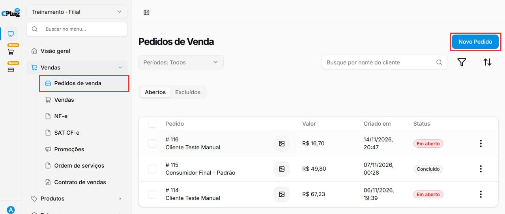
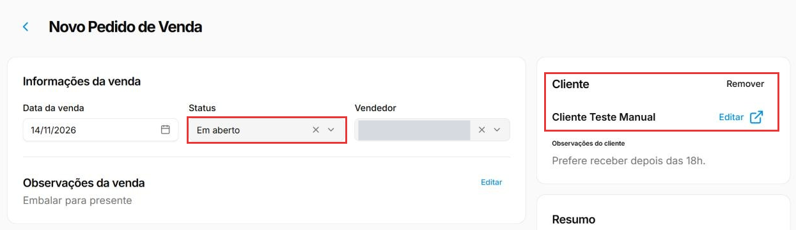
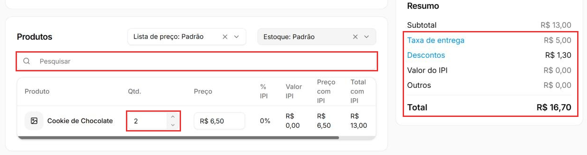
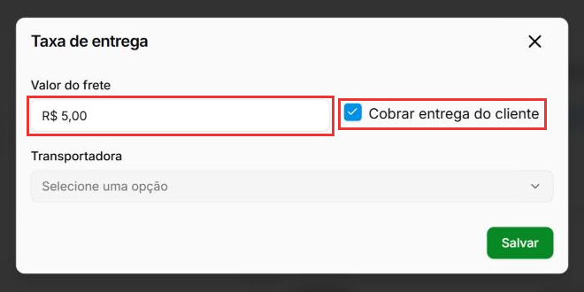
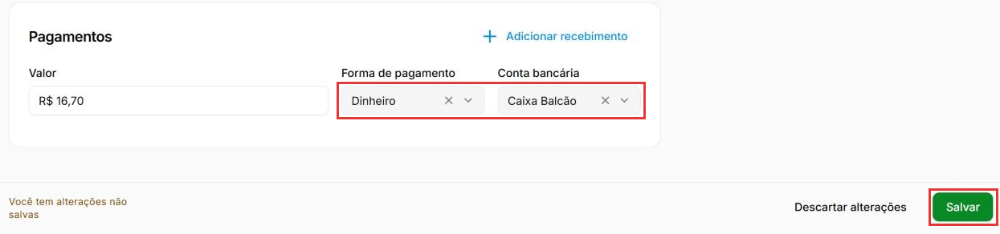
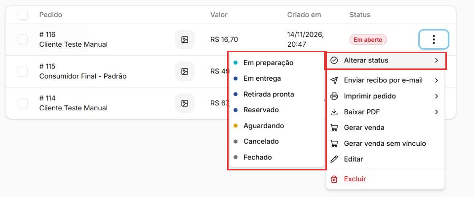
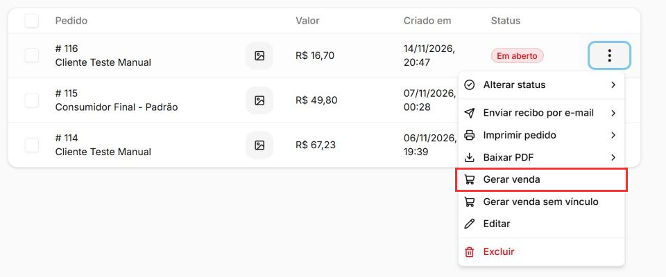
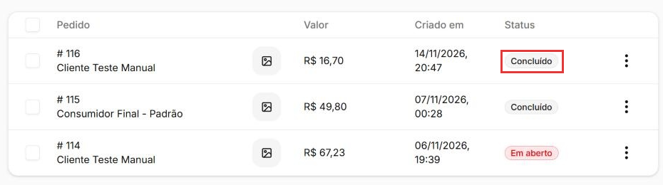
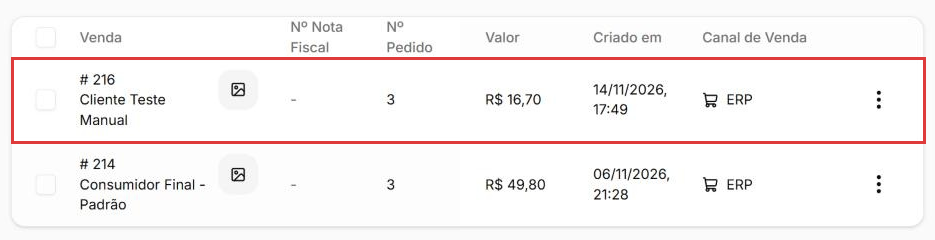
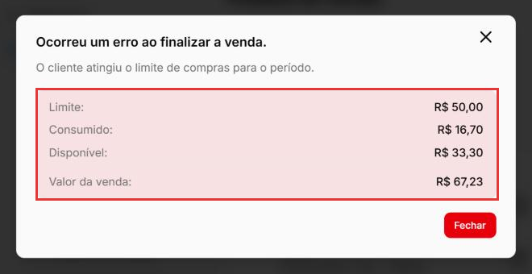

# Como criar um pedido de venda

:material-clock-outline: 8 minutos · :material-format-list-numbered: 7 passos · :material-calendar-check: Atualizado em 14/11/2026

O **pedido de venda** é o jeito de registrar uma encomenda antes de ela virar venda. Exemplo: um cliente liga e pede 2 Cookies de Chocolate para entregar amanhã, embalados para presente. Você registra o pedido na hora, a equipe acompanha a preparação pelo status e, quando o pedido for entregue ou retirado, você gera a venda com um clique, sem digitar tudo de novo.

## Entenda o conceito

**Pedido não é venda.** O pedido é a combinação com o cliente: o que ele quer, quanto vai pagar e como vai receber. Enquanto é só pedido, nada muda no estoque nem no financeiro. Tudo acontece quando você **gera a venda**:

| Onde | Com o pedido em aberto | Depois de gerar a venda |
| --- | --- | --- |
| **Estoque** | Nada muda (Cookie de Chocolate: 30). | Os produtos saem do estoque (Cookie de Chocolate: de 30 para 28). |
| **Financeiro** | Nada é lançado. | O recebimento aparece em **Finanças → Lançamentos** (R$ 16,70, **Pago**, no exemplo pago em dinheiro). |
| **Telas** | O pedido aparece em **Vendas → Pedidos de venda**, com status **Em aberto**. | O pedido fica **Concluído** e a venda aparece em **Vendas → Vendas**, com código próprio (# 216). |

**Para que serve o status.** O status mostra à equipe em que pé está o pedido. Mudar o status para acompanhar o andamento (por exemplo, de **Em aberto** para **Em preparação**) não mexe no estoque nem no financeiro. As opções são **Em preparação**, **Em entrega**, **Retirada pronta**, **Reservado**, **Aguardando**, **Cancelado** e **Fechado**. O status **Concluído** o sistema coloca sozinho quando a venda é gerada. Para desistir de um pedido, use **Excluir** (veja *Como cancelo um pedido?*, no fim do manual).

**Gerar venda ou Gerar venda sem vínculo?** As duas opções criam a venda e deixam o pedido **Concluído**. A diferença é o registro de origem: com **Gerar venda**, o sistema registra internamente de qual pedido a venda veio; com **Gerar venda sem vínculo**, a venda nasce sem esse registro. Prefira **Gerar venda**.

**Desconto e limite do cliente.** Se o cliente for de uma [categoria de clientes](../clientes/categorias-de-clientes.md) com desconto, o desconto entra sozinho no pedido. Se a categoria tiver **limite de compras**, o sistema não deixa gerar uma venda acima do valor disponível no período.

**Quando usar:** encomendas, vendas com entrega ou retirada depois e orçamentos que o cliente ainda vai confirmar. **Quando não usar:** venda feita e paga na hora, no balcão. Nesse caso, lance direto a venda (no caixa ou em **Vendas → Vendas → Nova Venda**).

!!! info "Antes de começar"
    O cliente, os produtos, as formas de pagamento e as contas bancárias precisam estar cadastrados (veja [Como cadastrar um cliente](../clientes/cadastrar-cliente.md) e [Como cadastrar um produto](../produtos/cadastrar-produto.md)). Confira também se você está na loja certa: cada loja tem os seus pedidos.

Nos prints, o **quadrado vermelho** mostra onde você deve olhar ou clicar.

## Abra a tela e clique em Novo Pedido

No menu do lado esquerdo, clique em **Vendas** e depois em **Pedidos de venda**. A aba **Abertos** mostra todos os pedidos que não foram excluídos, inclusive os já **Concluídos**, com o número do pedido, o cliente, o valor, a data e o status. Os pedidos excluídos ficam na aba **Excluídos**.

Para encontrar um pedido, use a busca (pelo nome do cliente), o seletor **Períodos** (**Hoje**, **Ontem**, **Últimos 7 dias**, **Últimas 2 semanas** ou **Últimos 30 dias**) ou o **funil**, que filtra por status, valor do pedido e período.

Para criar um pedido, clique em **Novo Pedido**, no canto de cima.

{ loading=lazy }

## Escolha o cliente e confira as informações

O pedido já abre com o cliente **Consumidor Final - Padrão**. Para trocar, clique em **Remover**, no quadro **Cliente**, e digite o nome do cliente na busca. Se o cliente ainda não tem cadastro, cadastre antes (veja [Como cadastrar um cliente](../clientes/cadastrar-cliente.md)). As **Observações do cliente**, do cadastro dele, aparecem logo abaixo (no exemplo, "Prefere receber depois das 18h"). Assim quem prepara o pedido já vê o recado.

No quadro **Informações da venda**:

- **Data da venda:** já vem com a data de hoje.
- **Status:** começa em **Em aberto**. Deixe assim; você muda depois, conforme o pedido anda.
- **Vendedor:** já vem com o seu usuário. Troque se o pedido for de outro vendedor.
- **Observações da venda:** clique em **Adicionar**, escreva o recado (até 400 caracteres) e clique em **Salvar**. Exemplo: "Embalar para presente".

{ loading=lazy }

## Adicione os produtos

No quadro **Produtos**, digite o nome do produto em **Pesquisar** e clique nele na lista. O produto entra com quantidade 1: ajuste no campo **Qtd.** (no exemplo, 2 Cookies de Chocolate). No alto do quadro aparecem a **Lista de preço** e o **Estoque** do pedido (no exemplo, **Padrão** nos dois): os preços vieram da lista Padrão, e os cookies saíram do estoque Padrão quando a venda foi gerada. Para alterar ou tirar um item, use os **três pontinhos** (⋮) no fim da linha do produto: **Editar** ou **Excluir**.

O quadro **Resumo**, à direita, faz as contas sozinho (o print já mostra a taxa de entrega, explicada no próximo passo): **Subtotal**, **Taxa de entrega**, **Descontos**, **Valor do IPI**, **Outros** e **Total**. No exemplo, o cliente é de uma categoria com 10% de desconto: em R$ 13,00 de produtos, o desconto de R$ 1,30 entrou sozinho. Para mudar o desconto, clique em **Descontos**: abre a janela **Adicionar desconto**, com o **Tipo** (**Desconto personalizado** ou **Sem desconto**), a **% do desconto** e o **Valor do desconto**.

{ loading=lazy }

## Se for entregar, informe a taxa de entrega

No **Resumo**, clique em **Taxa de entrega**. Na janela:

- **Valor do frete:** o campo tem máscara de dinheiro. Para R$ 5,00, digite **500**.
- **Cobrar entrega do cliente:** marque para somar o frete ao total do pedido. Desmarcado, o frete aparece no **Resumo**, mas o cliente não paga por ele. No exemplo, com a opção marcada, o total e o **Valor** em **Pagamentos** foram de R$ 11,70 para R$ 16,70.
- **Transportadora:** quem vai entregar (opcional). Veja [Como cadastrar uma transportadora ou um entregador](../estoque/transportadora.md).

Clique em **Salvar**.

{ loading=lazy }

## Informe o pagamento e salve

No quadro **Pagamentos**, o **Valor** já vem com o total do pedido. Escolha a **Forma de pagamento** (obrigatória) e a **Conta bancária**. A conta não é obrigatória para salvar, mas preencha: é nela que o recebimento vai entrar. No exemplo: **Dinheiro**, na conta **Caixa Balcão**. As opções vêm do cadastro (veja [Como cadastrar formas de pagamento](../financas/formas-de-pagamento.md) e [Como cadastrar uma conta bancária](../financas/conta-bancaria.md)).

Clique em **Salvar**, na barra de baixo. Aparece a mensagem **Dados salvos com sucesso**, e o pedido entra na lista com um número novo (no exemplo, **# 116**) e o status **Em aberto**. O botão **Descartar alterações**, ao lado, é para desfazer o que ainda não foi salvo.

{ loading=lazy }

## Acompanhe o pedido pelo status

Na lista de pedidos, clique nos **três pontinhos** (⋮) do pedido, depois em **Alterar status**, e escolha a nova etapa. Exemplo: quando a cozinha começar a preparar, escolha **Em preparação**. A etiqueta de status da lista muda (se não mudar na hora, atualize a página).

O mesmo menu também tem **Enviar recibo por e-mail**, **Imprimir pedido**, **Baixar PDF** e **Editar**. Clicar na linha do pedido também abre a tela **Editar Pedido de Venda**.

{ loading=lazy }

## Gere a venda

Quando o pedido for entregue (ou retirado), clique nos **três pontinhos** (⋮) do pedido e em **Gerar venda**.

{ loading=lazy }

Não abre janela de confirmação: aparece a mensagem **Pedido de venda convertido com sucesso** e o status do pedido muda para **Concluído**. A partir daí, o menu do pedido não mostra mais **Alterar status** nem **Gerar venda**. **Gerar venda sem vínculo** continua no menu, mas não funciona num pedido concluído (veja *Deu algum problema?*).

{ loading=lazy }

A venda aparece em **Vendas → Vendas**, com código próprio (no exemplo, **# 216**, de R$ 16,70). Nesse momento os produtos saem do estoque e o recebimento entra em **Finanças → Lançamentos**. Para consultar a venda, gerar a nota fiscal ou mandar o recibo, veja [Como consultar uma venda](consultar-venda.md). Atenção: a coluna **Nº Pedido** da tela Vendas não é o número do pedido de venda; o manual de consulta explica.

{ loading=lazy }

!!! tip "Boas práticas"
    - **Use as observações:** recados como "embalar para presente" ou "entregar depois das 18h" no pedido evitam erro na preparação e na entrega.
    - **Atualize o status:** com o status em dia, qualquer pessoa da equipe sabe o que já foi preparado e o que já saiu para entrega.
    - **Gere a venda só na entrega:** enquanto é pedido, o estoque e o financeiro não mudam. Gere a venda quando o pedido for entregue ou retirado, para o estoque e o caixa baterem com a realidade.
    - **Prefira Gerar venda:** assim a venda fica ligada ao pedido que a originou.

## Deu algum problema?

??? question "Apareceu \"O cliente atingiu o limite de compras para o período\""
    O cliente é de uma categoria com **limite de compras**, e a venda passaria do valor disponível. A janela mostra o **Limite**, o que o cliente já **Consumiu** no período, o que ainda está **Disponível** e o **Valor da venda**. No exemplo, o limite é de R$ 50,00, o cliente já consumiu R$ 16,70 e o pedido é de R$ 67,23. Clique em **Fechar**. Para seguir, diminua o pedido até caber no valor disponível, espere o limite renovar (ele vale para o período definido na categoria, por exemplo, por mês) ou ajuste o limite da categoria (veja [Como criar categorias de clientes](../clientes/categorias-de-clientes.md)).

    { loading=lazy }

??? question "Cliquei em Salvar e nada aconteceu"
    Falta preencher algum campo obrigatório. Desça até o quadro **Pagamentos**: se a **Forma de pagamento** estiver vazia, o campo mostra a mensagem **O preenchimento é obrigatório**. Escolha a forma de pagamento e clique em **Salvar** de novo.

??? question "Criei o pedido, mas o estoque não baixou"
    É assim mesmo. O pedido não mexe no estoque nem no financeiro. Os produtos saem do estoque quando você usa **Gerar venda**.

??? question "O desconto apareceu sozinho no pedido"
    O cliente é de uma categoria de clientes com desconto. O desconto da categoria entra sozinho ao escolher o cliente. Para mudar só neste pedido, clique em **Descontos**, no **Resumo**.

??? question "Usei Gerar venda sem vínculo e apareceu \"Sale order is closed\""
    A mensagem (em inglês) quer dizer que o pedido já está concluído: a venda dele já foi gerada e está em **Vendas → Vendas**. Não é preciso fazer mais nada. Se o cliente quer comprar de novo, crie um novo pedido.

??? question "Abri o pedido e apareceu \"Você tem alterações não salvas\", mas não mudei nada"
    O aviso aparece ao abrir a tela **Editar Pedido de Venda**, mesmo sem alteração. Se você só estava consultando, volte pela **seta para a esquerda** (**<**), ao lado do título, sem clicar em **Salvar**.

??? question "Como cancelo um pedido?"
    Se o pedido ainda não gerou a venda, clique nos **três pontinhos** (⋮) do pedido e em **Excluir**, e confirme. A janela de confirmação fala em "venda", mas é o pedido que vai ser excluído. O pedido passa para a aba **Excluídos**. Se o pedido já gerou a venda, o que precisa ser desfeito é a venda: veja [Como cancelar uma venda](cancelar-venda.md). Para excluir também o pedido nesse caso, fale com o suporte antes.

**Relacionados:** [Como consultar uma venda](consultar-venda.md) · [Como cancelar uma venda](cancelar-venda.md) · [Como criar categorias de clientes](../clientes/categorias-de-clientes.md) · [Como criar uma lista de preços](../produtos/lista-de-precos.md)

pedido de venda novo pedido encomenda orçamento pedido de entrega status do pedido em preparação em entrega retirada pronta gerar venda converter pedido em venda gerar venda sem vínculo pedido concluído taxa de entrega frete cobrar entrega do cliente desconto do cliente limite de compras observações do pedido
